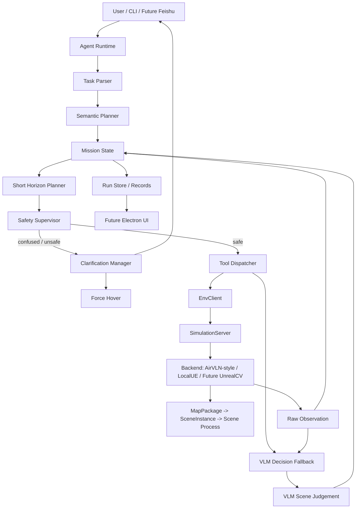

# FlyAgent 架构说明

## 1. 核心架构思想

FlyAgent 不采用“一次性 Planner 生成完整动作序列”的方式，而采用：

```text
整体语义规划
  -> 短期滚动执行
  -> EnvClient 调用环境服务
  -> 原始观测更新
  -> 必要时询问用户
```

LLM / VLM 可以负责理解任务、理解图像和提出建议，但底层飞控必须通过原子工具、`EnvClient` 和 Safety Supervisor 执行。

## 2. 总体架构



## 3. C/S 边界

FlyAgent 中的 `Client` 只指 `EnvClient`，不指整个 Agent。

分层如下：

```text
Agent Runtime
  -> EnvClient
    -> SimulationServer
      -> AirVLN-style Scene / Local UE / Future UnrealCV
```

- `Agent Runtime`：用户输入、任务解析、语义规划、短期规划、VLM、安全策略、困惑提问、run 记录。
- `EnvClient`：调用 `SimulationServer` 获取观测、执行 UAV 原子动作、reset/start/stop scene。
- `SimulationServer`：管理 UE 进程、地图资源、端口、scene、agent，并翻译成具体后端调用。

详细职责见 [C/S 架构职责划分](C:/Users/HP/Desktop/UAV-Agent/docs/cs_architecture.md)。

## 4. 模块说明

### 4.1 Agent Runtime

职责：

- 作为 FlyAgent 主运行时。
- 接收 CLI / 未来 Feishu / 未来 Electron 的任务输入。
- 维护任务主循环。
- 调用 Task Parser、Planner、VLM、Safety、Clarification。
- 调用 `EnvClient`，但不直接操作 UE / AirSim / UnrealCV。
- 写入 Run Store。

### 4.2 Task Parser

职责：

- 接收自然语言。
- 提取目标、线索、约束和终止条件。
- 不直接生成长动作序列。

示例输出：

```json
{
  "target": "黑色路灯",
  "spatial_hint": "右转后可能看到",
  "final_condition": "面向目标后悬停",
  "uncertainty": true
}
```

### 4.3 Semantic Planner

职责：

- 生成整体语义规划。
- 标注不确定性。
- 给短期 Planner 提供阶段目标。

示例阶段：

- `orient_right`
- `search_landmark`
- `align_to_landmark`
- `stop`

### 4.4 Short Horizon Planner

职责：

- 根据当前状态和语义阶段生成未来 1-3 个短期动作。
- 执行后必须重新观察。
- 根据新观测更新下一轮动作。

示例输出：

```json
{
  "phase": "search_landmark",
  "actions": [
    {"type": "observe", "modalities": ["rgb", "depth", "pose"]},
    {"type": "turn_yaw", "direction": "right", "angle_deg": 15},
    {"type": "hover", "duration_sec": 0.3}
  ],
  "replan_after": "hover"
}
```

### 4.5 VLM Decision Fallback

第一阶段不拆分视觉语义模块，统一用多模态大模型作为临时决策参考。

职责：

- 读取用户任务、当前阶段、最近动作、RGB 图像、depth 摘要和 pose。
- 判断目标是否可能出现。
- 给出下一步短期动作建议。
- 生成困惑时的澄清问题。

输出 schema：

```json
{
  "scene_summary": "画面右侧有黑色杆状物，可能是路灯",
  "target_status": "candidate_visible",
  "confidence": 0.72,
  "suggested_next_actions": [
    {"tool": "uav.turn_relative", "args": {"yaw_deg": 5}},
    {"tool": "uav.hover", "args": {"duration_sec": 0.5}}
  ],
  "ask_user": null
}
```

限制：

- VLM 只能建议，不直接执行。
- VLM 输出必须通过 schema 校验。
- VLM 建议动作必须经过 Safety Supervisor。
- 低置信度时只允许 hover、observe、小角度扫描或提问。

等当前闭环全部跑通后，再考虑是否做视觉能力模块化；这不进入当前 MVP 设计。

### 4.6 Safety Supervisor

职责：

- 所有飞控动作前置检查。
- 限制速度、角速度、持续时间、高度和距离。
- 不确定时强制 hover。
- VLM 输出低置信度时不允许直接进入危险动作。
- 困惑达到阈值时触发 Clarification Manager。

安全策略：

- 无观测时 hover。
- depth 不安全时 hover。
- 连续多轮无进展时 hover 并提问。
- 多个候选目标无法区分时 hover 并提问。
- 用户说“停下”默认解释为 hover，而不是 land。

### 4.7 Clarification Manager

职责：

- 判断是否需要向用户提问。
- 在提问前强制 hover。
- 生成一个对下一步最有帮助的问题。
- 等待用户回复。
- 将用户回复写入 Mission State 并触发重新规划。

触发条件：

- VLM 置信度过低。
- 目标候选有多个。
- 用户描述和观测冲突。
- Planner 无法选择安全下一步。
- 连续 N 轮没有发现目标。

### 4.8 EnvClient

EnvClient 是 C/S 中的 Client。

职责：

- 封装对 `SimulationServer` 的调用。
- 向 Agent Runtime 暴露统一环境 API。
- 获取 RGB/depth/pose 等观测。
- 执行 UAV 原子动作请求。
- 请求 scene start/reset/stop。
- 做超时、重试、返回结果解析。

EnvClient 不做：

- 任务理解。
- VLM 判断。
- 规划。
- 用户提问。
- 任务完成判断。

### 4.9 SimulationServer

SimulationServer 是 C/S 中的 Server。

职责：

- 管理地图资源和仿真环境。
- 管理 AirVLN 风格 scene、本地 UE / AirSim 和后续 UnrealCV 后端进程。
- 管理 scene、agent、端口和启动脚本。
- 把 EnvClient 请求翻译成具体后端调用。
- 返回标准化 observation 和 action result。
- 支持本地 UE `.sh` / `.bat` 启动。
- 支持 AirVLN 风格 `MapPackage + SceneInstance`。
- 支持环境对象操作。

对象操作预留：

- `add_object`
- `remove_object`
- `hide_object`
- `set_object_pose`
- `set_object_material`
- `set_weather`
- `reset_map`

### 4.10 Mission State

职责：

- 保存语义目标。
- 保存当前阶段。
- 保存短期计划。
- 保存 UAV 原始状态。
- 保存原始观测引用。
- 保存 VLM 判断。
- 保存工具调用历史。
- 保存困惑原因和用户澄清。

注意：

- 不把目标框、目标距离等视觉语义结果作为必然存在字段。
- 第一阶段保存 `vlm_scene_judgement` 作为临时视觉语义状态。

### 4.11 Run Store / Records

职责：

- 记录 run id。
- 记录语义规划。
- 记录每轮短期计划。
- 记录 VLM 判断。
- 记录澄清问题和用户回复。
- 记录工具调用。
- 记录观测 artifact。
- 记录轨迹。
- 记录失败原因。

未来 Electron UI 只读取 runtime 状态，不直接操作底层 UAV。

## 5. 规划执行流程

```text
用户输入
  -> Agent Runtime
  -> Task Parser 提取语义
  -> Semantic Planner 生成整体阶段
  -> Mission State 初始化
  -> Short Horizon Planner 生成 1-3 个动作
  -> Safety Supervisor 检查
  -> Tool Dispatcher 调用 EnvClient
  -> EnvClient 请求 SimulationServer
  -> SimulationServer 调用仿真后端执行原子能力
  -> 返回原始观测
  -> VLM 处理观测
  -> 更新 Mission State
  -> 如果困惑：hover + 提问
  -> 否则继续滚动规划
  -> 完成或失败后写入 Run Store
```

## 6. 代码目录建议

```text
src/
  runtime/                       # CLI 运行时和记录
    main.py                       # CLI 入口
    agent_runtime.py              # Agent Runtime 主循环
    config.py                     # 配置加载
    run_store.py                  # run 状态存储
    record_writer.py              # 轨迹、观测、日志记录

  agent/                         # Agent 规划、状态、安全逻辑
    task_parser.py                # 自然语言到语义任务
    semantic_planner.py           # 整体语义规划
    horizon_planner.py            # 短期滚动规划
    mission_state.py              # 任务状态
    safety.py                     # 安全监督
    clarification.py              # 困惑检测与用户提问

  cognition/                     # 第一阶段 VLM 临时认知层
    vlm_client.py                 # 多模态大模型调用
    context_builder.py            # 任务/观测上下文构建
    schemas.py                    # VLM 输出 schema

  tools/                         # 工具注册和分发
    registry.py                   # 工具注册表
    dispatcher.py                 # 工具调用分发
    schemas.py                    # 工具输入输出 schema

  env_client/                    # C/S 中的 Client
    base.py                       # EnvClient 抽象接口
    local_client.py               # 本地伪 C/S client
    remote_client.py              # 远程 RPC client 预留
    schemas.py                    # 请求/响应 schema

  sim_server/                    # C/S 中的 Server
    server.py                     # SimulationServer 入口
    scene_manager.py              # scene 生命周期管理
    process_manager.py            # UE 进程管理
    port_manager.py               # 端口管理
    backends/                     # 仿真后端
      airvln_backend.py           # AirVLN 风格 scene 后端
      local_ue_backend.py         # 本地 UE 脚本后端
      unrealcv_backend.py         # 后续 UnrealCV/gym_unrealcv 后端

  adapters/                      # 非 C/S 的外部库适配
    uav_primitives.py             # UAV 原子控制能力封装

configs/                         # 配置
  maps/                           # 地图 JSON
  envs/                           # 环境后端配置
  models/                         # VLM 模型配置
```
