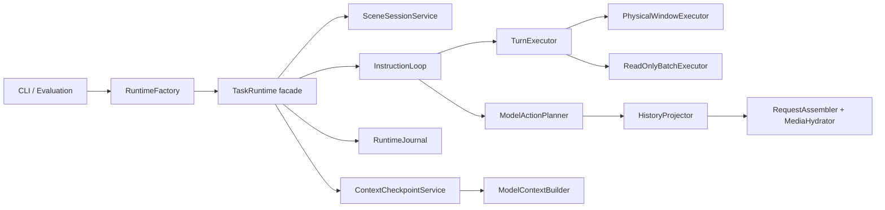

# FlyAgent 当前架构

## 依赖方向

```text
基础类型与 EnvClient
        ↓
Agent / Memory / Plugins / Tools / UAV
        ↓
RuntimeFactory + Runtime services
        ↓
CLI / Evaluation / Interactive session
```

低层包不得导入 `src.runtime`。Memory 通过 `MissionStateView` 读取任务状态，
不依赖 Agent 的具体实现类型。插件实现 Memory 定义的 ContextModule 契约；
插件发现只发生在 `RuntimeFactory`。

## 生产执行链



`TaskRuntime.run_task()` 保留场景获取、preflight、循环委托、终态与 cleanup。
instruction 级可变数据位于 `InstructionSession`；循环计数和 planner 时序属于
`InstructionLoop`；回合验证与分支属于 `TurnExecutor`；物理批、稳定等待、自动
观测和运动测量属于 `PhysicalWindowExecutor`。

## Context 所有权

- `memory/context`：从 `MissionStateView + FlightMemory` 生成 Envelope 和 Checkpoint。
- `agent/context`：历史选择、Provider 投影、请求顺序和临时媒体水合。
- `runtime/context`：checkpoint 发布、去重、V2 artifact 与 schema 拒绝。
- `RuntimeFactory`：创建并注入同一组 Plugin、Tool、Context 与 Planner 依赖。

模型只收到原始 instruction 一次。动态状态通过不可变 checkpoint 进入 Transcript；
没有模型可见状态变化的只读结果或协议拒绝不会发布 checkpoint。

## 不变量

- 物理回合只允许 1–3 个调用，整批预检后按序执行。
- 每个物理窗口只产生一次 after observation。
- 安全策略、ToolSpec 和 Provider 消息顺序由测试冻结。
- Checkpoint 和 Transcript 不保存 `data:image/...`；媒体只在单次请求内编码。
- 当前 RGB 缺失时明确标记 unavailable，不用历史图冒充 CURRENT。
