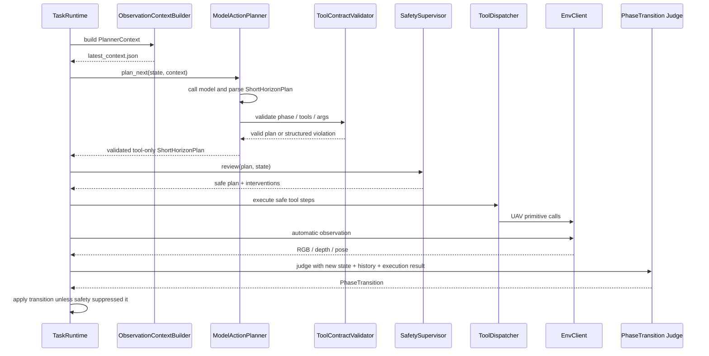
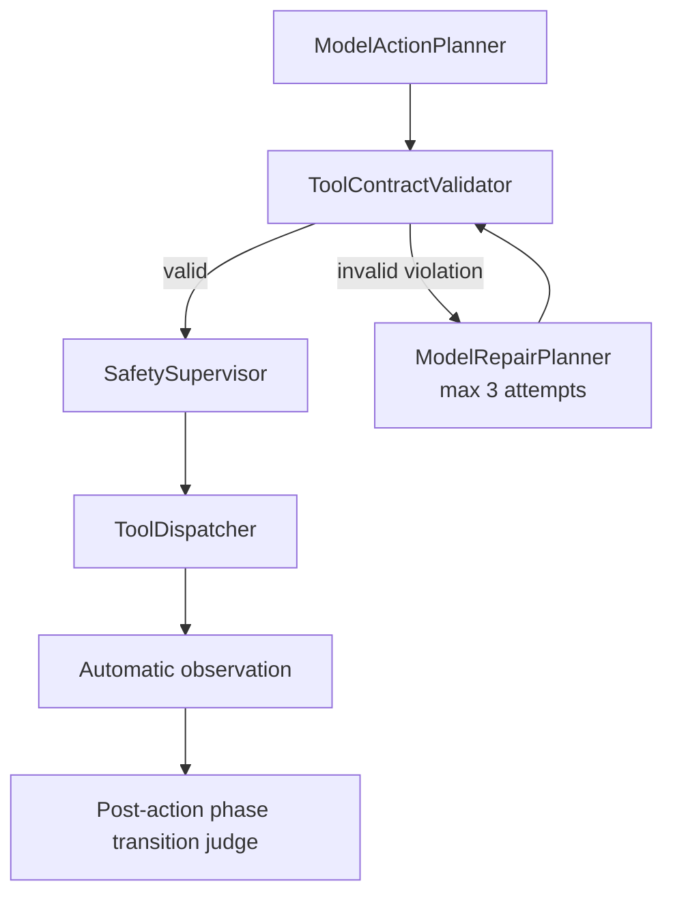

# FlyAgent 架构说明

## 1. 总体思路

FlyAgent 不让模型直接操作 UE、AirSim 或底层 SDK。模型只读取结构化上下文并输出短期 UAV 动作；runtime 负责执行、安全审查、自动观察、记忆写入和阶段推进。


核心边界：

- `TaskParser` 把自然语言任务拆成语义阶段，不生成 UAV tool 序列。
- `ObservationContextBuilder` 和 context modules 把记忆、规则、偏好、安全约束整理成 `PlannerContext`。
- `ModelActionPlanner` 只做模型调用、JSON 解析和动作规划编排。
- `ToolContractValidator` 校验模型动作是否符合 `allowed_action_constraints`。
- `SafetySupervisor` 做最后限幅、替换和安全拦截。
- `ToolDispatcher` 才能真正调用 UAV primitive tools。
- 阶段推进在动作执行和自动 observation 之后判断，不由 action plan 直接携带。

## 2. 地图与控制协议

地图资源、启动方式和控制协议分开描述：

```text
provider: packaged_unreal / remote_airsim / manual
launch.method: direct / wsl_bash / existing_process / manual
control.protocol: airsim / unrealcv
```

上层 agent 只依赖 `EnvClient`，不直接依赖具体 SDK。这样同一套 runtime 可以连接本地 UE、远程 AirSim 或后续 UnrealCV 后端。

## 3. 核心对象

`MapPackage` 描述静态地图资源：

```text
map_id, provider, scene_id, root, launch, control, resources
```

`SceneInstance` 描述一次运行中的场景实例：

```text
scene_instance_id, map_id, scene_id, host, server_port, airsim_port, settings_path, process_id, status
```

动作配置分两类：

- `UavActionConfig`：默认动作尺度，例如默认前进速度、默认 yaw step。
- `UavSafetyConfig`：安全硬上限，例如最大速度、最大 duration、累计 yaw scan budget。

## 4. Runtime 分层

`src/runtime` 按职责分层：

- `cli/`：命令行入口，只做参数解析和对象组装。
- `configs/`：加载地图、模型、UAV 动作尺度和安全上限配置。
- `logging/`：创建 run 目录，写 `system.log`、`events.jsonl` 和 artifacts。
- `runners/`：具体运行流程，例如 `TaskRuntime` 和 `InteractiveTaskSession`。

`TaskRuntime` 的主职责是组织闭环：

```text
构建 PlannerContext
调用 ModelActionPlanner 生成 tool-only 动作计划
执行 ToolContractValidator
执行 SafetySupervisor
执行安全审查后的动作
自动采集 RGB/depth/pose
执行后调用模型判断 PhaseTransition
应用阶段推进结果
写入 run artifacts
```

## 5. 动作规划链路

当前不保留规则版 short horizon planner。短期动作统一由 `ModelActionPlanner` 生成。



模型动作输出必须是 tool-only：

```json
{
  "phase": "copy current_phase.name",
  "steps": [
    {
      "kind": "tool",
      "tool": "uav.hover",
      "args": {},
      "reason": "hold position while waiting for automatic observation"
    }
  ]
}
```

模型动作计划不能输出：

- `kind="observe"`
- `env.observe`
- `uav.connect`
- `uav.takeoff`
- `uav.land`
- `uav.set_pose`
- `uav.get_pose`
- `uav.get_frames`

观察由 runtime 根据 `observation_policy` 自动完成。

## 6. Context 与 Memory 边界

`FlightMemory` 是飞行历史 manifest，不是 prompt。完整历史保存在 `runs/<run_id>/memory/*.jsonl` 和 artifacts 中。

`ContextModule` 按类别读取短窗口历史并输出 `ContextFragment`：

- `InstructionModule`：当前指令、历史指令、目标和 phase goal。
- `ImageModule`：最新 RGB/depth metadata、artifact refs 和图像可用性。
- `PoseModule`：latest pose、最近 pose 窗口和 pose delta。
- `ActionModule`：最近动作、执行结果、失败记录。
- `MapModule`：地图线索、召回过滤条件和 reconfirmation 风险。

`ContextComposer` 只负责排序、裁剪、合并和加入规则/偏好/安全约束。它不直接读取完整 jsonl，不调用 UAV tool，也不创造新事实。

## 7. 阶段推进

当前不单独实现 `PhaseCompletionEvaluator`。阶段推进判断复用 planning 目录里的 `PhaseTransition` schema，但触发时机从 action plan 内移动到动作执行后。

执行后判断输入包含：

- 当前 instruction / semantic goal / current phase。
- 执行前 latest pose。
- 执行后 latest pose。
- pose delta、yaw delta、planar displacement。
- 当前 phase 起点 observation、累计 pose delta、累计 planar displacement、归一化累计 yaw delta。
- 当前 phase 内累计执行过的 tool facts，例如成功 yaw 总量、move duration 总量和每个 direction 的 duration。
- executed steps、action results、Safety interventions。
- recent action / observation history 摘要。
- phase window count / max window count。

模型只输出：

```json
{
  "decision": "continue_current_phase | advance_to_next_phase | complete_task",
  "reason": "short reason"
}
```

runtime 才能真正修改 `MissionState`。如果 `SafetySupervisor` 有 intervention，runtime 会压制阶段推进判断并继续当前 phase。若同一 phase 连续执行超过窗口上限，runtime 触发 loop guard，安全 hover 后推进下一 phase。

## 8. Plan-Execute-Repair

当前支持 contract repair v1：当 `ToolContractValidator` 拒绝模型动作计划时，`ModelActionPlanner` 构建结构化 `RepairContext`，调用 `ModelRepairPlanner` 最多修正 3 次。任意一次修正通过后，计划继续进入 `SafetySupervisor`；3 次都失败时，runtime 走当前失败路径并 best-effort hover。



`ToolContractViolation` 保留结构化错误信息，例如 `code`、`message`、`step_index`、`tool`、`field`、`expected`、`actual`。repair planner 消费这些结构化信息，而不是解析自然语言错误。

当前 repair 只修 contract violation，不修执行失败、视觉失败或 safety intervention。

## 9. 视觉输入边界

当前 qwen 模型调用仍是文本 JSON 输入。RGB/depth 会被 runtime 真实采集并保存为 artifacts，但不会把图片像素或 depth 数组直接发送给 qwen。

PlannerContext 中的 image 信息只包括：

- 图像是否存在。
- artifact path / memory ref。
- 宽高、bytes、frame metadata。
- observation source。

因此当前阶段不是视觉多模态闭环。后续要让模型理解图像，需要接入多模态模型输入，或先通过视觉 skill/检测器把图像转成结构化结果再进入 context。
