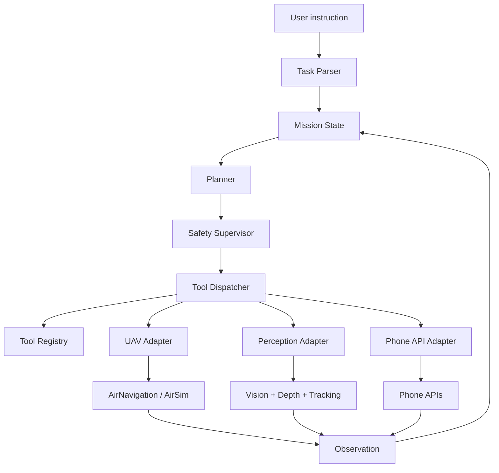

# UAV Agent 架构说明

## 1. 架构原则

本项目采用轻量级分层架构：

- Agent 负责理解、规划和决策。
- 工具层负责统一注册、校验和调用。
- 适配器层负责对接 AirNavigation、视觉模型和手机 API。
- 安全监督层负责限制危险动作。
- 不让 LLM 直接调用 AirSim 原始接口。

核心思想：把 UAV 能力变成可控、可审计、可限制的工具。

## 2. 总体架构



## 3. 模块说明

### 3.1 Task Parser

职责：

- 将自然语言转换成结构化任务。
- 提取目标、动作、顺序、终止条件和安全限制。
- 处理默认值，例如“右转”默认 90 度。

输入：

```text
前面右转会有一个黑色的路灯，右转面向路灯后停下
```

输出：

```json
{
  "intent": "navigate_to_visual_target",
  "steps": [
    {"type": "turn", "direction": "right", "angle_deg": 90},
    {"type": "search_target", "description": "black street lamp"},
    {"type": "face_target", "description": "black street lamp"},
    {"type": "hover"}
  ]
}
```

### 3.2 Mission State

职责：

- 保存任务当前阶段。
- 保存 UAV 位置、姿态、速度、相机角度。
- 保存目标候选、bbox、深度距离和最后观测时间。
- 保存动作历史和轨迹。

建议字段：

```json
{
  "mission_id": "mission_001",
  "phase": "searching",
  "pose": {"x": 0, "y": 0, "z": -5, "yaw": 1.57},
  "camera": {"pitch": -0.2},
  "target": {
    "description": "black street lamp",
    "bbox": [120, 80, 240, 300],
    "distance_m": 8.5,
    "last_seen_ms": 123456789
  },
  "history": []
}
```

### 3.3 Planner

职责：

- 根据任务步骤和当前观测选择下一步动作。
- 控制任务阶段流转。
- 处理失败恢复。

典型阶段：

- `initializing`
- `turning`
- `searching`
- `facing`
- `hovering`
- `completed`
- `failed`

第一版建议用规则 Planner，不急着做复杂 LLM 规划：

- 如果步骤是 turn，则调用 `uav.turn_relative`。
- 如果步骤是 search_target，则循环取图并调用 `vision.detect`。
- 如果目标不在画面中心，则调用 `uav.turn_relative` 或 `uav.move_body` 微调。
- 如果目标已居中且距离安全，则调用 `uav.hover`。

### 3.4 Safety Supervisor

职责：

- 检查工具调用是否安全。
- 限制速度、距离、角速度和执行时长。
- 检查深度图中的障碍物。
- 异常时强制悬停。

规则示例：

- `max_speed_mps <= 1.5`
- `min_depth_m >= 2.0`
- `turn_angle_deg <= 120`
- `tool_timeout_sec <= 10`
- 任务总时长超过上限则停止。

### 3.5 Tool Registry

职责：

- 注册所有可调用工具。
- 记录工具名称、参数 schema、可用条件、安全等级。

参考 openclaw 的 `InvokeCommandRegistry.kt`，但 Python 版可以更轻：

```python
ToolSpec(
    name="uav.hover",
    params={},
    availability="connected",
    safety_level="safe"
)
```

### 3.6 Tool Dispatcher

职责：

- 接收 Planner 的工具调用请求。
- 校验参数。
- 调用对应 Adapter。
- 统一返回结果或错误。
- 记录工具调用日志。

返回结构：

```json
{
  "ok": true,
  "tool": "uav.hover",
  "payload": {},
  "elapsed_ms": 42
}
```

失败结构：

```json
{
  "ok": false,
  "tool": "vision.detect",
  "error": {
    "code": "TARGET_NOT_FOUND",
    "message": "No object matched the target description"
  }
}
```

### 3.7 UAV Adapter

职责：

- 包装 AirNavigation 的 `UAVController`。
- 提供 Agent 可调用的稳定工具接口。
- 隐藏 AirSim 原始 API。

建议接口：

- `connect()`
- `takeoff()`
- `land()`
- `hover()`
- `turn_relative(angle_deg)`
- `move_body(v_front, v_right, v_down, duration)`
- `get_pose()`
- `get_frames(types)`
- `rotate_camera(pitch_rate, duration)`

### 3.8 Perception Adapter

职责：

- 获取和处理 RGB、Depth、Segmentation。
- 调用视觉模型检测目标。
- 将 bbox 转为角度偏差。
- 用深度估计距离。
- 输出可供 Planner 使用的观测结果。

建议接口：

- `detect(description)`
- `track(target)`
- `estimate_distance(bbox)`
- `target_offset(bbox)`
- `describe_scene()`

### 3.9 Phone API Adapter

职责：

- 通过轻量 RPC 接入手机能力。
- 作为任务上下文补充，不作为 UAV 主控制链路。

建议接口：

- `phone.device.status`
- `phone.device.permissions`
- `phone.location.get`
- `phone.motion.activity`
- `phone.camera.snap`

## 4. 推荐代码结构

```text
src/
  agent/
    task_parser.py
    planner.py
    mission_state.py
    safety.py
  tools/
    registry.py
    dispatcher.py
    schemas.py
  adapters/
    airnavigation_uav.py
    airnavigation_perception.py
    phone_gateway.py
  runtime/
    main.py
    config.py
```

## 5. 数据流

一次任务的核心数据流：

1. 用户输入自然语言。
2. `Task Parser` 输出结构化任务。
3. `Mission State` 初始化任务状态。
4. `Planner` 选择下一步工具调用。
5. `Safety Supervisor` 检查工具调用。
6. `Tool Dispatcher` 执行工具。
7. Adapter 调用 AirNavigation/视觉/手机 API。
8. 返回观测结果。
9. 更新 `Mission State`。
10. 重复直到任务完成或失败。

