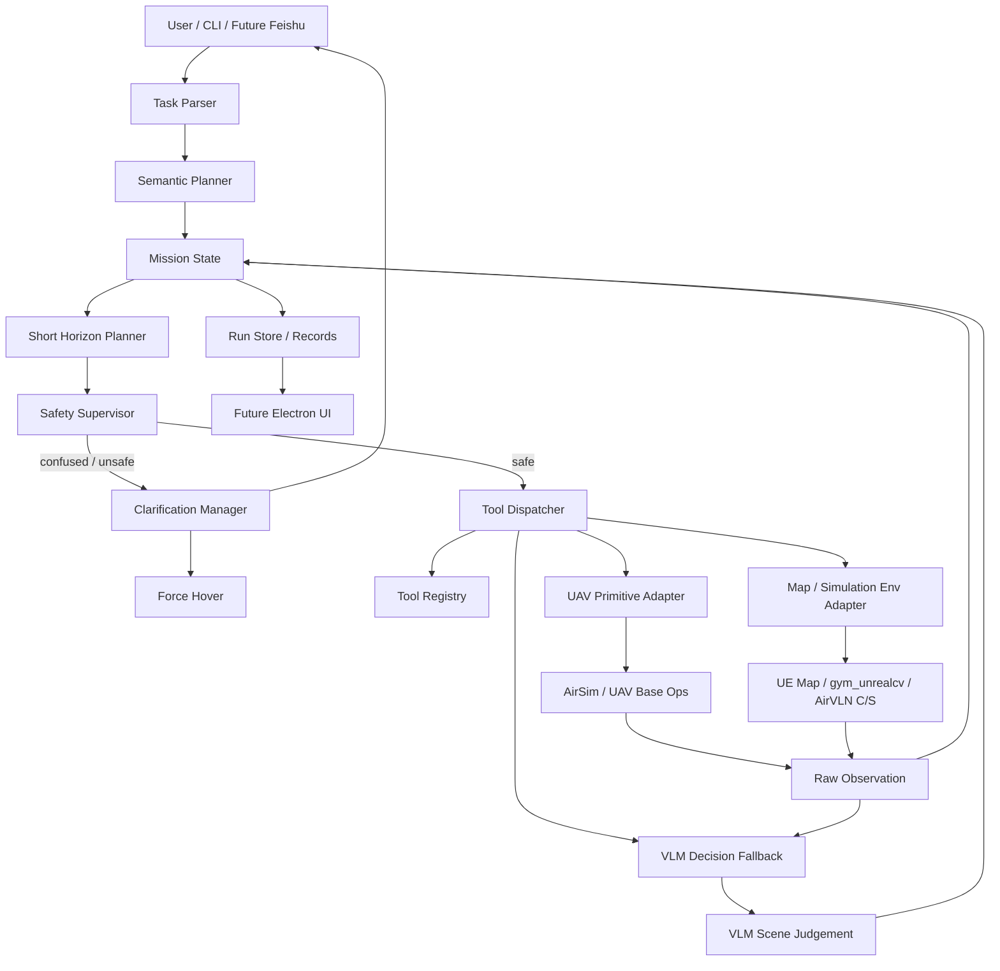

# FlyAgent 架构说明

## 1. 核心架构思想

FlyAgent 不采用“一次性 Planner 生成完整动作序列”的方式，而采用：

```text
整体语义规划
  -> 短期滚动执行
  -> 原子工具调用
  -> 观测更新
  -> 必要时询问用户
```

LLM / VLM 可以负责理解任务、理解图像和提出建议，但底层飞控必须通过原子工具和 Safety Supervisor 执行。

## 2. 总体架构



## 3. 模块说明

### 3.1 Task Parser

职责：

- 接收自然语言。
- 提取目标、线索、约束和终止条件。
- 不直接生成长动作序列。

示例输出：

```json
{
  "target": "黑色路灯",
  "spatial_hint": "右转后可能看到",
  "final_condition": "面向目标后悬停",
  "uncertainty": true
}
```

### 3.2 Semantic Planner

职责：

- 生成整体语义规划。
- 标注不确定性。
- 给短期 Planner 提供阶段目标。

示例阶段：

- `orient_right`
- `search_landmark`
- `align_to_landmark`
- `stop`

### 3.3 Short Horizon Planner

职责：

- 根据当前状态和语义阶段生成未来 1-3 个短期动作。
- 执行后必须重新观察。
- 根据新观测更新下一轮动作。

示例输出：

```json
{
  "phase": "search_landmark",
  "actions": [
    {"type": "observe", "modalities": ["rgb", "depth", "pose"]},
    {"type": "turn_yaw", "direction": "right", "angle_deg": 15},
    {"type": "hover", "duration_sec": 0.3}
  ],
  "replan_after": "hover"
}
```

### 3.4 VLM Decision Fallback

第一阶段不拆分视觉语义模块，统一用多模态大模型作为临时决策参考。

职责：

- 读取用户任务、当前阶段、最近动作、RGB 图像、depth 摘要和 pose。
- 判断目标是否可能出现。
- 给出下一步短期动作建议。
- 生成困惑时的澄清问题。

输出 schema：

```json
{
  "scene_summary": "画面右侧有黑色杆状物，可能是路灯",
  "target_status": "candidate_visible",
  "confidence": 0.72,
  "suggested_next_actions": [
    {"tool": "uav.turn_relative", "args": {"yaw_deg": 5}},
    {"tool": "uav.hover", "args": {"duration_sec": 0.5}}
  ],
  "ask_user": null
}
```

限制：

- VLM 只能建议，不直接执行。
- VLM 输出必须通过 schema 校验。
- VLM 建议动作必须经过 Safety Supervisor。
- 低置信度时只允许 hover、observe、小角度扫描或提问。

等当前闭环全部跑通后，再考虑是否做模块化；这不进入当前 MVP 设计。

### 3.5 UAV Primitive Adapter

职责：

- 只提供底层 UAV 原子控制。
- 不包含“靠近、面向、搜索、跟踪”等高级语义。

接口：

- `connect`
- `takeoff`
- `land`
- `hover`
- `move_velocity_body`
- `move_velocity_world`
- `turn_yaw`
- `rotate_camera`
- `get_pose`
- `get_velocity`
- `get_frame`
- `get_depth`
- `get_segmentation`

### 3.6 Mission State

职责：

- 保存语义目标。
- 保存当前阶段。
- 保存短期计划。
- 保存 UAV 原始状态。
- 保存原始观测引用。
- 保存 VLM 判断。
- 保存 VLM 判断。
- 保存工具调用历史。
- 保存困惑原因和用户澄清。

注意：

- 不把目标框、目标距离等视觉语义结果作为必然存在字段。
- 第一阶段可以保存 `vlm_scene_judgement` 作为临时视觉语义状态。

### 3.7 Safety Supervisor

职责：

- 所有飞控动作前置检查。
- 限制速度、角速度、持续时间、高度和距离。
- 不确定时强制 hover。
- VLM 输出低置信度时不允许直接进入危险动作。
- 困惑达到阈值时触发 Clarification Manager。

安全策略：

- 无观测时 hover。
- depth 不安全时 hover。
- 连续多轮无进展时 hover 并提问。
- 多个候选目标无法区分时 hover 并提问。
- 用户说“停下”默认解释为 hover，而不是 land。

### 3.8 Clarification Manager

职责：

- 判断是否需要向用户提问。
- 在提问前强制 hover。
- 生成一个对下一步最有帮助的问题。
- 等待用户回复。
- 将用户回复写入 Mission State 并触发重新规划。

触发条件：

- VLM 置信度过低。
- 目标候选有多个。
- 用户描述和观测冲突。
- Planner 无法选择安全下一步。
- 连续 N 轮没有发现目标。

示例问题：

```text
我右转后看到了两个疑似黑色路灯：一个在左侧较近，一个在中间偏远。
你希望我面向哪一个？
```

### 3.9 Map / Simulation Env Adapter

职责：

- 管理地图资源和仿真环境。
- 通过工厂模式创建不同环境后端。
- 支持本地 UE `.sh` / `.bat` 启动。
- 支持 `gym_unrealcv` 风格地图 JSON。
- 支持环境对象操作。

对象操作预留：

- `add_object`
- `remove_object`
- `hide_object`
- `set_object_pose`
- `set_object_material`
- `set_weather`
- `reset_map`

### 3.10 Run Store / Records

职责：

- 记录 run id。
- 记录语义规划。
- 记录每轮短期计划。
- 记录 VLM 判断。
- 记录澄清问题和用户回复。
- 记录工具调用。
- 记录观测 artifact。
- 记录轨迹。
- 记录失败原因。

未来 Electron UI 只读取 runtime 状态，不直接操作底层 UAV。

## 4. 规划执行流程

```text
用户输入
  -> Task Parser 提取语义
  -> Semantic Planner 生成整体阶段
  -> Mission State 初始化
  -> Short Horizon Planner 生成 1-3 个动作
  -> Safety Supervisor 检查
  -> Tool Dispatcher 执行原子工具
  -> 获取原始观测
  -> VLM 处理观测
  -> 更新 Mission State
  -> 如果困惑：hover + 提问
  -> 否则继续滚动规划
  -> 完成或失败后写入 Run Store
```

## 5. 代码目录建议

```text
src/
  agent/                         # Agent 规划、状态、安全逻辑
    task_parser.py                # 自然语言到语义任务
    semantic_planner.py           # 整体语义规划
    horizon_planner.py            # 短期滚动规划
    mission_state.py              # 任务状态
    safety.py                     # 安全监督
    clarification.py              # 困惑检测与用户提问

  cognition/                     # 第一阶段 VLM 临时认知层
    vlm_client.py                 # 多模态大模型调用
    context_builder.py            # 任务/观测上下文构建
    schemas.py                    # VLM 输出 schema

  tools/                         # 工具注册和分发
    registry.py                   # 工具注册表
    dispatcher.py                 # 工具调用分发
    schemas.py                    # 工具输入输出 schema

  adapters/                      # 外部系统适配
    uav_primitives.py             # UAV 原子控制适配
    sim_env_factory.py            # 仿真环境工厂
    airsim_env.py                 # AirSim 环境后端
    unrealcv_gym_env.py           # gym_unrealcv 环境后端
    airvln_env_client.py          # AirVLN C/S 客户端预留

  runtime/                       # CLI 运行时和记录
    main.py                       # CLI 入口
    config.py                     # 配置加载
    run_store.py                  # run 状态存储
    record_writer.py              # 轨迹、观测、日志记录

configs/                         # 配置
  maps/                           # 地图 JSON
  envs/                           # 环境后端配置
  models/                         # VLM 模型配置
```
