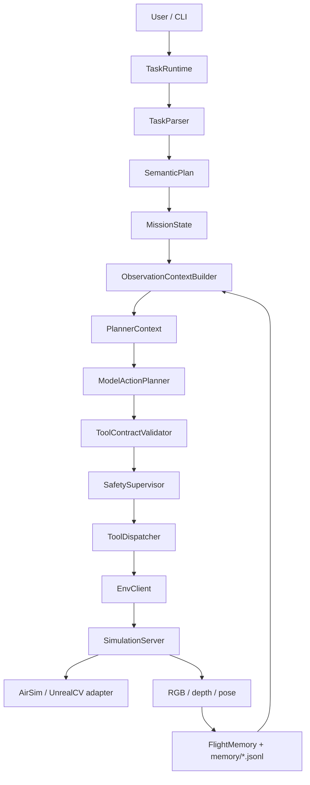
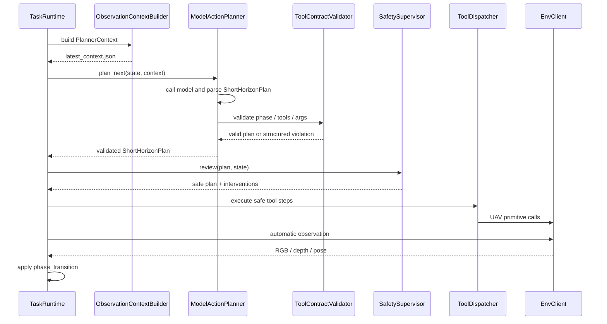
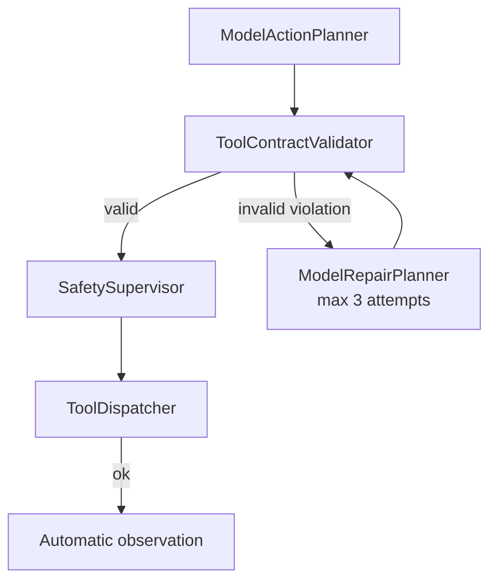

# FlyAgent 架构说明

## 1. 总体思路

FlyAgent 不让模型直接操作 UE、AirSim 或底层 SDK。模型只读取 `PlannerContext`，输出短期动作计划；runtime 负责执行、安全审查、自动观察和状态推进。



核心边界：

- `TaskParser` 负责把自然语言任务拆成语义阶段，不生成动作序列。
- `ObservationContextBuilder` 和 context modules 负责把记忆、规则、偏好、安全约束整理成 `PlannerContext`。
- `ModelActionPlanner` 只做模型调用、JSON 解析和短期计划编排。
- `ToolContractValidator` 校验模型输出是否符合 `allowed_action_constraints`。
- `SafetySupervisor` 做最终限幅、替换和安全拦截。
- `ToolDispatcher` 才能真正调用 UAV primitive tools。

## 2. 地图资源和控制协议

地图资源、启动方式和控制协议分开描述：

```text
provider: 地图资源形态，例如 packaged_unreal
launch.method: direct / wsl_bash / existing_process / manual
control.protocol: airsim / unrealcv
```

这样同一份上层 agent 逻辑可以适配本地 UE、远程已启动 UE、AirSim 或 UnrealCV。上层只依赖 `EnvClient`，不直接依赖具体 SDK。

## 3. 核心对象

`MapPackage` 描述静态地图资源：

```text
map_id
provider
scene_id
root
launch
control
resources
```

`SceneInstance` 描述一次运行中的场景实例：

```text
scene_instance_id
map_id
scene_id
host
server_port
airsim_port
settings_path
process_id
status
```

动作配置分两类：

- `UavActionConfig`：默认动作尺度，例如默认前进速度、默认 yaw 步长。
- `UavSafetyConfig`：安全硬上限，例如最大速度、最大 duration、累计 yaw scan budget。

## 4. Runtime 分层

`src/runtime` 按职责分层：

- `cli/`：命令行入口，只做参数解析和对象组装。
- `configs/`：加载地图、模型、UAV 动作尺度和安全上限配置。
- `logging/`：创建 run 目录，写 `system.log`、`events.jsonl` 和 artifacts。
- `runners/`：执行具体运行流程，例如 `TaskRuntime`。

runtime 的关键职责不是替模型规划，而是组织闭环：

```text
构建 context
调用 ModelActionPlanner
执行 ToolContractValidator
执行 SafetySupervisor
执行安全后的动作
自动采集 RGB/depth/pose
应用 phase_transition
写入 run artifacts
```

## 5. 模型动作规划链路

当前不保留规则版 short horizon planner。短期动作规划统一由 `ModelActionPlanner` 完成。



模型输出必须是 tool-only：

```json
{
  "phase": "copy current_phase.name",
  "steps": [
    {
      "kind": "tool",
      "tool": "uav.hover",
      "args": {},
      "reason": "hold position while waiting for automatic observation"
    }
  ],
  "phase_transition": {
    "decision": "continue_current_phase",
    "reason": "need more evidence after the next automatic observation"
  }
}
```

模型不能输出：

- `kind="observe"`
- `env.observe`
- `uav.connect`
- `uav.takeoff`
- `uav.land`
- `uav.set_pose`
- `uav.get_pose`
- `uav.get_frames`

观察由 runtime 根据 `observation_policy` 自动完成。

## 6. Context 和 Memory 边界

`FlightMemory` 是飞行历史 manifest，不是 prompt。完整历史保存在 `runs/<run_id>/memory/*.jsonl` 和 artifacts 中。

`ContextModule` 按类别读取短窗口历史并输出 `ContextFragment`：

- `InstructionModule`：当前指令、历史指令、目标和 phase goal。
- `ImageModule`：最近 RGB/depth metadata、artifact refs 和图像可用性。
- `PoseModule`：latest pose、最近 pose 窗口和 pose delta。
- `ActionModule`：最近动作、执行结果、失败记录。
- `MapModule`：地图线索、召回过滤条件和 reconfirmation 风险。

`ContextComposer` 只负责排序、裁剪、合并和加入规则/偏好/安全约束。它不直接读取完整 jsonl，不调用 UAV tool，也不创造新事实。

## 7. Phase 推进

当前不单独实现 `PhaseCompletionEvaluator`。模型在同一次 action plan 中输出 `phase_transition`：

- `continue_current_phase`
- `advance_to_next_phase`
- `complete_task`

runtime 才能真正修改 `MissionState`。如果 `SafetySupervisor` 发生 intervention，runtime 会压制模型的推进建议并继续当前 phase。若同一 phase 连续执行超过窗口上限，runtime 会触发 loop guard，安全 hover 后推进。

## 8. Plan-Execute-Repair

当前已支持第一版 contract repair：当 `ToolContractValidator` 拒绝模型动作计划时，`ModelActionPlanner` 会构建结构化 `RepairContext`，调用 `ModelRepairPlanner` 最多修正 3 次。任意一次修正通过后，计划继续进入 `SafetySupervisor`；3 次都失败时，runtime 走现有失败路径并 best-effort hover。



`ToolContractViolation` 保留结构化错误信息，例如 `code`、`message`、`step_index`、`tool`、`field`、`expected`、`actual`。repair planner 消费这些结构化信息，而不是解析自然语言错误。当前 repair 只修 contract violation，不修执行失败、视觉失败或 safety intervention。

`ModelActionPlanner` 不再做旧参数归一化。`uav.move_body` 只接受 context contract 中声明的 `direction/duration` 或 `vx/vy/vz/duration` 两种格式；`x_m`、`duration_sec`、`front/back` 等旧写法会先被 validator 拒绝，再交给 repair planner 尝试改成合法格式。
