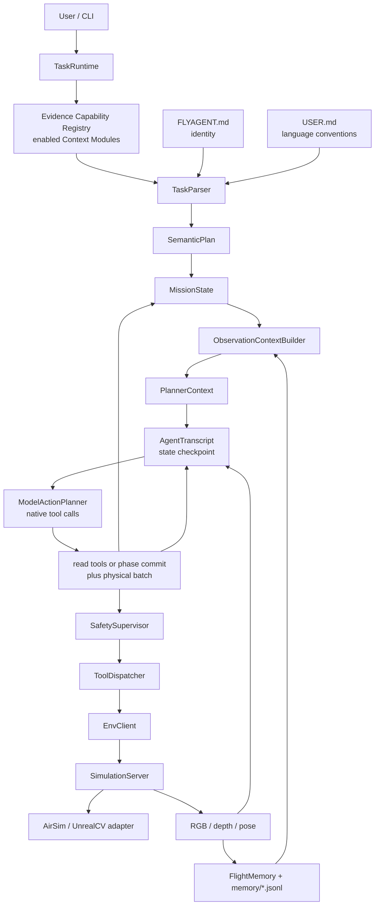
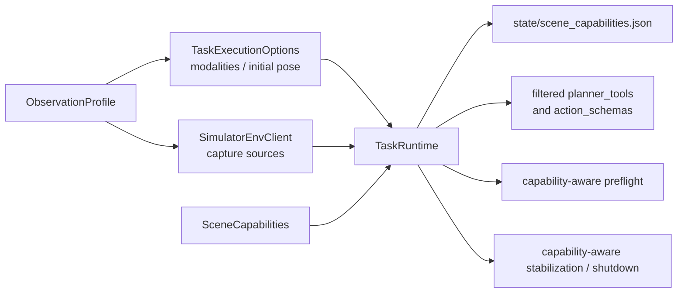
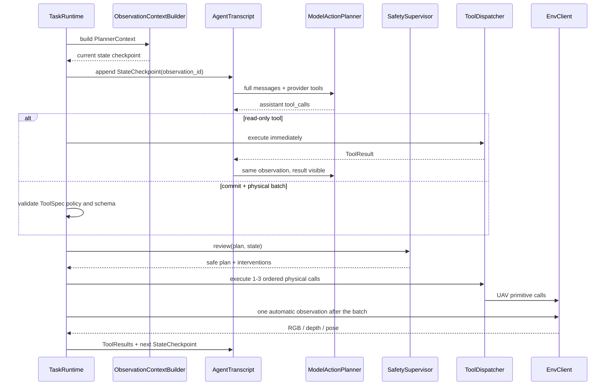
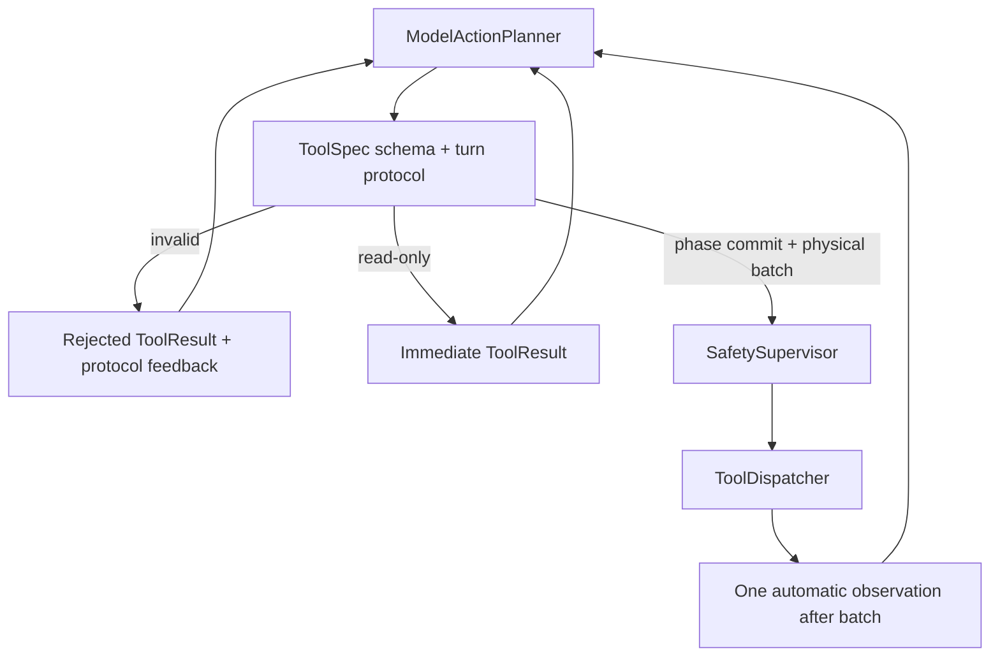

# FlyAgent 架构说明

> Update: 模型动作链路已经迁移到原生 tool calling 与完整 active-task transcript。Runtime stop 仍区分语义完成和异常 loop guard；`SafetySupervisor` 仍只负责硬安全。

## 1. 总体思路

FlyAgent 不让模型直接操作 UE、AirSim 或底层 SDK。模型只读取结构化上下文并输出短期 UAV 动作；runtime 负责执行、安全审查、自动观察、记忆写入和阶段推进。



核心边界：

- `TaskParser` 把自然语言任务拆成语义阶段，不生成 UAV tool 序列；每次解析前，
  Runtime 从当前启用的 Context Modules 重新聚合本次可能提供的语义证据。
- `ObservationContextBuilder` 和 context modules 只把源数据加工为当前状态，不代理动作历史。
- `AgentTranscript` 按时间保存 instruction、state checkpoint、assistant tool calls 和 ToolResult。
- `ModelActionPlanner` 只使用 provider 原生 `tools/tool_calls`；无 JSON action-plan fallback。
- `ToolSpec` 同时定义 provider schema 与显式 Runtime 属性；执行层不通过名称前缀猜副作用。
- `SafetySupervisor` 做最后限幅、替换和安全拦截。
- `ToolDispatcher` 才能真正调用 UAV primitive tools。
- Runtime 根据结构化 completion assessment 派生阶段推进；`phase_strategy` 只指导未完成阶段的动作，不参与完成判定。

## 2. 地图与控制协议

地图来源、部署位置和控制协议是三个独立维度。上层 Agent 只依赖 `EnvClient`，不直接依赖 AirSim、UnrealCV、SSH 或具体 UE 启动方式。

当前 Backend 多态、Local/Remote 生命周期、配置与验收步骤统一维护在：

[Simulator Control Documentation](simulator_control/README.md)

该文档包当前标记为 `Status: Implemented`；远程实机验收状态在其中单独记录。

## 3. 核心对象

`MapPackage` 描述静态地图资源：

```text
map_id, provider, scene_id, root, connection, launch, control, airsim/unrealcv
```

`SceneInstance` 描述一次运行中的场景实例：

```text
scene_instance_id, map_id, scene_id, control_host, control_port,
process_ownership, remote_process_id, settings_sha256, capabilities, status
```

动作配置分两类：

- `UavActionConfig`：默认动作尺度，例如默认前进速度、默认 yaw step。
- `UavSafetyConfig`：安全硬上限，例如最大速度、最大 duration、累计 yaw scan budget。

Runtime 还组合两个与 MapPackage 正交的运行级对象：

- `ObservationProfile`：由 Benchmark runner、CLI 或 Demo 选择本次运行的 canonical
  modality 与 capture source；同一个实例同时注入 `SimulatorEnvClient`。
- `TaskExecutionOptions`：由同一个 Profile 构造，向 `TaskRuntime`提供 Agent 可见
  modalities 和可选的 canonical episode initial pose。

场景启动后，Backend 返回 `SceneCapabilities`。Runtime 将其作为唯一的模拟器能力事实：



这三个对象不会替代 Agent 闭环，只决定闭环可观察什么、初始状态是什么以及哪些
primitive 可以安全执行。它们不携带 SSH、端口、executable、settings 或 Benchmark
评测真值。

## 4. Runtime 分层

`src/runtime` 按职责分层：

- `cli/`：命令行入口，只做参数解析和对象组装。
- `configs/`：加载地图、模型、UAV 动作尺度和安全上限配置。
- `logging/`：创建 run 目录，写 `system.log`、`events.jsonl` 和 artifacts。
- `runners/`：具体运行流程，例如 `TaskRuntime` 和 `InteractiveTaskSession`。

`TaskRuntime` 的主职责是组织闭环：

```text
构建当前 PlannerContext，并追加带 observation_id 的 StateCheckpoint
进入内层 tool loop：模型可调用 read-only tool，Runtime 立即回写 ToolResult
模型调用 runtime.commit_phase_turn 结束当前决策
未完成时，同一 assistant turn 可附带 1-3 个有序 physical tool calls
执行 SafetySupervisor 和安全审查后的动作批次
整批动作后只自动采集一次 RGB/depth/pose
下一外层窗口追加新 StateCheckpoint，完整历史继续发给同一模型
完成时只提交 runtime.commit_phase_turn，不再执行物理动作
```
Runtime 根据 completion assessment 应用阶段推进结果
写入 run artifacts
```

每次启动统一 Backend 场景后，Runtime 还会：

- 写入 `state/scene_capabilities.json`；
- 用 `supported_actions`过滤 `planner_tools`与对应 action schemas；
- 不把 protocol、control mode、lifecycle 与 observation capability 作为
  `simulator_contract`注入模型上下文；
- 在自定义 Planner 绕过模型 contract 时，于 ToolDispatcher 前再次拒绝不支持的动作；
- 根据 capability 决定 takeoff、hover、brake、pose polling 与 land 是否执行或跳过。

`SceneCapabilities=None`仅是旧 EnvClient（当前 UAV-Flow 路径）的临时兼容分支。
新统一 Backend 不依赖该 fallback。

## 5. 动作规划链路

当前不保留规则版 short horizon planner。短期动作统一由 `ModelActionPlanner` 生成。



模型输出 provider 原生 tool calls。未完成阶段的终止 turn 形态如下：

```json
{
  "role": "assistant",
  "content": "public intent",
  "tool_calls": [
    {
      "id": "call_commit",
      "function": {"name": "runtime_commit_phase_turn", "arguments": "{...}"}
    },
    {"id": "call_turn", "function": {"name": "uav_turn_relative", "arguments": "{...}"}},
    {"id": "call_move", "function": {"name": "uav_move_body", "arguments": "{...}"}}
  ]
}
```

只有本轮 provider `tools` 中的工具可调用。lifecycle 和普通 observation 仍由 Runtime 管理，默认不向模型暴露：

- `kind="observe"`
- `env.observe`
- `uav.connect`
- `uav.takeoff`
- `uav.land`
- `uav.set_pose`
- `uav.get_pose`
- `uav.get_frames`

每个 call 都通过 `tool_call_id` 获得 ToolResult。参数或组合非法时结果为 `rejected`，模型在同一 transcript 中自行修正。物理批次后由 Runtime 自动观察。

## 6. Context 与 Memory 边界

`FlightMemory` 是飞行历史 manifest，不是 prompt。完整历史保存在 `runs/<run_id>/memory/*.jsonl` 和 artifacts 中。

`ContextModule` 按类别读取短窗口历史并输出 `ContextFragment`，同时通过
`describe_output().semantic_evidence`声明本模块在启用时可能提供的证据：

- `InstructionModule`：当前指令、历史指令、目标和 phase goal。
- `ImageModule`：图像选择、时序角色、可选深度 overlay、provider-ready 图像输入。
- `PoseModule`：模型侧只提供可选 AGL；完整 pose 与 delta 留在审计 metadata。
- `ActionModule`：phase-relative 与 last-window 自身运动；精确动作历史由 transcript 表达。
- `MapModule`：地图线索、召回过滤条件和 reconfirmation 风险。

`ContextModuleRegistry`只聚合已启用模块的短语义能力声明，去除空项和重复项；
它不暴露模拟器协议、连接参数，也不把“可能提供”误写成“已经观察到”。
`ContextComposer` 只负责排序、裁剪、合并和加入规则/偏好/安全约束。它不直接
读取完整 jsonl，不调用 UAV tool，也不创造新事实。

## 7. 阶段推进

当前不单独实现 `PhaseCompletionEvaluator`。模型在 `runtime.commit_phase_turn` 参数中提交覆盖全部 `done_when` 的 `completion_assessment`；Runtime 由这些结构化状态派生 `PhaseTransition`。

每次提交可依据的 transcript 包含：

- 当前 instruction / semantic goal / current phase。
- 执行前 latest pose。
- 执行后 latest pose。
- pose delta、yaw delta、planar displacement。
- 当前 phase 起点 observation、累计 pose delta、累计 planar displacement、归一化累计 yaw delta。
- 当前 phase 内累计执行过的 tool facts，例如成功 yaw 总量、move duration 总量和每个 direction 的 duration。
- executed steps、action results、Safety interventions。
- 原样 assistant tool calls、ToolResult、Safety requested/executed args。
- 按 observation ID 排列的历史 StateCheckpoint。

commit 的核心参数是：

```json
{
  "phase": "current phase name",
  "completion_assessment": {
    "done_when": [
      {"index": 0, "status": "supported | unknown | contradicted", "evidence": "..."}
    ]
  }
}
```

只有 Runtime 能修改 `MissionState`。所有条件为 `supported` 时，最后阶段完成、非最后阶段推进；否则继续当前阶段并要求同一 assistant turn 提交 physical batch。若同一 phase 连续执行超过窗口上限，Runtime 触发 loop guard，安全 hover 后标记 `stopped/incomplete`，不会自动推进下一 phase。

## 8. Tool-Call Self-Repair

生产模型路径不再调用独立 `ModelRepairPlanner`。provider 响应、tool 参数或调用组合不合法时，Runtime 把每个 call 标为 `rejected`，并把结构化错误作为 transcript feedback 回灌给同一模型。模型在同一个观察状态上重新调用工具，不消耗飞行动作窗口。



`max_tool_rounds`（默认 10）是单个状态上的总协议安全阀；连续协议拒绝另由
`max_consecutive_protocol_rejections`（默认 3）限制。成功 read-only ToolResult 会清零
连续拒绝计数。两者都不是 token budget；当前版本不做 transcript 摘要、裁剪或静默降级，
超限应显式报错。

## 9. 视觉输入边界

RGB/depth 会被 runtime 真实采集并保存为 artifacts。默认 image context module 保持轻量：不 caption、不调用模型；每个 checkpoint 只产出当次 observation 的图像，并在深度有效时生成带底部米制色条的 RGB/depth 融合图。完整历史由 transcript 按 observation 时间保留。

默认多模态接入遵守这些边界：

- `src/memory/context/modules/image.py` 只产出单个当前图像及 overlay；不在图像像素中
  写 NOW/PAST 标题。场景像素保持原尺寸，色条仅附加在下方。
- 每个图片标签都包含 `observation_id`、`frame_id` 和 artifact reference，使后续
  tool call/result 能明确指向同一画面；ID 本身不会让 VLM 自动记住未再次发送的图片。
- transcript 按时间把旧图标为 `HISTORY`、最新图标为 `CURRENT`，每个 observation
  只发送一次；phase-start 与 before-action ID 可继续作为审计锚点，但不重放图像。
- 有效 overlay 会替代该 checkpoint 模型附件中的原始 RGB，不重复发送同一画面；
  原始 RGB 与 Depth artifact 仍分别保存，未被覆盖。
- custom image module 负责读取、筛选、融合、caption 或压缩图片，并产出 planner-ready 信息；当前 `multimodal_image` 实现会把最近真实 RGB 转成 `visual_description` 文本。
- `ModelActionPlanner` 不读取图片 path，不理解图片策略，只消费 `model_inputs` 中已经编码好的输入。
- `ModelInputAssembler` 按 module 给出的交错顺序把 `model_inputs` 转成
  openai-compatible content parts，最后追加脱敏后的 JSON Context；它不解释
  时间角色。caption 模式下 planner 收到的是 text model input。
- 融合色条只支持定性远近。需要显式定位时使用 JSON 启用的
  `skill.visual_grounding.locate`：身份/方位确认设置 `include_distance=false`，只有显式
  米制值、接近阈值或定量完成才设置为 `true`。插件负责 detector 候选、可选 segmentation
  与候选内部的鲁棒深度，模型不再自己提交 ROI。
- ToolResult 的候选标注图是普通 user-role Tool Evidence，不创建新 observation；模型仍须
  根据指令确认候选语义，不能把 detector confidence 当作目标真值。
- capability 通过通用 ToolSpec metadata 声明条件式 `current_observation_success`：仅符合
  JSON `when` 条件的调用要求 supported 终态在当前 observation 上有成功结果。Runtime
  不解析任务语言、目标类别或 `include_distance` 这一具体字段名。
- 视觉层不输出 `recommended_next_observation`、转向、扫描或移动建议。
- 模型只有在实际收到图片，或 context 中存在明确视觉证据时，才能声称看到了目标。

当前 custom caption 只处理最近 1 张真实 RGB，不传 depth 数组给 caption 模型；默认 image module 则可直接生成当前 RGB/depth overlay。两条路径都保留原始 Depth artifact。
