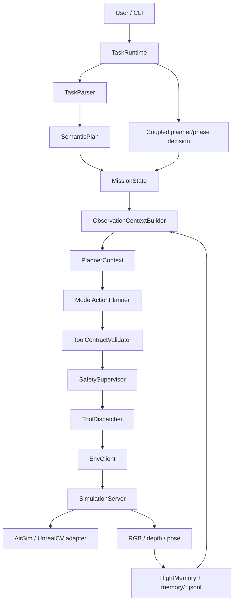
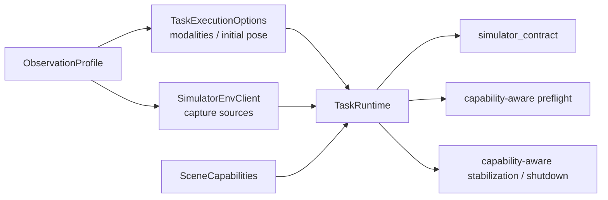
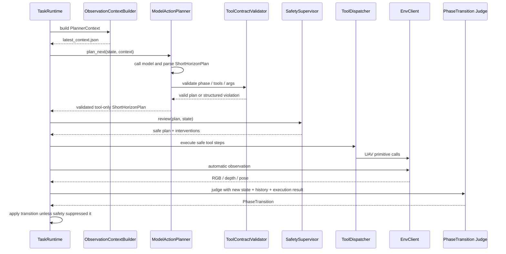

# FlyAgent 架构说明

> Update: Runtime stop now distinguishes semantic completion from abnormal loop-guard stop. A task normally ends when the coupled phase decision returns `complete_task`, or when all semantic phases naturally advance. If a phase exceeds the runtime loop guard, runtime writes `runtime_loop_guard_reached`, hovers, and marks the mission `stopped/incomplete`; it does not auto-advance the phase. `SafetySupervisor` remains a hard safety layer for tool whitelist, yaw/velocity/duration clipping, and yaw scan budget, not a semantic stop rule.

## 1. 总体思路

FlyAgent 不让模型直接操作 UE、AirSim 或底层 SDK。模型只读取结构化上下文并输出短期 UAV 动作；runtime 负责执行、安全审查、自动观察、记忆写入和阶段推进。



核心边界：

- `TaskParser` 把自然语言任务拆成语义阶段，不生成 UAV tool 序列。
- `ObservationContextBuilder` 和 context modules 把记忆、规则、偏好、安全约束整理成 `PlannerContext`。
- `ModelActionPlanner` 只做模型调用、JSON 解析和动作规划编排。
- `ToolContractValidator` 校验模型动作是否符合 `allowed_action_constraints`。
- `SafetySupervisor` 做最后限幅、替换和安全拦截。
- `ToolDispatcher` 才能真正调用 UAV primitive tools。
- 阶段推进在动作执行和自动 observation 之后判断，不由 action plan 直接携带。

## 2. 地图与控制协议

地图来源、部署位置和控制协议是三个独立维度。上层 Agent 只依赖 `EnvClient`，不直接依赖 AirSim、UnrealCV、SSH 或具体 UE 启动方式。

当前 Backend 多态、Local/Remote 生命周期、配置与验收步骤统一维护在：

[Simulator Control Documentation](simulator_control/README.md)

该文档包当前标记为 `Status: Implemented`；远程实机验收状态在其中单独记录。

## 3. 核心对象

`MapPackage` 描述静态地图资源：

```text
map_id, provider, scene_id, root, connection, launch, control, airsim/unrealcv
```

`SceneInstance` 描述一次运行中的场景实例：

```text
scene_instance_id, map_id, scene_id, control_host, control_port,
process_ownership, remote_process_id, settings_sha256, capabilities, status
```

动作配置分两类：

- `UavActionConfig`：默认动作尺度，例如默认前进速度、默认 yaw step。
- `UavSafetyConfig`：安全硬上限，例如最大速度、最大 duration、累计 yaw scan budget。

Runtime 还组合两个与 MapPackage 正交的运行级对象：

- `ObservationProfile`：由 Benchmark runner、CLI 或 Demo 选择本次运行的 canonical
  modality 与 capture source；同一个实例同时注入 `SimulatorEnvClient`。
- `TaskExecutionOptions`：由同一个 Profile 构造，向 `TaskRuntime`提供 Agent 可见
  modalities 和可选的 canonical episode initial pose。

场景启动后，Backend 返回 `SceneCapabilities`。Runtime 将其作为唯一的模拟器能力事实：



这三个对象不会替代 Agent 闭环，只决定闭环可观察什么、初始状态是什么以及哪些
primitive 可以安全执行。它们不携带 SSH、端口、executable、settings 或 Benchmark
评测真值。

## 4. Runtime 分层

`src/runtime` 按职责分层：

- `cli/`：命令行入口，只做参数解析和对象组装。
- `configs/`：加载地图、模型、UAV 动作尺度和安全上限配置。
- `logging/`：创建 run 目录，写 `system.log`、`events.jsonl` 和 artifacts。
- `runners/`：具体运行流程，例如 `TaskRuntime` 和 `InteractiveTaskSession`。

`TaskRuntime` 的主职责是组织闭环：

```text
构建 PlannerContext
调用 ModelActionPlanner 生成 tool-only 动作计划
执行 ToolContractValidator
执行 SafetySupervisor
执行安全审查后的动作
自动采集 RGB/depth/pose
执行后调用模型判断 PhaseTransition
应用阶段推进结果
写入 run artifacts
```

每次启动统一 Backend 场景后，Runtime 还会：

- 写入 `state/scene_capabilities.json`；
- 在 PlannerContext 中加入精简的 `simulator_contract`；
- 用 `supported_actions`过滤 `planner_tools`与对应 action schemas；
- 在自定义 Planner 绕过模型 contract 时，于 ToolDispatcher 前再次拒绝不支持的动作；
- 根据 capability 决定 takeoff、hover、brake、pose polling 与 land 是否执行或跳过。

`SceneCapabilities=None`仅是旧 EnvClient（当前 UAV-Flow 路径）的临时兼容分支。
新统一 Backend 不依赖该 fallback。

## 5. 动作规划链路

当前不保留规则版 short horizon planner。短期动作统一由 `ModelActionPlanner` 生成。



模型动作输出必须是 tool-only：

```json
{
  "phase": "copy current_phase.name",
  "steps": [
    {
      "kind": "tool",
      "tool": "uav.hover",
      "args": {},
      "reason": "hold position while waiting for automatic observation"
    }
  ]
}
```

模型动作计划不能输出：

- `kind="observe"`
- `env.observe`
- `uav.connect`
- `uav.takeoff`
- `uav.land`
- `uav.set_pose`
- `uav.get_pose`
- `uav.get_frames`

观察由 runtime 根据 `observation_policy` 自动完成。

## 6. Context 与 Memory 边界

`FlightMemory` 是飞行历史 manifest，不是 prompt。完整历史保存在 `runs/<run_id>/memory/*.jsonl` 和 artifacts 中。

`ContextModule` 按类别读取短窗口历史并输出 `ContextFragment`：

- `InstructionModule`：当前指令、历史指令、目标和 phase goal。
- `ImageModule`：最新 RGB/depth metadata、artifact refs、图像可用性，以及最近 1 张真实 RGB 的 encoded image model input。
- `PoseModule`：latest pose、最近 pose 窗口和 pose delta。
- `ActionModule`：最近动作、执行结果、失败记录。
- `MapModule`：地图线索、召回过滤条件和 reconfirmation 风险。

`ContextComposer` 只负责排序、裁剪、合并和加入规则/偏好/安全约束。它不直接读取完整 jsonl，不调用 UAV tool，也不创造新事实。

## 7. 阶段推进

当前不单独实现 `PhaseCompletionEvaluator`。阶段推进判断复用 planning 目录里的 `PhaseTransition` schema，但触发时机从 action plan 内移动到动作执行后。

执行后判断输入包含：

- 当前 instruction / semantic goal / current phase。
- 执行前 latest pose。
- 执行后 latest pose。
- pose delta、yaw delta、planar displacement。
- 当前 phase 起点 observation、累计 pose delta、累计 planar displacement、归一化累计 yaw delta。
- 当前 phase 内累计执行过的 tool facts，例如成功 yaw 总量、move duration 总量和每个 direction 的 duration。
- executed steps、action results、Safety interventions。
- recent action / observation history 摘要。
- phase window count / max window count。

模型只输出：

```json
{
  "decision": "continue_current_phase | advance_to_next_phase | complete_task",
  "reason": "short reason"
}
```

runtime 才能真正修改 `MissionState`。如果 `SafetySupervisor` 有 intervention，runtime 会压制阶段推进判断并继续当前 phase。`complete_task` 只在最后一个 semantic phase 生效；如果模型在中间 phase 误报 `complete_task`，runtime 会记录降级事件并推进到下一 phase。若同一 phase 连续执行超过窗口上限，runtime 触发 loop guard，安全 hover 后标记 `stopped/incomplete`，不会自动推进下一 phase。

## 8. Plan-Execute-Repair

当前支持 contract repair v1：当 `ToolContractValidator` 拒绝模型动作计划时，`ModelActionPlanner` 构建结构化 `RepairContext`，调用 `ModelRepairPlanner` 最多修正 3 次。任意一次修正通过后，计划继续进入 `SafetySupervisor`；3 次都失败时，runtime 走当前失败路径并 best-effort hover。


`ToolContractViolation` 保留结构化错误信息，例如 `code`、`message`、`step_index`、`tool`、`field`、`expected`、`actual`。repair planner 消费这些结构化信息，而不是解析自然语言错误。

当前 repair 只修 contract violation，不修执行失败、视觉失败或 safety intervention。

## 9. 视觉输入边界

RGB/depth 会被 runtime 真实采集并保存为 artifacts。默认 image context module 保持轻量：不 caption、不调用模型，但会把最近 1 张真实 RGB 编码为 `ContextFragment.model_inputs[type=image]`，同时继续提供图像 metadata、artifact refs 和可用性。项目可以通过 custom image module 替换默认处理方式，例如融合多图、压缩、caption，或只输出文字摘要。

第一版多模态接入遵守这些边界：

- `src/memory/context/modules/image.py` 默认选择最近 1 张真实 RGB 并编码为 provider-ready image input；mock、缺失或不可读图片只保留 metadata。
- custom image module 负责读取、筛选、融合、caption 或压缩图片，并产出 planner-ready 信息；当前 `multimodal_image` 实现会把最近真实 RGB 转成 `visual_description` 文本。
- `ModelActionPlanner` 不读取图片 path，不理解图片策略，只消费 `model_inputs` 中已经编码好的输入。
- `ModelInputAssembler` 会把 `model_inputs` 转成 openai-compatible content parts，并在 JSON 文本里脱敏大块 encoded data；caption 模式下 planner 收到的是 text model input。
- 视觉层不输出 `recommended_next_observation`、转向、扫描或移动建议。
- 模型只有在实际收到图片，或 context 中存在明确视觉证据时，才能声称看到了目标。

当前 custom caption 只处理最近 1 张真实 RGB，不传 depth 数组给视觉模型。Depth 仍作为 artifact 和 metadata 保留，后续再决定是否进入多模态请求或单独解释。
