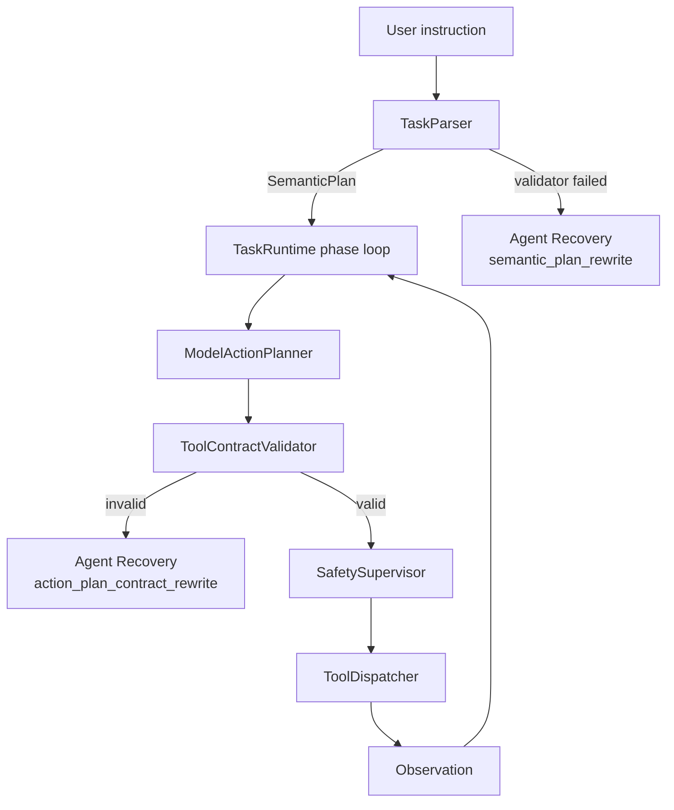

> Status: Historical

# 02 当前 Loop 盘点

本文整理 FlyAgent 当前已有的循环和验证路径，并标出哪些旧 repair 逻辑会被 Agent Recovery 替换。

## 1. TaskRuntime Phase Loop

位置：

```text
src/runtime/runners/task_runtime.py
```

职责：

- 构建 planner context。
- 调用 action planner。
- 执行 action contract validation。
- 通过 SafetySupervisor 做硬安全检查。
- 调用 ToolDispatcher 执行动作。
- 自动采集 RGB/depth/pose observation。
- 调用 coupled phase decision 判断当前 phase 是否完成。
- 根据 `continue_current_phase / advance_to_next_phase / complete_task` 推进任务。
- loop guard 只做极端防死循环兜底。

它解决的是：

```text
当前 phase 还没完成，下一步怎么飞？
```

它不负责：

- 修复 semantic parser 输出。
- 修复 action planner JSON/schema。
- 处理 provider 返回的 markdown JSON 包裹。
- 根据 validator error 重写模型输出。

## 2. SemanticParser Validation

位置：

```text
src/agent/semantic/task_parser.py
src/agent/semantic/validator.py
```

当前 model mode 流程：

```text
TaskParser.parse(instruction)
  -> _parse_with_model(instruction)
    -> _call_openai_compatible(instruction)
    -> _loads_json_object(content)
    -> semantic_plan_from_dict(response)
      -> SemanticPlan.from_dict(data)
      -> validate_semantic_plan(plan)
  -> validate_semantic_plan(plan)
  -> TaskParseResult(...)
```

当前缺口：

- validator error 没有 repair attempt。
- `_parse_with_model()` 失败后直接抛异常。
- parser 没有 `last_repair_attempts` 或 repair result。
- runtime 只能看到最终异常，看不到模型输出是否可修。

迁移目标：

```text
TaskParser
  -> RecoveryRequest(source="task_parser")
  -> RecoveryOrchestrator
  -> semantic_plan_rewrite / json_object_rewrite
  -> validate_semantic_plan
```

## 3. SemanticPlan Validator

位置：

```text
src/agent/semantic/validator.py
```

当前禁止 token：

```text
uav.
env.observe
move_body
turn_relative
takeoff
land
get_frames
get_pose
```

这个 validator 是正确边界，第一版不放宽。

## 4. ModelActionPlanner Contract Repair

位置：

```text
src/agent/planning/model_action_planner.py
src/agent/planning/model_repair_planner.py
```

当前流程：

```text
ModelActionPlanner.plan_next()
  -> model call
  -> ShortHorizonPlan.from_dict()
  -> ToolContractValidator.validate()
  -> if invalid: _repair_contract_violation()
```

它已经能处理：

- forbidden tool。
- phase 不匹配。
- action window 结构错误。
- observe step 越界。
- `uav.move_body` / `uav.turn_relative` 参数不符合 contract。

限制：

- 它和 `ShortHorizonPlan`、`ToolContractViolation` 强绑定。
- 它不能被 `TaskParser` 复用。
- 它把 selector、tool call、attempt loop、error 类型都塞在 planner 分支里，无法作为统一 recovery 层扩展到 parser/judge/caption。

迁移目标：

```text
ModelActionPlanner
  -> RecoveryRequest(source="action_planner")
  -> RecoveryOrchestrator
  -> action_plan_contract_rewrite / json_object_rewrite
  -> ShortHorizonPlan.from_dict + ToolContractValidator
```

旧 `ModelRepairPlanner` 不作为长期并行分支保留。迁移完成后应删除：

```text
src/agent/planning/model_repair_planner.py
```

并从 `src/agent/planning/__init__.py` 移除相关导出。

## 5. Safety

位置：

```text
src/runtime/safety.py
```

职责：

- 工具白名单。
- yaw / velocity / duration 限制。
- yaw scan budget。
- 参数裁剪。

Safety 不负责：

- 判断用户任务是否完成。
- 解析自然语言。
- 修复模型输出字段。
- 根据连续失败自动改写任务。

## 6. 当前层级图



Agent Recovery 是 parser/planner 的错误恢复层，不是 runtime 执行循环的一部分。
