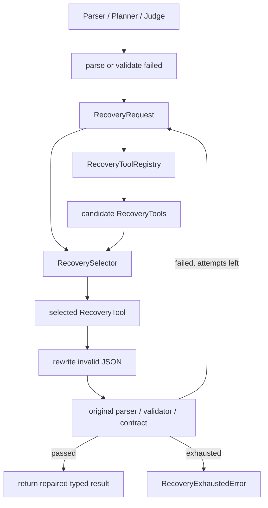

> Status: Historical

# 03 Agent Recovery 架构

本文说明 `src/agent/recovery/` 的目标架构。它是 FlyAgent 的通用错误恢复层：模型模块把错误封装成 `RecoveryRequest`，`RecoveryOrchestrator` 调用 selector 选择一个 `RecoveryTool`，再把修复结果交回原模块的 parser/validator/contract 验收。

## 1. 代码放置

建议新增：

```text
src/
  agent/
    recovery/
      __init__.py
      orchestrator.py
      selector.py
      registry.py
      schemas.py
      errors.py
      json_utils.py
      tools/
        semantic_plan_rewrite.py
        action_plan_contract_rewrite.py
        json_object_rewrite.py
      prompts/
        recovery_selector_system.txt
        semantic_plan_rewrite_system.txt
        action_plan_contract_rewrite_system.txt
        json_object_rewrite_system.txt
```

这个包不应依赖：

- `TaskRuntime`。
- `SafetySupervisor`。
- `ToolDispatcher`。
- simulator client。
- UAV-Flow benchmark。

外层模块可以依赖 recovery，recovery 不反向拥有 runtime。

## 2. 核心数据结构

### `RecoveryRequest`

表示一次需要恢复的错误。

建议字段：

```text
request_id
source
stage
error_type
error_message
invalid_output
context_summary
candidate_tools
max_attempts
```

示例 source：

```text
task_parser
action_planner
phase_judge
visual_caption
```

示例 stage：

```text
json_parse
schema_parse
semantic_validation
tool_contract_validation
```

### `RecoveryTool`

表示一种可被 selector 选择的修复能力。

每个 tool 需要声明：

```text
name
description
supported_sources
supported_stages
input_contract
output_contract
```

注意：`RecoveryTool` 不是 UAV tool。它只重写模型输出，不执行飞行动作。

### `RecoveryToolRegistry`

职责：

- 注册 v1 recovery tools。
- 根据 `source/stage/error_type` 过滤 candidate tools。
- 给 selector 提供工具说明。

### `RecoverySelector`

职责：

- 接收 `RecoveryRequest + candidate_tools`。
- 调用当前模型配置。
- 输出一个选择结果：

```text
selected_tool
repair_goal
reason
```

v1 主设计是模型选择 tool；实现可提供 deterministic fallback，但 fallback 不能取代 selector 的架构位置。

### `RecoveryOrchestrator`

职责：

- 生成 candidate tools。
- 调用 selector。
- 调用 selected tool。
- 调用调用方提供的 parse/validate 函数验收。
- 记录 attempts。
- 超过次数后抛 `RecoveryExhaustedError`。

## 3. 数据流



## 4. 验收边界

Recovery tool 不能自己宣布成功。

成功必须由原模块验收：

- `TaskParser`：`SemanticPlan.from_dict + validate_semantic_plan`。
- `ModelActionPlanner`：`ShortHorizonPlan.from_dict + ToolContractValidator.validate`。
- 后续 `PhaseJudge`：`PhaseTransition.from_dict` 和 phase transition policy。
- 后续 visual caption：caption schema normalize / validator。

## 5. 统一错误类型

新增：

```text
RecoveryExhaustedError
```

它替代旧：

```text
ModelRepairPlannerError
```

建议字段：

```text
source
stage
reason
attempts
max_attempts
last_error_type
last_error_message
selected_tools
initial_output
final_output
```

## 6. JSON 工具

`json_utils.py` 承接当前 `_loads_json_object()` 能力：

- 支持 provider 返回 markdown code fence。
- 只接受 JSON object。
- 失败时给出结构化 parse error。

`TaskParser`、`ModelActionPlanner`、recovery tools 都应从这里读取 JSON object。

## 7. 与 runtime 的关系

runtime 只需要知道：

```text
模型模块可能触发 recovery；
recovery 成功后继续；
recovery exhausted 后按结构化失败处理。
```

runtime 不参与 tool 选择，也不把 recovery 当作 phase loop。
