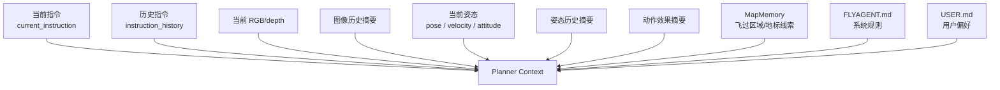

> Status: Historical

# 01 需求文档

## 1. 背景

FlyAgent 当前已经具备：

- M4：短期滚动执行器，每轮输出少量原子动作。
- M5：原始观测和 context builder，能保存 RGB/depth/pose metadata 并生成 `latest_context`。

但真实无人机任务不是孤立的一问一答。用户可能连续下达多条指令：

```text
向前飞行5米，然后悬停
向前飞行5米，然后悬停
右转，看有没有黑色路灯
```

这时第二条指令不应该重建世界，也不应该忘掉第一条结束后的 UAV 姿态、图像状态和动作效果。普通新指令应只更新当前意图，飞行记忆继续保留。

## 2. 每轮决策需要的数据

无人机每轮模型规划至少需要以下数据：

```text
current_instruction
instruction_history
current_rgb / current_depth
current_pose
recent_action_refs
recent_observation_refs
recent_pose_refs
recent_frame_refs
memory/*.jsonl
map_memory
FLYAGENT rules
USER preferences
```

数据关系：



## 3. 不直接进入模型的内容

以下内容应保存为 artifact 或长期记录，但不直接塞入每轮 planner context：

```text
完整历史图像
完整历史深度矩阵
全部 action log
全部 run artifacts
未经确认的地图事实
```

原因：

- 完整图像和深度矩阵过大，应该通过引用和摘要进入上下文。
- 全量 action log 会稀释当前决策重点。
- 未经确认的地图事实可能误导模型执行高风险动作。
- run artifacts 更适合复盘、调试和离线抽取，不适合每轮在线规划。

## 4. 连续指令需求

普通连续指令的语义：

```text
保持当前 scene、当前 UAV、当前物理位置；
更新 active_instruction；
保留 FlightMemory；
继续从当前真实状态规划。
```

只有以下情况刷新飞行连续记忆：

- 用户显式 reset UAV pose。
- 用户重启 scene。
- 用户切换 map。
- 系统检测到 scene 不再可信，例如环境重启或状态丢失。

reset 后保留：

- 当前 map 的 `MapMemory`。
- 用户偏好。
- 系统规则。
- 可用于复盘的 `RunMemory`。

reset 后刷新：

- 当前连续飞行的 pose/action/image rolling summary。
- active instruction 的执行进度。
- 当前 scene 内的短期稳定性判断。

## 5. 成功标准

设计完成后，应该能回答：

- 模型为什么知道第二条“向前飞行5米”要从当前位置继续？
- 哪些历史图像进入上下文，哪些只保存在 artifact？
- 动作历史如何压缩为“动作效果”而不是流水账？
- 地图记忆如何提供线索但不直接证明目标存在？
- reset pose 后哪些记忆刷新，哪些继续保留？
