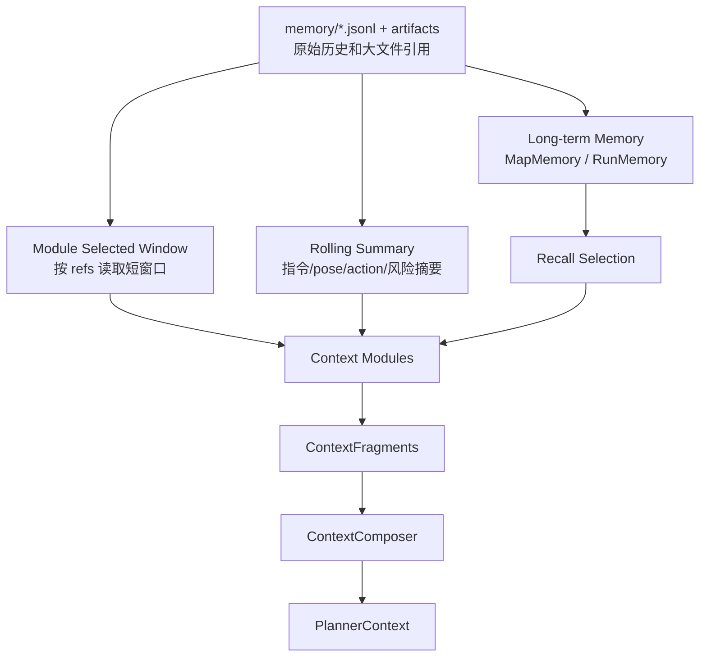

> Status: Historical

# 04 历史压缩策略

历史压缩服务于短期飞行决策：让模型知道当前状态、刚做过什么、动作效果如何、有哪些风险，而不是把完整流水账塞进 prompt。

第一版压缩策略由各 `ContextModule` 分别负责，`ContextComposer` 只做合并、排序和裁剪。

## 1. 三层历史



职责边界：

- `FlightMemory` 保存 manifest refs 和当前 run 索引。
- `memory/*.jsonl` 保存 append-only 原始记录。
- `ContextModule` 读取自己需要的窗口并输出 `ContextFragment`。
- `ContextComposer` 不直接读取完整 raw store。

## 2. 默认模块窗口

| Module | 默认窗口 | 输出重点 |
| --- | --- | --- |
| `InstructionModule` | 最近约 5 条指令 | active instruction、history summary、phase goal |
| `ImageModule` | 当前 checkpoint 帧 | provider-ready RGB/depth 融合图、artifact refs |
| `PoseModule` | 最近 2-3 个 pose | 模型侧可选 AGL；绝对 pose/delta 仅审计 |
| `ActionModule` | 最近 3-5 个 action | phase-relative自身运动、tool/args、失败记录 |
| `MapModule` | 当前 map/scene 匹配线索 | recalled clues、requires_reconfirmation |

这些窗口是 module 策略，不属于 `FlightMemory` 的职责。

## 3. Rolling Summary

摘要应该写可核验内容：

```text
好：最近一次 uav.move_body forward duration=2.0 执行 ok，pose delta 约 dx=1.55, dy=0.89。
不好：刚才飞得还可以。
```

摘要必须区分：

- 观察事实。
- 模型推测。
- 地图线索。
- 用户目标。
- 安全风险。

## 4. Budget v1

第一版使用固定优先级和粗略 token 估算：

```json
{
  "budget_defaults": {
    "instruction": {"priority": 100, "max_items": 5},
    "pose": {"priority": 95, "max_items": 5},
    "action": {"priority": 90, "max_items": 5},
    "image": {"priority": 80, "max_items": 3},
    "map": {"priority": 60, "max_items": 5}
  }
}
```

原则：

- instruction / pose / action 优先级最高。
- image 默认保留最近 3 轮 metadata 和 artifact refs。
- map 是线索，不优先于当前 observation。
- 自定义 module 应声明 `budget.priority` 和 `budget.tokens_estimate`。

## 5. 压缩触发点

建议触发：

- 每次 action 执行后。
- 每次 automatic observation 更新后。
- 每条 instruction 更新 active_instruction 时。
- reset pose / restart scene / switch map 时。
- run 结束归档时。

## 6. 当前 phase 判断策略

当前不做独立 `PhaseCompletionEvaluator`。`ModelActionPlanner` 在同一次计划中输出：

- `continue_current_phase`
- `advance_to_next_phase`
- `complete_task`

runtime 根据安全审查和 loop guard 决定是否应用。module 不负责判断 phase 是否完成。

未来如果 phase 判断复杂，可以让独立 evaluator 复用同一套 `ContextFragment`，但不应把判断逻辑硬编码到 `ActionModule` 或 `MapModule`。

## 7. Raw Store 与压缩职责

```text
memory/*.jsonl / artifacts:
  保存原始历史、索引和大文件引用

state/flight_memory.json:
  保存当前 run 的 manifest / index / recent refs

ContextModule:
  读取自己需要的 refs，执行本类别压缩，输出 ContextFragment

ContextComposer:
  合并 fragments，不读取完整 raw store，不创造新事实
```

因此 `FlightMemory` 不应该：

- 做 pose 去重。
- 裁剪 action result 的原始 data。
- 把 RGB/depth 历史预先总结成固定摘要。
- 替 image/pose/action/map module 决定保留几条。
