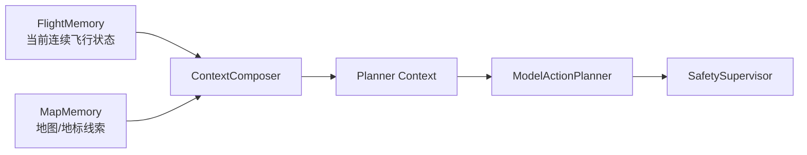
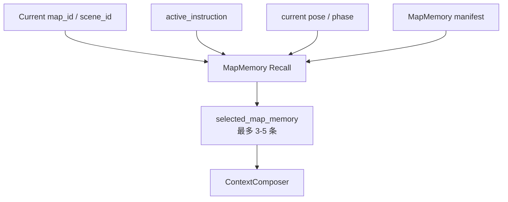

> Status: Historical

# 05 地图记忆设计

`MapMemory` 用来保存无人机飞过区域中的地标、障碍、候选目标和空间线索。它不是 SLAM，也不是事实数据库；第一版只做可复查的语义地图线索。

## 1. MapMemory 的定位



使用原则：

- 可以指导“往哪里观察”。
- 不能单独证明目标存在。
- 不能绕过最新 RGB/depth/pose。
- 靠近、穿越、降落等高风险动作必须依赖最新 observation。

## 2. 数据结构

每条 map memory 建议包含：

```text
map_id
scene_id
coordinate_frame
origin_ref
yaw_ref
pose_units
altitude_ref
region_hint / pose_hint
landmark_description
visual_evidence_ref
depth_evidence_ref
confidence
last_seen_at
requires_reconfirmation
risk_notes
```

示例：

```json
{
  "map_id": "cityenviron_win64",
  "scene_id": "cityenviron",
  "coordinate_frame": "airsim_ned",
  "origin_ref": "scene_start_pose",
  "yaw_ref": "airsim_world_yaw_rad",
  "pose_units": "meters",
  "altitude_ref": "airsim_ned_z",
  "region_hint": "start_area_right_forward",
  "pose_hint": {
    "x": 1.5,
    "y": 0.9,
    "yaw_rad": 0.87
  },
  "landmark_description": "疑似黑色路灯候选区域",
  "visual_evidence_ref": "runs/.../observations/xxx_rgb.png",
  "depth_evidence_ref": "runs/.../observations/xxx_depth.npy",
  "confidence": "medium",
  "last_seen_at": "2026-05-13T10:00:00+08:00",
  "requires_reconfirmation": true,
  "risk_notes": ["target_not_confirmed", "distance_unknown"]
}
```

## 3. 坐标系和参考系

`pose_hint` 必须声明坐标系和参考系。没有参考系的空间线索不能进入高风险决策，只能作为人工复盘或低置信搜索线索。

推荐字段：

```json
{
  "coordinate_frame": "airsim_ned",
  "origin_ref": "scene_start_pose",
  "yaw_ref": "airsim_world_yaw_rad",
  "pose_units": "meters",
  "altitude_ref": "airsim_ned_z"
}
```

字段说明：

| 字段 | 说明 |
| --- | --- |
| `coordinate_frame` | 坐标系，例如 `airsim_ned`、`unreal_world`、`local_start_relative` |
| `origin_ref` | 原点参考，例如 scene 起点、reset 后起点、地图固定原点 |
| `yaw_ref` | yaw 的参考定义和单位 |
| `pose_units` | 位置单位，MVP 默认 `meters` |
| `altitude_ref` | 高度/深度方向参考，AirSim NED 中 z 向下 |

约束：

- reset pose 后，pose-local 线索必须设为 `requires_reconfirmation=true`。
- 不同 map/scene 的坐标线索不能直接混用。
- 不同 `coordinate_frame` 的记忆不能直接比较距离。
- MVP 不做复杂坐标系融合，但必须记录参考系，避免后续误用。

## 4. 召回规则



召回优先级：

1. 当前 `map_id` / `scene_id` 匹配。
2. 当前 pose 或 region 接近。
3. 与 active instruction 的目标相关。
4. confidence 较高。
5. 最近确认过。

## 5. reset 与 map 切换

| 操作 | MapMemory 行为 |
| --- | --- |
| 普通新指令 | 保留并可召回 |
| reset pose | 保留，但 pose-local 线索需要重新确认 |
| restart scene | 当前 map 的记忆可保留 |
| switch map | 不召回旧 map 记忆 |
| 用户清除 map memory | 删除或禁用指定记忆 |

## 6. 置信度与重新确认

第一版使用简单置信度：

```text
low
medium
high
```

默认规则：

- 视觉模型单次识别：最多 `medium`。
- 多次观测一致：可提升到 `high`。
- reset pose 后：保持记忆，但设为 `requires_reconfirmation=true`。
- long gap 后：需要重新确认。

## 7. 不做的事情

MVP 不做：

- 完整 SLAM。
- 自动三维地图构建。
- 多 UAV 地图共享。
- 复杂坐标系融合。
- 基于 MapMemory 自动执行高风险靠近动作。
