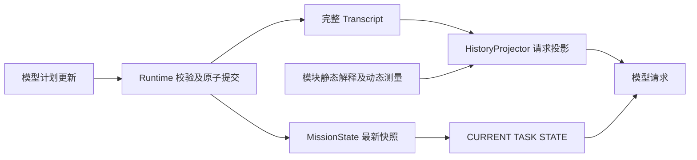

# Context V3

物理窗口固定为一个动作，随后自动发布新观测。调用 ID、对应工具结果、checkpoint 的
observation ID 与图片标签保留时间顺序，表示这张图片是在该动作后获得的；只读和计划
调用不生成动作后图片。沿用既有组织，不新增重复的动作关联状态。历史多动作窗口仍表示
整批之后的观测，不能解释为每个动作都有中间图片。

`InstructionEnvelope` 在 instruction 开始时创建一次，包含 protocol、身份文档、
用户偏好、知识目录和静态模块说明；原始 instruction 仍由 `user_instruction` 事件
唯一拥有。

`StateCheckpoint` 只保存 checkpoint ID、发布原因、observation ID、动态环境
`ContextFragment`、`MediaRef` 和覆盖感知状态的 fingerprint。任务计划和知识索引不在
checkpoint 中；相同感知 fingerprint 不会重复发布。

`ContextFragment` 原生只含 `name`、最终 `content` 与有序 `media_refs`。来源、置信度、
warnings、artifact refs、metadata 与构建耗时位于独立 `FragmentAudit`，不进入模型
字段。

`MissionState.task_plan` 是当前计划的权威状态，`KnowledgeService` 是知识加载状态的
权威所有者，`MissionState.loaded_knowledge` 只是同步后的轻量索引。Runtime 在每次
`plan_turn()` 前临时构造一份 `CURRENT TASK STATE`，它位于完整历史之后、周期提醒
之前，并且既不写入 Transcript，也不复制到 checkpoint。历史压缩只能概括历史事件，
不能修改这一份当前状态；完整知识正文继续由成功的 `knowledge.load` ToolResult 保存。

`HISTORY CAPSULE` 只描述 `through_event_index` 及之前已经发生的进展、决策结果和
失败恢复。它不包含当前待办、下一步或剩余计划；这些内容只由请求末尾的
`CURRENT TASK STATE` 表达。Capsule 是 Provider 请求投影，不会替换或删改持久化的
完整 Transcript。
摘要引用通过校验只说明引用来源有效，不能证明模型的视觉解释。`semantic_summary`
保留模型判断、不确定性及后续纠正；`verified_facts` 只包含程序记录的次数、状态和
运动测量，不代表地标身份或到达条件已经验证。

只有通过结构与证据引用验证的压缩结果才能推进 `through_event_index`。后台压缩仍在
等待、失败、超时、返回非法内容或遇到超大单窗口时，投影继续保留当前已接受 Capsule
以及它之后的完整原始事件；尚无 Capsule 时则保留完整历史，不生成替代摘要。

`TaskPlanStep` 只包含 `id`、`description`、`status`，不接受计划 `evidence_refs`。
`runtime.update_plan` 使用 `operation=replace/patch` 和单个 `steps` 数组，计划工具启用
`strict:true`。顶层和步骤字段全部必填；`explanation=null` 保留原说明，patch 的
description/status 为 null 时保留原值，每项至少一个非 null 修改。Runtime 原子提交。
`completed` 记录模型的进度判断。动作成功只直接证明动作执行结果，不自动证明地标、
路线关系或到达；终止工具仍要求独立环境证据。

完整计划回执与参数副本存于 Transcript。Provider 投影精简成功的计划 ToolResult，
只提供前后 revision、变化 ID 和说明；历史原生 ToolCall 参数保持真实，拒绝结果保留
纠错信息。语义压缩输入去除计划正文，也覆盖 requested/executed 参数副本。
每个 checkpoint 均标记 CURRENT/HISTORY，包括没有附图的 checkpoint；图片采集状态
与请求未附图分别表达。原生调用仍在历史中时，结果不重复 requested_args；执行参数有
安全调整时保留 executed_args。诊断包含 code、phase 和工具 execution，未知执行不能
被摘要或恢复逻辑解释为未执行。
运动坐标系、AGL 和自身运动的含义集中于 `InstructionEnvelope.static_module_guidance`；
动态 checkpoint 仅保留测量值。采集配置在 `FragmentAudit`，不暗示未附加的深度图可见。



`CURRENT` 只建立当前相机可见性；下一步动作综合指令、当前视野、历史经过和测量结果。
`HISTORY` 描述旧观测，`TOOL EVIDENCE` 属于关联观测；`CONTEXT IMAGE` 是累计上下文，
模型填写的地点标签仍是解释。计划、知识及历史摘要不能升级为环境事实。

`MediaRef` 只保存路径/引用、SHA、MIME、尺寸和 observation/frame ID。Runtime 持久化
的 `ref` 固定为当前 run 目录下的 POSIX 相对路径，例如
`artifacts/scene_x/rgb/frame_000001.png`；禁止绝对路径、`..` 和依赖进程工作目录的
解析。选中的引用由 `MediaHydrator` 严格相对当前 `run_dir` 读取为 `PreparedMedia`；
instruction 级 SHA-LRU 上限为 32 项、32 MiB，结束后清空。独立诊断工具可以在不提供
`base_dir` 时使用绝对临时引用，但这种引用不得写入 Runtime 的 V3 artifact。

场景采集服务可以被多个 Runtime 复用，其产物目录不必位于当前 run 内。
`FlightEvidenceRecorder` 在观测入库之前，通过 `ObservationMediaStore` 将外部图片、
配对深度和已有预览原样归档到 `artifacts/observations/`，按内容哈希去重；当前 run
内已有的文件直接复用。帧记录和当前观测使用同一份归档路径，原采集路径仅作来源
审计。这样 RGB 上下文、历史像素深度及地点照片都由当前 Runtime 持有，不依赖共享
场景目录的存续。明确提供但无法读取、校验或写入的媒体沿观测错误链路报告，避免
把归档故障伪装成一次有效的无图观测；真正没有 RGB 的观测仍保持 unavailable。

每个 Provider 请求最多选择 20 张图片，优先级依次为：真实的 instruction-start
observation、当前 observation、最近 3 个更早 observation、最多 4 张位于 raw tail 或被
Capsule 引用的 tool evidence，以及填充剩余名额的对数采样旧 observation。tool evidence
不能挤掉这些 observation 锚点。压缩前缀只在 `CompressedHistorySection` 中保留轻量、
无二进制的 `MediaRef` 索引；语义 compactor 和 `HISTORY CAPSULE` 都不接收图片。最终被
策略选中的前缀图片才会在 Capsule 后作为 `HISTORY EVIDENCE` 延迟读取和编码，raw tail
图片仍附着于原 checkpoint 或 ToolResult。当前 RGB 缺失时会明确标记 unavailable，历史
图片不会被提升为 `CURRENT`。

Provider 顺序固定为：身份和偏好；Planner/ToolUser；原始 instruction；protocol、
知识目录和静态说明；按时间排序的 checkpoint/assistant/tool/feedback；一份
`CURRENT TASK STATE`；可选进度提醒。

V3 artifact：

```text
contexts/instruction_envelope.json
contexts/latest_checkpoint.json
debug/context_checkpoints/<checkpoint_id>.json
memory/agent_transcript.jsonl
artifacts/observations/<sha-prefix>/<sha>.<format>
artifacts/model_media/<observation_id>/<sha>.png
```

V2 及更旧 run 不会自动迁移；读取时抛出 `UnsupportedRunSchema`。
同一 V3 run 中旧的计划步骤格式仅由离线审计适配，原始证据字段及历史证明检查保留，
不会自动改写日志或成为实时工具的兼容输入。

后续导航对照使用冻结源码和相同模型、案例、插件配置，分为基线、仅计划修改、仅
上下文修改、两者结合四组。保持图片选择、20 张预算和压缩阈值，分别记录 SR、
oracle SR、nDTW、输入 token、决策轮数、计划创建/更新及拒绝情况。小样本只用于诊断，
离线回放不作为导航提升证据。
