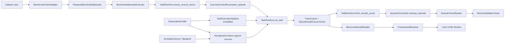

# Benchmark Runtime 迁移架构

当前 benchmark 层已统一复用 `SimulationServer → SimulatorEnvClient →
TaskRuntime`。UAV-Flow 和 AerialVLN 不再实现自己的飞行 EnvClient，也不直接
拥有 scene lifecycle。

## 关系图



## Core 边界

`evaluation/benchmarks/core/` 只包含 simulator-neutral 契约：

- `PreparedBenchmarkEpisode`：instruction、map/scene/agent、一个
  `ObservationProfile`、由该 Profile 生成的 `TaskExecutionOptions`、安全
  metadata，以及类型化的 scenario/evaluation payload。
- `BenchmarkEpisodeExecutor`：固定场景准备、Runtime 执行、轨迹冻结、关闭、
  清理、评测顺序。
- `TraceCursor`：在 shutdown 前冻结 actions/poses/observations 的行号。
- `EpisodeTraceReader`：从 `task_initial` observation anchor 开始生成
  action-aligned trajectory。
- `EpisodeAuditCursor`：在 shutdown 前冻结 observation、frame、action、
  pose、message 和 event 的审计边界。
- `BenchmarkAuditReader`：在 async recorder 关闭后读取冻结范围，不读取
  benchmark evaluation truth。
- `FrameAssetResolver`：统一解析 `artifact_path`、frame `path` 和 base64，
  将图片复制到 evaluation case directory。
- `BenchmarkReviewRenderer`：渲染两个 benchmark 共用的评测入口、case
  页面、帧 gallery、动作/消息/事件时间线和 Planner debug。
- `NoopScenarioController`：用于不需要额外布置场景的 benchmark。

evaluation payload 不会写入 Runtime run directory。Runtime 中只保存
`benchmark/episode_planner_safe.json`；goal、reference path、official actions
等 truth 只写入 evaluation case directory。

## 轨迹边界

轨迹的起点是 `task_initial` observation。结束游标在
`finish_reused_scene()` 前冻结，因此自动排除：

- preflight connect/takeoff/hover；
- episode `set_pose`；
- shutdown hover/land；
- benchmark 物体布置。

每个正式 action 优先使用 action result pose；缺失时使用其后的第一条
observation pose。turn/hover 即使位置不变也保留为动作步。所有 sample 都保存
source、tool、action id、timestamp 和 coordinate frame。

HTML 审计使用独立的 `EpisodeAuditCursor`，其边界同样在 shutdown 前冻结。
报告生成发生在 `recorder.close()` 之后，既能读取完整异步日志，也不会把
shutdown hover/land 误算为 Planner 行为。

## UAV-Flow

实现目录：`evaluation/benchmarks/uav_flow/`。

- `adapter.py`：数据集 cm → canonical meter `InitialPose`。
- `scenario.py`：临时特权 UnrealCV 连接，仅创建、放置、隐藏
  `BP_Character_21/22` 并生成 mask label map。
- `trajectory.py`：`unrealcv_world_m` → UAV-Flow 初始局部 cm。
- `metric_suite.py`：输出兼容轨迹并计算既有 nDTW。
- `runner.py`：每 case 独立创建 SimulationServer/Runtime session。

旧 `UavFlowBenchmarkEnvClient`、gym lifecycle、camera capture、`pose_history`
已删除。旧配置键会给出明确迁移错误。新配置使用：

```json
{
  "map_config_path": "configs/maps/unrealcv_actor_control.example.json",
  "map_id": "downtownwest_local_unrealcv",
  "execution_mode": "dry",
  "observation_profile_path": null,
  "headless": true,
  "save_artifacts": false
}
```

`execution_mode`：

- `dry`：in-memory UnrealCV Backend，不连接 UE；
- `attach`：连接已运行的 UE，不启动进程；
- `managed`：由 SimulationServer 按 MapPackage 启动和停止进程。

普通运行要求 `rgb + depth + pose`。STMR 还要求 `segmentation`。
`planner_depth_input` 只控制 depth 是否进入模型 context，不改变 Backend
采集 Profile。

真实引擎 Gate：

```powershell
python evaluation/benchmarks/uav_flow/scripts/run_manual_eval.py `
  --config evaluation/benchmarks/uav_flow/configs/uav_flow_turn_3cases.local `
  --execution-mode managed `
  --classes Turn `
  --limit-per-class 3 `
  --parser-mode model `
  --no-sr-judge `
  --no-visual-diagnostics
```

## AerialVLN

实现目录：`evaluation/benchmarks/aerial_vln/`。

- loader 读取 official episode 字段和 WXYZ start rotation；
- adapter 显式执行 NED ↔ canonical positive-up 转换；
- `scene_map` 显式映射 dataset scene id 到 MapPackage；
- `NoopScenarioController`，不做 benchmark 物体布置；
- 协议固定记录为
  `aerial_vln.uav_agent_native_actions.v2`，表示数据和指标兼容，但控制使用
  UAV-Agent 连续 primitive，不宣称官方离散动作等价；
- 长路线按连续地标 checkpoint 拆分；`land on/in/by X` 表示到达对应目标
  区域并结束 episode，不要求物理接地、AirSim landed 状态或调用
  `uav.land`。

指标包括 DistanceToGoal、Success、OracleSuccess、nDTW、sDTW、PathLength、
StepsTaken 和 `uav_action_steps`。正常 completed episode 增加一个虚拟 STOP
step；异常停止不增加。

真实引擎 Gate：

```powershell
python tests/manual/aerial_vln_real_engine_probe.py `
  --config evaluation/benchmarks/aerial_vln/configs/aerial_vln_eval.example.json `
  --execution-mode attach
```

## TravelUAV

实现目录：`evaluation/benchmarks/travel_uav/`。

- 官方逐帧 split 先转换为可移植的 compact episode index；
- Adapter 显式执行 AirSim NED、XYZW quaternion 到 Runtime canonical pose 的
  转换；
- `TravelUavScenarioController` 通过当前 scene endpoint 布置并 readback 验证
  动态目标；
- 复用现有 remote SSH、tunnel、managed process ownership、TaskRuntime 与
  Benchmark Core，不维护第二套 EnvClient、Backend 或远端控制；
- 协议固定记录为
  `travel_uav.flyagent_native_actions.front_view.no_assistant.v1`。

该协议使用前视 RGB/depth/pose、FlyAgent native actions，并且不使用官方
L1/L2/L3 assistant。它是 TravelUAV 数据和环境上的 transfer evaluation，不
宣称与官方五视角 assistant-guided leaderboard 协议等价。指标包括 NE、
Success、OracleSuccess、SPL 和 PathLength；target position、reference path 与
spawn pose 始终留在 evaluation payload，不进入 Planner context。
