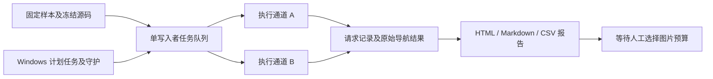

# 图片预算实验：第一阶段

固定使用 AerialVLN-S 和 TravelUAV 各 100 例，测试总图片预算 10、20、30 张，共 600 个配置结果。所有组关闭历史压缩，保留知识与可选计划、像素深度和任务内地点记忆。RGB、最新地图及工具证据共同占用总预算，实际图片数量可以低于预算。证据上限 4 张、近期非当前观察 3 张等其他参数保持一致。

## 样本与执行

- AerialVLN-S：seen/unseen 各 50；各划分困难 35、中等 15；8 个通过原始指令与目标/参考路径核验的历史成功锚点占用对应配额。剩余样本按场景比例、随机种子 42 填充。
- TravelUAV：6 个核验过的历史成功锚点，加 94 个随机样本；先分配 split × 官方 easy/hard 的比例配额，锚点占用所在配额。easy ≤250 m，hard >250 m。
- 该子集用于参数比较，包含定向选定的成功锚点与困难任务，不能当作全数据集均匀随机采样的性能估计。
- 三组任务 ID 完全相同；冻结当前工作目录实际代码、提示词、知识、插件和参数的 SHA256。历史结果仅用于锚点选择，不复用为当前图片预算分数。
- 两路独立 Runtime、任务状态和远端场景，远端 GPU 0/2 与独立端口；严格保持两个 worker。按 10、20、30 张预算依次运行，每档完成 AerialVLN-S 和 TravelUAV 各 100 个有效结果后才进入下一档；技术错误重试也在当前档处理。每档先检查两个数据集各 2 例，共 4 次，三档合计 12 次；检查通过后纳入正式结果并继续本档，SR 不作为技术门槛。
- 从交错调度切换时，正在运行的两例正常结束，已完成的其他预算结果保留，不重复执行。切换只更新独立实验控制器；原始样本、冻结导航源码及主指标口径保持一致。各预算按时间顺序执行，报告保留请求时延和开始/结束时间，便于检查服务状态随时间的变化。



## 指标口径

只保留每个配置任务的首次有效执行。基础设施失败尝试进入重试审计；正常完成但导航失败、正常阻塞报告等仍保留，成功指示为 0。缺失有效结果时报告覆盖不足，正式分母不缩小。

AerialVLN-S 使用现有评估器：正常完成且最终 XY 距离 ≤20 m 时成功；SR=100×成功数/100。DTW 对预测与参考的三维位置计算；nDTW=exp(−DTW/(20×参考点数))；报告展示 nDTW (%)=100×所有有效任务的 nDTW 均值，导航失败也贡献其路径分数。逐例 CSV 的 `ndtw` 保留 0–1 原始值，汇总与 HTML 转为百分比；缺失值不当作零。

两类数据集均标记有效任务的结束距离 ≤25 m（含边界）：AerialVLN-S 使用最终 XY 距离 `distance_to_goal`，TravelUAV 使用最终三维距离 `navigation_error`。`per_case.csv` 包含 `final_distance_m`、`within_25m`，HTML 提供高亮及筛选，阶段统计提供标记数和距离覆盖数。此标记不改变 20 m 的 SR 判定；错误尝试及缺失距离不标记，不使用途中最小距离。

TravelUAV 使用现有评估器：正常完成且最终三维距离 ≤20 m 时成功；SR=100×成功数/100。NE 是全部 100 个有效任务最终三维目标距离的均值，包含导航失败任务。

输入/输出 token（千/任务）=首次有效执行内有效模型响应的对应 provider usage 之和/200/1000；有效 LLM 调用（次/任务）=有效响应数/200。缓存输入包含在输入总量中，另列缓存计数。缺失 usage 保留缺失标记，不补零，也不用上下文估计代替真实 token。第一阶段摘要调用为 0。

决策时延（秒/请求）=Σ最终成功传输尝试的 `elapsed_seconds` / 有效决策请求数。采用逐请求汇总，不能先平均各任务时延。时间包含网络传输、服务端排队、生成和 SDK 返回；不含失败尝试、退避等待、工具/感知、场景启动、上下文组装或摘要。例：请求一失败 3 秒、等待 1 秒、成功 5 秒，请求二成功 7 秒，则主表时延为 (5+7)/2=6 秒。并行时也逐请求计时，不能用实验总墙钟时间除以调用数。

无效响应和失败任务尝试的已知 token、请求次数、耗时、失败传输与等待独立保存在审计输出中。主表反映约定的有效执行成本，不等同于实际全部付费支出。未报告 usage 的失败请求费用不可恢复。

## 启动、报告和守护

工作目录中的实验入口已接到公共并行引擎；数据集执行分别由 AerialVLN/TravelUAV 适配层负责，具体职责和独立测试命令见 [公共并行评测](shared_campaign.md)。正在运行的既有实验继续使用其已冻结的控制器。

所有本地项目命令使用 `F:\conda_env\flyagent\python.exe`。当前有效实验输出：`G:\FlyAgent-Eval\image_budget_200_20261013_v2`。首次启动的轻量记录配置未保留完整请求，已停止且排除，其记录另存于 `excluded_startup_audit.json`；两个原场景已验证清理。v2 使用同一固定样本，从原始起点重新执行并开启完整审计。

2026-10-13 在 9 个有效结果时迁移到 G 盘，迁移前后 4,264 个文件的 SHA256 一致。H 盘原实验路径通过目录联接指向 G 盘，以保留冻结配置和历史审计中的绝对引用；H 盘保留迁移前备份，原始 manifest、任务进度及模型导航源码不改写。新增任务、临时缓存和守护日志写入 G 盘，Windows 计划任务也从 G 盘启动。迁移记录见 `storage_migration.json`。

```powershell
& 'F:\conda_env\flyagent\python.exe' -m evaluation.experiments.image_budget prepare --output 'H:\FlyAgent-Eval\image_budget_200_NEW_TIMESTAMP'
& 'F:\conda_env\flyagent\python.exe' -m evaluation.experiments.image_budget preflight --output 'H:\FlyAgent-Eval\image_budget_200_NEW_TIMESTAMP'
& '.\tests\manual\install_aerial_vln_watchdog.ps1' -OutputRoot 'H:\FlyAgent-Eval\image_budget_200_NEW_TIMESTAMP' -Workers 2
& 'F:\conda_env\flyagent\python.exe' -m evaluation.experiments.image_budget report --output 'G:\FlyAgent-Eval\image_budget_200_20261013_v2'
```

Windows 当前用户计划任务在登录及每 5 分钟启动隐藏守护；文件锁防重复。守护按 30/120/300/900/1800 秒退避，控制器恢复前验证进程身份和所属场景清理。不会终止其他实验；不会将两路降为一路。手动 `PAUSE` 不自动清除；移除后写入 `parallel/watchdog/RESUME` 才恢复手动暂停。

技术试运行后的空间检查不足会暂停为 `pilot_storage_budget`，这属于容量等待而非技术检查失败。守护保持原有空间预测和安全余量，在 `waiting_for_storage` 状态检查实际可用空间，并把读数保存到 `parallel/watchdog/storage_wait.json`；空间达到要求后自动启动控制器，由控制器重新核验存储及场景清理再调度两路任务。等待空间时不重复启动模型，也不修改任务进度。

已有交错调度实验可用 `F:\conda_env\flyagent\python.exe tests/manual/image_budget_order_handoff.py --output H:\FlyAgent-Eval\image_budget_200_20261013_v2` 切换。该人工运维入口仅挂起旧队列调度器，让独立执行主机完成当前两例，同时启动能识别切换状态的新守护；随后由旧控制器提交结果并验证场景清理，再接续按预算顺序运行的新控制器。守护通过 PID、创建时间和命令核对切换进程，不将有意挂起的旧控制器判为卡死；切换进程异常退出时保留暂停并报告错误。切换状态保存在 `parallel/scheduling_handoff/status.json`。

报告输出为 `report.html`、`report.md`、`paper_table.html`、`metrics.json`、`per_case.csv`、`per_request.csv`、`attempt_audit.csv`。逐任务链接包含完整轨迹、公开文字、工具结果、实际请求图片和地点地图；原始记录不改写。完成时状态为 `awaiting_image_budget_choice`，计划任务自动禁用，等待用户选择图片预算。

当前采用与全量 AerialVLN-S 相同的轻量日志思路：RGB 与地图引用原始媒体树，不复制图片与深度缓存；帧记录不重复写入已有文件的 base64。每次请求另存小型 `debug/model_call_metrics` 记录，包含 usage、传输计时、公开决策、真实图片引用、选择规则及校准后的上下文估计，不保存每轮完整历史请求。该记录方式通过单独校验的日志适配器应用，冻结的模型、提示词、工具、上下文预算和导航逻辑保持一致。已完成的两个完整审计结果继续保留，后续空间预测只使用新日志方式的实测大小。

失败请求的旧记录可能把重试列表写成次数整数。统计读取保留其次数，并明确标记丢失的逐尝试明细，不能从总耗时反推成功尝试时间。报告错误单独标记为待修复，不中断任务队列；报告与日志修复的独立源码哈希保存在 `parallel/report_repair.json` 及执行扩展中。`repair-reporting` 仅在所属控制器与执行主机已停止时运行，不替换已经开始实验的冻结导航源码。

## 下一阶段的预备数据

关闭压缩时仍逐请求记录和校准上下文估计；任务峰值来自该组完整未压缩执行。缺失估计证据时保守重跑。选定图片预算后，L<24k 可复用无压缩结果；24k≤L<40k 仅重跑 32k；L≥40k 重跑 32k/48k。依据为预取阈值而非启用阈值，因为预取已产生摘要成本。32k/48k 的预取分别为 24k/40k、目标均 16k；该阶段需要另行启动。
