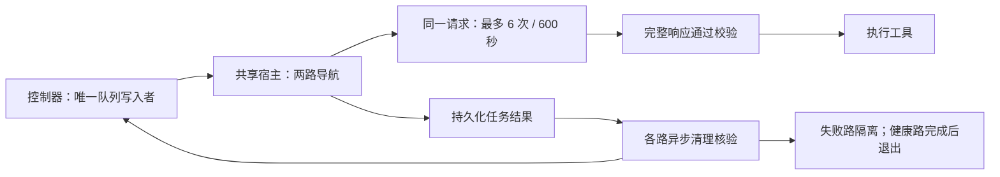

# 评测传输恢复与路级清理

## Windows 无窗口启动

`tests/manual/install_campaign_watchdog.ps1` 编译同目录的
`campaign_windowless_launcher.cs` 为 Windows GUI 子系统程序，计划任务直接启动它。
启动器使用 `UseShellExecute=false`、`CreateNoWindow=true` 启动固定的
`F:\conda_env\flyagent\python.exe`，不改变 Python 环境。标准输入关闭，输出和错误写入
`parallel/watchdog/launcher_logs/`；启动器异常写入 `launcher_error.log`，不弹对话框。
它等待 Python 退出并传递退出码，重试、单实例锁、恢复与调度仍由原 Python 守护负责。
完成状态直接返回，五分钟触发不会启动新的实验。安装时保留原计划任务 XML 备份。

SSH、SCP 和本地转发隧道也必须显式设置 Windows `CREATE_NO_WINDOW`，不能把重定向
stdout/stderr 当作无窗口保证。远端 Linux 场景启动不受影响。
既有实验通过 `tests/manual/install_windowless_revision.py --output ROOT` 从当前执行快照
生成仅修改 SSH/隧道进程标志的候选，再由 `recovery_revision_handoff.py` 等待当前租约结束
和清理后激活；禁止覆盖正在运行的冻结源。测试见 `tests/test_campaign_windowless_launcher.py`。

恢复由三层负责：`src/llm` 处理同一逻辑请求的传输重试；SimulationServer 处理远端场景身份、文件上传和安全 SSH 操作；公共评测控制器负责清理核验、队列及指标。恢复不会重放已经执行的飞行动作，也不会改变提示词、观测选择、样本和评分规则。



## 请求恢复

实验通过调用者作用域 `recovery_scope(RecoveryPolicy(...))` 启用策略，不改变模型参数。连接、读取、限流和明确的临时 SSE 服务错误共享六次 HTTP 尝试上限；退避为 5、15、30、60、60 秒，增加 ±20% 抖动。有合法 HTTP `Retry-After` 时优先使用，等待始终受总期限限制。认证、配置和无法识别的服务错误不按临时故障无限重试。

监控线程每五秒输出等待状态，并在截止或取消时关闭请求。迟到的返回值不会交给导航循环。600 秒耗尽意味着当前任务尝试失败，可进入原有任务补跑队列；它不授予新的任务尝试额度。任务仍使用原三次上限和已有单任务追加授权。

`attempts` 始终是逐次明细列表，`attempt_count` / `error_attempt_count` 是次数。记录请求 ID、异常链类型、响应头、首/末数据块时间、字节数、失败耗时、退避及取消原因。缺失阶段保留未知。响应头和首块等待包含服务端排队与生成，不能称为“纯网络延迟”。

## SSH 与清理

安全操作最多三次尝试，间隔 2、5 秒，单操作总预算 100 秒；认证和主机密钥错误直接报告。上传写入临时路径、校验 SHA-256 后原子替换；重复提交必须匹配同一内容。远端启动使用场景锁，复用已启动进程必须匹配登记身份与包含 settings 内容的配置摘要，状态不明时拒绝重复启动。

清理在线程池中进行，但队列仍只由控制器主线程写入。等待清理的路保留租约和端口，核验预算为 120 秒，SSH 操作共享剩余清理期限。未核验的路不会再次派发任务；健康路可以完成。清理记录写入 `cleanup_history.jsonl`，首次失败和最终核验均保留。

旧隧道 PID 被系统复用时，不操作新进程；仍须独立证明本地端口关闭、远端进程组停止及远端端口不可达，才能释放该路。

旧运行时会把 AirSim RPC 超时包装为 `SceneRecoveryRequired`，丢失原异常类型。队列兼容识别适配器生成的明确诊断 `AirSim freeze failed: Request timed out`：只在该尝试清理核验通过后进入原有补跑队列。未知场景控制故障、显式不可重试错误及清理未完成的回执仍不自动恢复；不会在故障场景内重放飞行动作。已暂停的历史回执使用同一分类供守护判断，无需改写原始错误或增加重试额度。

## 冻结接入与审计

使用指定解释器执行：

```powershell
& 'F:\conda_env\flyagent\python.exe' -X utf8 tests/manual/install_recovery_revision.py --output G:/FlyAgent-Eval/image_budget_200_20261013_v2
```

先生成候选配置及 `recovery.patch`。新源从原冻结 `source/` 复制，只替换工具中列明的恢复文件；其余文件逐一验证原哈希。原源保持不变。停止状态可加 `--activate`；运行中用 `recovery_revision_handoff.py --output ROOT --candidate PATH` 等待已有租约结束再交接。启动时校验新源哈希并在宿主就绪前检查模块加载路径。Windows 使用原隐藏守护与五分钟计划任务。

历史迁移只识别明确的旧 `model provider SSE error:` 前缀，不把普通 `ValueError` 视为临时服务错误。撤销技术错误的有效标记，保留原始回执；正常导航失败保留。迁移重复执行不再改写队列。每次部署备份队列与执行配置。

报告的正式成本口径保持不变：只纳入有效任务中的有效请求；传输重试成功仅算一次调用。决策时延为最终成功 HTTP 尝试耗时总和除以有效决策请求数，排除失败尝试、退避、工具、场景启动及摘要。失败尝试与退避单独审计，不将缺失 usage 视为零费用。

各任务尝试和逐请求报告保留 `recovery_revision`。本实验保留旧有效结果，恢复条件在中途更新，因此不能描述为全部采用完全相同的执行条件。

## 验证与现场状态

离线测试位于 `tests/test_transport_recovery.py`，覆盖同一请求恢复、统一次数上限、截止与取消、身份不匹配拒绝接管、两路清理隔离、旧 SSE 分类和迁移幂等性。控制器的新版本准入门只允许当前阶段的两例先行；这两例有效完成且清理通过后，才放行其余固定样本。

首次部署曾因控制器重新生成 overlay 覆盖新源路径，产生两次导航前导入失败。该路径已修复，错误回执保留；通过独立端口核验后排入补跑，不计入导航和成本，也没有增加任务尝试额度。审计工具为 `tests/manual/audit_bootstrap_failure.py`，其识别范围限定在这次已核实的启动错误。
