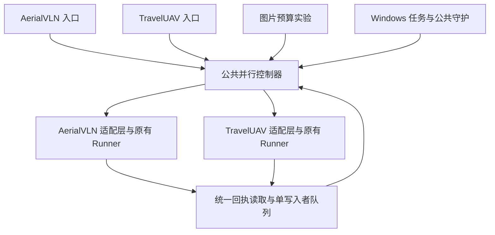

# 公共并行评测

任务默认最多三次尝试。用户明确要求继续已耗尽的任务时，操作员须先确认控制器及执行宿主停止、队列锁已持有、历史尝试全部无效且清理已核验，再调用 `authorize_extra_attempt`，仅为该任务增加一次额度。授权原因、时间与前后额度写入 `retry_authorizations`，原始尝试、编号和结果全部保留。新增额度通过 `attempt_limit` 持久化，重启后仍有效；本次追加失败后再次进入耗尽状态，不自动无限重试。先备份队列，并使用显式 RESUME 恢复守护。

AerialVLN 与 TravelUAV 共用 `evaluation/benchmarks/core/campaign/` 的任务队列、两路控制器和守护。各数据集的 `campaign_adapter.py` 负责配置校验、样本加载、原始指令与真值摘要核验，并调用原有 Runner；指标定义和场景生命周期继续由现有评测器与 SimulationServer 管理。



## 文件职责

| 文件 | 职责 |
| --- | --- |
| `core/campaign/contracts.py` | 任务身份、配置定位、适配层协议 |
| `core/campaign/recovery.py` | 任务认领、首次有效结果、错误分类和延期重试 |
| `core/campaign/parallel.py` | 两路主机、独立配置、GPU/端口隔离、清理核验和技术检查 |
| `core/campaign/watchdog.py` | 进程监督、持久退避、容量等待、手动暂停与显式恢复 |
| `core/campaign/prepare.py` | 独立数据集任务准备、冻结配置与源码、离线校验 |
| `core/campaign/support.py` | 公共环境诊断、锁、目录与源码冻结工具 |
| `core/campaign/reporting.py` | 独立测试覆盖率、指标与逐任务报告索引 |
| `core/campaign/compat.py` | 旧 manifest 的划分、状态、报告和日志约定；不改写历史记录 |
| 各数据集 `campaign_adapter.py` | 选择样本、核验指令/真值并调用数据集 Runner |
| 各数据集 `parallel_campaign.py` | 启动入口；AerialVLN 原入口保留兼容导入 |

## TravelUAV 独立测试

所有 Python 命令显式使用 Conda `flyagent` 解释器。先用实际地图路径和索引配置执行离线校验；该命令不启动场景、不调用模型。

```powershell
& 'F:\conda_env\flyagent\python.exe' -m evaluation.benchmarks.travel_uav.parallel_campaign validate --config 'your_travel_config.json'
```

准备新的实验目录，可重复传入 `--config` 以覆盖三个划分。配置中的 `case_ids`、难度和数量仍由 TravelUAV 配置与选择器控制。准备阶段记录解释器、PyTorch、CUDA 与实际 CUDA 张量诊断；CUDA 不可用时明确失败，禁止切换到其他 Python 环境。

```powershell
& 'F:\conda_env\flyagent\python.exe' -m evaluation.benchmarks.travel_uav.parallel_campaign prepare --config 'seen.json' --config 'unseen_map.json' --config 'unseen_object.json' --output 'G:\FlyAgent-Eval\travel_uav_NEW_RUN'
& 'F:\conda_env\flyagent\python.exe' -m evaluation.benchmarks.travel_uav.parallel_campaign run --output 'G:\FlyAgent-Eval\travel_uav_NEW_RUN' --workers 2
```

独立运行时 `run` 冻结公共控制器与适配层，再从冻结入口执行。后续 `run/watch` 复用已固定的快照，不因工作目录更新自动替换正在评估的代码。每个通道使用独立 Runtime、请求与任务状态；只复用原有受保护的模型资源缓存。Windows 后台启动与子进程都使用指定解释器及隐藏窗口。

```powershell
& '.\tests\manual\install_campaign_watchdog.ps1' -OutputRoot 'G:\FlyAgent-Eval\travel_uav_NEW_RUN' -Workers 2
```

计划任务按登录和每 5 分钟拉起守护，OS 锁防止重复监督与队列写入。手动创建根目录 `PAUSE` 会暂停；删除该标记后创建 `parallel/watchdog/RESUME` 才继续手动暂停。已核验控制器修复可使用该一次性恢复标记；重复程序故障不会进入无限重启。

AerialVLN 可用对应的 `evaluation.benchmarks.aerial_vln.parallel_campaign` 执行相同命令。旧的 `install_aerial_vln_watchdog.ps1` 转发到公共安装器，旧计划任务名称与描述保持兼容。

## 任务、指标与错误

新任务键包含数据集、划分和案例 ID；配置对照增加配置身份。旧 Aerial 的 `split/episode_id` 和已有图片预算的 `dataset/images_N/split/episode_id` 键继续可读。只有控制器可以写 `progress.json`；每个通道必须先提交独占任务记录，再执行。

两种数据集的嵌套和扁平基础设施错误均由公共恢复器解释，原始回执保留。已核验清理的 SSH/RPC 超时延期重试，不影响另一条正常通道；认证、未知错误、清理不明确以及尝试耗尽明确报告。只保留首次有效导航结果；正常导航失败仍计入指标。耗尽的 Provider 请求即使旧 Runner 只写在顶层 `error`，也不会被计为正常导航失败。

独立报告为根目录 `report.html`、`metrics.json` 和 `per_case.csv`，链接到原有逐任务过程页。Aerial 的 SR、SDTW 与 Travel 的 SR、NE 由原有评测器产生；SR/SDTW 以百分比展示，NE 为米。未齐全时标为临时值；缺失指标的正式单元格保持空白并记录覆盖数量。

图片预算实验继续使用专用成本报告，保持错误尝试排除、有效 token/调用统计和逐请求时延口径。配置顺序通过 manifest 的 `scheduling.group_field/group_order` 声明，当前为 10、20、30 张，每档完成有效覆盖后推进。

图片预算实验支持在冻结执行层声明 `dataset_order`，按 10/20/30 张预算，依次完成 AerialVLN-S、TravelUAV 各 100 例。两路同时服务当前数据集，当前阶段存在待重试或尝试耗尽任务时不提前推进。技术检查按预算与数据集保存，各使用原来选定的两例，仍计入正式样本。

已有实验通过 `tests/manual/image_budget_order_handoff.py --output CAMPAIGN --dataset-order aerial_vln travel_uav` 交接：当前任务在原期限内结束并核验清理后，备份队列、审计修正历史技术错误计分、冻结公共控制器并恢复 Windows 守护。原导航源码、样本和 manifest 保持原哈希；原始错误回执保留，只有队列有效性标记经过审计修正。已有有效任务不会重复执行。

导航指标在对应数据集满 100 例时填写，汇总成本在同预算满 200 例时填写。报告每五分钟更新运行状态与最近两小时有效吞吐，新增有效样本不足四例时不显示 ETA。完成时间预测包含错误尝试和停机的实际时间；论文的决策时延、token 和调用次数仍只包含保留的有效任务与有效请求。

按数据集分阶段时，容量检查以当前阶段的剩余任务为准，保持两倍已观测最大留存量、两路临时峰值和至少 10 GiB 空闲要求；阶段转换和周期检查重新评估。`storage_check.json` 同时保留整个实验的容量预测，后续阶段空间不足时等待空间，不提前派发。
