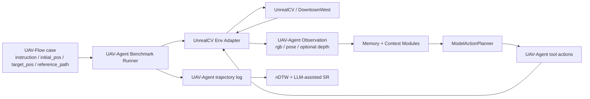

# UAV-Flow 外部 Benchmark 评估需求

## 1. 定位

UAV-Flow 在本项目中定位为外部 benchmark，而不是运行时 integration。

它提供的是：

- Flow-style 指令集合。
- UnrealCV / DowntownWest 场景资源参考。
- 初始位姿、目标对象、参考轨迹。
- nDTW 与 SR 评估口径。

它不提供的是：

- UAV-Agent 的主运行循环。
- UAV-Agent 的动作协议。
- UAV-Agent 的停止条件。
- UAV-Agent 的 planner 输入输出格式。

核心原则：

> 用 UAV-Flow 的任务和指标测试 UAV-Agent，但不让 UAV-Flow 的 runner 或 `/predict` 协议反向定义 UAV-Agent 架构。

## 2. 背景与目标

UAV-Flow 论文中的 Flow task 关注短程、细粒度、语言引导 UAV 控制。它更接近“基于当前视觉和状态完成一句原子指令”，而不是传统长程 VLN。

简明任务要点：

- 输入：自然语言 instruction、当前视觉观测、UAV 6-DoF state。
- 输出：低层 UAV action sequence。
- 任务类型：primitive motion 与 object-interactive commands。
- 评估：closed-loop simulation，主要看 SR 和 nDTW。

本项目接入 UAV-Flow 的目标：

- 复用 UAV-Flow 的任务定义、指令、初始位姿、目标位姿、参考轨迹和评估口径。
- 使用 UAV-Agent 自己的 observation、context、planner、tool action 和停止条件跑闭环。
- 评估 UAV-Agent 在 Flow-style 指令上的视觉理解、动作执行和轨迹质量。
- 把评估逻辑放在 `evaluation/benchmarks/uav_flow/`，不混入 `src/` 主运行链路。

## 3. 职责边界

| 部分 | 职责 |
|---|---|
| UAV-Flow 资源 | 提供 `test_jsons/*.json`、`classified_instr.json`、DowntownWest/UnrealCV 场景参考、`reference_path_preprocessed` 和 nDTW 口径 |
| UAV-Agent eval runner | 读取 benchmark case，初始化 UnrealCV 场景，启动 UAV-Agent 原生闭环，保存轨迹和评估输入 |
| UAV-Agent runtime | 使用自己的 observation、context、planner、tool action、phase transition、AgentMessage 和停止条件 |
| benchmark evaluator | 对齐 UAV-Agent 轨迹与 UAV-Flow reference path，计算 nDTW，生成 LLM-assisted SR 报告 |
| UAV-Flow 原始 runner | 只作为参考实现和数据格式参考，不作为本项目控制 loop |

边界原则：

- UAV-Flow 的任务和参考轨迹是 benchmark source，不是 runtime ownership。
- UAV-Agent 的输入输出格式以本项目现有架构为准。
- UnrealCV 可以采集 UAV-Agent 需要的 RGB、pose、后续 depth 或 mask，但采集结果必须转成 UAV-Agent observation。
- `target_pos` 和 `reference_path_preprocessed` 只能用于评估，不能进入 planner context。
- benchmark 输出和 UAV-Agent run artifacts 分开保存。

## 4. 不采用 `/predict` Policy Server

UAV-Flow 原始 `batch_run_act_all.py` 是“环境 loop + HTTP policy”模式：runner 采集 `image/proprio/instr`，请求 `/predict`，拿到 `action_tokens` 后执行动作，并用 progress 或 near-zero action 判断停止。

本项目不采用这个方向，原因是：

- UAV-Agent 已经有自己的 `TaskRuntime` 闭环，包括 planner、contract validator、safety、automatic observation、phase transition judge 和 AgentMessage。
- UAV-Agent planner 输出的是 `uav.move_body`、`uav.turn_relative`、`uav.hover` 等 tool action，不是 UAV-Flow 的 4 维 action token。
- UAV-Agent 的停止条件应由 phase transition、window limit、safety 和 final AgentMessage 决定。
- 如果强行兼容 `/predict`，benchmark 协议会污染主架构，评估结果也难以解释。

明确结论：

- 当前不增加 HTTP policy server。
- 后续也不以 UAV-Flow 原始 `/predict` policy 协议作为目标。
- 当前和后续都不要求输出 UAV-Flow `action_tokens`。

## 5. 数据流



每个 case 的概念流程：

1. 读取 UAV-Flow task JSON。
2. 提取 `instruction` 或 `instruction_unified`。
3. 使用 `initial_pos` 初始化 UnrealCV 场景中的 UAV/camera。
4. 如 task 包含 `obj_id/use_obj/target_pos`，按 benchmark 语义放置目标对象。
5. 采集 RGB 和 pose，转成 UAV-Agent observation。
6. 默认 image module 将最近 RGB 作为 `model_inputs[type=image]` 传给 planner。
7. UAV-Agent 按自己的 runtime loop 输出并执行 tool action。
8. 保存 trajectory、run artifacts、planner context、动作和 AgentMessage。
9. 用 `reference_path_preprocessed` 计算 nDTW。
10. 用 LLM-assisted SR judge 判断语义成功，并保留人工复核字段。

## 6. 输入输出协议

### 输入按 UAV-Agent

UAV-Flow 的 `image/proprio` 只作为数据来源参考，不作为本项目接口标准。benchmark runner 需要将 UnrealCV 采集结果转成 UAV-Agent observation。

第一版目标 observation：

```json
{
  "modalities": ["rgb", "pose"],
  "frames": {
    "rgb": {"path": "..."}
  },
  "pose": {
    "x": 0.0,
    "y": 0.0,
    "z": -2.0,
    "yaw_deg": 0.0
  },
  "source": "uav_flow_benchmark"
}
```

第一版只要求 RGB + pose 跑通；depth、mask、object metadata 是后续增强。

### 输出按 UAV-Agent

动作仍使用 UAV-Agent tool 协议：

```json
{
  "tool": "uav.move_body",
  "args": {
    "direction": "forward",
    "duration": 1.5
  }
}
```

或：

```json
{
  "tool": "uav.turn_relative",
  "args": {
    "yaw_deg": 15
  }
}
```

### 停止条件按 UAV-Agent

停止条件使用 UAV-Agent 当前机制：

- phase transition judge 输出 `complete_task`。
- phase window limit 触发 loop guard。
- safety hover 或其他 safety intervention 中止继续推进。
- final AgentMessage 记录最终结果。
- runtime shutdown policy 负责收尾。

UAV-Flow 的 near-zero action、progress、done 逻辑只作为论文和原始实现背景，不作为本项目停止条件。

## 7. 坐标、单位与地图兼容

UAV-Flow-Sim 使用 UnrealCV/UE 环境，task JSON 中的位姿、目标和参考轨迹有自己的单位与坐标约定。benchmark runner 必须显式记录转换。

需求层约束：

- `initial_pos` 用于初始化 UnrealCV 中的 UAV/camera 位置与朝向。
- `target_pos` 用于对象放置、SR judge 和评估解释，不直接作为 planner 可见的导航捷径。
- `reference_path_preprocessed` 用于 nDTW 评估，不进入 planner context。
- UAV-Agent 内部 pose 保持项目自己的 model-facing 格式。
- UE/UnrealCV 坐标、UAV-Agent pose、UAV-Flow reference path 之间的单位转换必须写入评估 metadata。
- yaw 正负方向、body-frame/world-frame 的转换必须在实现文档中写清楚，不允许靠隐式假设。

## 8. 指标与成功率定义

第一版报告两类指标：

- `nDTW`：参考 UAV-Flow `metric.py` 的轨迹相似度计算方式，对比 UAV-Agent 轨迹与 `reference_path_preprocessed`。
- `llm_success_rate`：LLM 辅助语义成功率，用 instruction、预测轨迹、目标信息、2D/3D 图进行判定。

关键声明：

> UAV-Flow 论文里的 SR 主要依赖人工语义检查；本项目第一版报告的是 LLM-assisted SR，需要保留人工复核字段，不能直接声称等同论文 SR。

LLM SR 输出建议字段：

```json
{
  "case_id": "...",
  "class": "Approach",
  "instruction": "...",
  "success": true,
  "confidence": "high|medium|low",
  "reason": "...",
  "failure_type": "wrong_direction|missed_target|overshoot|early_stop|unsafe_or_invalid|unknown",
  "needs_human_review": false
}
```

SR judge 的输出必须可追溯到证据：原始 instruction、目标信息、UAV-Agent 轨迹、参考轨迹、2D/3D 图和判定理由都应保留。

## 9. 运行模式

计划中的运行模式：

- 小样本 smoke：每类 1-2 条，检查 UnrealCV 初始化、observation、动作执行、停止条件和轨迹保存。
- 分类评估：按 `classified_instr.json` 分组，分别统计 Turn、Move、Shift、Approach、Land 等类别。
- 全量评估：完整 `test_jsons`。

输出建议：

- benchmark 汇总输出放在 `evaluation/benchmarks/uav_flow/outputs/`。
- 临时手动诊断输出可以放在 `tests/manual_outputs/uav_flow_eval/`。
- UAV-Agent 原始 run artifacts 仍保留在 `runs/<run_id>/...`。
- UAV-Flow 原始结果目录可作为对照来源，但第一版不依赖其 runner 输出。

## 10. 验收标准

需求验收点：

- 能读取 UAV-Flow `test_jsons/*.json` 并生成 UAV-Agent eval case。
- 能用 `initial_pos` 初始化 UnrealCV 场景中的 UAV/camera。
- 能把 UnrealCV 当前帧转成 UAV-Agent observation，并让默认 image module 送入 planner 多模态输入。
- UAV-Agent 能按自己的 tool action 与停止条件完成至少一个小样本 case。
- UAV-Agent 侧能保存每步 image/pose/instruction/planner output/action/result。
- 至少一个小样本 case 能生成 UAV-Agent trajectory json、2D/3D 图、nDTW 和 LLM SR judge。
- 报告中明确区分 nDTW、LLM SR、人工复核状态。
- `reference_path_preprocessed` 和 `target_pos` 不进入 planner context，只用于评估。

## Assumptions

- 本文档只确定需求和边界，不写具体代码实现。
- 论文背景只做简明引用，不写成长篇论文笔记。
- UAV-Flow 第一版作为 benchmark task/eval source 使用，不并入主 runtime scene ownership。
- 输入、输出和停止条件均以 UAV-Agent 当前架构为准。
- 实现细节见 `unrealcv_compatibility_plan.md`。
