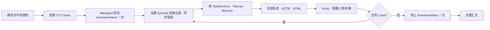

# UAV-Flow 人工测试

## 1. 本地 MapPackage

真实 UAV-Flow 使用本地 DowntownWest。不要把机器相关的绝对路径提交到公共示例
配置；创建被 git 忽略的 `.local` MapPackage，并确认：

- `scene_id=DowntownWest`；
- `control.protocol=unrealcv`；
- actor 为 `BP_Drone01_2`；
- `units_per_meter=100`；
- `landed_origin_z_m=0.35`，用于 DowntownWest 当前局部落地区域的可选 AGL；
- `yaw_offset_deg=-180`；
- `camera_follow=standard_pose`；
- `startup.hide_objects`包含`BP_Drone01_2`，只隐藏自机 mesh，Actor 仍负责真实位姿和
  动作；这样 Planner 的 RGB/Depth overlay 保持第一视角；
- `camera_validation.enabled=true`，`position_mode=max_distance`，
  camera/Actor 最大距离 `1.5m`、yaw 容差 `1°`；
- UnrealCV 监听 `127.0.0.1:9068`。

正式评测前应先运行底层 Probe，并同时使用`--require-visual`和
`--require-first-person`。后者会按受控 Actor 的 object-mask 颜色检查初始、转向、
移动和恢复帧，防止配置遗漏导致自机偶尔进入视野。该检查只验证部署，不读取 case
目标或评测真值。已经落盘的历史图片不会被配置更新追溯修改。

Land 回归前可以额外传入`--descend-m 0.10`。Backend 通过现有 Pose 返回可选
`agl_m`，不新增 EnvClient 调用；模型侧只看到该离地净空，不看到绝对世界
`x/y/z/yaw`。历史批次不会补算 AGL，也不会被追溯改写。

2026-08-20 的真实闭环中，四个阶段的自机 mask 像素数均为 0；随后 UAV-Flow canary
`uav_flow_first_person_canary_20260820`完成 1 个真实 Turn case，Planner 请求使用当前
RGB/Depth overlay（深度不可用时才回退当前 raw RGB），抽查首帧、中间帧和末帧均未出现无人机机身。

## 2. 正式真实评测

真实人工验收只调用正式 Runner，不使用静态 Parser、固定 Planner 或预设动作：

```powershell
python evaluation/benchmarks/uav_flow/scripts/run_manual_eval.py `
  --config evaluation/benchmarks/uav_flow/configs/uav_flow_turn_3cases.local `
  --execution-mode managed `
  --case-ids 2025-03-30_11-49-14,2025-03-30_11-49-27,2025-03-30_11-52-45 `
  --eval-id uav_flow_turn_local_real_3cases `
  --parser-mode model `
  --planner-depth-input off `
  --stmr-mode off `
  --no-sr-judge `
  --no-visual-diagnostics
```

前三个 Turn case 是：

1. `2025-03-30_11-49-14`；
2. `2025-03-30_11-49-27`；
3. `2025-03-30_11-52-45`。

每个 case 仍使用独立的 TaskRuntime、Planner、Memory 和 run directory，但同一批次、
同一 `map_id + scene_id` 只启动一次 DowntownWest。UE 进程和 SceneInstance 在 case
之间复用，避免重复启动地图；真实 HTML 运行自动启用 RGB artifact 和 Planner debug。
检查：

```text
outputs/<eval_id>/review.html
outputs/<eval_id>/scene_session.json
outputs/<eval_id>/cases/<case_id>/case.json
outputs/<eval_id>/cases/<case_id>/review.html
outputs/<eval_id>/cases/<case_id>/audit.json
outputs/<eval_id>/cases/<case_id>/turn_diagnostics.json
```

Turn diagnostics 包含 reference/actual yaw delta、最终 yaw 误差、平移漂移和初始
姿态误差。HTML gallery 只展示 RGB；Depth 仍保存在 `audit.json` 和审计资产中。
不再生成 case 级 Markdown review；`case.json` 只保存 Core HTML 路径和紧凑的
`audit_summary`。

`case_ids` 是运行选择，不是环境校准。同一 DowntownWest 下更换案例只需替换 ID，
不修改 MapPackage。新运行通过 `physical_window_v2` 显式记录每批动作的 ordered
steps 和 before/after observation。`backend_action_tracking.json` 按窗口组合 turn、
move 和 hover 后再与唯一的批后观测比较；模型没有成功执行 move/turn 就完成时标记为
`zero_motion_completion`。旧运行缺少该 schema 时显示
`unsupported_legacy_trace_schema`，不得使用时间戳猜测或通过严格 Campaign 审计。

## 3. 273 Case 全量配置

`uav_flow_all_actions.local` 只包含 12 个代表性案例，用于覆盖 10 个动作类别；它不
是全量数据配置。本机全量配置为：

```text
evaluation/benchmarks/uav_flow/configs/uav_flow_full_273.local
```

全量数据共有 273 个唯一 case：

| 类别 | 数量 |
|---|---:|
| Turn | 15 |
| Move | 15 |
| Shift | 49 |
| Rotate | 15 |
| Surround | 12 |
| Ascend/Descend | 19 |
| Approach | 42 |
| Retreat | 12 |
| Pass | 40 |
| Land | 54 |

本轮配置使用 `managed`、模型 Parser、Planner NOW depth、每个语义 phase 最多 80
个规划窗口，并关闭额外 SR judge、逐帧 visual diagnostics 和 STMR。真实 HTML 审计
要求 `save_artifacts=true` 和 `enable_action_planner_debug=true`，manual runner 会继续
保证这两个条件。

```powershell
python evaluation/benchmarks/uav_flow/scripts/run_manual_eval.py `
  --config evaluation/benchmarks/uav_flow/configs/uav_flow_full_273.local `
  --all-cases `
  --execution-mode managed `
  --planner-depth-input now `
  --runtime-loop-guard-windows 80 `
  --stmr-mode off `
  --no-sr-judge `
  --no-visual-diagnostics `
  --eval-id uav_flow_full_273_depth_now_loop80_20260817
```

`--all-cases` 会显式清空 `case_ids`、`classes`、`limit_per_class` 和 `max_cases`，避免
基础配置中的 smoke selector 静默截断全量运行。其他未提供的 CLI 参数保持配置文件
中的值，不再由 manual script 的另一套默认值覆盖。

当前 Runner 按 case 顺序执行，并在普通 case 异常后继续下一个 case，但没有自动
checkpoint/resume。终止整个 Python 进程后，需要人工选择尚未完成的 case 重新运行；
不要复用同一个 `eval-id` 假装获得一份原子完成的全量结果。



### 批次场景生命周期

Runner 在调用 TaskParser 前就应用 planner-safe 的 episode 初始位姿，并进行一次相机
同步与 warm-up。该 warm-up 不写入正式 Runtime recorder，不计入 Agent 动作、轨迹或
nDTW。TaskRuntime 随后按 `connect → capability-aware takeoff → set_pose → hover →
first observation`完成有审计记录的初始化，因此不会先在地图默认位置 hover、再跳到
case 初始位置。

case 完成后只冻结正式轨迹、执行安全 hover、隐藏受控人物/车辆并释放 UnrealCV
protocol client，不关闭 UE。人物、车辆的物理、外观、mask color 和位置在下一 case
重新设置；每个 case 的 Agent Memory 仍完全独立。

`scene_session.json`记录 `start_count`、`restart_count`、`stop_count`、SceneInstance 和
生命周期事件。正常同地图批次应满足：

```text
start_count   = 1
restart_count = 0
stop_count    = 1
```

相机跟随、Actor pose 或 UnrealCV 连接失败时，Runner 先重新同步并重跑当前 case
一次；仍失败才重启 UE 并再重跑一次。TaskParser、Planner、DashScope、SSL/HTTP 等
模型网络错误不会触发 UE 重启。`Ctrl+C`、报告异常或正常结束都由批次外层 `finally`
清理本次拥有的 UE。

## 4. Planner RGB 与深度融合

`planner_depth_input=now` 不改变 UnrealCV Backend 的采集格式，也不覆盖原始 RGB：

1. Backend 分别保存 RGB PNG 与米制 Depth NPY。
2. Context Builder 只匹配同一个 `observation_id` 的当前 RGB 和 Depth。
3. 两者尺寸不一致时拒绝构造 overlay，不缩放深度来制造伪对齐。
4. 有效深度使用固定 `0–10m` 色标，以 `42%` 透明度叠加；无效深度像素保留原 RGB。
5. 生成的无顶部标题、带底部米制色条 PNG 替代模型附件中的当前原始 RGB；原始 artifact
   仍保持不变。

Planner 图片按 observation 时间排列，每张只发送一次：旧图为 `HISTORY`，最新图为
`CURRENT`。每张有合法 Depth 时使用融合图，否则回退 raw RGB。融合颜色足以支持明显的
定性远近时，不应调用精确感知工具。

需要确认目标存在、身份或方位，但不需要米制距离时，调用
`skill.visual_grounding.locate(include_distance=false)`。只有接近明确阈值、动作幅度依赖
米数、用户要求准确距离，或准备提交定量完成证据时，才设置 `include_distance=true`。
插件先由开放词汇 detector 生成候选；需要距离时再用 segmentation mask 内部的稳健中位数
测距，SAM 不可用时回退到收缩后的 detector box。模型不再自己画 ROI，深度跨越多个表面
时返回 unavailable，而不是输出看似精确的数值。

ToolResult 随附候选 ID、框和可选 mask 标注图。模型必须结合指令与图像确认候选语义，
不能把 detector 置信度当作目标身份真值。距离表示相机到候选可见表面的约值，不是目标
几何中心、水平距离或 UAV-Flow 真值。一次 observation 最多调用两次，允许修正一次 query；
相同参数不会重复执行。只有 `include_distance=true` 的成功调用会触发定量 completion 的
current-observation freshness 约束。

离线验证 capability 时可直接使用保存的 RGB 与匹配 Depth，不启动 UE 或 Provider：

默认 GroundingDINO/SAM adapter 需要先安装适合本机 CPU/CUDA 的 PyTorch，再执行
`python -m pip install -r plugins/capabilities/visual_grounding/requirements.txt`。
`--grounding-model` 与 `--segmentation-model` 可在探针中临时指向本地权重，不会修改
`capability.json` 或 Runtime 的正式配置。

```powershell
python tests/manual/visual_grounding_capability_probe.py `
  --rgb <rgb.png> `
  --depth <depth.npy> `
  --query "the person to approach" `
  --include-distance `
  --grounding-model F:/hf_models/grounding-dino-tiny `
  --segmentation-model F:/hf_models/sam-vit-base `
  --output-dir <probe-output>
```

## 5. Runtime 循环上限

`runtime_loop_guard_windows=80` 表示每个语义 phase 最多执行 80 个规划窗口，不是
每个 case 最多 80 个动作。每个窗口通常包含一次 Coupled Planner 调用；进入下一个
phase 时窗口计数清零。

达到上限后 Runtime 会尝试 hover，将 case 标记为
`stopped_reason=runtime_loop_guard_reached`，保存已有轨迹并继续生成 nDTW 和报告，
然后 Runner 进入下一个 case。不得把该状态统计为成功完成。

## 6. 五类低分任务 15-Case 回归

本机配置：

```text
evaluation/benchmarks/uav_flow/configs/uav_flow_low5_3cases_depth_now_loop40.local
```

该配置锁定 Approach、Retreat、Land、Move、Pass 各 3 个 case，共 15 个，并使用
Planner NOW depth 和每个语义 phase 40 个窗口。显式 `case_ids`用于保证修改前后使用
完全相同的样本；不会再由分类文件顺序动态选择。SR judge、逐帧 visual diagnostics 和
STMR 均关闭，因此 `completed/stopped/error`不能解释为 UAV-Flow SR。

```powershell
python evaluation/benchmarks/uav_flow/scripts/run_manual_eval.py `
  --config evaluation/benchmarks/uav_flow/configs/uav_flow_low5_3cases_depth_now_loop40.local `
  --execution-mode managed `
  --planner-depth-input now `
  --runtime-loop-guard-windows 40 `
  --stmr-mode off `
  --no-sr-judge `
  --no-visual-diagnostics `
  --eval-id uav_flow_low5_3cases_depth_now_loop40_no_contract_20260827
```

正常批次只启动和停止 DowntownWest 各一次。结果分析应分别统计 nDTW、loop guard、
重复转向、前后或上下振荡、零动作完成、模型网络错误和 UnrealCV 错误。基础设施错误
不作为 Agent 能力结论；需要补测时使用新的 `eval-id`和原始精确 case ID。

## 7. 离线自动化测试

生产 CLI 不再提供 dry 执行；测试通过显式注入 Fake Adapter/Scenario 验证报告和生命周期。

```powershell
python -m pytest tests/test_uav_flow_runner.py tests/test_benchmark_core.py -q
```

## 8. STMR

STMR Profile 必须包含：

```json
{
  "modalities": ["rgb", "depth", "segmentation", "pose"]
}
```

Profile 不满足要求时，Runner 会在 scene 启动前失败。
