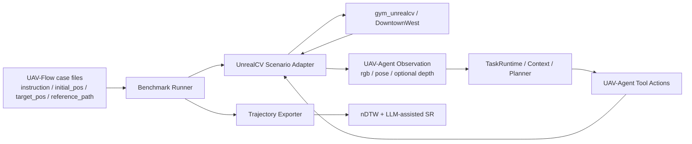

# UAV-Flow UnrealCV Benchmark 兼容实现影响计划

## 1. 目标

本文档说明：在保持 UAV-Agent 原生闭环的前提下，为了复用 UAV-Flow 的 UnrealCV/DowntownWest 任务集与参考轨迹，需要新增哪些评估代码结构、修改哪些现有模块、以及哪些主链路保持不变。

这个能力的定位是 benchmark evaluation，不是 runtime integration：

> UAV-Agent 自己负责输入、输出、动作执行和停止条件；UAV-Flow 提供任务 JSON、初始位姿、目标对象、参考路线和评估口径。

因此第一版不做 `/predict` policy server，不输出 UAV-Flow `action_tokens`，也不让 UAV-Flow runner 控制主循环。

## 2. 代码放置原则

UAV-Flow 相关代码不建议放在 `src/integrations/`。

原因：

- 它的主要职责是评估 UAV-Agent，而不是给主 runtime 提供一个通用外部服务适配。
- 它依赖外部 benchmark repo、UnrealCV 环境、地图资源、测试 case 和评估指标。
- 它不应该成为默认 CLI/runtime 的导入依赖。

建议放置：

```text
evaluation/benchmarks/uav_flow/
```

这个目录表达的是“外部 benchmark harness”。如果未来 UnrealCV 成为 UAV-Agent 的正式环境后端，再把通用环境能力沉淀到 `src/env_client/` 或 `src/sim_server/backends/`，而不是把 benchmark 代码搬进 `src/`。

## 3. 目标架构



核心原则：

- UAV-Agent runtime 仍使用自己的 `TaskRuntime`、context modules、`ModelActionPlanner`、tool dispatcher 和 safety 逻辑。
- UnrealCV 只是 benchmark 环境来源，不改变 planner 的输入输出协议。
- UAV-Flow 的 `reference_path_preprocessed` 和 `target_pos` 只用于评估，不进入 planner context。

## 4. 建议新增文件结构

```text
evaluation/
  benchmarks/
    uav_flow/
      README.md
      cases.py
      config.py
      runner.py
      unrealcv_scenario.py
      trajectory.py
      metrics.py
      sr_judge.py
      reports.py
      configs/
        uav_flow_eval.example.json
      outputs/
        .gitkeep

tests/manual/uav_flow_eval/
  README.md
  run_eval_smoke.py
  run_eval_batch.py
  judge_sr_outputs.py

tests/
  test_uav_flow_cases.py
  test_uav_flow_trajectory.py
  test_uav_flow_metrics.py
```

### `evaluation/benchmarks/uav_flow/cases.py`

负责读取 UAV-Flow 任务资源：

- `test_jsons/*.json`
- `classified_instr.json`
- task class、case id、instruction、instruction_unified
- `initial_pos`
- `target_pos`
- `obj_id/use_obj`
- `reference_path_preprocessed`

输出一个 UAV-Agent eval case schema，供 benchmark runner 使用。

这个模块不能调用模型，不能启动 simulator，只负责解析和标准化 benchmark case。

### `evaluation/benchmarks/uav_flow/config.py`

负责读取评估配置，例如：

- UAV-Flow repo path。
- test_jsons path。
- classified_instr path。
- UnrealCV env id / binary path。
- output dir。
- max cases / classes。
- 是否启用 LLM SR judge。

评估配置不应塞进 `configs/context_modules.json` 或默认 map config。

### `evaluation/benchmarks/uav_flow/unrealcv_scenario.py`

负责把 UAV-Flow 的 UnrealCV/gym 环境适配成 UAV-Agent 可用的环境来源。

需要支持：

- 从 `initial_pos` 初始化 camera/UAV pose。
- 按 UAV-Flow task 语义放置目标对象。
- 采集 RGB，后续可扩展 depth/mask。
- 生成 UAV-Agent observation。
- 执行 UAV-Agent tool action：`connect`、`hover`、`move_body`、`turn_relative`、可选 `land`。

注意：这里不是把 UAV-Flow 原始 runner 作为主 loop，而是让 UAV-Agent runtime 通过自己的动作协议驱动 UnrealCV 场景。

### `evaluation/benchmarks/uav_flow/runner.py`

负责 benchmark case 的外层编排：

- 读取 case。
- 初始化 UnrealCV scenario。
- 启动 UAV-Agent 原生 runtime。
- 收集每步 observation、action、result、AgentMessage。
- 写出 case 级结果。
- 调用 trajectory、metrics 和 SR judge。

runner 只负责评估编排，不改变 `TaskRuntime` 内部逻辑。

### `evaluation/benchmarks/uav_flow/trajectory.py`

负责把 UAV-Agent 执行结果转换成评估轨迹：

- 从 action result / observation pose 中抽取轨迹点。
- 保存 UAV-Agent trajectory json。
- 生成用于 nDTW 的 state 序列。
- 记录单位和坐标转换 metadata。

该模块只处理评估轨迹，不改变 runtime state。

### `evaluation/benchmarks/uav_flow/metrics.py`

负责计算自动指标：

- 读取 UAV-Agent trajectory。
- 读取 UAV-Flow `reference_path_preprocessed`。
- 复用或重写 UAV-Flow `metric.py` 中的 nDTW 思路。
- 按 `classified_instr.json` 汇总 per-class nDTW。

第一版可以直接在本项目中实现最小 nDTW，不依赖修改 UAV-Flow 仓库。

### `evaluation/benchmarks/uav_flow/sr_judge.py`

负责 LLM-assisted SR：

- 输入 instruction、case metadata、UAV-Agent trajectory、reference trajectory、2D/3D 图。
- 输出 `success/confidence/reason/failure_type/needs_human_review`。
- 不参与 runtime 控制，只用于评估报告。

### `evaluation/benchmarks/uav_flow/reports.py`

负责生成评估报告：

- case 级 `summary.json`。
- 分类统计。
- 全量 `summary.md`。
- 失败 case 列表。
- 需要人工复核的 case 列表。

只生成静态文件，不做单独 UI。

## 5. 需要修改或复用的现有模块

### `src/sim_server/backends/unrealcv_backend.py`

当前已有一个最小 UnrealCV backend，主要支持 camera pose、RGB/depth 获取和基础动作。

第一版建议不直接修改它。先在 `evaluation/benchmarks/uav_flow/unrealcv_scenario.py` 内完成 benchmark 适配，等小样本跑通后再决定是否把通用 UnrealCV helper 下沉到 `src/sim_server/backends/`。

### `src/env_client/`

原则上不修改核心 schema。UAV-Flow benchmark 适配层应输出项目已有的 observation 和 action result。

如果需要记录 case id、object id、target metadata，优先写入 benchmark result 或 run metadata，不扩展核心 observation schema。

### `src/runtime/runners/task_runtime.py`

第一版不修改。`TaskRuntime` 仍按当前方式运行：

- preflight
- automatic observation
- planner context
- tool execution
- phase transition
- shutdown

如果 benchmark 需要从固定 pose 开始，优先通过 benchmark runner 或 UnrealCV scenario 初始化环境，不改主 runtime。

### `src/memory/context/modules/image.py`

不需要修改。当前默认 image module 已经能把最近真实 RGB 作为 `model_inputs[type=image]` 传给 planner。

UnrealCV scenario 只要把 RGB 保存成 artifact path，并写入 observation，就可以复用这条路径。

## 6. 手动评估入口

建议在 `tests/manual/uav_flow_eval/` 下放手动入口脚本，而不是放进 `demos/`。

原因：

- 这是 benchmark / evaluator / real-engine diagnostic，不是用户体验 demo。
- 需要外部 UAV-Flow repo、UnrealCV 环境、模型 API，不能进默认 pytest。
- 输出主要用于工程评估和调参。

建议入口：

```text
tests/manual/uav_flow_eval/run_eval_smoke.py
```

用途：

- 每类抽 1-2 个 case。
- 初始化 UnrealCV。
- 跑 UAV-Agent 原生闭环。
- 生成 trajectory、nDTW、LLM SR。

```text
tests/manual/uav_flow_eval/run_eval_batch.py
```

用途：

- 按 `classified_instr.json` 批量跑。
- 支持 `--classes Turn,Move,Approach`。
- 支持 `--limit-per-class`。
- 生成分类汇总报告。

```text
tests/manual/uav_flow_eval/judge_sr_outputs.py
```

用途：

- 对已经生成的轨迹和图进行 LLM-assisted SR judge。
- 允许先跑轨迹，后补 SR judge，避免每次重跑 simulator。

## 7. 输出目录

benchmark 正式输出建议放在：

```text
evaluation/benchmarks/uav_flow/outputs/
  <eval_id>/
    cases/
      <case_id>/
        case.json
        uav_agent_trajectory.json
        ndtw.json
        sr_judge.json
        review.md
        plots/
          trajectory_2d.png
          trajectory_3d.png
    summary.json
    summary.md
    console.txt
```

手动诊断临时输出可以放在：

```text
tests/manual_outputs/uav_flow_eval/
```

UAV-Agent 原始 run 仍写入：

```text
runs/<run_id>/
```

评估输出只保存对比和汇总，不复制完整 run history。需要跳转时在 `case.json` 中记录 `run_dir`。

## 8. 测试策略

自动测试只覆盖纯逻辑，不启动 UnrealCV：

- `test_uav_flow_cases.py`
  - 能读取 task JSON。
  - 能识别 instruction、initial_pos、reference_path。
  - 能按 `classified_instr.json` 分组。

- `test_uav_flow_trajectory.py`
  - 能把 UAV-Agent pose history 转成 nDTW 输入。
  - 单位转换 metadata 必须存在。
  - 不把 `target_pos/reference_path_preprocessed` 放入 planner context。

- `test_uav_flow_metrics.py`
  - nDTW 计算对简单轨迹可预测。
  - 空轨迹、缺 reference path 有明确错误或 skipped 状态。
  - summary 能按 class 聚合。

手动测试覆盖真实环境：

- 小样本 smoke：验证 UnrealCV 初始化、RGB observation、动作执行和停止条件。
- 分类 batch：验证每类少量 case。
- 全量评估：验证完整 `test_jsons`。

## 9. 不做的事情

第一版明确不做：

- 不修改 UAV-Flow 仓库。
- 不使用 UAV-Flow `/predict` 作为主评估接口。
- 不输出 UAV-Flow `action_tokens`。
- 不增加 HTTP policy server 兼容模式，也不以原始 `batch_run_act_all.py` 的 policy 协议作为后续目标。
- 不增加专门的人工 review UI 或表格系统；只输出静态报告和复核字段。
- 不增加独立动作尺度 calibration probe；坐标和尺度转换写入实现配置与 metadata。
- 不让 `reference_path_preprocessed` 或 `target_pos` 进入 planner context。
- 不把 UAV-Flow case 字段扩展进核心 observation schema。
- 不把 UnrealCV 评估逻辑塞进 `TaskRuntime`。

## 10. 后续可选增强

小样本跑通后，可以再考虑：

- 把 benchmark 中通用的 UnrealCV 操作沉淀到 `src/sim_server/backends/unrealcv_backend.py`。
- 增加 depth 或 semantic mask observation。
- 增加更丰富的失败类型统计。
- 增加按任务类别的 prompt / planner 行为分析报告。

## Assumptions

- 第一版以 UAV-Agent 原生闭环为准。
- UAV-Flow 主要提供任务、路线和指标，不拥有控制 loop。
- benchmark 代码放在 `evaluation/benchmarks/uav_flow/`，不影响默认 CLI/runtime。
- 真实 UnrealCV 评估脚本放在 `tests/manual/uav_flow_eval/`，不进入默认 pytest。
