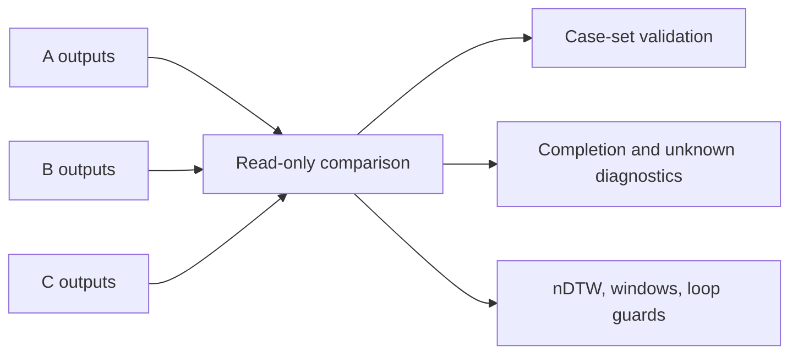

# DoneWhen Flow Experiment Comparison

Status: Experimental

The A, B, and C branches change only when phase completion criteria are
created or revised. All real canaries must use the same five case IDs, model
configuration, Depth NOW profile, 40-window phase limit, action scale, and
simulator package.

After the three serial runs finish, compare their persisted outputs without
starting UE or calling a model:

```powershell
python tests/manual/done_when_flow_compare.py `
  --run A=H:/UAV-Agent-Evaluation/uav_flow/outputs/donewhen_static_dynamic_canary5_20260904 `
  --run B=H:/UAV-Agent-Evaluation/uav_flow/outputs/donewhen_initial_grounded_canary5_20260904 `
  --run C=H:/UAV-Agent-Evaluation/uav_flow/outputs/donewhen_adaptive_revision_canary5_20260904 `
  --output H:/UAV-Agent-Evaluation/uav_flow/outputs/donewhen_flow_comparison_20260904.json
```



Only directories containing both `case.json` and `audit.json` are finalized.
Infrastructure errors are counted separately, and existing nDTW values are
read rather than recomputed. The tool does not turn `completed` into semantic
SR when the SR judge was disabled.
