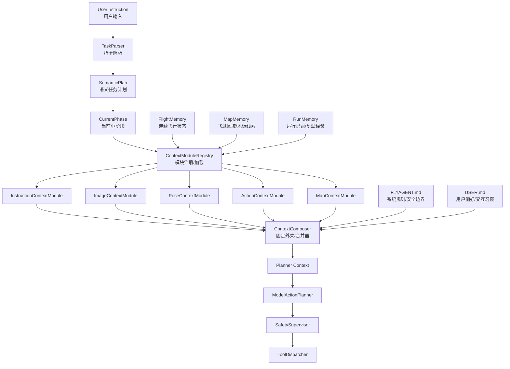

# 02 记忆分层设计

FlyAgent 的记忆不是一个统一大池子，而是按用途拆成多个层。每层的更新频率、可信度和使用方式不同。

## 1. 主体结构



## 2. `FLYAGENT.md`

`FLYAGENT.md` 是系统规则和项目约束，不放实时状态。

适合放：

- Agent 不能直接调用 UE/AirSim SDK。
- planner 不能使用生命周期工具，例如 `uav.takeoff` / `uav.land`。
- 低置信度时必须 hover、选择小幅安全 yaw，或等待下一次自动观察；模型不输出 observe step。
- 未经最新观测确认，不能基于地图记忆靠近目标。
- SafetySupervisor 拥有最终裁剪和拒绝权。

不适合放：

- 当前 pose。
- 当前任务进度。
- 某次 run 的临时错误。
- 某张图像中看到的候选目标。

## 3. `USER.md`

`USER.md` 是用户偏好和交互习惯，不放飞行事实。

适合放：

- 用户偏好先设计清楚上下文再写代码。
- 用户不希望为“向前5米”这类命令写特化逻辑。
- 用户希望文档多画图。

不适合放：

- UAV 当前在什么位置。
- 某地图哪里有地标。
- 某次飞行的动作结果。

## 4. `FlightMemory`

`FlightMemory` 是当前 scene/UAV 的连续飞行历史数据源，是第一版最重要的运行时记忆。

它不是最终给 `ModelActionPlanner` 的上下文。`FlightMemory` 保存历史数据，`ContextModule` 从中抽取和压缩信息，`ContextComposer` 再把模块输出合并成 `PlannerContext`。

运行时落盘的 `flight_memory.json` 是快照、调试和审计 artifact，用来检查当前记忆状态；planner 的结构化输入应是 `contexts/latest_context.json` 中的 `PlannerContext`。

生命周期：

```text
scene_instance_id + agent_id
```

普通新指令不会清空 `FlightMemory`，只更新 `active_instruction`。

建议字段：

```json
{
  "scene_instance_id": "scene_xxx",
  "agent_id": "uav_1",
  "map_id": "cityenviron_win64",
  "active_instruction": "向前飞行5米，然后悬停",
  "active_instruction_id": "inst_0002",
  "instruction_history": [
    {"id": "inst_0001", "ref": "memory/instructions.jsonl#1"}
  ],
  "recent_observation_refs": [
    {"id": "obs_0007", "ref": "memory/observations.jsonl#7"}
  ],
  "recent_action_refs": [
    {"id": "act_0012", "ref": "memory/actions.jsonl#12"}
  ],
  "recent_pose_refs": [
    {"id": "pose_0019", "ref": "memory/poses.jsonl#19"}
  ],
  "recent_frame_refs": [
    {"id": "frame_0016", "ref": "memory/frames.jsonl#16"}
  ],
  "latest_pose_ref": {"id": "pose_0019", "ref": "memory/poses.jsonl#19"},
  "reset_epoch": 0
}
```

## 5. `MapMemory`

`MapMemory` 保存飞过区域、地标、障碍和候选目标等空间线索。

核心原则：

- 可以指导模型“往哪里观察”。
- 不能单独证明目标存在。
- 高风险动作必须依赖最新 observation。
- reset pose 不清空 MapMemory。

## 6. `RunMemory`

`RunMemory` 保存运行记录、调试经验和历史失败模式。

它主要服务：

- 复盘。
- 调参。
- 后续改进 planner、safety、adapter。

它不直接驱动高风险动作。比如“某次 forward 2s 实际移动约 1.8m”可以提醒 evaluator 需要观测验收，但不能让 planner 自动绕过 Safety 多飞。

## 7. `ContextModuleRegistry`

`ContextModuleRegistry` 不保存记忆。它是插件架构里的注册和加载层，负责把固定数据源交给可替换的上下文模块。

职责：

- 加载模块配置。
- 注册默认模块。
- 加载用户自定义模块。
- 按数据类型调用模块。
- 把模块输出交给 `ContextComposer`。

第一版固定五类模块：

```text
InstructionContextModule
ImageContextModule
PoseContextModule
ActionContextModule
MapContextModule
```

其中 `FLYAGENT.md` 和 `USER.md` 不是插件模块，它们是规则和偏好输入，由 `ContextComposer` 直接合并进 planner context。

## 8. `ContextComposer`

`ContextComposer` 是固定外壳，不实现具体压缩算法。

它负责：

- 调用 `ContextModuleRegistry`。
- 合并各模块输出的 context fragment。
- 加入 `FLYAGENT.md`、`USER.md` 和 safety constraints。
- 裁剪过大的字段。
- 输出稳定的 `PlannerContext`。

具体压缩策略由各类模块实现。例如科研用户可以只替换 `ImageContextModule`，使用论文中的图片历史记忆方式，而继续使用默认的 instruction/action/pose/map 模块。

`PlannerContext` 是最终传给 `ModelActionPlanner` 的唯一结构化上下文输入。`FlightMemory`、`MapMemory`、`RunMemory` 和 run artifacts 都不能绕过 `ContextComposer` 直接进入 planner。

## 9. 分层边界表

| 层 | 保存什么 | 不保存什么 | 使用方式 |
| --- | --- | --- | --- |
| `FLYAGENT.md` | 系统规则、安全边界 | 实时飞行状态 | 每轮作为规则摘要进入 context |
| `USER.md` | 用户偏好、交互习惯 | 飞行事实 | 影响协作和默认策略 |
| `FlightMemory` | 当前连续飞行历史 | 最终 planner context、跨地图长期事实 | 作为模块数据源，经 modules/composer 后进入 planner |
| `MapMemory` | 地图/地标/区域线索 | 未标注来源的事实 | 召回少量相关线索 |
| `RunMemory` | 运行经验、失败模式 | 当前控制指令 | 复盘和低风险提示 |
| `ContextModuleRegistry` | 模块注册信息 | 飞行事实 | 加载默认/自定义上下文模块 |
| `ContextComposer` | 不保存记忆 | 具体压缩算法 | 合并模块输出为 `PlannerContext` |
## 10. FlightMemory Manifest / JSONL Store 边界

`FlightMemory` 的最终定位是“飞行连续记忆索引”，而不是“大 JSON 历史数据库”。`flight_memory.json` 应该让开发者快速知道当前 run 中有哪些历史数据、最近窗口指向哪里、当前 UAV 状态是什么；具体历史内容放到独立 append-only 日志中。

推荐边界：

| 层 | 保存内容 | 不保存内容 | 使用者 |
| --- | --- | --- | --- |
| `flight_memory.json` | 当前 active instruction ref、最近 instruction/action/observation/pose/frame refs、latest pose ref、reset_epoch、scene/map/uav identity | 完整 RGB/depth、大量 action result、重复 pose 压缩结果、复杂摘要 | `ContextModuleRegistry` / 调试审计 |
| `memory/instructions.jsonl` | 每条用户指令、semantic plan、timestamp | 图像、动作结果 | `InstructionContextModule` |
| `memory/actions.jsonl` | tool、args、result、timestamp、phase/action id | 最终 planner context | `ActionContextModule` / 后续 evaluator |
| `memory/poses.jsonl` | pose、坐标系、来源 observation/action ref | 图像文件内容 | `PoseContextModule` |
| `memory/observations.jsonl` | 一次 observation 的总索引，连接 pose/frame/action/phase | RGB/depth 大文件 | `ImageContextModule` / `PoseContextModule` / `MapContextModule` |
| `memory/frames.jsonl` | RGB/depth frame metadata、artifact path、observation ref | 图片二进制或 depth 矩阵 | `ImageContextModule` / 自定义 image module |
| `memory/artifacts/rgb` / `depth` | 真实图像和 depth 文件 | 上下文摘要 | 需要视觉历史的 module |

`observations.jsonl` 需要保留，因为它负责对齐同一次观测中的 RGB、depth、pose、timestamp、phase 和 preceding action。没有它时，后续 module 只能靠时间戳或命名规则把多模态数据重新拼回一次观测，容易产生歧义。
