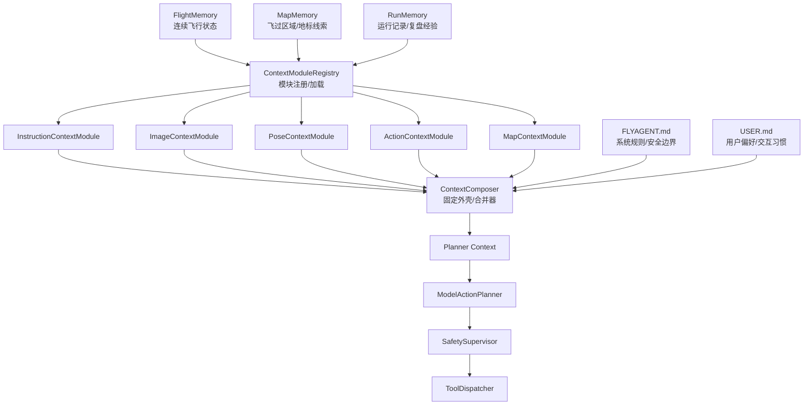

# 02 记忆分层设计

FlyAgent 的记忆不是一个统一大池子，而是按用途拆成多个层。每层的更新频率、可信度和使用方式不同。

## 1. 主体结构



## 2. `FLYAGENT.md`

`FLYAGENT.md` 是系统规则和项目约束，不放实时状态。

适合放：

- Agent 不能直接调用 UE/AirSim SDK。
- planner 不能使用生命周期工具，例如 `uav.takeoff` / `uav.land`。
- 低置信度时必须 hover 或 observe。
- 未经最新观测确认，不能基于地图记忆靠近目标。
- SafetySupervisor 拥有最终裁剪和拒绝权。

不适合放：

- 当前 pose。
- 当前任务进度。
- 某次 run 的临时错误。
- 某张图像中看到的候选目标。

## 3. `USER.md`

`USER.md` 是用户偏好和交互习惯，不放飞行事实。

适合放：

- 用户偏好先设计清楚上下文再写代码。
- 用户不希望为“向前5米”这类命令写特化逻辑。
- 用户希望文档多画图。

不适合放：

- UAV 当前在什么位置。
- 某地图哪里有地标。
- 某次飞行的动作结果。

## 4. `FlightMemory`

`FlightMemory` 是当前 scene/UAV 的连续飞行记忆，是第一版最重要的运行时记忆。

生命周期：

```text
scene_instance_id + agent_id
```

普通新指令不会清空 `FlightMemory`，只更新 `active_instruction`。

建议字段：

```json
{
  "scene_instance_id": "scene_xxx",
  "agent_id": "uav_1",
  "map_id": "cityenviron_win64",
  "active_instruction": "向前飞行5米，然后悬停",
  "instruction_history": [],
  "latest_observation": {},
  "recent_raw_window": [],
  "image_history_summary": {},
  "pose_history_summary": {},
  "action_history_summary": {},
  "map_memory_refs": [],
  "reset_epoch": 0
}
```

## 5. `MapMemory`

`MapMemory` 保存飞过区域、地标、障碍和候选目标等空间线索。

核心原则：

- 可以指导模型“往哪里观察”。
- 不能单独证明目标存在。
- 高风险动作必须依赖最新 observation。
- reset pose 不清空 MapMemory。

## 6. `RunMemory`

`RunMemory` 保存运行记录、调试经验和历史失败模式。

它主要服务：

- 复盘。
- 调参。
- 后续改进 planner、safety、adapter。

它不直接驱动高风险动作。比如“某次 forward 2s 实际移动约 1.8m”可以提醒 evaluator 需要观测验收，但不能让 planner 自动绕过 Safety 多飞。

## 7. `ContextModuleRegistry`

`ContextModuleRegistry` 不保存记忆。它是插件架构里的注册和加载层，负责把固定数据源交给可替换的上下文模块。

职责：

- 加载模块配置。
- 注册默认模块。
- 加载用户自定义模块。
- 按数据类型调用模块。
- 把模块输出交给 `ContextComposer`。

第一版固定五类模块：

```text
InstructionContextModule
ImageContextModule
PoseContextModule
ActionContextModule
MapContextModule
```

其中 `FLYAGENT.md` 和 `USER.md` 不是插件模块，它们是规则和偏好输入，由 `ContextComposer` 直接合并进 planner context。

## 8. `ContextComposer`

`ContextComposer` 是固定外壳，不实现具体压缩算法。

它负责：

- 调用 `ContextModuleRegistry`。
- 合并各模块输出的 context fragment。
- 加入 `FLYAGENT.md`、`USER.md` 和 safety constraints。
- 裁剪过大的字段。
- 输出稳定的 `Planner Context`。

具体压缩策略由各类模块实现。例如科研用户可以只替换 `ImageContextModule`，使用论文中的图片历史记忆方式，而继续使用默认的 instruction/action/pose/map 模块。

## 9. 分层边界表

| 层 | 保存什么 | 不保存什么 | 使用方式 |
| --- | --- | --- | --- |
| `FLYAGENT.md` | 系统规则、安全边界 | 实时飞行状态 | 每轮作为规则摘要进入 context |
| `USER.md` | 用户偏好、交互习惯 | 飞行事实 | 影响协作和默认策略 |
| `FlightMemory` | 当前连续飞行历史 | 跨地图长期事实 | 每轮规划核心输入 |
| `MapMemory` | 地图/地标/区域线索 | 未标注来源的事实 | 召回少量相关线索 |
| `RunMemory` | 运行经验、失败模式 | 当前控制指令 | 复盘和低风险提示 |
| `ContextModuleRegistry` | 模块注册信息 | 飞行事实 | 加载默认/自定义上下文模块 |
| `ContextComposer` | 不保存记忆 | 具体压缩算法 | 合并模块输出为 planner context |
