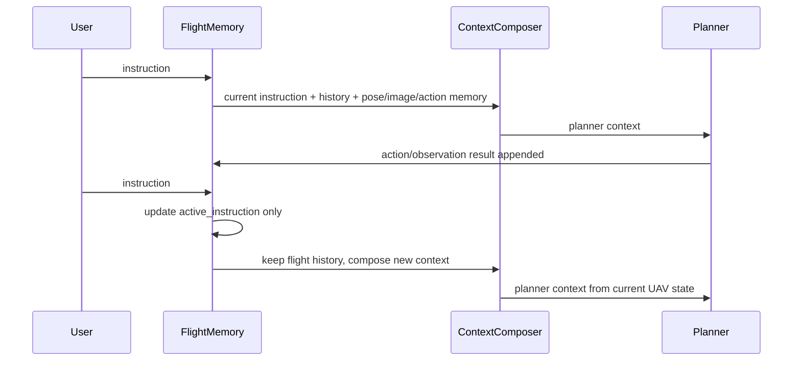
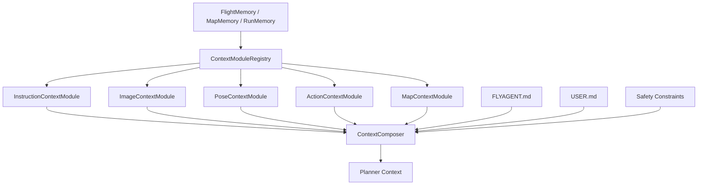
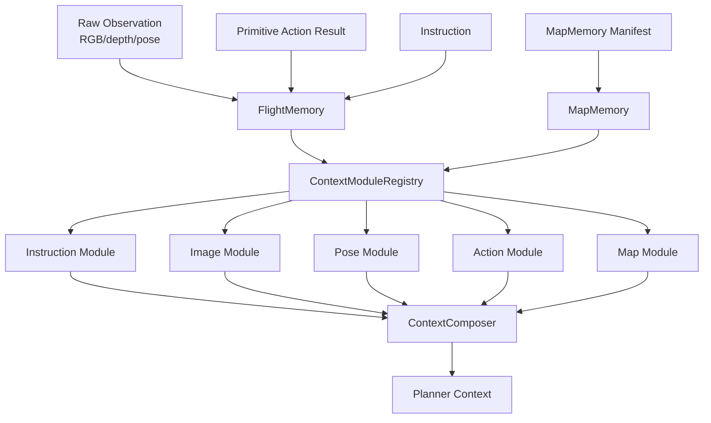

# 03 上下文编排

上下文编排的目标是让模型看到“足够做下一步决策的信息”，而不是看到所有历史。

## 1. 核心原则

```text
普通新指令只更新 active_instruction；
FlightMemory 继续保留历史指令、姿态摘要、图像摘要、动作效果摘要；
只有 reset pose / restart scene / switch map 才刷新飞行连续记忆；
MapMemory 继续保留。
```

`ContextComposer` 不实现具体压缩算法。它调用 `ContextModuleRegistry`，由各模块输出 context fragment，再合并为稳定的 `Planner Context`。

## 2. 连续指令流程



## 3. 软件架构

上下文编排使用：

```text
Ports & Adapters + Pipeline + Strategy/Registry
```

含义：

- 固定数据源由 `FlightMemory`、`MapMemory`、`RunMemory` 提供。
- `ContextModuleRegistry` 加载默认模块和用户自定义模块。
- `instruction/image/pose/action/map` 各类模块分别生成 context fragment。
- `ContextComposer` 是固定外壳，只负责合并、裁剪和加入规则/安全约束。
- 具体历史压缩算法不写死在 `ContextComposer` 内。



## 4. ContextComposer 输入

`ContextComposer` 第一版输入：

```text
FLYAGENT rules
USER preferences
context fragments from registered modules
current safety constraints
available planner tools
```

它不直接读取全部 run artifacts，也不直接实现所有压缩逻辑。它依赖各类 `ContextModule` 从 `FlightMemory`、`MapMemory`、`RunMemory` 中提取和压缩信息。

## 5. Context Fragment schema

每个 `ContextModule` 都必须输出统一外壳的 `Context Fragment`。这样五类模块可以共用同一种合并、裁剪和调试方式；用户关闭某个模块时，`Planner Context` 结构也不会破坏。

统一外壳：

```json
{
  "name": "image",
  "enabled": true,
  "source": "DefaultImageContextModule",
  "content": {},
  "facts": [],
  "inferences": [],
  "goals": [],
  "risks": [],
  "confidence": "medium",
  "artifact_refs": [],
  "budget": {
    "priority": 80,
    "tokens_estimate": 300
  },
  "warnings": [],
  "metadata": {}
}
```

字段说明：

| 字段 | 说明 |
| --- | --- |
| `name` | fragment 类型，例如 `instruction`、`image`、`pose`、`action`、`map` |
| `enabled` | 当前模块是否启用 |
| `source` | 生成该 fragment 的模块名 |
| `content` | 模块自己的结构化内容 |
| `facts` | 已观测或可核验事实 |
| `inferences` | 推测、候选、模型判断和地图线索 |
| `goals` | 与当前 mission/phase 有关的目标 |
| `risks` | 不确定性、危险因素和需要重新确认的内容 |
| `confidence` | `low` / `medium` / `high` |
| `artifact_refs` | 图像、depth、日志等 artifact 引用 |
| `budget` | 当前 fragment 的优先级和 token 估计 |
| `warnings` | 模块输出警告 |
| `metadata` | 坐标系、map_id、modalities 等辅助信息 |

`content` 可以因模块类型不同而不同，但外层字段必须保持一致。第一版这是文档约束，后续实现可以再加入 schema validator。

## 6. facts / inferences / goals / risks 的生成阶段

这些字段不是一次性由某个模块生成，而是在上下文流水线中逐步形成：

```text
TaskParser / SemanticPlan:
  生成 mission goals 和 phase goals

InstructionContextModule:
  整理 active_instruction、历史指令和目标摘要

ImageContextModule:
  生成视觉 facts、视觉 inferences、视觉 risks

PoseContextModule:
  生成姿态 facts、运动状态 risks

ActionContextModule:
  生成动作执行 facts、动作效果 inferences、phase completion risks

MapContextModule:
  生成地图线索 inferences 和 reconfirmation risks

ContextComposer:
  只合并、裁剪、排序，不创造新事实

PhaseCompletionEvaluator:
  使用 facts/inferences/goals/risks 判断 phase 是否完成
```

约束：

- `goals` 主要来自用户指令、`SemanticPlan` 和当前 phase。
- `ImageContextModule` 不能把“疑似目标”写成“已确认目标”。
- `MapMemory` 默认是 inference/risk，不是当前视觉事实。
- `ContextComposer` 不创造新事实，只合并模块输出。

## 7. Planner Context 输出

推荐输出结构：

```json
{
  "active_instruction": "向前飞行5米，然后悬停",
  "fragments": [],
  "disabled_fragments": [],
  "selected_run_memory": [],
  "rules": {},
  "user_preferences": {},
  "safety_constraints": {}
}
```

`fragments` 中只放 `enabled=true` 的模块输出。用户关闭某个模块时，例如关闭 `image` 或 `map`，`ContextComposer` 将模块名写入 `disabled_fragments`，Planner Context 仍然保持兼容。

## 8. 信息流



## 9. Reset 语义

| reset 类型 | FlightMemory | MapMemory | active_instruction | reset_epoch |
| --- | --- | --- | --- | --- |
| 普通新指令 | 保留 | 保留 | 更新 | 不变 |
| soft reset instruction | 保留 | 保留 | 清空或替换 | 不变 |
| reset pose | 刷新飞行连续摘要 | 保留但需 reconfirm | 可保留或重设 | +1 |
| restart scene | 新建 | 当前 map 可保留 | 清空 | 重置 |
| switch map | 新建 | 只召回新 map | 清空 | 重置 |
| clear map memory | 不影响 | 删除或禁用指定记忆 | 不影响 | 不变 |

说明：

- `soft reset instruction` 只清理当前目标，不改变 UAV 物理连续状态。
- `reset pose` 表示 UAV 位置被外部工具或用户显式重设，飞行连续摘要不再可信。
- `restart scene` 和 `switch map` 都需要新建 `FlightMemory`。
- `MapMemory` 在 reset pose 后保留，但所有 pose-local 线索必须重新确认。
