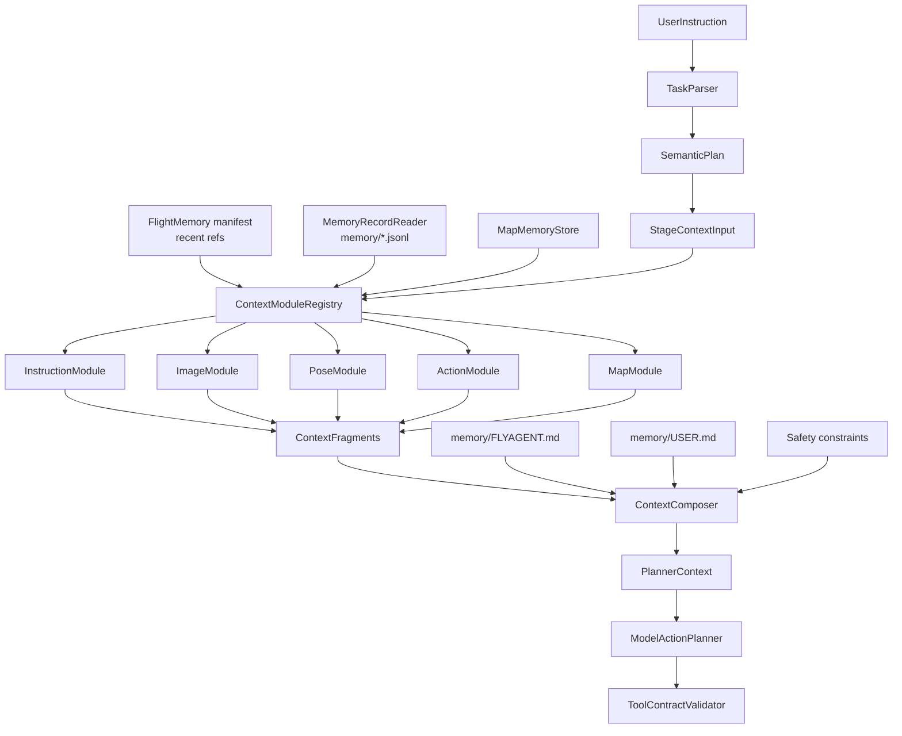

# 03 上下文编排

上下文编排的目标是让模型看到“足够做下一步短期动作决策的信息”，而不是看到完整飞行历史。

## 1. 核心原则

```text
普通新指令只更新 active_instruction；
FlightMemory 保留历史指令、pose refs、observation refs、action refs；
reset pose / restart scene / switch map 才刷新飞行连续性；
MapMemory 可以长期保留，但召回后仍需要和当前观察复核。
```

`ContextComposer` 不负责读取完整历史，也不负责创造事实。它调用 `ContextModuleRegistry`，收集各 module 输出的 `ContextFragment`，再合并成稳定的 `PlannerContext`。

## 2. 完整链路



关键边界：

- `FlightMemory` 是 manifest，不生成 `ContextFragment`。
- `ContextModule` 只处理本类别信息。
- `ContextComposer` 只合并、排序、裁剪和加入规则。
- `ModelActionPlanner` 只消费 `PlannerContext` 并输出 tool-only action plan。
- `ToolContractValidator` 根据 `PlannerContext.allowed_action_constraints` 校验模型动作。
- 阶段推进由 coupled planner 在同一次模型调用中和动作计划一起判断。

## 3. ContextFragment 外壳

每个 module 输出统一外壳：

```json
{
  "name": "image",
  "enabled": true,
  "source": "DefaultImageContextModule",
  "content": {},
  "facts": [],
  "inferences": [],
  "goals": [],
  "risks": [],
  "confidence": "medium",
  "artifact_refs": [],
  "budget": {
    "priority": 80,
    "tokens_estimate": 300
  },
  "warnings": [],
  "metadata": {}
}
```

字段含义：

| 字段 | 含义 |
| --- | --- |
| `name` | fragment 类型，例如 `instruction`、`image`、`pose`、`action`、`map` |
| `content` | module 自己维护的结构化内容 |
| `facts` | 当前可观察或可校验事实 |
| `inferences` | 推测、候选、地图线索或需要确认的判断 |
| `goals` | 当前 mission / phase 相关目标 |
| `risks` | 不确定性、安全风险或 reconfirmation 要求 |
| `artifact_refs` | 图像、depth、日志等 artifact 引用 |
| `budget` | priority 和 tokens 估计 |

## 4. Module 职责

- `InstructionModule`：当前指令、历史指令、semantic goal、phase goal。
- `ImageModule`：最新 RGB/depth metadata、artifact refs、图像可用性。
- `PoseModule`：latest pose、最近 2-3 个 pose、pose delta。
- `ActionModule`：最近 3-5 个 action、执行结果、失败记录。
- `MapModule`：当前 map/scene 相关线索、recall filter、requires_reconfirmation。

module 不做：

- phase 是否完成。
- 动作规划。
- safety 裁剪。
- UAV tool 调用。
- 跨类别事实合成。

## 5. PlannerContext 输出

`PlannerContext` 是传给 `ModelActionPlanner` 的结构化输入：

```json
{
  "context_schema": {},
  "active_instruction": "",
  "current_phase": {},
  "semantic_goal": {},
  "fragments": [],
  "disabled_fragments": [],
  "rules": {},
  "user_preferences": {},
  "allowed_action_constraints": {},
  "observation_policy": {},
  "phase_transition_policy": {},
  "phase_execution_summary": {},
  "safety_constraints": {},
  "metadata": {}
}
```

重要边界：

- 不包含完整 `FlightMemory`。
- 不包含完整 `memory/*.jsonl` 原始历史。
- 不让 planner 直接读 run artifacts。
- `context_schema` 解释顶层字段和各 module 输出字段。
- `allowed_action_constraints` 是 `ToolContractValidator` 的动作契约来源。
- `observation_policy` 告诉模型观察由 runtime 自动完成。
- `phase_transition_policy` 告诉模型 action plan 不输出 `phase_transition`，阶段推进在执行后判断。
- `phase_execution_summary` 保留为 runtime/debug 的原始 phase 进展来源，不直接发送给模型。
- planner 只读取 action fragment 中的 `motion_history_summary`：phase-start-relative UAV motion，以及按从旧到新排列的最近成功动作。

## 6. facts / inferences / goals / risks

这些字段在流水线中分阶段产生：

```text
TaskParser / SemanticPlan:
  产生 mission goals 和 phase goals

ContextModule:
  按类别整理 facts / inferences / risks

ContextComposer:
  合并、排序、裁剪，不创造新事实

ModelActionPlanner:
  基于 PlannerContext 输出 tool-only action plan

TaskRuntime:
  构造 coupled planner context，执行动作并自动观察

PhaseTransition judge:
  基于执行后的 state + 历史判断 continue / advance / complete
```

当前不单独实现 `PhaseCompletionEvaluator`。阶段推进先复用 `ModelActionPlanner` 的模型调用能力和 `PhaseTransition` schema；后续如果判断复杂，可以把这部分独立成 evaluator。

## 7. Reset 语义

| reset 类型 | FlightMemory | MapMemory | active_instruction | reset_epoch |
| --- | --- | --- | --- | --- |
| 普通新指令 | 保留 | 保留 | 更新 | 不变 |
| soft reset instruction | 保留 | 保留 | 清空或替换 | 不变 |
| reset pose | 刷新飞行连续摘要 | 保留但需 reconfirm | 可保留或重设 | +1 |
| restart scene | 新建 | 当前 map 可保留 | 清空 | 重置 |
| switch map | 新建 | 只召回新 map | 清空 | 重置 |
| clear map memory | 不影响 | 删除或禁用指定记忆 | 不影响 | 不变 |

`reset pose` 后，最新 pose 从 `recent_pose_refs[-1]` 推导，不再维护单独 `latest_pose_ref` 字段。
