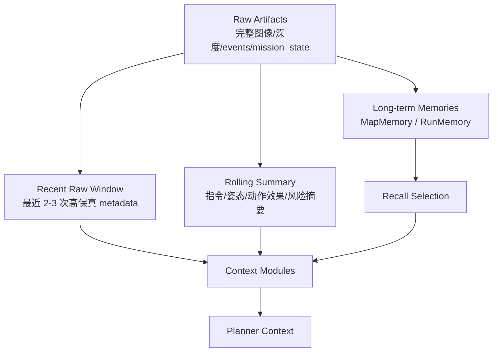

# 04 历史压缩策略

历史压缩的目标是服务飞行决策：让模型知道当前状态、刚才做过什么、动作效果如何、有哪些风险，而不是保存完整流水账。

第一版压缩策略不写死在 `ContextComposer` 里，而是由可注册的上下文模块分别负责。这样科研用户可以替换某一类数据的压缩方法，例如只替换 RGB/depth 图像历史记忆方式。

## 1. 三层历史



对应模块：

```text
InstructionContextModule 处理指令历史压缩
ImageContextModule 处理 RGB/depth 历史压缩
PoseContextModule 处理姿态历史压缩
ActionContextModule 处理动作效果压缩
MapContextModule 处理地图记忆召回与摘要
```

### Recent Raw Window

保留最近 2-3 次 observation/action metadata。

适合保存：

- 最新 pose / velocity / attitude。
- 最近 RGB/depth 的尺寸、时间戳、artifact ref。
- 最近动作 tool、args、ok/error。

不保存：

- 完整图像字节。
- 完整 depth 矩阵。
- 很久以前的动作流水。

Recent Raw Window 的默认策略由各模块共享使用。自定义模块可以读取 recent window，但输出仍必须是可审计的 context fragment，而不是直接输出动作计划。

### Rolling Summary

持续压缩历史信息，保留高价值结论。

建议字段：

```json
{
  "instruction_summary": "连续执行过两条向前飞行指令",
  "pose_summary": "最近一次 forward 后水平位移约 1.8m，yaw 基本稳定",
  "image_summary": "最近 RGB/depth 可用，未做明确目标识别",
  "action_effect_summary": "uav.move_body forward duration=2.0 执行成功，但实际位移小于 5m",
  "risk_summary": "hover 后仍可能存在短时残余速度"
}
```

默认模块策略：

- `DefaultInstructionContextModule`：保留 active instruction 和最近历史指令摘要。
- `DefaultImageContextModule`：保留最新 RGB/depth metadata、artifact refs 和简单图像历史摘要。
- `DefaultPoseContextModule`：保留 latest pose、最近 pose delta、velocity、reset_epoch。
- `DefaultActionContextModule`：保留最近动作效果摘要、失败原因和 Safety 裁剪摘要。
- `DefaultMapContextModule`：召回当前 map/scene 相关线索，并标注 confidence 和 reconfirmation。

可替换策略：

- 用户可以只替换 `ImageContextModule`，使用论文中的图片历史压缩方法。
- 替换 image 模块不影响 instruction、pose、action、map 的默认逻辑。
- 自定义模块输出必须保留来源、置信度或 metadata，便于复盘和安全审查。

### Artifacts

完整数据留在 run 目录：

```text
observations/
contexts/
events.jsonl
mission_state.json
artifacts/
```

模型只看到引用和摘要，需要复盘时再读 artifact。

## 2. 信息优先级

进入 planner context 的信息按优先级排序：

1. 当前 instruction 与目标。
2. 最新 pose / velocity / attitude。
3. 最近动作效果，例如 “forward 2s 后水平位移约 1.8m”。
4. 最近图像/depth 是否可用、是否稳定。
5. 历史指令摘要。
6. map memory 相关地标线索。
7. 用户偏好和系统规则摘要。

## 3. Budget v1

第一版先使用固定默认 budget，后续可让用户在 `configs/context_modules.json` 中配置。当前文档只定义默认优先级和设计约束，不实现复杂动态 token 估算。

```json
{
  "budget_defaults": {
    "instruction": {"priority": 100, "max_items": 5},
    "pose": {"priority": 95, "max_items": 5},
    "action": {"priority": 90, "max_items": 8},
    "image": {"priority": 80, "max_items": 3},
    "map": {"priority": 60, "max_items": 5}
  }
}
```

默认原则：

- `instruction` / `pose` / `action` 优先级最高。
- `image` 默认只保留最近少量 metadata、artifact refs 和摘要。
- `map` 是线索，不优先于当前 observation。
- 自定义模块应声明 `budget.priority` 和 `budget.tokens_estimate`。
- 用户后续可以关闭某个模块，或调整模块 budget 来减少 token。

## 4. 压缩触发点

建议触发：

- 每次 action 执行后。
- 每次 observation 更新后。
- 每条 instruction 更新 active_instruction 时。
- reset pose / restart scene / switch map 时。
- continuous session 结束时。

## 5. 压缩输出规范

压缩输出应避免模糊词，优先写可核验内容：

```text
不好：刚才飞得还可以。
好：最近一次 uav.move_body forward duration=2.0 执行 ok，pose delta 约 dx=1.55, dy=0.89。
```

压缩输出必须区分：

- 观测事实。
- 模型推测。
- 地图线索。
- 用户目标。
- 安全风险。

插件模块输出也必须遵守这个规范。模块可以改变压缩算法，但不能降低可审计性。

## 6. 过期策略

第一版不做复杂 TTL，但要按范围处理：

| 信息 | 过期条件 |
| --- | --- |
| Recent Raw Window | 超过最近 2-3 条后压缩 |
| Pose/action rolling summary | reset pose 后刷新 |
| Image summary | 新图像更新后替换或合并；自定义 image 模块可扩展 |
| MapMemory | 切换 map 后不召回；长期保留但需 reconfirm |
| RunMemory | 长期保留，主要用于复盘 |
