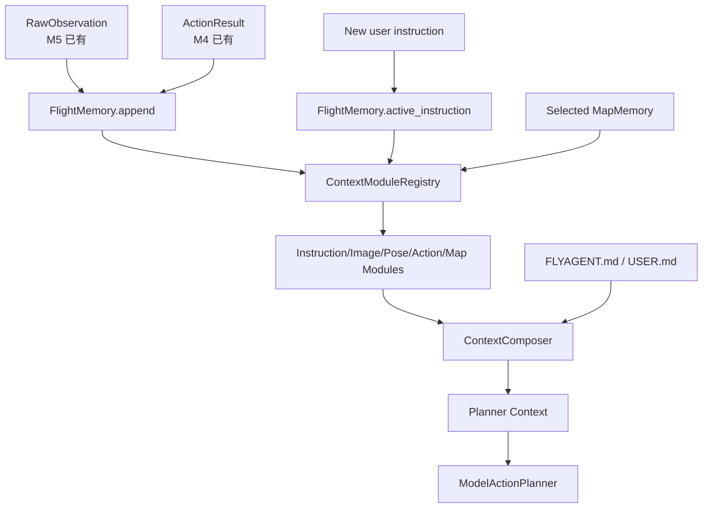

# 06 MVP 计划

本 MVP 是 M4/M5 的上下文扩写版。目标不是立即实现完整长期记忆库，而是先确定运行时上下文设计，支撑后续 `FlightMemory`、`ContextModuleRegistry` 和 `ContextComposer` 实现。

## 1. MVP 范围

第一版只做：

- 定义 `FlightMemory` JSON 结构。
- 定义 `ContextModule` 接口。
- 定义 `ContextModuleRegistry`。
- 定义 `ContextComposer` 固定外壳和输出结构。
- 定义 `Context Fragment schema` 文档约束。
- 定义 `FLYAGENT.md` / `USER.md` 内容边界。
- 定义五类默认上下文模块。
- 定义可替换的历史压缩规则。
- 定义 budget v1 默认配置。
- 定义 `configs/context_modules.json` 注册格式。
- 定义 `MapMemory` schema。
- 定义 `MapMemory` 坐标系和参考系字段。
- 定义连续指令和 reset 语义细分。
- 说明用户如何替换单类模块。
- 用真实 demo 场景验证设计是否能解释“连续两次向前飞行5米”。

不做：

- 向量数据库。
- 自动地标识别模块。
- 完整 SLAM。
- 多 UAV 共享地图。
- 长期自动写入用户记忆。
- 复杂 UI。
- 远程插件。
- 动态热加载。
- 插件 marketplace。
- 允许插件执行 UAV tool。

## 2. MVP 链路



## 3. 推荐文件夹结构

第一版实现时建议新增这些目录和文件：

```text
src/
  memory/
    __init__.py
    flight_memory.py              # FlightMemory 数据结构和 append/update 方法
    context_composer.py           # ContextComposer 固定外壳
    registry.py                   # ContextModuleRegistry
    modules/
      __init__.py
      base.py                     # ContextModule 接口和通用输入/输出类型
      instruction.py              # DefaultInstructionContextModule
      image.py                    # DefaultImageContextModule
      pose.py                     # DefaultPoseContextModule
      action.py                   # DefaultActionContextModule
      map.py                      # DefaultMapContextModule
    stores/
      __init__.py
      map_memory_store.py         # MapMemory manifest/读写/召回
      run_memory_store.py         # RunMemory 读写和复盘摘要
    custom_modules/
      README.md                   # 用户自定义模块放置说明
      image_memory/
        paper_x.py                # 示例：自定义 ImageContextModule

configs/
  context_modules.json            # 默认模块和自定义模块注册

memory/
  FLYAGENT.md                     # 项目/系统规则，后续可考虑提交
  USER.md                         # 本地用户偏好，默认不提交
  map/
    MEMORY.md                     # MapMemory 索引
  run/
    MEMORY.md                     # RunMemory 索引
```

说明：

- `src/memory/modules/` 放 FlyAgent 官方默认模块。
- `src/memory/custom_modules/` 放科研用户自定义模块，便于实验和替换。
- `configs/context_modules.json` 是注册入口，用户优先改配置，不改核心代码。
- `memory/FLYAGENT.md` 和 `memory/USER.md` 是规则/偏好输入，不是插件模块。
- `memory/map/`、`memory/run/` 是后续长期记忆目录，MVP 可以先只定义结构。

## 4. 第一版验收场景

### 场景 A：普通连续指令

输入：

```text
向前飞行5米，然后悬停
向前飞行5米，然后悬停
```

期望：

- 第二条指令只更新 `active_instruction`。
- `FlightMemory` 保留第一条后的 pose/action/image 摘要。
- 模型 context 能表达“从当前 UAV 状态继续”。

### 场景 B：reset pose

输入：

```text
向前飞行5米
reset UAV pose
向前飞行5米
```

期望：

- `FlightMemory.reset_epoch += 1`。
- 飞行连续摘要刷新。
- `MapMemory` 保留，但相关线索需要重新确认。

### 场景 B2：soft reset instruction

输入：

```text
向前飞行5米
soft reset instruction
右转寻找黑色路灯
```

期望：

- `FlightMemory` 保留。
- `active_instruction` 清空或替换。
- `reset_epoch` 不变。
- `MapMemory` 保留。

### 场景 C：地图线索

输入：

```text
右转看有没有黑色路灯
```

期望：

- 当前 map 相关 `MapMemory` 可作为搜索线索。
- planner 不能只凭 map memory 判定目标已存在。
- 高风险动作仍需最新 RGB/depth/pose。

### 场景 D：替换图片历史模块

输入：

```text
用户注册 paper_x_image_memory 作为 image 模块
其余 instruction/pose/action/map 使用 default
```

期望：

- `ContextModuleRegistry` 只替换 `ImageContextModule`。
- planner context 中 image_context 来自自定义模块。
- 其他 context fragment 仍来自默认模块。
- 自定义模块不能输出动作计划，也不能绕过 SafetySupervisor。

### 场景 E：关闭模块

输入：

```json
{
  "modules": {
    "instruction": "default",
    "image": false,
    "pose": "default",
    "action": "default",
    "map": false
  }
}
```

期望：

- `image` 和 `map` 不生成 context fragment。
- `disabled_fragments` 包含 `image` 和 `map`。
- Planner Context 仍然有效。

## 5. 文档验收

文档完成后应能回答：

- 当前 M4/M5 为什么不够？
- 为什么新指令只更新 `active_instruction`？
- `FlightMemory` 和 `MapMemory` 如何区分？
- 完整图像/depth 为什么不直接进入模型？
- reset pose 后哪些记忆刷新、哪些保留？
- 后续实现 `FlightMemory` / `ContextComposer` 时要有哪些接口和字段？
- 科研用户如何只替换 image 历史记忆方式？
- 插件和 SafetySupervisor 的边界是否清楚？
- 官方模块和用户自定义模块应该分别放在哪些目录？
- 用户是否只需要新增模块文件并修改配置就能替换单类上下文？
- Context Fragment schema 是否能约束五类模块？
- 第一版 budget 默认值是什么？
- `soft reset instruction` 和 `reset pose` 的区别是否清楚？
- MapMemory 的 `pose_hint` 使用什么坐标系？

## 6. 后续实现建议

实现时建议按顺序：

1. 在 runtime 中增加 `FlightMemory` 数据对象。
2. 在 observation/action 记录后更新 recent raw window。
3. 定义 `ContextModule` 接口和五类默认模块。
4. 实现 `ContextModuleRegistry` 和配置加载。
5. 增加 `ContextComposer`，替代或扩展当前 `ObservationContextBuilder`。
6. 增加 map memory manifest 和简单召回。
7. 最后再考虑自动抽取和长期写入。
