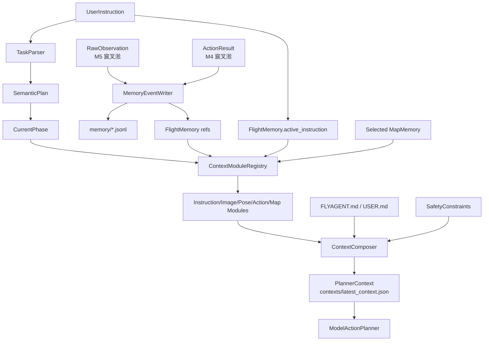

# 06 MVP 璁″垝

鏈?MVP 鏄?M4/M5 鐨勪笂涓嬫枃鎵╁啓鐗堛€傜洰鏍囦笉鏄珛鍗冲疄鐜板畬鏁撮暱鏈熻蹇嗗簱锛岃€屾槸鍏堢‘瀹氳繍琛屾椂涓婁笅鏂囪璁★紝鏀拺鍚庣画 `FlightMemory`銆乣ContextModuleRegistry` 鍜?`ContextComposer` 瀹炵幇銆?
## 1. MVP 鑼冨洿

绗竴鐗堝彧鍋氾細

- 瀹氫箟 `FlightMemory` JSON 缁撴瀯銆?- 瀹氫箟 `ContextModule` 鎺ュ彛銆?- 瀹氫箟 `ContextModuleRegistry`銆?- 瀹氫箟 `ContextComposer` 鍥哄畾澶栧３鍜岃緭鍑虹粨鏋勩€?- 瀹氫箟 `Context Fragment schema` 鏂囨。绾︽潫銆?- 瀹氫箟 `FLYAGENT.md` / `USER.md` 鍐呭杈圭晫銆?- 瀹氫箟浜旂被榛樿涓婁笅鏂囨ā鍧椼€?- 瀹氫箟鍙浛鎹㈢殑鍘嗗彶鍘嬬缉瑙勫垯銆?- 瀹氫箟 budget v1 榛樿閰嶇疆銆?- 瀹氫箟 `configs/context_modules.json` 娉ㄥ唽鏍煎紡銆?- 瀹氫箟 `MapMemory` schema銆?- 瀹氫箟 `MapMemory` 鍧愭爣绯诲拰鍙傝€冪郴瀛楁銆?- 瀹氫箟杩炵画鎸囦护鍜?reset 璇箟缁嗗垎銆?- 璇存槑鐢ㄦ埛濡備綍鏇挎崲鍗曠被妯″潡銆?- 鐢ㄧ湡瀹?demo 鍦烘櫙楠岃瘉璁捐鏄惁鑳借В閲娾€滆繛缁袱娆″悜鍓嶉琛?绫斥€濄€?
涓嶅仛锛?
- 鍚戦噺鏁版嵁搴撱€?- 鑷姩鍦版爣璇嗗埆妯″潡銆?- 瀹屾暣 SLAM銆?- 澶?UAV 鍏变韩鍦板浘銆?- 闀挎湡鑷姩鍐欏叆鐢ㄦ埛璁板繂銆?- 澶嶆潅 UI銆?- 杩滅▼鎻掍欢銆?- 鍔ㄦ€佺儹鍔犺浇銆?- 鎻掍欢 marketplace銆?- 鍏佽鎻掍欢鎵ц UAV tool銆?
## 2. MVP 閾捐矾



MVP 杈圭晫锛?
- `flight_memory.json` 鏄繍琛屾椂蹇収鍜岃皟璇?artifact銆?- `ModelActionPlanner` 涓嶇洿鎺ユ秷璐?`flight_memory.json`銆?- `contexts/latest_context.json` / `PlannerContext` 鏄?planner 鐨勭粨鏋勫寲杈撳叆銆?- 褰撳墠 phase 鏄ā鍧楃紪鎺掔殑鍓嶇疆杈撳叆锛屽拰鍘嗗彶鏁版嵁涓€璧疯繘鍏?`ContextModuleRegistry`銆?
## 3. 鎺ㄨ崘鏂囦欢澶圭粨鏋?
绗竴鐗堝疄鐜版椂寤鸿鏂板杩欎簺鐩綍鍜屾枃浠讹細

```text
src/
  memory/
    __init__.py
    flight_memory.py              # FlightMemory manifest / refs
    context/composer.py           # ContextComposer 鍥哄畾澶栧３
    registry.py                   # ContextModuleRegistry
    modules/
      __init__.py
      base.py                     # ContextModule 鎺ュ彛鍜岄€氱敤杈撳叆/杈撳嚭绫诲瀷
      instruction.py              # DefaultInstructionContextModule
      image.py                    # DefaultImageContextModule
      pose.py                     # DefaultPoseContextModule
      action.py                   # DefaultActionContextModule
      map.py                      # DefaultMapContextModule
    stores/
      __init__.py
      event_store.py              # MemoryEventWriter / MemoryRecordReader
      map_memory_store.py         # MapMemory manifest/璇诲啓/鍙洖
      run_memory_store.py         # RunMemory 璇诲啓鍜屽鐩樻憳瑕?    custom_modules/
      README.md                   # 鐢ㄦ埛鑷畾涔夋ā鍧楁斁缃鏄?      image_memory/
        paper_x.py                # 绀轰緥锛氳嚜瀹氫箟 ImageContextModule

configs/
  context_modules.json            # 榛樿妯″潡鍜岃嚜瀹氫箟妯″潡娉ㄥ唽

memory/
  FLYAGENT.md                     # 椤圭洰/绯荤粺瑙勫垯锛屽悗缁彲鑰冭檻鎻愪氦
  USER.md                         # 鏈湴鐢ㄦ埛鍋忓ソ锛岄粯璁や笉鎻愪氦
  map/
    MEMORY.md                     # MapMemory 绱㈠紩
  run/
    MEMORY.md                     # RunMemory 绱㈠紩
```

璇存槑锛?
- `src/memory/context/modules/` 放 FlyAgent 官方默认 ContextModule。
- `src/memory/context/custom_modules/` 放科研用户自定义模块，便于实验和替换。
- `configs/context_modules.json` 是模块注册入口；用户优先改配置，不改核心代码。
- `memory/FLYAGENT.md` 和 `memory/USER.md` 是规则/偏好输入，不是插件模块。
- `memory/map/`、`memory/run/` 是长期记忆数据目录，MVP 可以先只定义结构。
## 4. 绗竴鐗堥獙鏀跺満鏅?
### 鍦烘櫙 A锛氭櫘閫氳繛缁寚浠?
杈撳叆锛?
```text
鍚戝墠椋炶5绫筹紝鐒跺悗鎮仠
鍚戝墠椋炶5绫筹紝鐒跺悗鎮仠
```

鏈熸湜锛?
- 绗簩鏉℃寚浠ゅ彧鏇存柊 `active_instruction`銆?- `FlightMemory` 淇濈暀绗竴鏉″悗鐨?pose/action/image 鎽樿銆?- 妯″瀷 context 鑳借〃杈锯€滀粠褰撳墠 UAV 鐘舵€佺户缁€濄€?
### 鍦烘櫙 B锛歳eset pose

杈撳叆锛?
```text
鍚戝墠椋炶5绫?reset UAV pose
鍚戝墠椋炶5绫?```

鏈熸湜锛?
- `FlightMemory.reset_epoch += 1`銆?- 椋炶杩炵画鎽樿鍒锋柊銆?- `MapMemory` 淇濈暀锛屼絾鐩稿叧绾跨储闇€瑕侀噸鏂扮‘璁ゃ€?
### 鍦烘櫙 B2锛歴oft reset instruction

杈撳叆锛?
```text
鍚戝墠椋炶5绫?soft reset instruction
鍙宠浆瀵绘壘榛戣壊璺伅
```

鏈熸湜锛?
- `FlightMemory` 淇濈暀銆?- `active_instruction` 娓呯┖鎴栨浛鎹€?- `reset_epoch` 涓嶅彉銆?- `MapMemory` 淇濈暀銆?
### 鍦烘櫙 C锛氬湴鍥剧嚎绱?
杈撳叆锛?
```text
鍙宠浆鐪嬫湁娌℃湁榛戣壊璺伅
```

鏈熸湜锛?
- 褰撳墠 map 鐩稿叧 `MapMemory` 鍙綔涓烘悳绱㈢嚎绱€?- planner 涓嶈兘鍙嚟 map memory 鍒ゅ畾鐩爣宸插瓨鍦ㄣ€?- 楂橀闄╁姩浣滀粛闇€鏈€鏂?RGB/depth/pose銆?
### 鍦烘櫙 D锛氭浛鎹㈠浘鐗囧巻鍙叉ā鍧?
杈撳叆锛?
```text
鐢ㄦ埛娉ㄥ唽 paper_x_image_memory 浣滀负 image 妯″潡
鍏朵綑 instruction/pose/action/map 浣跨敤 default
```

鏈熸湜锛?
- `ContextModuleRegistry` 鍙浛鎹?`ImageContextModule`銆?- planner context 涓?image_context 鏉ヨ嚜鑷畾涔夋ā鍧椼€?- 鍏朵粬 context fragment 浠嶆潵鑷粯璁ゆā鍧椼€?- 鑷畾涔夋ā鍧椾笉鑳借緭鍑哄姩浣滆鍒掞紝涔熶笉鑳界粫杩?SafetySupervisor銆?
### 鍦烘櫙 E锛氬叧闂ā鍧?
杈撳叆锛?
```json
{
  "modules": {
    "instruction": "default",
    "image": false,
    "pose": "default",
    "action": "default",
    "map": false
  }
}
```

鏈熸湜锛?
- `image` 鍜?`map` 涓嶇敓鎴?context fragment銆?- `disabled_fragments` 鍖呭惈 `image` 鍜?`map`銆?- Planner Context 浠嶇劧鏈夋晥銆?
### 鍦烘櫙 F锛歱lanner 涓嶇洿鎺ユ秷璐?FlightMemory

杈撳叆锛?```text
run 瀹屾垚鍚庡悓鏃跺瓨鍦?flight_memory.json 鍜?contexts/latest_context.json
```

鏈熸湜锛?
- `flight_memory.json` 鍙敤浜庤皟璇曞拰瀹¤銆?- `ModelActionPlanner` 浣跨敤 `contexts/latest_context.json` 瀵瑰簲鐨?`PlannerContext`銆?- `FlightMemory` 涓殑瀹屾暣鍘嗗彶蹇呴』鍏堢粡杩?ContextModule 鍘嬬缉/鏁寸悊锛屼笉鑳界粫杩?composer 鐩存帴杩涘叆 planner銆?
## 5. 鏂囨。楠屾敹

鏂囨。瀹屾垚鍚庡簲鑳藉洖绛旓細

- 褰撳墠 M4/M5 涓轰粈涔堜笉澶燂紵
- 涓轰粈涔堟柊鎸囦护鍙洿鏂?`active_instruction`锛?- `FlightMemory` 鍜?`MapMemory` 濡備綍鍖哄垎锛?- 瀹屾暣鍥惧儚/depth 涓轰粈涔堜笉鐩存帴杩涘叆妯″瀷锛?- reset pose 鍚庡摢浜涜蹇嗗埛鏂般€佸摢浜涗繚鐣欙紵
- 鍚庣画瀹炵幇 `FlightMemory` / `ContextComposer` 鏃惰鏈夊摢浜涙帴鍙ｅ拰瀛楁锛?- 绉戠爺鐢ㄦ埛濡備綍鍙浛鎹?image 鍘嗗彶璁板繂鏂瑰紡锛?- 鎻掍欢鍜?SafetySupervisor 鐨勮竟鐣屾槸鍚︽竻妤氾紵
- 瀹樻柟妯″潡鍜岀敤鎴疯嚜瀹氫箟妯″潡搴旇鍒嗗埆鏀惧湪鍝簺鐩綍锛?- 鐢ㄦ埛鏄惁鍙渶瑕佹柊澧炴ā鍧楁枃浠跺苟淇敼閰嶇疆灏辫兘鏇挎崲鍗曠被涓婁笅鏂囷紵
- Context Fragment schema 鏄惁鑳界害鏉熶簲绫绘ā鍧楋紵
- 绗竴鐗?budget 榛樿鍊兼槸浠€涔堬紵
- `soft reset instruction` 鍜?`reset pose` 鐨勫尯鍒槸鍚︽竻妤氾紵
- MapMemory 鐨?`pose_hint` 浣跨敤浠€涔堝潗鏍囩郴锛?- `planner` 鏄惁鏄庣‘涓嶇洿鎺ユ秷璐?`flight_memory.json`锛?- `latest_context.json` / `PlannerContext` 鏄惁鏄庣‘鏄?`ModelActionPlanner` 杈撳叆锛?- `ContextModule` 鏄惁鏄庣‘涓嶈礋璐ｈ法妯″潡 phase completion 鍒ゆ柇锛?
## 6. 鍚庣画瀹炵幇寤鸿

瀹炵幇鏃跺缓璁寜椤哄簭锛?
1. 鍦?runtime 涓鍔?`FlightMemory` 鏁版嵁瀵硅薄銆?2. 鍦?observation/action 璁板綍鍚庡啓鍏?`memory/*.jsonl`锛屽苟鏇存柊 `FlightMemory` refs銆?3. 瀹氫箟 `ContextModule` 鎺ュ彛鍜屼簲绫婚粯璁ゆā鍧椼€?4. 瀹炵幇 `ContextModuleRegistry` 鍜岄厤缃姞杞姐€?5. 澧炲姞 `ContextComposer`锛屾浛浠ｆ垨鎵╁睍褰撳墠 `ObservationContextBuilder`銆?6. 澧炲姞 map memory manifest 鍜岀畝鍗曞彫鍥炪€?7. 鍚庣画濡傞渶鍒ゆ柇 phase 鏄惁瀹屾垚锛屾柊澧炵嫭绔?`PhaseCompletionEvaluator`锛岀敱瀹冩秷璐?fragments锛涗笉瑕佹妸瀹屾垚鍒ゆ柇纭紪鐮佸埌榛樿 context module銆?8. 鏈€鍚庡啀鑰冭檻鑷姩鎶藉彇鍜岄暱鏈熷啓鍏ャ€?## 7. MVP 钀界洏缁撴瀯锛歁anifest + JSONL

鍚庣画瀹炵幇 `FlightMemory` 鏃讹紝MVP 鍙互鍏堟妸钀界洏缁撴瀯鏀规垚 manifest + jsonl store锛岃€屼笉鏄户缁妸鎵€鏈夊巻鍙查兘濉炶繘 `flight_memory.json`銆?
鎺ㄨ崘缁撴瀯锛?
```text
runs/<run_id>/
  flight_memory.json
  memory/
    instructions.jsonl
    actions.jsonl
    poses.jsonl
    observations.jsonl
    frames.jsonl
    artifacts/
      rgb/
      depth/
```

### 鏂囦欢鑱岃矗

| 鏂囦欢 | 鑱岃矗 |
| --- | --- |
| `flight_memory.json` | 褰撳墠 run 鐨勮蹇?manifest锛屼繚瀛?active refs銆乺ecent refs銆乴atest pose ref銆乺eset_epoch銆乻cene/map/uav identity |
| `instructions.jsonl` | append-only 鎸囦护鍘嗗彶锛屾瘡鏉″寘鍚?instruction銆乻emantic plan銆乼imestamp |
| `actions.jsonl` | append-only 鍔ㄤ綔鍘嗗彶锛屾瘡鏉″寘鍚?tool銆乤rgs銆乺esult銆乼imestamp銆乸hase/action id |
| `poses.jsonl` | append-only pose 鍘嗗彶锛屾瘡鏉″寘鍚?pose銆乧oordinate_frame銆乻ource ref |
| `observations.jsonl` | observation 鎬荤储寮曪紝杩炴帴鍚屼竴娆¤娴嬮噷鐨?pose銆乺gb銆乨epth銆乼imestamp銆乸hase銆乸receding action |
| `frames.jsonl` | 鍥惧儚/depth frame 绱㈠紩锛岃褰?modality銆乤rtifact path銆乵etadata銆乷bservation ref |
| `artifacts/rgb` / `artifacts/depth` | 淇濆瓨鐪熷疄 RGB/depth 鏂囦欢 |

### 楠屾敹鏍囧噯

- `flight_memory.json` 涓嶅嚭鐜?`pose_ref: same_as_previous_observation` 杩欑被鍔犲伐瀛楁銆?- `flight_memory.json` 涓嶅垹闄?action result 鐨勫師濮?`data` 瀛楁銆?- `observations.jsonl` 鑳芥妸涓€娆?observation 鐨?RGB銆乨epth銆乸ose 瀵归綈璧锋潵銆?- 榛樿 module 浠嶇劧杈撳嚭鐭獥鍙?fragment锛涢暱绐楀彛璇诲彇鑳藉姏鐣欑粰 module 鍜岃嚜瀹氫箟 module銆?- `ModelActionPlanner` 浠嶇劧鍙秷璐?`contexts/latest_context.json` 瀵瑰簲鐨?`PlannerContext`銆?
