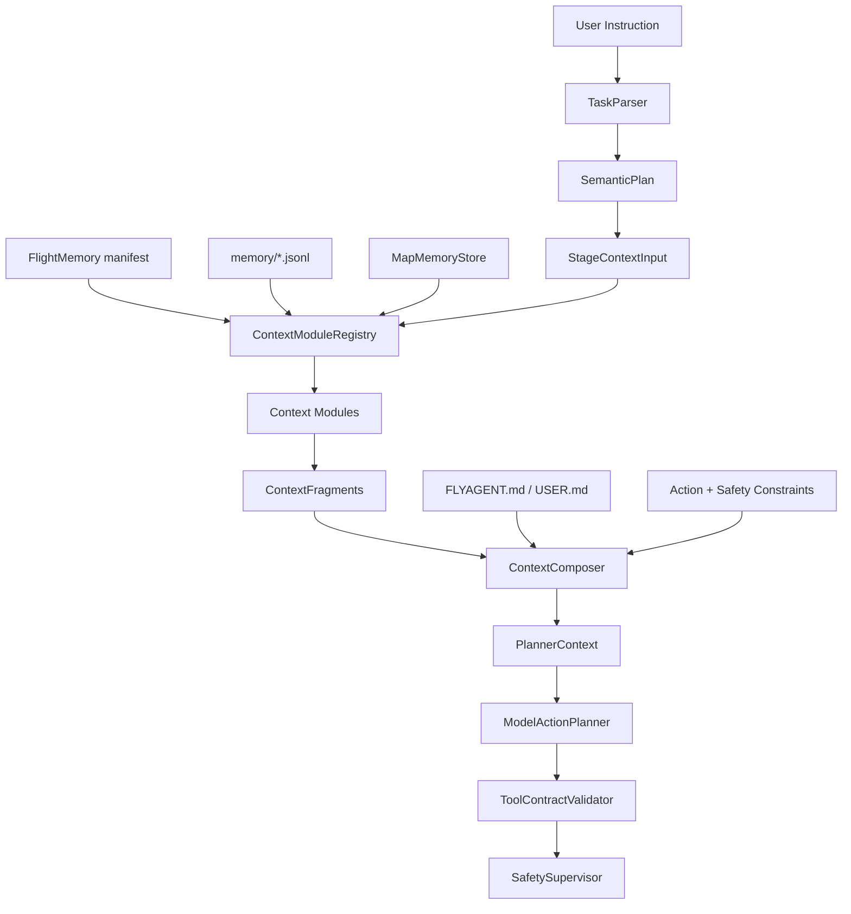
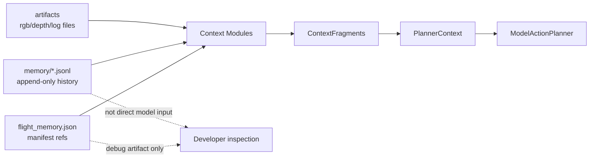
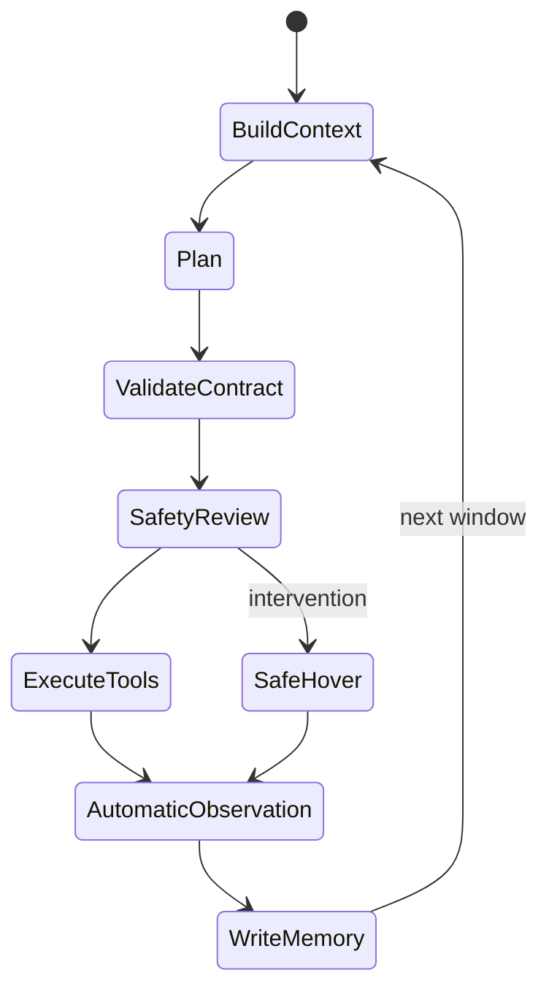
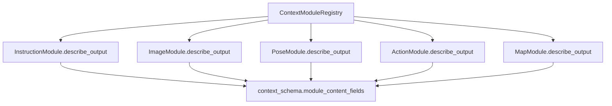
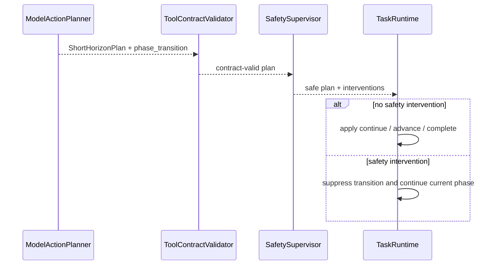
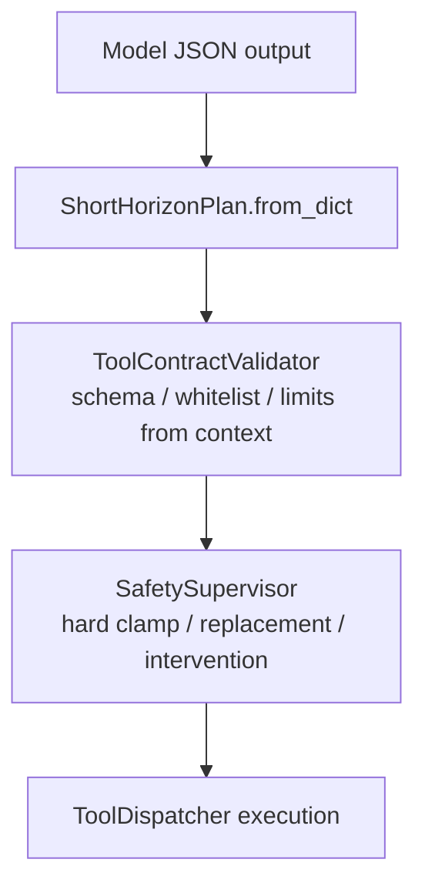

# 07 记忆系统图

## 1. 主链路

## 2. FlightMemory 与 PlannerContext

模型看 `PlannerContext`，不直接看完整 memory。

## 3. 自动观察

`observe` 不是模型动作。runtime 每个 phase window 后采集 RGB/depth/pose。

## 4. Module 字段自解释

谁生产字段，谁解释字段。`ContextComposer` 只解释 `PlannerContext` 外壳。

## 5. Phase Transition

当前阶段推进先由 `ModelActionPlanner` 同步输出，未来复杂后可独立 evaluator。

## 6. Tool Contract 与 Safety 分层

`ToolContractValidator` 拒绝明显不符合 `PlannerContext` 的输出。`SafetySupervisor` 负责最后一道安全门。
