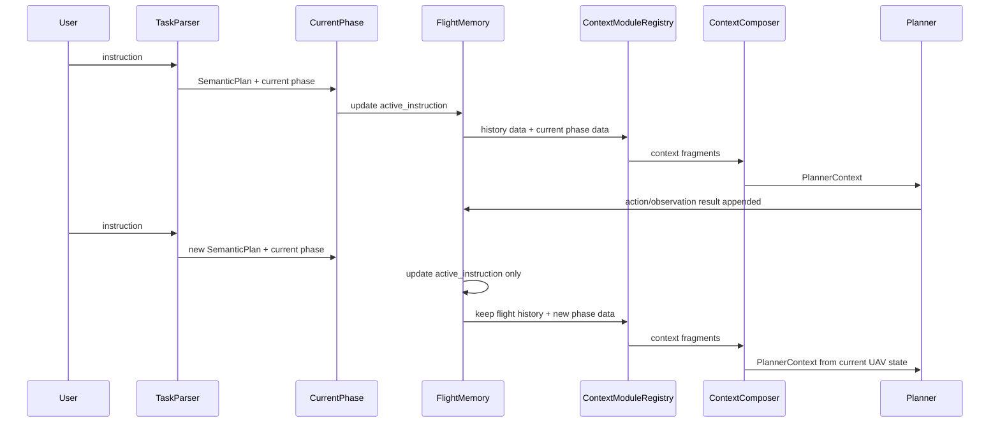
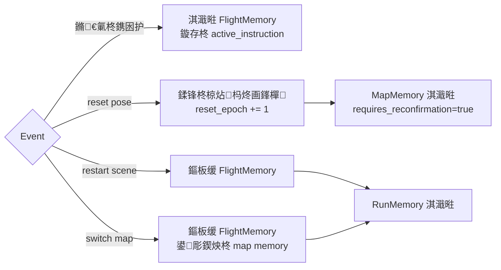
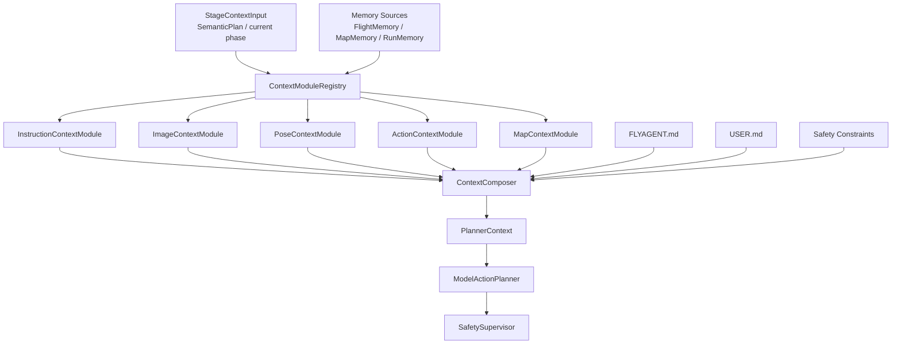
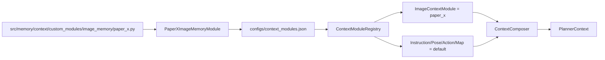
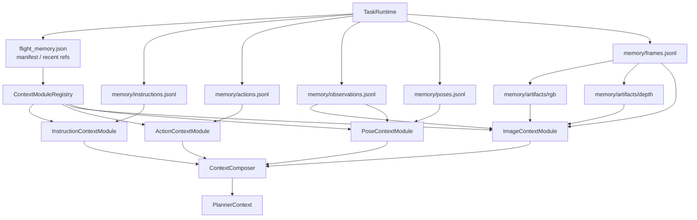
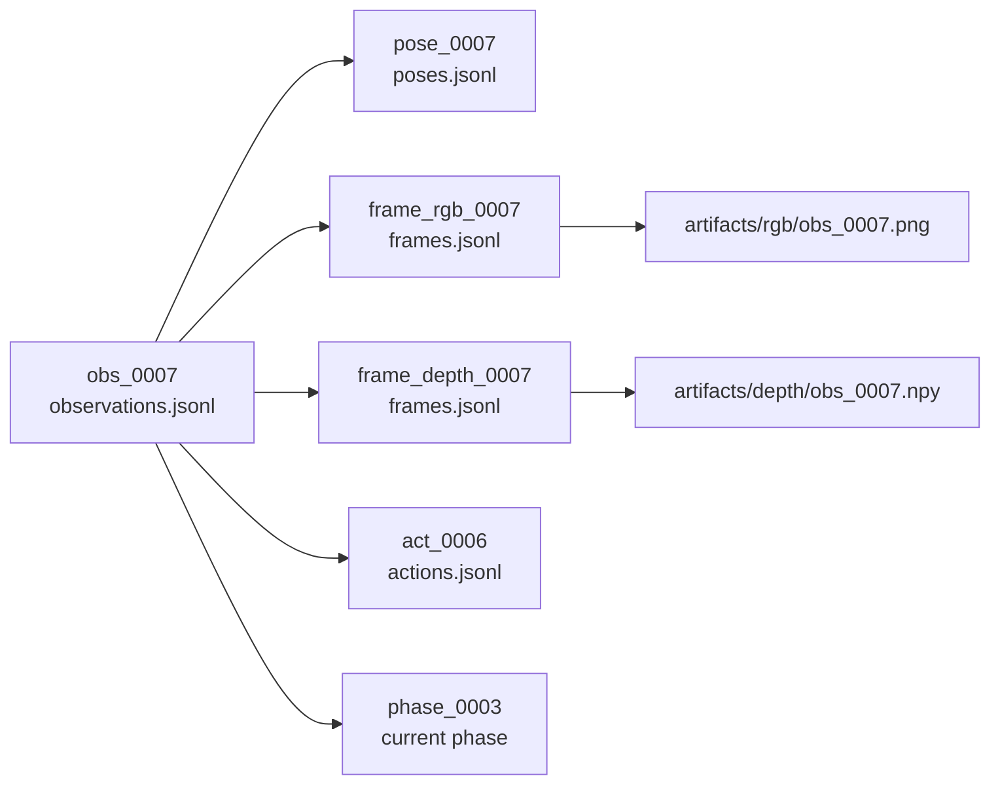

# 07 鍥剧ず姹囨€?
鏈枃浠堕泦涓繚瀛樿蹇嗙郴缁熺殑鍏抽敭鍥撅紝鏂逛究蹇€熻瘎瀹°€?
## 1. 瀹屾暣涓婁笅鏂囦富閾捐矾

```mermaid
flowchart TD
    U["UserInstruction<br/>鐢ㄦ埛杈撳叆"] --> TP["TaskParser<br/>鎸囦护瑙ｆ瀽"]
    TP --> SP["SemanticPlan<br/>璇箟闃舵璁″垝"]
    SP --> CP["CurrentPhaseSelector<br/>褰撳墠 phase / 灏忛樁娈?]

    CP --> R["ContextModuleRegistry"]
    FM["FlightMemory<br/>鍘嗗彶鎸囦护/濮挎€?鍥惧儚/鍔ㄤ綔"] --> R
    MM["MapMemory<br/>鍦板浘绾跨储"] --> R
    RM["RunMemory<br/>杩愯缁忛獙"] --> R

    R --> I["InstructionContextModule"]
    R --> IMG["ImageContextModule"]
    R --> P["PoseContextModule"]
    R --> ACT["ActionContextModule"]
    R --> MAP["MapContextModule"]

    I --> FR["ContextFragments"]
    IMG --> FR
    P --> FR
    ACT --> FR
    MAP --> FR

    FR --> C["ContextComposer"]
    FLY["FLYAGENT.md"] --> C
    USER["USER.md"] --> C
    SAFE["SafetyConstraints"] --> C

    C --> PC["PlannerContext<br/>contexts/latest_context.json"]
    PC --> PL["ModelActionPlanner"]
    PL --> SF["SafetySupervisor"]
    SF --> TD["ToolDispatcher"]
```

## 2. 鎬讳綋鍒嗗眰

```mermaid
flowchart TD
    A["FLYAGENT.md<br/>绯荤粺瑙勫垯/瀹夊叏杈圭晫"]
    B["USER.md<br/>鐢ㄦ埛鍋忓ソ/浜や簰涔犳儻"]
    C["FlightMemory<br/>杩炵画椋炶鐘舵€?]
    D["MapMemory<br/>椋炶繃鍖哄煙/鍦版爣绾跨储"]
    E["RunMemory<br/>杩愯璁板綍/澶嶇洏缁忛獙"]
    R["ContextModuleRegistry<br/>妯″潡娉ㄥ唽/鍔犺浇"]
    F["ContextComposer<br/>鍥哄畾澶栧３/鍚堝苟鍣?]

    C --> R
    D --> R
    E --> R
    R --> F
    A --> F
    B --> F

    F --> G["PlannerContext"]
    G --> H["ModelActionPlanner"]
    H --> I["SafetySupervisor"]
    I --> J["ToolDispatcher"]
```

## 3. 杩炵画鎸囦护



## 4. 鍘嗗彶鍘嬬缉

```mermaid
flowchart TD
    A["memory/*.jsonl + artifacts<br/>鍘熷鍘嗗彶鍜屽ぇ鏂囦欢寮曠敤"] --> B["Module Selected Window<br/>妯″潡鎸?refs 璇诲彇鐭獥鍙?]
    A --> C["Rolling Summary<br/>鎸囦护/濮挎€?鍔ㄤ綔鏁堟灉/椋庨櫓鎽樿"]
    A --> D["Long-term Memories<br/>MapMemory / RunMemory"]

    B --> E["Context Modules"]
    C --> E
    D --> F["Recall Selection"]
    F --> E
    E --> G["PlannerContext"]
```

## 5. MapMemory 鍙洖

```mermaid
flowchart TD
    A["Current map_id / scene_id"] --> D["MapMemory Recall"]
    B["active_instruction"] --> D
    C["current pose / phase"] --> D
    E["MapMemory manifest"] --> D
    D --> F["selected_map_memory<br/>鏈€澶?3-5 鏉?]
    F --> G["ContextComposer"]
```

## 6. Reset 璁板繂杈圭晫



## 7. 鎻掍欢鏋舵瀯鎬诲浘



## 8. 鐢ㄦ埛鏇挎崲 ImageContextModule



## 9. 鎺ㄨ崘鐩綍缁撴瀯

```mermaid
flowchart TD
    A["src/memory<br/>瀹樻柟璁板繂绯荤粺瀹炵幇"]
    B["src/memory/context/modules<br/>榛樿浜旂被 ContextModule"]
    C["src/memory/stores<br/>MapMemory / RunMemory store"]
    D["configs/context_modules.json<br/>妯″潡娉ㄥ唽閰嶇疆"]
    E["memory/FLYAGENT.md<br/>绯荤粺瑙勫垯"]
    F["memory/USER.md<br/>鐢ㄦ埛鍋忓ソ"]
    G["src/memory/context/custom_modules<br/>鐢ㄦ埛鑷畾涔夋ā鍧?]
    H["src/memory/context/custom_modules/image_memory/paper_x.py<br/>绀轰緥鍥剧墖鍘嗗彶妯″潡"]

    A --> B
    A --> C
    D --> B
    D --> G
    E --> A
    F --> A
    G --> H
```
## 10. Manifest + JSONL Store



## 11. Observation 瀵归綈鍏崇郴


