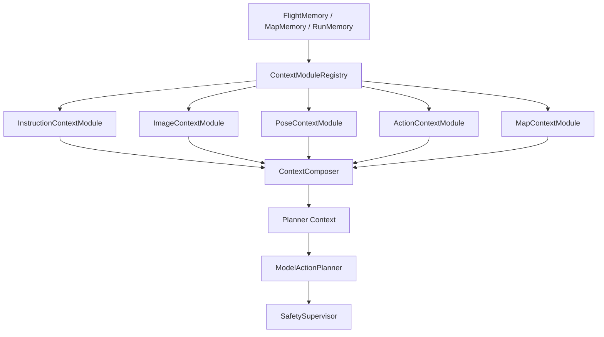
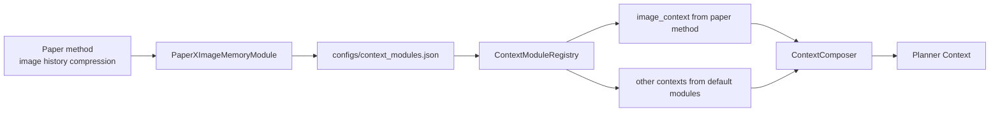

# 08 鍙彃鎷斾笂涓嬫枃妯″潡

## 1. 涓轰粈涔堥渶瑕佹彃浠舵灦鏋?
FlyAgent 闈㈠悜绉戠爺鐢ㄦ埛銆傛棤浜烘満鐨勬暟鎹潵婧愮浉瀵瑰浐瀹氾細

```text
instruction / instruction history
RGB + depth / image history
pose / pose history
action history
map memory
```

浣嗕笉鍚岀爺绌惰€呭彲鑳戒細鐢ㄤ笉鍚屾柟寮忓帇缂╄繖浜涘巻鍙层€備緥濡傛湁浜烘兂浣跨敤璁烘枃閲岀殑鍥剧墖鍘嗗彶璁板繂鏂瑰紡锛屼絾浠嶇劧娌跨敤 FlyAgent 榛樿鐨勬寚浠ゅ巻鍙层€佸姩浣滃巻鍙插拰鍦板浘璁板繂銆備负浜嗘敮鎸佽繖绉嶅疄楠岋紝璁板繂绯荤粺涓嶈兘鎶婃墍鏈夊帇缂╅€昏緫鍐欐鍦?`ContextComposer` 閲屻€?
绗竴鐗堥噰鐢ㄥ彲鎻掓嫈涓婁笅鏂囨ā鍧楋細

```text
鍥哄畾鏁版嵁婧?+ 鍙浛鎹㈡ā鍧?+ 鍥哄畾瀹夊叏杈圭晫
```

## 2. 杞欢鏋舵瀯閫夋嫨

杞欢鏋舵瀯閲囩敤锛?
```text
Ports & Adapters + Pipeline + Strategy/Registry
```

鍚箟锛?
- `FlightMemory`銆乣MapMemory`銆乣RunMemory` 鏄浐瀹氭暟鎹簮銆?- `ContextModuleRegistry` 鏄敞鍐屽拰鍔犺浇灞傘€?- 浜旂被 `ContextModule` 鏄彲鏇挎崲绛栫暐銆?- `ContextComposer` 鏄浐瀹氱绾垮澹筹紝鍙悎骞舵ā鍧楄緭鍑恒€?- `SafetySupervisor` 浠嶇劧鏄姩浣滃畨鍏ㄨ竟鐣屻€?


## 3. ContextModuleRegistry

`ContextModuleRegistry` 涓嶄繚瀛樿蹇嗭紝涔熶笉鍋氶鎺с€傚畠璐熻矗锛?
- 璇诲彇閰嶇疆鏂囦欢銆?- 鍔犺浇榛樿妯″潡銆?- 鍔犺浇鐢ㄦ埛鑷畾涔夋ā鍧椼€?- 鎸夋暟鎹被鍨嬭皟鐢ㄦā鍧椼€?- 鏀堕泦鍚勬ā鍧楄緭鍑虹殑 context fragment銆?- 鎶?fragments 浜ょ粰 `ContextComposer`銆?
寤鸿閰嶇疆鏂囦欢锛?
```text
configs/context_modules.json
```

閰嶇疆閿欒鏃讹紝鍚庣画瀹炵幇寤鸿 fail fast锛屽苟缁欏嚭娓呮櫚閿欒锛涗笉瑕侀潤榛樺姞杞芥湭鐭ユā鍧椼€?
## 4. 浜旂被榛樿妯″潡

绗竴鐗堝浐瀹氫簲绫绘ā鍧楋細

```text
InstructionContextModule
ImageContextModule
PoseContextModule
ActionContextModule
MapContextModule
```

榛樿瀹炵幇锛?
| 妯″潡 | 榛樿鑱岃矗 |
| --- | --- |
| `DefaultInstructionContextModule` | active instruction + 鏈€杩戝巻鍙叉寚浠ゆ憳瑕?|
| `DefaultImageContextModule` | 鏈€鏂?RGB/depth metadata銆乤rtifact refs銆佺畝鍗曞浘鍍忓巻鍙叉憳瑕?|
| `DefaultPoseContextModule` | latest pose銆乸ose delta銆乿elocity銆乺eset_epoch |
| `DefaultActionContextModule` | 鏈€杩戝姩浣滄晥鏋溿€佸け璐ュ師鍥犮€丼afety 瑁佸壀鎽樿 |
| `DefaultMapContextModule` | 褰撳墠 map/scene 鐩稿叧绾跨储鍙洖銆乧onfidence銆乺econfirmation |

榛樿妯″潡蹇呴』濮嬬粓瀛樺湪锛屼繚璇佷笉閰嶇疆鎻掍欢涔熻兘杩愯銆?
## 5. 閰嶇疆鏂囦欢娉ㄥ唽鏂瑰紡

榛樿閰嶇疆绀轰緥锛?
```json
{
  "modules": {
    "instruction": "default",
    "image": "default",
    "pose": "default",
    "action": "default",
    "map": "default"
  },
  "custom_modules": {}
}
```

鏇挎崲鍥剧墖鍘嗗彶妯″潡绀轰緥锛?
```json
{
  "modules": {
    "instruction": "default",
    "image": "paper_x_image_memory",
    "pose": "default",
    "action": "default",
    "map": "default"
  },
  "custom_modules": {
    "paper_x_image_memory": {
      "module_path": "src.memory.context.custom_modules.image_memory.paper_x",
      "class_name": "PaperXImageMemoryModule"
    }
  }
}
```

鍏抽棴妯″潡绀轰緥锛?
```json
{
  "modules": {
    "instruction": "default",
    "image": false,
    "pose": "default",
    "action": "default",
    "map": false
  },
  "custom_modules": {}
}
```

姝ゆ椂 `image` 鍜?`map` 涓嶇敓鎴?fragment锛宍ContextComposer` 搴旀妸瀹冧滑璁板綍鍒?`disabled_fragments`銆?
## 6. Context Fragment 杈撳嚭瑙勮寖

姣忎釜妯″潡蹇呴』杈撳嚭缁熶竴澶栧３鐨?`Context Fragment`锛?
```json
{
  "name": "image",
  "enabled": true,
  "source": "DefaultImageContextModule",
  "content": {},
  "facts": [],
  "inferences": [],
  "goals": [],
  "risks": [],
  "confidence": "medium",
  "artifact_refs": [],
  "budget": {
    "priority": 80,
    "tokens_estimate": 300
  },
  "warnings": [],
  "metadata": {}
}
```

浜旂被妯″潡鐨勯噸鐐癸細

```text
InstructionContextModule -> goals 涓轰富
ImageContextModule -> facts / inferences / risks 涓轰富
PoseContextModule -> facts / risks 涓轰富
ActionContextModule -> facts / inferences / risks 涓轰富
MapContextModule -> inferences / risks 涓轰富
```

鐢ㄦ埛鑷畾涔夋ā鍧椾篃蹇呴』閬靛畧缁熶竴 fragment 澶栧３銆傛ā鍧楀彲浠ユ敼鍙?`content` 鍐呴儴缁撴瀯锛屼絾涓嶈兘鐪佺暐 `name`銆乣enabled`銆乣source`銆乣confidence`銆乣budget`銆乣metadata` 绛夊灞傚瓧娈点€?
## 7. 鏂囦欢澶规斁缃缓璁?
瀹樻柟榛樿瀹炵幇寤鸿鏀惧湪 `src/memory` 涓嬶細

```text
src/
  memory/
    flight_memory.py
    context/composer.py
    registry.py
    modules/
      base.py
      instruction.py
      image.py
      pose.py
      action.py
      map.py
    stores/
      map_memory_store.py
      run_memory_store.py
```

鐢ㄦ埛鑷畾涔夋ā鍧楀缓璁斁鍦?`src/memory/context/custom_modules` 涓嬶細

```text
src/
  memory/
    custom_modules/
      README.md
      image_memory/
        paper_x.py
      pose_memory/
        paper_y.py
      action_memory/
        custom_action_summary.py
```

閰嶇疆鏂囦欢鏀惧湪锛?
```text
configs/context_modules.json
```

瑙勫垯鍜屽亸濂芥枃浠跺缓璁斁鍦細

```text
memory/
  FLYAGENT.md
  USER.md
```

闀挎湡鍦板浘鍜岃繍琛岃蹇嗗悗缁彲浠ユ斁鍦細

```text
memory/
  map/
    MEMORY.md
    cityenviron_lamp_candidates.md
  run/
    MEMORY.md
    cityenviron_forward_undertravel.md
```

鐩綍杈圭晫锛?
- `src/memory/context/modules` 是官方默认模块，不建议科研用户直接改。
- `src/memory/context/custom_modules` 是用户实验模块，适合放论文方法、临时对比实验和自定义压缩策略。
- `configs/context_modules.json` 是唯一注册入口。
- 根目录 `memory/` 下面只放规则、偏好和长期记忆数据，不放 Python 插件代码。
## 8. 鐢ㄦ埛濡備綍娣诲姞鑷畾涔夋ā鍧?
浠ユ浛鎹㈠浘鐗囧巻鍙茶蹇嗕负渚嬶細

1. 鏂板缓 Python 妯″潡锛?
```text
src/memory/context/custom_modules/image_memory/paper_x.py
```

2. 瀹炵幇绾﹀畾绫伙細

```text
PaperXImageMemoryModule
```

3. 鍦?`configs/context_modules.json` 娉ㄥ唽锛?
```json
{
  "modules": {
    "instruction": "default",
    "image": "paper_x_image_memory",
    "pose": "default",
    "action": "default",
    "map": "default"
  },
  "custom_modules": {
    "paper_x_image_memory": {
      "module_path": "src.memory.context.custom_modules.image_memory.paper_x",
      "class_name": "PaperXImageMemoryModule"
    }
  }
}
```

4. 杩愯鏃跺彧鏇挎崲 image 鍘嗗彶璁板繂澶勭悊锛屽叾浣?instruction銆乸ose銆乤ction銆乵ap 浠嶄娇鐢ㄩ粯璁ゅ疄鐜般€?
鐢ㄦ埛涓嶉渶瑕佷慨鏀?`ContextComposer`锛屼篃涓嶉渶瑕佹敼 `ModelActionPlanner`銆?
## 9. 妯″潡瀹夊叏杈圭晫

妯″潡鍙敓鎴?context fragment锛屼笉鐢熸垚 action plan銆?
妯″潡涓嶈兘锛?
- 璋冪敤 `ToolDispatcher`銆?- 璋冪敤 `EnvClient`銆?- 鐩存帴璋冪敤 AirSim 鎴?UnrealCV銆?- 缁曡繃 `SafetySupervisor`銆?- 杈撳嚭鐢熷懡鍛ㄦ湡宸ュ叿寤鸿銆?- 鎶婃湭缁忕‘璁ょ殑 map memory 鍐欐垚浜嬪疄銆?- 淇敼鍘熷 run artifacts銆?
妯″潡杈撳嚭蹇呴』鍖呭惈鏉ユ簮銆佺疆淇″害鎴?metadata锛屼究浜庡璁°€備緥濡傦細

```json
{
  "image_context": {
    "summary": "鏈€杩?RGB 鍙敤锛宒epth 鍙敤锛屾湭纭鐩爣",
    "source": "PaperXImageMemoryModule",
    "confidence": "medium",
    "metadata": {
      "latest_rgb_ref": "observations/latest_rgb.png"
    }
  }
}
```

## 10. 绉戠爺鎵╁睍绀轰緥锛氭浛鎹?ImageContextModule

鍦烘櫙锛?
```text
鐢ㄦ埛甯屾湜浣跨敤鏌愮瘒璁烘枃鐨勫浘鐗囧巻鍙茶蹇嗘柟娉曪紱
浣?instruction/action/pose/map 浠嶄娇鐢?FlyAgent 榛樿绛栫暐銆?```

娴佺▼锛?


杩欒绉戠爺鐢ㄦ埛鍙互鐙珛瀹為獙鍥剧墖鍘嗗彶鍘嬬缉锛岃€屼笉鐮村潖 FlyAgent 鐨勯鎺с€佸畨鍏ㄥ拰鍦板浘璁板繂杈圭晫銆?
## 11. MVP 杈圭晫

MVP 鍋氾細

- 瀹氫箟浜旂被妯″潡鎺ュ彛銆?- 瀹氫箟 `ContextModuleRegistry`銆?- 瀹氫箟閰嶇疆娉ㄥ唽鏍煎紡銆?- 鎻愪緵浜旂被榛樿妯″潡銆?- 鏀寔鐢ㄦ埛鏇挎崲鍗曚竴妯″潡銆?
MVP 涓嶅仛锛?
- 杩滅▼鎻掍欢銆?- 鍔ㄦ€佺儹鍔犺浇銆?- 鎻掍欢 marketplace銆?- 鎻掍欢鐩存帴鎵ц UAV tool銆?- 鎻掍欢淇敼 SafetySupervisor銆?- 鎻掍欢鑷姩鍐欓暱鏈熺敤鎴疯蹇嗐€?## 10. 鑷畾涔夋ā鍧楀浣曡鍙?JSONL 璁板繂

閲囩敤 manifest + jsonl store 鍚庯紝鑷畾涔夋ā鍧椾笉搴旇渚濊禆 `flight_memory.json` 閲屼繚瀛樺畬鏁村巻鍙层€傛帹鑽愭柟寮忔槸锛?
1. 浠?`MemorySourceBundle.flight_memory` 璇诲彇褰撳墠妯″潡闇€瑕佺殑 refs锛屼緥濡?`recent_observation_refs`銆乣recent_action_refs`銆乣latest_pose_ref`銆?2. 閫氳繃杩愯鏃舵彁渚涚殑 reader 鎴?store 璇诲彇瀵瑰簲 `memory/*.jsonl` 璁板綍銆?3. 瀵规湰妯″潡鐨勬暟鎹仛鍘嬬缉鎴栫爺绌剁畻娉曞鐞嗐€?4. 杈撳嚭缁熶竴 `ContextFragment`銆?
绀轰緥锛氳嚜瀹氫箟 image module 鍙互璇诲彇锛?
```text
flight_memory.json:
  recent_observation_refs

memory/observations.jsonl:
  observation -> frame_refs / pose_ref / action_ref

memory/frames.jsonl:
  frame -> modality / artifact path / metadata

memory/artifacts/rgb
memory/artifacts/depth
```

杩欐牱鐢ㄦ埛鍙互鏇挎崲鍥剧墖鍘嗗彶璁板繂鏂瑰紡锛岃€?instruction / pose / action / map 妯″潡浠嶇劧浣跨敤榛樿瀹炵幇銆?
鑷畾涔夋ā鍧楃害鏉燂細

- 鍙互璇诲彇 refs 鎸囧悜鐨?raw records銆?- 鍙互浣跨敤鑷繁鐨勫帇缂╃畻娉曘€?- 杈撳嚭蹇呴』鏄?`ContextFragment`銆?- 涓嶈兘鐩存帴杈撳嚭 action plan銆?- 涓嶈兘缁曡繃 `ContextComposer` 鍜?`SafetySupervisor`銆?
