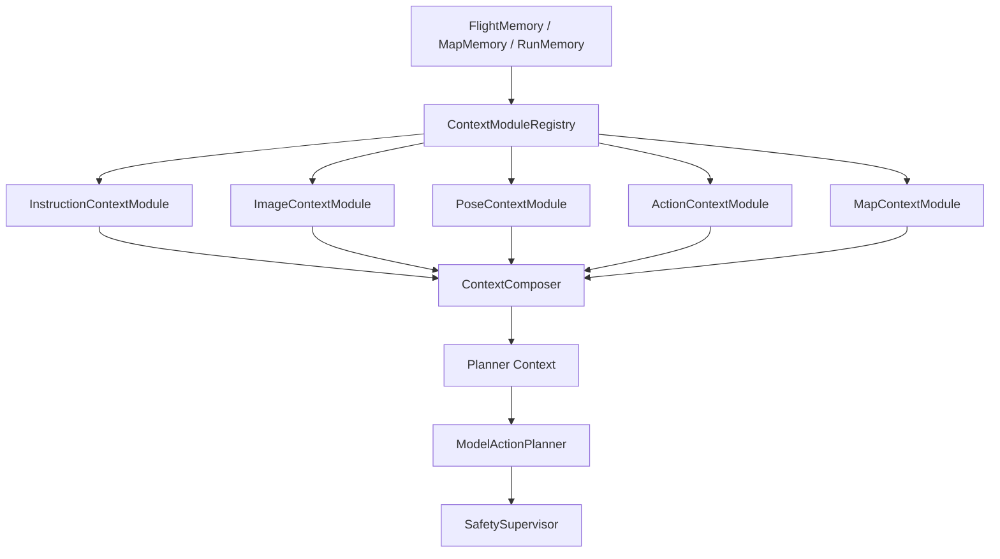
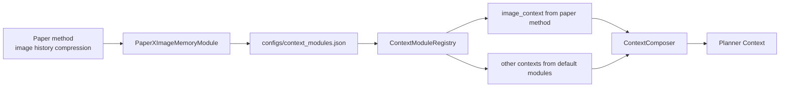

# 08 可插拔上下文模块

## 1. 为什么需要插件架构

FlyAgent 面向科研用户。无人机的数据来源相对固定：

```text
instruction / instruction history
RGB + depth / image history
pose / pose history
action history
map memory
```

但不同研究者可能会用不同方式压缩这些历史。例如有人想使用论文里的图片历史记忆方式，但仍然沿用 FlyAgent 默认的指令历史、动作历史和地图记忆。为了支持这种实验，记忆系统不能把所有压缩逻辑写死在 `ContextComposer` 里。

第一版采用可插拔上下文模块：

```text
固定数据源 + 可替换模块 + 固定安全边界
```

## 2. 软件架构选择

软件架构采用：

```text
Ports & Adapters + Pipeline + Strategy/Registry
```

含义：

- `FlightMemory`、`MapMemory`、`RunMemory` 是固定数据源。
- `ContextModuleRegistry` 是注册和加载层。
- 五类 `ContextModule` 是可替换策略。
- `ContextComposer` 是固定管线外壳，只合并模块输出。
- `SafetySupervisor` 仍然是动作安全边界。



## 3. ContextModuleRegistry

`ContextModuleRegistry` 不保存记忆，也不做飞控。它负责：

- 读取配置文件。
- 加载默认模块。
- 加载用户自定义模块。
- 按数据类型调用模块。
- 收集各模块输出的 context fragment。
- 把 fragments 交给 `ContextComposer`。

建议配置文件：

```text
configs/context_modules.json
```

配置错误时，后续实现建议 fail fast，并给出清晰错误；不要静默加载未知模块。

## 4. 五类默认模块

第一版固定五类模块：

```text
InstructionContextModule
ImageContextModule
PoseContextModule
ActionContextModule
MapContextModule
```

默认实现：

| 模块 | 默认职责 |
| --- | --- |
| `DefaultInstructionContextModule` | active instruction + 最近历史指令摘要 |
| `DefaultImageContextModule` | 最新 RGB/depth metadata、artifact refs、简单图像历史摘要 |
| `DefaultPoseContextModule` | latest pose、pose delta、velocity、reset_epoch |
| `DefaultActionContextModule` | 最近动作效果、失败原因、Safety 裁剪摘要 |
| `DefaultMapContextModule` | 当前 map/scene 相关线索召回、confidence、reconfirmation |

默认模块必须始终存在，保证不配置插件也能运行。

## 5. 配置文件注册方式

默认配置示例：

```json
{
  "modules": {
    "instruction": "default",
    "image": "default",
    "pose": "default",
    "action": "default",
    "map": "default"
  },
  "custom_modules": {}
}
```

替换图片历史模块示例：

```json
{
  "modules": {
    "instruction": "default",
    "image": "paper_x_image_memory",
    "pose": "default",
    "action": "default",
    "map": "default"
  },
  "custom_modules": {
    "paper_x_image_memory": {
      "module_path": "src.memory.custom_modules.image_memory.paper_x",
      "class_name": "PaperXImageMemoryModule"
    }
  }
}
```

关闭模块示例：

```json
{
  "modules": {
    "instruction": "default",
    "image": false,
    "pose": "default",
    "action": "default",
    "map": false
  },
  "custom_modules": {}
}
```

此时 `image` 和 `map` 不生成 fragment，`ContextComposer` 应把它们记录到 `disabled_fragments`。

## 6. Context Fragment 输出规范

每个模块必须输出统一外壳的 `Context Fragment`：

```json
{
  "name": "image",
  "enabled": true,
  "source": "DefaultImageContextModule",
  "content": {},
  "facts": [],
  "inferences": [],
  "goals": [],
  "risks": [],
  "confidence": "medium",
  "artifact_refs": [],
  "budget": {
    "priority": 80,
    "tokens_estimate": 300
  },
  "warnings": [],
  "metadata": {}
}
```

五类模块的重点：

```text
InstructionContextModule -> goals 为主
ImageContextModule -> facts / inferences / risks 为主
PoseContextModule -> facts / risks 为主
ActionContextModule -> facts / inferences / risks 为主
MapContextModule -> inferences / risks 为主
```

用户自定义模块也必须遵守统一 fragment 外壳。模块可以改变 `content` 内部结构，但不能省略 `name`、`enabled`、`source`、`confidence`、`budget`、`metadata` 等外层字段。

## 7. 文件夹放置建议

官方默认实现建议放在 `src/memory` 下：

```text
src/
  memory/
    flight_memory.py
    context_composer.py
    registry.py
    modules/
      base.py
      instruction.py
      image.py
      pose.py
      action.py
      map.py
    stores/
      map_memory_store.py
      run_memory_store.py
```

用户自定义模块建议放在 `src/memory/custom_modules` 下：

```text
src/
  memory/
    custom_modules/
      README.md
      image_memory/
        paper_x.py
      pose_memory/
        paper_y.py
      action_memory/
        custom_action_summary.py
```

配置文件放在：

```text
configs/context_modules.json
```

规则和偏好文件建议放在：

```text
memory/
  FLYAGENT.md
  USER.md
```

长期地图和运行记忆后续可以放在：

```text
memory/
  map/
    MEMORY.md
    cityenviron_lamp_candidates.md
  run/
    MEMORY.md
    cityenviron_forward_undertravel.md
```

目录边界：

- `src/memory/modules` 是官方默认模块，不建议科研用户直接改。
- `src/memory/custom_modules` 是用户实验模块，适合放论文方法、临时对比实验和自定义压缩策略。
- `configs/context_modules.json` 是唯一注册入口。
- `memory/` 下面只放规则、偏好和长期记忆，不放 Python 插件代码。

## 8. 用户如何添加自定义模块

以替换图片历史记忆为例：

1. 新建 Python 模块：

```text
src/memory/custom_modules/image_memory/paper_x.py
```

2. 实现约定类：

```text
PaperXImageMemoryModule
```

3. 在 `configs/context_modules.json` 注册：

```json
{
  "modules": {
    "instruction": "default",
    "image": "paper_x_image_memory",
    "pose": "default",
    "action": "default",
    "map": "default"
  },
  "custom_modules": {
    "paper_x_image_memory": {
      "module_path": "src.memory.custom_modules.image_memory.paper_x",
      "class_name": "PaperXImageMemoryModule"
    }
  }
}
```

4. 运行时只替换 image 历史记忆处理，其余 instruction、pose、action、map 仍使用默认实现。

用户不需要修改 `ContextComposer`，也不需要改 `ModelActionPlanner`。

## 9. 模块安全边界

模块只生成 context fragment，不生成 action plan。

模块不能：

- 调用 `ToolDispatcher`。
- 调用 `EnvClient`。
- 直接调用 AirSim 或 UnrealCV。
- 绕过 `SafetySupervisor`。
- 输出生命周期工具建议。
- 把未经确认的 map memory 写成事实。
- 修改原始 run artifacts。

模块输出必须包含来源、置信度或 metadata，便于审计。例如：

```json
{
  "image_context": {
    "summary": "最近 RGB 可用，depth 可用，未确认目标",
    "source": "PaperXImageMemoryModule",
    "confidence": "medium",
    "metadata": {
      "latest_rgb_ref": "observations/latest_rgb.png"
    }
  }
}
```

## 10. 科研扩展示例：替换 ImageContextModule

场景：

```text
用户希望使用某篇论文的图片历史记忆方法；
但 instruction/action/pose/map 仍使用 FlyAgent 默认策略。
```

流程：



这让科研用户可以独立实验图片历史压缩，而不破坏 FlyAgent 的飞控、安全和地图记忆边界。

## 11. MVP 边界

MVP 做：

- 定义五类模块接口。
- 定义 `ContextModuleRegistry`。
- 定义配置注册格式。
- 提供五类默认模块。
- 支持用户替换单一模块。

MVP 不做：

- 远程插件。
- 动态热加载。
- 插件 marketplace。
- 插件直接执行 UAV tool。
- 插件修改 SafetySupervisor。
- 插件自动写长期用户记忆。
