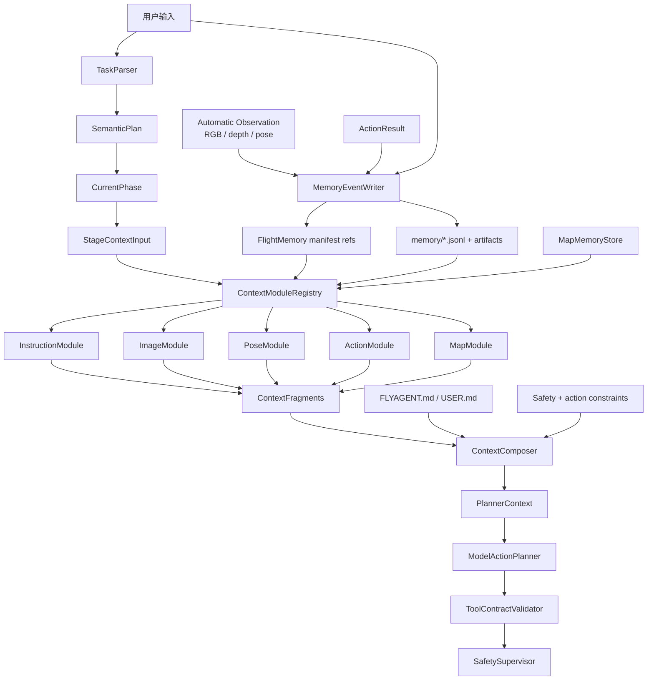

# 09 记忆系统实现策略

本文把记忆系统设计整理成可执行路线。重点是：记忆系统不是一个“大记忆对象”，而是一条上下文生产流水线。

## 1. 当前执行图



## 2. 已完成的实现事实

- `FlightMemory` 已转为 manifest + jsonl refs。
- 默认五类 context modules 已收敛职责。
- `ContextComposer` 已输出 `PlannerContext` 外壳、budget metadata、rules 和 preferences。
- `context_schema` 已包含顶层字段和 module 字段说明。
- `allowed_action_constraints` 已进入 context。
- `observation_policy` 已声明 runtime 自动观察。
- `phase_transition` 已进入 `ShortHorizonPlan`。
- 模型不再输出 observe step。

## 3. 当前阶段：ToolContractValidator

下一步重点是把动作约束从 planner 内部逻辑拆成独立模块：

```text
ModelActionPlanner
  -> ToolContractValidator
    -> SafetySupervisor
      -> ToolDispatcher
```

实现要求：

- `ToolContractValidator` 从 `PlannerContext.allowed_action_constraints` 读取契约。
- 校验 phase、step 数、step kind、tool 白名单、forbidden tool。
- 校验 `uav.hover`、`uav.turn_relative`、`uav.move_body` 参数。
- `kind="observe"` 直接失败，原因是观察由 runtime 管理。
- 输出结构化 `ToolContractViolation`，为后续 repair 做准备。

## 4. StageContextInput

`StageContextInput` 显式表达当前阶段输入：

```text
active_instruction
semantic_plan
current_phase
semantic_goal
safety_constraints
allowed_action_constraints
observation_policy
phase_transition_policy
```

这样 module 不只是看到历史，还知道当前阶段要解决什么。

## 5. FlightMemory Manifest

`FlightMemory` 保存：

```text
active_instruction_id
instruction_history refs
recent_observation_refs
recent_action_refs
recent_pose_refs
recent_frame_refs
reset_epoch
map_id / scene_id / agent_id
```

最新 pose 从 `recent_pose_refs[-1]` 推导，不再维护 `latest_pose_ref`。

## 6. 默认 Module 职责

```text
InstructionModule:
  当前指令、历史指令、当前 goal / phase goal

ImageModule:
  最近 3 轮 RGB/depth metadata、artifact refs、图像可用性

PoseModule:
  latest_pose、最近 2-3 个 pose、pose delta

ActionModule:
  最近 3-5 个 action、动作结果、失败记录

MapModule:
  当前 map/scene 相关线索、requires_reconfirmation
```

module 不做 phase completion、动作规划、安全判断或 UAV tool 调用。

## 7. ContextComposer 外壳

`ContextComposer` 只做：

- 收集 fragments。
- 按 priority 排序。
- 应用 budget 裁剪。
- 加入 `FLYAGENT.md`。
- 加入 `USER.md`。
- 加入 action / safety constraints。
- 输出 `PlannerContext`。

它不做：

- 读取完整 run artifacts。
- 读取完整 jsonl 历史。
- 创造 facts。
- 解释各 module 的内部业务字段。

## 8. Phase 推进策略

当前不做独立 `PhaseCompletionEvaluator`。模型在同一次 action plan 中输出：

```json
{
  "phase_transition": {
    "decision": "continue_current_phase | advance_to_next_phase | complete_task",
    "reason": "short reason"
  }
}
```

runtime 决定是否应用：

- 无 safety intervention 时按模型建议处理。
- 有 safety intervention 时压制推进，继续当前 phase。
- 同一 phase 连续超过窗口上限时触发 loop guard。

未来如果阶段判断复杂，可以独立 `PhaseCompletionEvaluator`，但它应复用 `PlannerContext` 或 `ContextFragment`，不直接读完整 memory。

## 9. 推荐实现顺序

1. 保持 `TaskRuntime` 只把 `PlannerContext` 传给 planner。
2. 保持 `FlightMemory` 只做 manifest 和 refs。
3. 保持默认 modules 各自只整理本类别 context。
4. 固定 `ContextComposer` 输出 schema、rules、preferences、constraints。
5. 拆出 `ToolContractValidator`。
6. 为 validator 加结构化错误和独立单元测试。
7. 更新文档和 Mermaid 图。
8. 后续再考虑 `ModelRepairPlanner`。

## 10. 最小验收 Demo

运行：

```text
python demos/demo_model_action_planner_context.py --env-path .env
```

重点查看：

- `semantic_parse_result.json`
- `flight_memory.json`
- `mission_state.json`
- `latest_context.json`
- `model_payload.json`
- `raw_model_response.json`
- `validated_plan.json`
- `safety_decision.json`
- `demo_preview.md`

验收标准：

- `latest_context.json` 包含 `context_schema`、五类 fragments、`allowed_action_constraints`、`observation_policy`。
- 模型输出不包含 observe step。
- `validated_plan.json` 包含 `phase_transition`。
- 非法 tool 或非法 args 会被 `ToolContractValidator` 拒绝。
