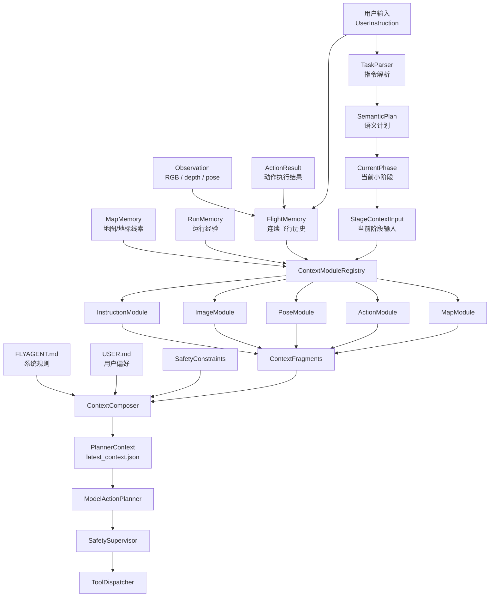
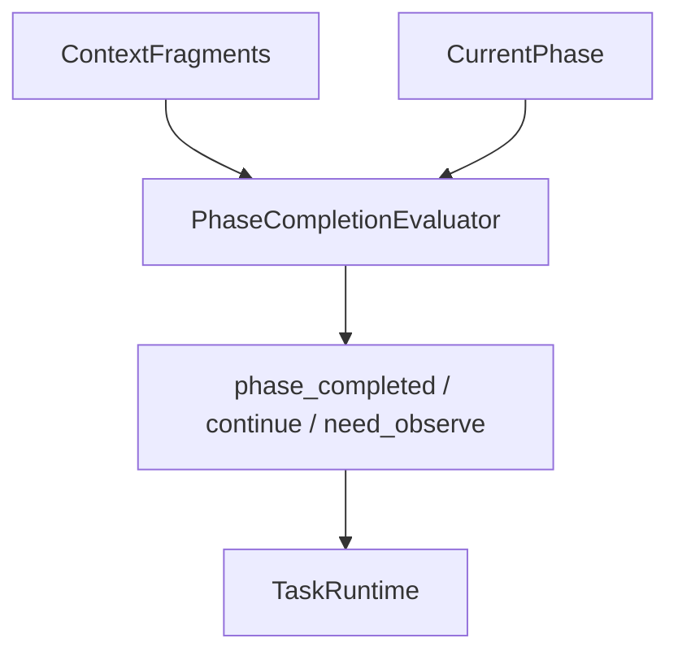

# 09 记忆系统实现策略

本文把前面设计整理成可执行的实现路线。重点是：记忆系统不是一个“大记忆对象”，而是一条“上下文生产流水线”。

## 1. 当前执行图



## 2. 实现总策略

核心边界：

```text
FlightMemory 负责保存历史，不负责决定给模型看什么。
ContextModule 负责从历史中抽取本类别高价值信息。
ContextComposer 负责合并、排序、裁剪、加规则。
ModelActionPlanner 只看 PlannerContext。
```

文件作用：

```text
flight_memory.json:
  调试/审计用，用来检查当前 FlightMemory 保存了什么。

contexts/latest_context.json:
  planner 输入，用来传给 ModelActionPlanner。

ContextFragment:
  各模块整理后的高信息密度上下文碎片。
```

不要让 `FlightMemory` 直接变成 prompt，也不要让 module 直接做 action plan 或 phase completion 判断。

## 3. 第一阶段：整理主链路

目标是让代码结构和文档一致：

```text
TaskParser -> SemanticPlan -> CurrentPhase
FlightMemory + CurrentPhase -> ContextModuleRegistry
ContextModuleRegistry -> modules
modules -> ContextFragments
ContextComposer -> PlannerContext
```

实现要点：

- `TaskRuntime` 负责拿到用户输入并调用 `TaskParser`。
- `SemanticPlan` 负责表达任务目标和阶段。
- 当前 phase / 小阶段作为 `StageContextInput` 的一部分进入模块管线。
- `FlightMemory` 只作为历史数据源进入 `ContextModuleRegistry`。
- `ModelActionPlanner` 不直接读取 `FlightMemory` 或 run artifacts。

验收标准：

- 一次 run 后同时生成 `flight_memory.json` 和 `contexts/latest_context.json`。
- `latest_context.json` 中能看到当前 phase、semantic goal 和 fragments。
- planner 调用只使用 `PlannerContext`。

## 4. 第二阶段：规范 FlightMemory

`FlightMemory` 应保存源数据和少量运行时索引：

```text
active_instruction
active_instruction_id
instruction_history refs
recent_observation_refs
recent_action_refs
recent_pose_refs
recent_frame_refs
reset_epoch
map_id / scene_id / agent_id
```

设计原则：

- `FlightMemory` 保存“发生过什么”，不负责决定“模型应该看什么”。
- `FlightMemory` 只保留 manifest refs；原始历史保存在 `memory/*.jsonl`，短窗口由各 module 按 refs 读取。
- `flight_memory.json` 可以比 planner context 更详细，但仍应避免无意义重复。
- 如果需要压缩或摘要，应优先放到对应 `ContextModule` 中。

验收标准：

- 连续两条普通指令只更新 `active_instruction`，不清空 `instruction_history`。
- reset pose 时刷新飞行连续记忆，`reset_epoch += 1`。
- switch map / restart scene 时新建 FlightMemory。

## 5. 第三阶段：定义 StageContextInput

模块输入应拆成两类：

```text
MemorySourceBundle:
  flight_memory
  map_memory
  run_memory

StageContextInput:
  active_instruction
  semantic_plan
  current_phase
  semantic_goal
  safety_constraints
  allowed_tools
```

这样模块不是只看历史，而是知道“当前阶段要干什么”。

实现建议：

- 第一版可以用 dataclass 或 TypedDict 定义 `StageContextInput`。
- 不要继续把 current phase 散落在普通 dict 里。
- 所有默认 module 都接收同一个输入结构，方便用户自定义模块复用。

验收标准：

- `InstructionModule` 可以从 `StageContextInput` 中拿到 current phase。
- `PoseModule` / `ActionModule` 可以结合 current phase 做摘要，但不做完成判断。
- 自定义模块能通过统一输入拿到当前阶段和历史数据。

## 6. 第四阶段：收敛默认模块职责

第一版每个 module 只做本类别上下文整理：

```text
InstructionModule:
  当前指令、历史指令、当前 goal / phase goal

ImageModule:
  最新 RGB/depth metadata、artifact refs、图像可用性

PoseModule:
  latest_pose、最近 2-3 个 pose、pose delta

ActionModule:
  最近 3-5 个 action、动作效果摘要、失败记录

MapModule:
  当前 map/scene 相关线索、requires_reconfirmation
```

不要让 module 做：

```text
phase 是否完成
是否该继续靠近
是否目标已确认
是否安全
```

这些应由后续 `PhaseCompletionEvaluator`、`SafetySupervisor` 或 planner 自己根据 context 判断。

验收标准：

- 每个 module 输出统一 `ContextFragment`。
- 每个 module 的 `content` 只包含本类别内容。
- `facts / inferences / risks` 不把推测写成事实。
- 禁用某个 module 后，PlannerContext 仍然有效。

## 7. 第五阶段：固定 ContextComposer 外壳

`ContextComposer` 只做上下文最终编排：

```text
收集 fragments
按 priority 排序
应用 budget 裁剪
加入 FLYAGENT.md
加入 USER.md
加入 safety constraints
输出 PlannerContext
```

它不应该知道 image 如何压缩，也不应该知道 action 如何摘要。

验收标准：

- `ContextComposer` 不直接读取完整 run artifacts。
- `ContextComposer` 不创造新的 facts。
- `ContextComposer` 不调用 UAV tool。
- `PlannerContext` 是 `ModelActionPlanner` 的唯一结构化输入。

## 8. 第六阶段：独立 PhaseCompletionEvaluator

当前阶段先不要把 phase completion 逻辑塞进 module。

后续如果要实现，应作为独立组件：



它负责判断：

```text
当前 phase 是否完成？
是否需要等待下一次自动 observation？
是否进入下一个 phase？
是否需要 hover 等待？
```

验收标准：

- evaluator 消费 fragments，不绕过 context pipeline 读原始大历史。
- evaluator 的判断结果独立记录，便于调试。
- module 仍只负责生成本类别 fragment。

## 9. 推荐实现顺序

建议按下面顺序推进：

1. 梳理 `TaskRuntime`，确认 planner 调用只使用 `PlannerContext`。
2. 引入 `StageContextInput`，把 current phase / semantic plan 显式传给 modules。
3. 清理 `FlightMemory`，让它只承担历史源数据和调试快照职责。
4. 收敛默认 modules 输出，避免低信息密度重复字段。
5. 固定 `ContextComposer` 的合并和裁剪行为。
6. 增加 demo，稳定生成 `flight_memory.json` 和 `latest_context.json`。
7. 增加单元测试覆盖连续指令、模块禁用、自定义模块和 MapMemory recall。
8. 最后再独立设计 `PhaseCompletionEvaluator`。

## 10. 最小验收 Demo

连续执行两条普通指令：

```text
指令 1：前面右转会有一个黑色的路灯，右转面向路灯后停下
指令 2：左转寻找建筑入口，并停在入口前
```

期望：

- scene 只启动一次，第二条指令复用 scene。
- `FlightMemory.instruction_history` 包含两条指令。
- `FlightMemory.active_instruction` 是第二条指令。
- `contexts/latest_context.json` 中包含五类 fragments。
- `ModelActionPlanner` 只接收 `PlannerContext`。
- `flight_memory.json` 只作为调试快照，不直接进入 planner。
## 11. 下一阶段：把 FlightMemory 改成 Manifest

在当前 `StageContextInput` 主链路整理完成后，下一阶段建议把 `FlightMemory` 从“内存里保存最近 raw 列表并直接 dump”升级为 manifest + jsonl store。

### 实现目标

```text
TaskRuntime
-> MemoryEventWriter
-> memory/*.jsonl + artifacts
-> FlightMemory manifest refs
-> ContextModule 按需读取 refs
-> ContextFragment
```

### 建议新增组件

| 组件 | 职责 |
| --- | --- |
| `MemoryEventWriter` | 统一写入 instructions/actions/poses/observations/frames jsonl |
| `MemoryRef` | 表达 `{id, ref, timestamp}` 这类轻量引用 |
| `FlightMemoryManifest` | 保存 active refs、recent refs、reset_epoch；最新 pose 由 `recent_pose_refs[-1]` 推导 |
| `MemoryRecordReader` | 给 ContextModule 按 ref 读取最近窗口 |

### 实现顺序

1. 新增 `runs/<run_id>/memory/` 目录创建逻辑。
2. 每次 instruction 更新时写 `instructions.jsonl`，`flight_memory.json` 只保存 instruction refs。
3. 每次 action result 写 `actions.jsonl`，如果 result 里带 pose，同时写 `poses.jsonl`。
4. 每次 observation 写 `observations.jsonl`；pose 写 `poses.jsonl`；RGB/depth metadata 写 `frames.jsonl`。
5. 如果未来拿到真实图像/depth 文件，把大文件放进 `memory/artifacts/rgb` 和 `memory/artifacts/depth`。
6. 更新默认 modules，让它们通过 refs 读取 jsonl，而不是依赖 `FlightMemory` 里的完整对象。
7. 保持 `PlannerContext` 结构不变，避免影响 `ModelActionPlanner`。

### 不做的事

- 不在 `FlightMemory` 层做 pose 去重。
- 不在 `FlightMemory` 层做图像历史压缩。
- 不在 `FlightMemory` 层裁剪 action result 的原始 `data`。
- 不让 planner 直接读取 `memory/*.jsonl`。

## 12. Manifest 化后的旧逻辑收口

当前实现中 `MissionState` 只作为 runtime 执行状态快照，保留 phase、connected、airborne、errors、safety 和短期调试窗口；它不是 `ContextModule` 的 memory source。

`ObservationContextBuilder` 必须接收显式 `FlightMemory` manifest。它不能从 `MissionState` 隐式还原记忆系统，因为 manifest 需要 refs 和 `MemoryRecordReader`。

`events.jsonl` 保留为运行事件时间线，用于调试和审计；原始记忆数据以 `memory/*.jsonl` 为准。
