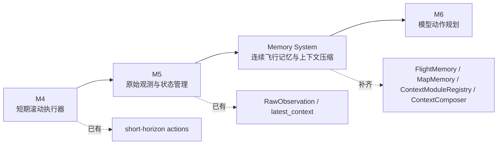

# FlyAgent 记忆系统文档集

本目录用于设计 FlyAgent 的无人机记忆系统。它是当前 M4/M5 的上下文扩写版：M4 已经有短期滚动执行，M5 已经有原始观测和 context builder，但这两层还不足以表达真实无人机在同一 scene 中连续执行多条指令时的历史状态、地图线索和压缩记忆。

核心结论：

- 新指令不是新世界。普通连续指令只更新 `active_instruction`。
- `FlightMemory` 持续保存当前 scene/UAV 的历史指令、图像摘要、姿态摘要和动作效果摘要。
- 用户显式 reset pose、重启 scene 或切换 map 时，才刷新飞行连续记忆。
- `MapMemory` 不因 reset pose 清空，除非切换 map 或用户显式清除。
- 模型上下文不塞完整历史，而是使用“最近原始窗口 + 滚动摘要 + map data 线索 + 规则/偏好”。
- 历史压缩和上下文编排使用可插拔模块，科研用户可以只替换某一类数据处理方式，例如只替换图片历史记忆。

## 文档目录

1. [需求文档](./01_requirements.md)
2. [记忆分层设计](./02_memory_layers.md)
3. [上下文编排](./03_context_composition.md)
4. [历史压缩策略](./04_history_compression.md)
5. [地图记忆设计](./05_map_memory.md)
6. [MVP 计划](./06_mvp_plan.md)
7. [图示汇总](./07_diagrams.md)
8. [可插拔上下文模块](./08_pluggable_context_modules.md)
9. [实现策略](./09_implementation_strategy.md)

## 与 M4/M5 的关系



M4/M5 解决的是“每轮怎么执行和观测”。记忆系统要解决的是：

- 多条指令之间如何延续当前 UAV 物理状态。
- 历史图像、姿态、动作如何压缩成模型可用信息。
- 飞过区域和地标线索如何保留但不误当事实。
- `FLYAGENT.md` 与 `USER.md` 这类规则/偏好如何进入上下文。
- 不同研究方法如何替换单类上下文处理，而不破坏飞控和安全边界。

## 第一版目标

第一版先把需求和设计写清楚，不实现完整 runtime 代码。后续实现时，应优先落地：

```text
FlightMemory JSON
ContextComposer 固定外壳
ContextModuleRegistry 注册机制
默认五类上下文模块
可替换的历史压缩策略
MapMemory schema
连续指令与 reset 语义
```
## 最新设计补充：FlightMemory 作为 Manifest / Index

当前设计进一步明确：`FlightMemory` 不应该保存大量完整历史内容，也不应该提前做去重、摘要或压缩。它更适合作为当前 run / scene / UAV 的记忆索引文件，也就是 `flight_memory.json`。

推荐落盘结构：

```text
runs/<run_id>/
  flight_memory.json              # 当前飞行记忆 manifest / index
  memory/
    instructions.jsonl            # 用户指令历史原始记录
    actions.jsonl                 # UAV action 调用与结果
    poses.jsonl                   # pose / attitude / coordinate frame 历史
    observations.jsonl            # 每次 observation 的总索引
    frames.jsonl                  # RGB/depth frame 索引
    artifacts/
      rgb/                        # RGB 图像文件
      depth/                      # depth 文件
```

核心原则：

- `flight_memory.json` 保存 refs、最新状态、窗口指针、`reset_epoch`、`map_id`、`scene_instance_id`、`agent_id`。
- `memory/*.jsonl` 保存 append-only 原始历史记录。
- `artifacts/rgb` 和 `artifacts/depth` 保存大文件，`frames.jsonl` 只保存引用。
- `ContextModule` 通过 `flight_memory.json` 中的索引读取自己需要的数据，再决定如何压缩成 `ContextFragment`。
- `FlightMemory` 不做 pose 去重、不写 `pose_ref: same_as_previous_observation`、不裁剪 action result 的原始字段。
