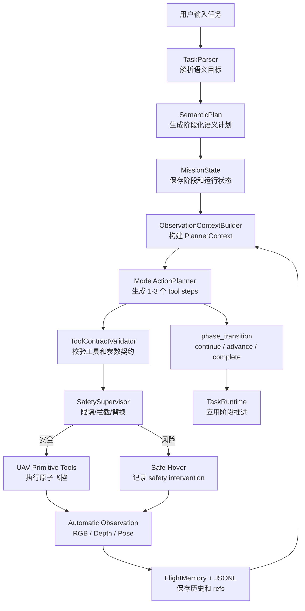
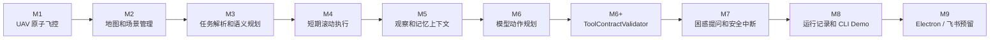
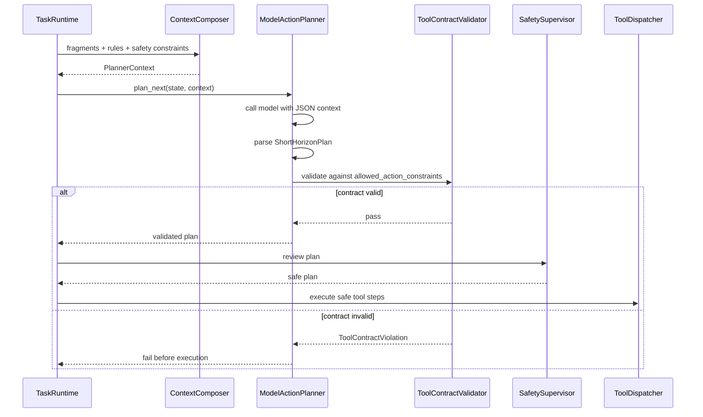
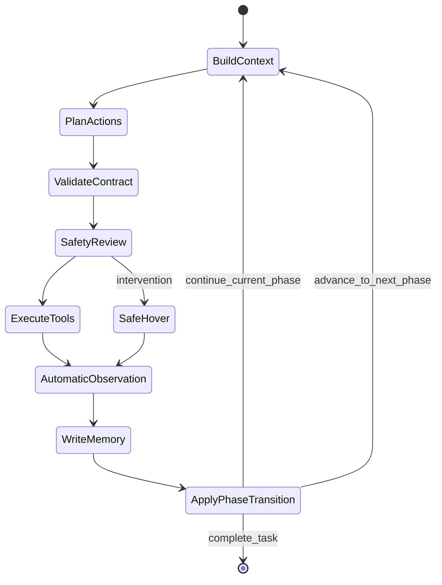
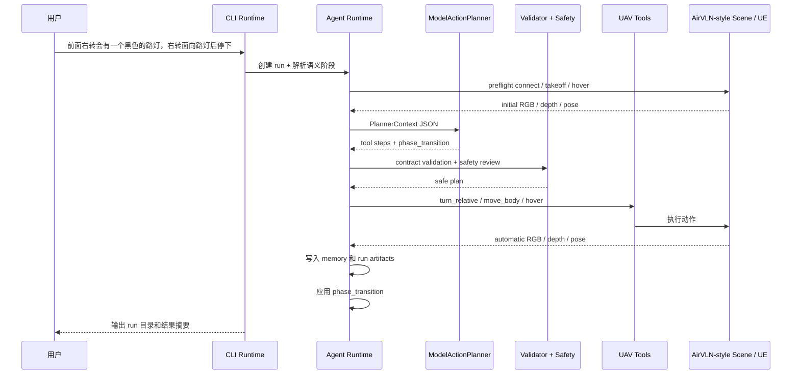

# MVP 规划与流程图

本文只描述第一阶段 MVP 的可运行闭环，以及每张图对应的验收点。

## 图 1: MVP 总闭环

需要完成：

- CLI 能接收自然语言任务。
- 能生成语义阶段，而不是长动作序列。
- 每轮模型只规划短期 UAV tool steps。
- 模型输出经过 `ToolContractValidator` 和 `SafetySupervisor`。
- 动作后 runtime 自动采集 RGB/depth/pose。
- runtime 根据 `phase_transition` 推进、继续或完成任务。

## 图 2: MVP 阶段交付图

验收重点：

- `M1-M5` 跑通环境、观察和 context。
- `M6` 让模型基于 `PlannerContext` 生成动作和 `phase_transition`。
- `M6+` 把动作契约从 planner 内部硬编码拆成独立 validator。
- `M7` 以后再补主动提问和 repair。

## 图 3: 模型规划和契约校验

模型可用动作：

- `uav.hover`
- `uav.turn_relative`
- `uav.move_body`

模型不可用动作：

- `kind="observe"`
- `env.observe`
- 生命周期工具和诊断工具。

## 图 4: 自动观察策略

说明：

- 观察不是模型动作。
- 即使模型只输出 hover，runtime 也会在 phase window 后采集一次 RGB/depth/pose。
- 下一轮 context 使用最新 observation 和 pose refs。

## 图 5: 首个 Demo 任务流程

验收效果：

- 能看到模型实际收到的 `latest_context.json`。
- 能看到模型原始输出和校验后的 `validated_plan.json`。
- 能看到 `safety_decision.json`。
- 能看到动作后自动生成的新 observation 进入下一轮 context。
