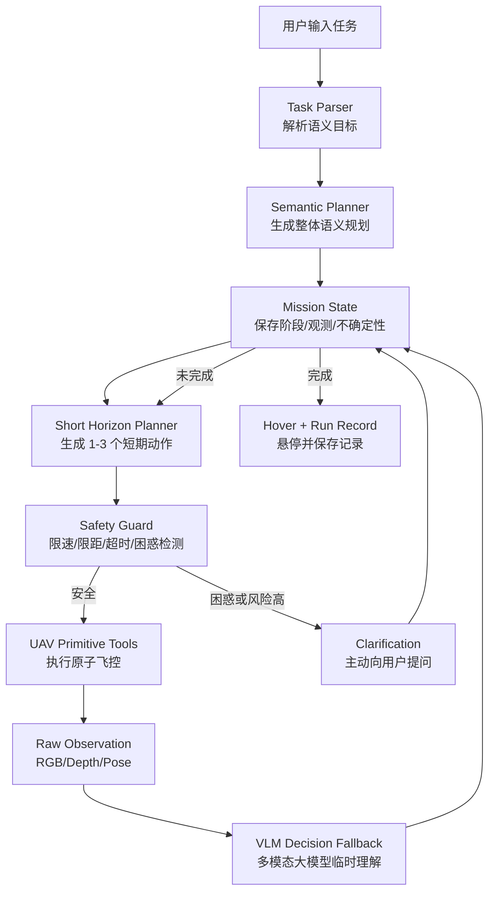
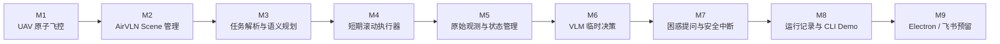
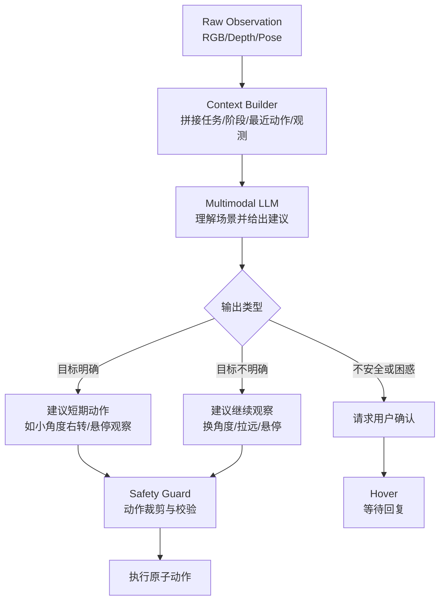
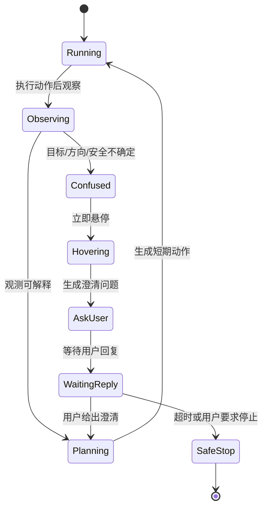
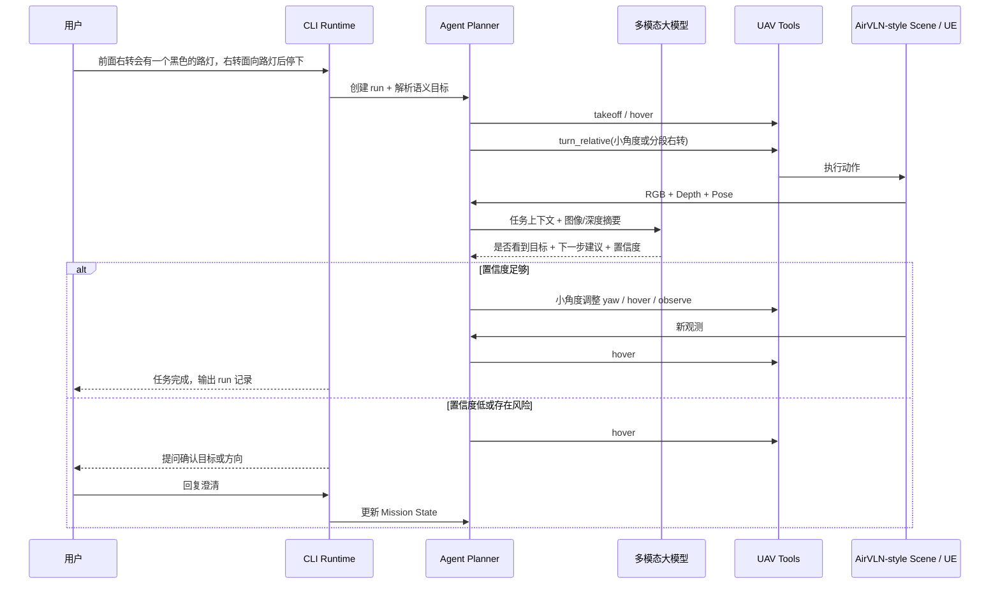

# MVP 规划与流程图

这份文档只描述第一阶段 MVP 应该怎么跑通，以及每张图对应要完成什么、达到什么效果。

## 图 1：MVP 总闭环

需要完成：

- CLI 能接收自然语言任务。
- 能生成整体语义规划，而不是长动作序列。
- 每轮只执行短期动作。
- 每轮动作后重新观察。
- 调用多模态大模型理解 RGB/depth/pose 和任务上下文。
- 困惑或风险高时先 hover，再向用户提问。

达到效果：

- 可以跑通“右转观察、寻找黑色路灯、面向后悬停”的最小闭环。
- 视觉能力先不拆模块，统一用 VLM 完成临时决策。
- 不会因为一次错误规划直接长距离乱飞。

## 图 2：MVP 阶段交付图

需要完成：

- `M1`：封装起飞、悬停、移动、转向、降落、获取位姿和图像。
- `M2`：明确 EnvClient / SimulationServer 边界，用 AirVLN 风格管理 MapPackage、SceneInstance、端口和场景进程。
- `M3`：把用户输入解析成语义目标、目标描述、完成条件和不确定性。
- `M4`：每次只生成 1-3 个原子动作。
- `M5`：保存 RGB/depth/pose、动作日志、状态和轨迹。
- `M6`：用多模态大模型判断“看到了什么、下一步该怎么保守行动”。
- `M7`：困惑时进入 hover，并向用户提出一个简短问题。
- `M8`：CLI 跑通首个任务并保存 run 记录。
- `M9`：预留 Electron 和飞书接口。

达到效果：

- 每个阶段都有独立验收点。
- 先跑通可用闭环，暂不拆分视觉语义模块。

## 图 3：VLM 临时决策

需要完成：

- 定义 VLM 输入：用户任务、语义阶段、最近动作、RGB 图、深度摘要、位姿。
- 定义 VLM 输出 schema：`confidence`、`scene_summary`、`target_status`、`suggested_next_actions`、`ask_user`。
- VLM 只能建议动作，不能直接绕过 Safety Guard 控制 UAV。
- 当 VLM 信心低、目标冲突、深度不安全时，必须返回 `ask_user` 或 `hover`。

达到效果：

- 第一阶段通过大模型完成视觉语义判断。
- 视觉语义能力模块化等当前闭环完成后再考虑。

## 图 4：困惑时主动提问状态机

需要完成：

- 定义困惑触发条件。
- 进入困惑状态后先 hover，再提问。
- 每次只问一个对下一步最有帮助的问题。
- 用户回复进入 `Mission State`，重新规划。
- 如果用户长时间不回复，保持 hover 或安全降落，由配置决定。

达到效果：

- Agent 不会在看不懂场景时继续猜。
- 用户可以用自然语言纠正任务，例如“不是左边那个，是更远处黑色细杆的路灯”。

## 图 5：首个 Demo 任务流程

需要完成：

- CLI demo：`lamp_right_turn_demo`。
- 分段右转，不直接假设 90 度一步到位。
- 每轮调用 VLM 或 mock VLM。
- VLM 输出必须经过 schema 校验和 Safety Guard。
- 低置信度时能主动提问。

达到效果：

- 第一阶段就能看到一个可交互、可记录、可安全中断的 UAV Agent 原型。
- 后续如果要拆分视觉能力，可以把 VLM 判断从“主决策参考”逐步降级为“兜底解释器”。
