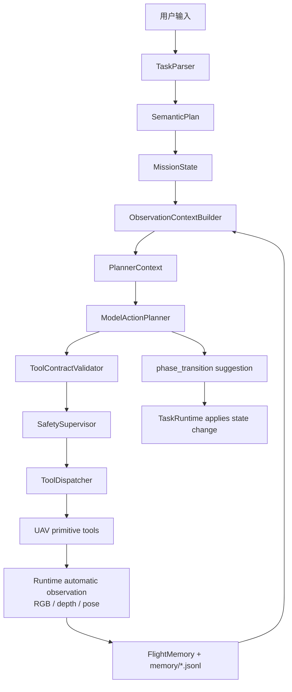

# UAV Agent MVP 计划

## 1. MVP 范围

MVP 只做单机、单 UAV、UE / AirSim 仿真闭环。第一阶段使用 CLI 跑通任务，不做完整 Electron 前端、多机协同或手机端能力。

优先支持任务示例：

```text
前面右转会有一个黑色的路灯，右转面向路灯后停下
```

这类任务不应该一次性生成很长的固定动作序列，而应拆成：

- 语义目标：右转后寻找黑色路灯，并让 UAV 面向它悬停。
- 短期执行窗口：每轮只输出 1-3 个可校验 UAV 原子动作。
- 自动观察：runtime 在每个 phase window 后自动采集 RGB/depth/pose。
- 模型规划：`ModelActionPlanner` 读取 `PlannerContext`，生成动作计划和 `phase_transition`。
- 契约校验：`ToolContractValidator` 检查工具白名单、禁用工具和参数格式。
- 安全边界：`SafetySupervisor` 做最终限幅、替换和拦截。

## 2. 当前主链路



模型只输出 `kind="tool"` 的动作 step，不能输出 observe。观察由 runtime 的 `observation_policy` 管理。

## 3. 阶段划分

### M1: UAV 原子飞控封装

目标：

- 从 AirNavigation / AirSim 侧抽象 UAV 基础操作。
- 只封装原子飞控和原始观察，不继承外部项目的整体任务架构。

动作边界：

- 生命周期工具：`uav.connect`、`uav.takeoff`、`uav.land` 只允许 runtime 使用。
- 模型规划工具：`uav.hover`、`uav.turn_relative`、`uav.move_body`。
- 诊断/观察工具：`uav.get_pose`、`uav.get_frames`、`env.observe` 不暴露给 planner。

### M2: 地图资源与场景管理

目标：

- 使用 `MapPackage` 描述地图资源。
- 使用 `SceneInstance` 描述一次运行中的场景实例。
- 由 `SimulationServer` 查找 scene、分配端口、生成 AirSim settings、启动或复用场景。

### M3: 任务解析与语义规划

目标：

- 将用户自然语言指令解析为稳定的 `SemanticPlan`。
- 语义规划只描述 intent、goal、phase 和 uncertainty，不展开成长动作序列。
- phase 使用开放名称，但必须包含 `index`、`total`、`name`、`meaning`。

### M4: 短期滚动执行器

目标：

- runtime 每轮构建 `PlannerContext`。
- `ModelActionPlanner` 输出短期动作计划。
- `ToolContractValidator` 拒绝不符合 context contract 的输出。
- `SafetySupervisor` 做最终安全审查。
- runtime 执行动作后自动观察，再根据 `phase_transition` 推进或继续 phase。

当前事实：

- 规则版短期 planner 已移除。
- `run-task` 固定使用 `ModelActionPlanner`。
- 模型不能输出 `kind="observe"`。
- `phase_transition` 已进入 `ShortHorizonPlan`。

### M5: 原始观察与上下文管理

目标：

- 原始感知层只负责 RGB/depth/pose，不伪造高级视觉事实。
- `FlightMemory` 采用 manifest + `memory/*.jsonl` 保存可追溯历史。
- context modules 压缩出 `ContextFragment`。
- `ContextComposer` 输出 `PlannerContext`。

验收：

- 每轮写入 `observations/latest_observation.json`。
- 每轮写入 `contexts/latest_context.json`。
- planner 输入不暴露完整 `FlightMemory` 或完整 jsonl 历史。

### M6: 模型动作规划

模型输出格式：

```json
{
  "phase": "copy current_phase.name",
  "steps": [
    {
      "kind": "tool",
      "tool": "uav.hover",
      "args": {},
      "reason": "hold position"
    }
  ],
  "phase_transition": {
    "decision": "continue_current_phase",
    "reason": "need more evidence before advancing"
  }
}
```

约束：

- 只允许 `kind="tool"`。
- 不允许 `env.observe` 或 `kind="observe"`。
- `uav.hover` 参数必须是 `{}`。
- `uav.turn_relative` 只允许 `{"yaw_deg": number}`。
- `uav.move_body` 只允许 direction/duration 或 vx/vy/vz/duration 两种格式。
- limits 来自 `PlannerContext.allowed_action_constraints`，最终安全限幅由 `SafetySupervisor` 执行。

### M6 后续增强: Plan-Execute-Repair

当前链路已经包含 contract repair v1：

```text
ModelActionPlanner
  -> ToolContractValidator
    -> if invalid: ModelRepairPlanner(max 3 attempts)
    -> SafetySupervisor
      -> ToolDispatcher
```

后续可继续扩展执行失败 repair：

```text
ModelActionPlanner
  -> ToolContractValidator
    -> if invalid: ModelRepairPlanner(max 3 attempts)
    -> SafetySupervisor
    -> ToolDispatcher
    -> if execution failed: ModelRepairPlanner or safe hover
```

### M7: 困惑提问与安全中断

目标：

- Agent 不确定继续行动是否正确或安全时，主动停下并询问用户。
- 触发困惑时先 hover。
- 用户回复可更新目标、方向、候选选择或停止指令。

### M8: 运行记录与 CLI

目标：

- CLI 是第一阶段主入口。
- 每次任务生成 run id。
- 每轮保存语义规划、context、模型计划、contract validation、动作结果、观察、安全介入和错误。
- `demo_model_action_planner_context.py` 展示模型输入、模型输出、校验结果和安全审查结果。

### M9: Electron 与飞书预留

目标：

- Electron 等 UE CLI 完整跑通后再做。
- 飞书只作为未来消息入口和通知入口。
- 第一阶段不依赖手机传感器 API。

## 4. 优先级

最高优先级：

- UAV 原子飞控封装。
- EnvClient / SimulationServer 本地 C/S。
- RGB/depth/pose 原始观察。
- `PlannerContext` 构建。
- `ModelActionPlanner` 动作规划。
- `ToolContractValidator` contract 校验。
- `SafetySupervisor` 安全裁剪。
- 自动 observation 和 phase transition。

中优先级：

- run store 和轨迹复盘。
- 主动提问。
- 执行失败 repair。
- 真实 UE / AirSim demo 验证。

低优先级：

- 视觉语义能力模块化。
- skills 系统。
- 多 UAV。
- Electron 前端。
- 飞书接入。

## 5. 第一条 Demo

文件：

```text
demos/demo_model_action_planner_context.py
```

流程：

1. 读取用户自然语言指令。
2. `TaskParser(mode="model")` 生成 `SemanticPlan`。
3. 写入 demo memory 和 `FlightMemory` manifest refs。
4. `ObservationContextBuilder` 生成 `PlannerContext`。
5. `ModelActionPlanner` 调用模型生成动作计划和 `phase_transition`。
6. `ToolContractValidator` 校验计划契约。
7. `SafetySupervisor` 审查动作。
8. 输出 `demo_preview.md` 供人工检查。

## 6. 风险

- map memory 和图像推测不能当作当前视觉事实。
- 模型动作必须先经过 contract 校验，再经过 `SafetySupervisor`。
- 自动观察目前是 phase-window 后采样，不是真实异步定时线程。
- `phase_transition` 是模型建议，runtime 才能真正修改 `MissionState`。
- 如果阶段完成判断变复杂，再独立抽出 `PhaseCompletionEvaluator`。
