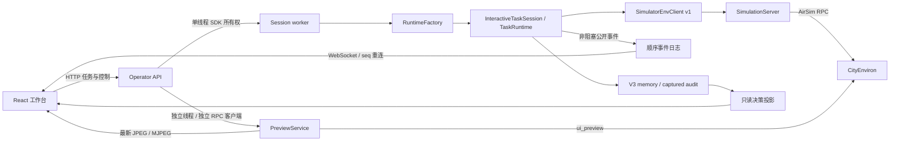

# Flight Workbench

React + TypeScript + Vite 的本机工作台通过 FastAPI 接入现有 Runtime。第一版提供
自主飞行、完整执行边界上的暂停/恢复/停止、独立 UI 相机、V3 决策回放、场景连接
和预览设置。Electron 可在后续作为桌面外壳加入，当前浏览器即可使用。

## 启动

在仓库根目录安装可选 API 依赖，然后启动 API：

```powershell
& 'F:\conda_env\flyagent\python.exe' -m pip install -r requirements-ui.txt
& 'F:\conda_env\flyagent\python.exe' -m src.operator_api
```

开发前端，在另一终端执行：

```powershell
Set-Location F:\UAV-Agent\frontend
npm.cmd ci
npm.cmd run dev
```

打开 `http://127.0.0.1:5173`。Vite 将 `/api` 和 WebSocket 代理到本机 8000 端口。
执行 `npm.cmd run build` 后重新启动 API，也可直接从 `http://127.0.0.1:8000`
访问构建后的工作台。API 文档位于 `/docs`。默认仅监听回环地址。

API 读取现有 `.env`、插件、Context、UAV 安全配置，不创建另一套模型或飞行策略。
可用 `--maps` 指定地图配置、`--env` 指定模型配置。启动 API 不会自动启动 UE。

## 环境和连接

默认地图为 `cityenviron_win64`，可执行文件位于地图配置中指定的 CityEnviron
目录。选择“受管启动”时，SimulationServer 创建场景专用 settings 文件，分配
RPC 端口（默认从 30001 起），启动 UE 并等待就绪；关闭会话时释放预览和 SDK
客户端，再终止本次拥有的 UE 进程并归还端口。

“连接已有场景”使用地图配置的 `airsim.host` / `airsim.port`，未配置时为
`127.0.0.1:41451`。其他端口可在传给 `--maps` 的地图副本中指定。已有场景需要
预先配置 `ui_preview` 相机，其分辨率应与工作台设置一致；API 不修改运行中的
原场景配置，关闭会话保留外部场景进程。UnrealCV 环境沿用现有连接路径，第一版
独立连续预览仅支持 AirSim。



一个 API 进程同时管理一个活动场景、一个无人机和一个任务执行线程。
`SimulationServer` 是现有 Python 服务对象，API 通过它管理 UE，SDK 通过 RPC
连接 UE；没有额外假设仿真服务器是 HTTP 服务。远程场景仍由原有部署、隧道和
进程所有权机制管理。

## 数据与控制边界

- 模型相机维持地图配置；默认 CityEnviron RGB 224×224、Depth 256×256。
  UI 相机默认为 `ui_preview`、960×540、目标 20 FPS、JPEG quality 80。
  新相机显式提供有限位姿，避免旧 AirSim 用 NaN 创建自定义相机造成 UE 崩溃。
  原模型相机和 CameraDefaults 不被改写。
- 预览有单独客户端和捕获线程，只保留最新一帧，慢浏览器不会积压任务队列。
  预览不写入模型 observations、Transcript 或模型上下文，也不默认录像。
- 控制请求立即返回 `pause_requested`、`resume_requested` 或 `stop_requested`。
  Runtime 在规划前、模型响应后执行前、完整工具回合后确认；已开始的物理 batch
  会完成工具结果、稳定化和 after observation。不会中断一半 batch，也不会
  在 UI 线程额外发飞行命令。停止后丢弃尚未执行的模型决策，任务无法再恢复。
- WebSocket 每秒发送控制心跳。最后一个控制连接断开或心跳过期 5 秒后请求暂停。
  实际确认可能等待当前模型请求/完整执行窗口结束。重连不自动恢复，必须点击
  “继续”。只打开 MJPEG 流或只读历史接口不算控制连接。
- 事件使用 `seq`、`session_id`、`instruction_id`、`decision_id`；工具结果保持
  `tool_call_id`。同一会话的新任务可重复 `decision_0001`，投影通过 instruction ID
  区分。发送任务的 `request_id` 防止同一服务会话内重试导致重复执行。
- 回放从 V3 文件读取原始输入、公开意图、工具请求/执行参数、结果、安全干预和
  观测引用。Provider 公开内容与工具名称摘要分别标记来源，不展示隐藏推理。
  缺失的历史计划、图片或结果保持缺失，不用当前状态补写历史。
- 位姿与速度来自最近一次已记录观测；高度为 NED 原点的 −Z，不是离地高度。
  轨迹只连接真实 XY 记录，回放限制到选中决策的观测边界。宽屏预览保持概念图
  的裁切布局；全屏可查看完整画面。
- 历史运行与资源使用不透明 ID，仅允许读取配置 run root 中已引用的图像资源；
  原始审计按需读取并去除媒体字节和凭据。API 会话暂不跨进程重启恢复。

## 文件结构

```text
frontend/
  src/app/App.tsx                    导航、页面组合和用户操作
  src/api/{client,types,useSession}  HTTP 类型、事件重连和控制心跳
  src/components/Evidence.tsx        原始观测缩略图
  src/features/flight/               已记录轨迹、决策检查器
  src/features/replay/               双栏详情、参数对照、请求审计
  src/styles/                        颜色、字型、布局和响应式样式
  tests/workbench.spec.ts             浏览器控制/回放/手机回归
src/operator_api/
  __main__.py / app.py                启动、HTTP、WebSocket、MJPEG、静态前端
  config.py / schemas.py              API 配置与请求契约
  composition.py                     接入既有 RuntimeFactory
  services/sessions.py                会话生命周期、控制与断连保护
  services/worker.py                  SDK 单线程所有权
  services/event_stream.py            非阻塞、顺序、可恢复订阅事件
  projections/{replay,decisions}.py    V3 历史关联与受限资源读取
src/runtime/control/runtime_control.py Runtime 完整边界控制锁存
src/sim_server/preview/               独立 UI 相机、捕获源、最新帧服务
tests/test_operator_{api,control}.py  会话与核心控制回归
tests/manual/operator_*_probe.py      真实飞行、预览测量与场景清理探针
```

`EnvClient v1` 签名保持不变，场景与 preview 的资源所有权位于 sim_server。
API 不直接依赖某个飞行策略或创建第二套插件注册图。新事件副本存于
`operator/events.jsonl`，原 Runtime events、V3 memory 和 debug artifacts 仍是
原始执行记录。

## 验证

```powershell
& 'F:\conda_env\flyagent\python.exe' -m pytest -q tests --ignore=tests/manual
Set-Location F:\UAV-Agent\frontend
npm.cmd run build
npm.cmd run test:e2e
```

浏览器插件在本次会话不可用，因此浏览器检查采用普通 Playwright 和本机已安装的
Chrome。默认测试配置使用 `channel: chrome`。前端集成测试在测试文件中模拟服务
契约；真实飞行探针使用现有 provider、Runtime 和 CityEnviron，不注入模拟决策。

真实探针示例（先从 UI 创建场景，在 `/api/sessions` 获取 session ID）：

```powershell
& 'F:\conda_env\flyagent\python.exe' -m tests.manual.operator_workbench_probe `
  --session SESSION_ID --disconnect-test --output runs/experiments/workbench-flight.json
& 'F:\conda_env\flyagent\python.exe' -m tests.manual.operator_workbench_probe `
  --session SESSION_ID --stop-test --output runs/experiments/workbench-stop.json
```

每次真实探针记录解释器、PyTorch、CUDA 版本和可用状态。CUDA 可用性是环境
诊断，不代表每个飞行任务都执行了 GPU 感知工具。

2026-10-08 本机实测：完整飞行任务完成，7 次决策、8 次观测；停止探针新增
1 次被丢弃决策、0 个物理窗口。重连保持暂停，事件时间显示约 5 秒后请求暂停，
确认耗时约 6.9 秒（等待模型响应边界）。初次 12 秒采样为 14.8–16.4 FPS、
P95 75–107 ms；后续任务暂停期间及前后采样为 18.0–18.3 FPS、P95 64–70 ms。
这表示稳定状态达到 15 FPS 目标，但首轮采样有低于目标的波动，20 FPS 为请求
上限。延迟测量包含 AirSim RPC、JPEG 编码和本机完整 HTTP 帧到达，不包含浏览器
绘制；没有将其标为屏幕呈现延迟。

原始测试数据、原始工作区差异基线与真实运行日志在
`runs/experiments/operator_ui_baseline_20261008_163941/`。视觉检查按已确认主界面
1672×941、详情页 1504×1046 核对，使用真实 CityEnviron 图像替代概念图示例。

最终验证通过 1433 项 Python 回归和 4 项浏览器回归。从构建后的真实界面连接
CityEnviron、发送前进 1 米任务、检查参数并关闭会话也已通过；实际前向位移
1.008 米，记录 8 次决策、7 个物理窗口。首个窗口记录 ground-contact collision，
Agent 根据真实反馈调整间隙后继续，保留了失败与恢复的完整记录。对应结果为
`real-ui-qa.json`。工作区保留原有修改，`implementation_manifest.json` 单独列出
工作台范围，以及基线核对中观察到的范围外 benchmark 修改；没有将其回滚或提交。
