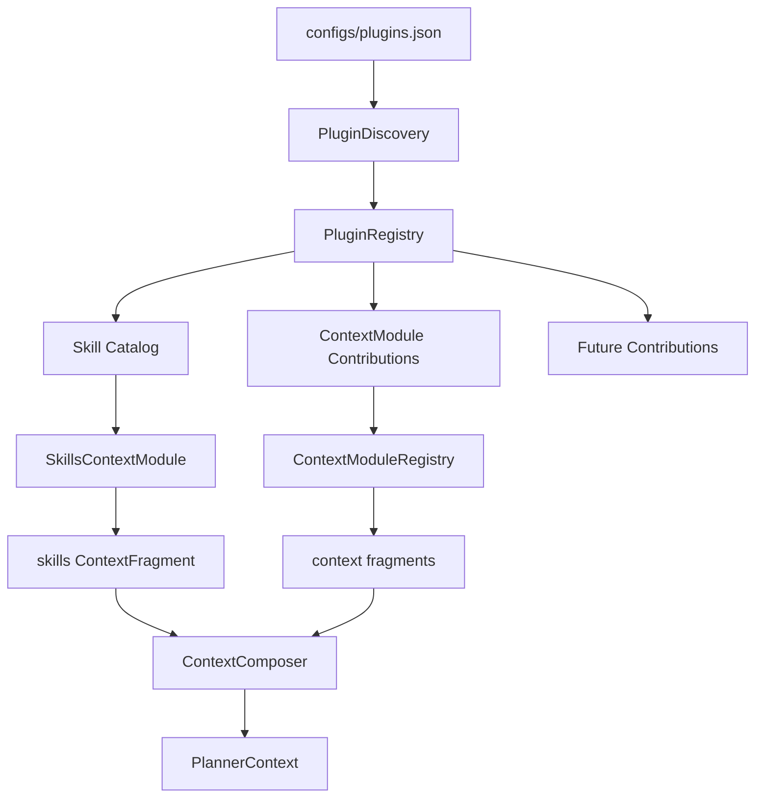
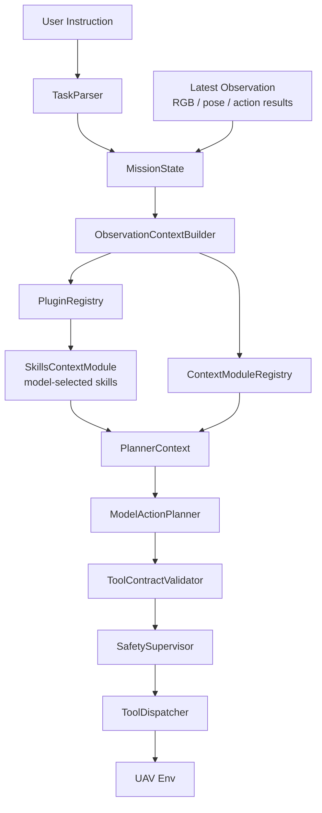

# 01 Architecture

插件系统是 UAV-Agent 的扩展装配层。它不替代 `TaskRuntime`、`ToolDispatcher`、`ContextModuleRegistry` 或 `FlightMemory`，而是把不同插件贡献分发给这些已有边界。

## 角色划分

```text
plugins/
  插件资产目录：Markdown skills、research context modules、未来用户插件

src/plugins/
  插件系统代码：发现、注册、选择、装配

src/memory/context/
  上下文运行接口：ContextModule、ContextFragment、ContextComposer

TaskRuntime / ObservationContextBuilder
  飞行时加载入口：把插件贡献接入 planner context
```

## 系统边界

插件系统只负责贡献和装配：

- `Skill` 进入 `skills` context fragment。
- `ContextModuleContribution` 进入 `ContextModuleRegistry`。
- 带 `capability.json` 的 callable skill 进入 `SkillCapabilityCatalog`，并以 `skill.*` 形式经过 validator 和 dispatcher。
- `ResponseProtocol` 未来进入 agent message / final answer 层。
- `PolicyRule` 未来进入约束合成层。

插件系统不做：

- 不直接调用无人机。
- 不直接输出动作。
- 不直接判断 phase 是否完成。
- 不直接读完整 run artifacts。
- 不绕过 `ToolContractValidator` 和 `SafetySupervisor`。

## 加载链路



## 飞行链路



## 第一版目标

第一版先让飞行知识稳定进入 planner context：

```text
instruction / semantic_plan / phase / image availability
  -> model selects Skill from listing
  -> skills fragment
  -> planner context
```

这能解决 UAV-Flow 暴露出来的一类通用问题：模型需要知道“turn to face person”是视觉对齐任务，不是 yaw 回到 0；“move to a position X meters from person”需要先定位目标，再根据距离调整动作。
