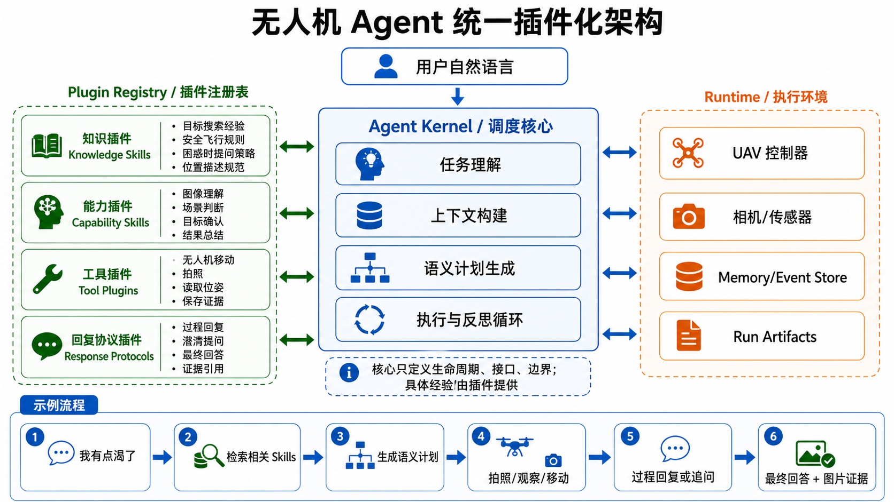

# 统一插件化架构



## 设计目标

统一插件系统的目标不是把无人机行为写成固定策略，而是让 Agent Kernel 能发现并组合不同类型的能力：

- 知识：任务经验、飞行规则、困惑时提问策略、位置描述规范。
- 能力：看图理解、场景判断、目标确认、结果总结。
- 工具：无人机移动、拍照、读取位姿、保存证据。
- 上下文：把 instruction、image、pose、action、map 等信息组织成模型可读片段。
- 回复协议：过程回复、澄清提问、最终回答、证据引用。

Agent Kernel 只负责生命周期、上下文构建、语义计划生成、工具执行和反馈循环。具体“怎么观察目标、什么时候换角度、如何描述结果”应该由 skills 和上下文引导模型生成语义计划，而不是在 runtime 里写死。

## 插件层只做贡献声明

插件不应该直接控制整个飞行流程。推荐把插件抽象成贡献集合：

```python
@dataclass
class PluginContributions:
    knowledge_skills: list[KnowledgeSkill]
    capability_skills: list[CapabilitySkill]
    tool_specs: list[ToolSpec]
    context_modules: list[ContextModule]
    response_protocols: list[ResponseProtocol]
```

这些贡献分别进入已有或未来的系统：

- `tool_specs` 进入现有 `ToolRegistry`。
- `context_modules` 进入现有 `ContextModuleRegistry`。
- `knowledge_skills` 被注入 planner context。
- `capability_skills` 提供模型能力包装，例如看图理解或结果总结。
- `response_protocols` 生成用户可见的过程回复、追问和最终回答。

## 不写死目标搜索策略

以“我有点渴了，帮我找售货机”为例，runtime 不应该内置“右转 45 度、拍照、再右转”的固定策略。

更合适的流程是：

1. 用户自然语言进入任务解析。
2. PluginRegistry 检索相关知识，例如“寻找周围目标时可以先观察当前视角，目标不明显时扩大视野，低置信度时向用户说明不确定性”。
3. 模型基于任务、图片、位姿、历史动作和 skills 生成语义计划。
4. runtime 执行模型给出的工具调用。
5. 每次观察和动作结果写回 memory/context。
6. 回复协议把关键过程和最终答案发给人类。

这样保留了模型自主规划能力，也让未来的 skills/plugin 可以持续扩展经验。

