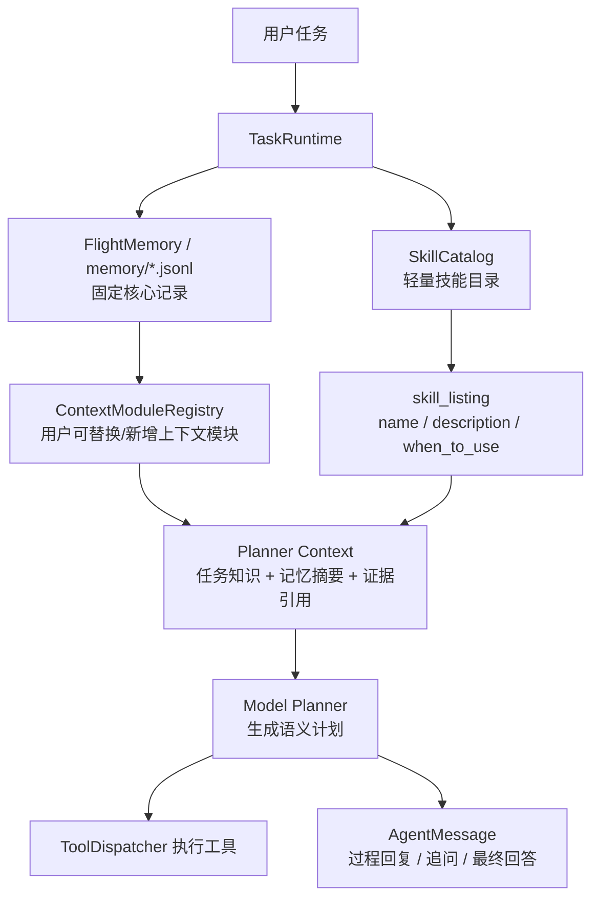

# 插件系统需求文档

## 背景

UAV Agent 的长期目标是让无人机能够根据自然语言任务、环境观察、历史记忆和任务知识自主生成语义计划。例如用户说“我有点渴了，帮我找一下周围有没有售货机”，系统应该能观察环境、利用图片证据、必要时追问，并给出过程回复和最终回答。

插件系统第一版不是为了把所有功能都做成插件，而是为了解决模型上下文组织问题：

> 模型如何按需获得任务知识、记忆摘要和回复规范。

## 目标

- 给模型一个可发现的 UAV skills 目录，而不是把所有飞行、视觉、回复知识常驻 prompt。
- 让不同任务按需注入相关知识，例如目标搜索、视觉观察、低空安全、回答规范。
- 让用户在不改 runtime 的情况下，自定义“记忆如何被模型看到”。
- 保持现有 `ToolRegistry`、`ContextModuleRegistry`、`FlightMemory` 可复用，不推翻现有架构。

## 非目标

- 不做完整插件市场。
- 不允许用户改写无人机执行生命周期。
- 不开放任意自定义 memory 写入管线。
- 不把 `ObjectDetector` 作为必选能力；视觉默认仍是模型看图。
- 不让 skill 直接生成 planner action 绕过安全和工具校验。

## MVP 边界

第一版插件系统由三部分组成：

### SkillCatalog

负责发现内置 UAV skills，读取 frontmatter，生成轻量 `skill_listing`。模型先看到目录，不直接看到完整知识库。

### SkillContentInjector

负责在需要时展开完整 `SKILL.md`，并把它注入 planner context。第一版可以由 runtime 自动选择相关 skill，不必暴露模型可调用的 SkillTool。

### ContextModule 用户扩展

第一版只允许用户自定义记忆呈现方式，而不是底层记忆写入方式。

## 记忆自定义策略

第一版只开放上下文层自定义：

- 核心 memory 记录仍固定为 `instructions/actions/observations/poses/frames`。
- `FlightMemory` 仍作为 manifest/index，只保存 refs 和窗口指针。
- 用户可以新增或替换 `ContextModule`，把已有 memory 加工成不同的 `ContextFragment`。

推荐用户自定义方式：

- 替换 `image` module：例如更长图像历史、关键帧选择、视觉不确定性摘要。
- 新增逻辑类别但不新增底层记录：例如 `visual_findings` 可以先作为 image module 的输出字段，而不是新建写入管线。
- 每个自定义 module 必须实现 `build()` 和 `describe_output()`，并解释输出字段。

后续版本再考虑记录层扩展：

- 只有当回复系统和视觉信息接入稳定后，才允许插件声明新的 append-only memory 文件，例如 `answers.jsonl`、`visual_findings.jsonl`。
- 新增记录类别必须有 schema、ref 规则、context module 和测试。

## 验收标准

- 文档能回答插件系统到底解决什么问题。
- 文档能说明用户如何自定义当前各类记忆。
- 文档能解释为什么第一版只开放上下文层，而不是完整 memory pipeline。
- Markdown 链接和 mermaid 图可正常阅读。
- 不修改运行时代码。

