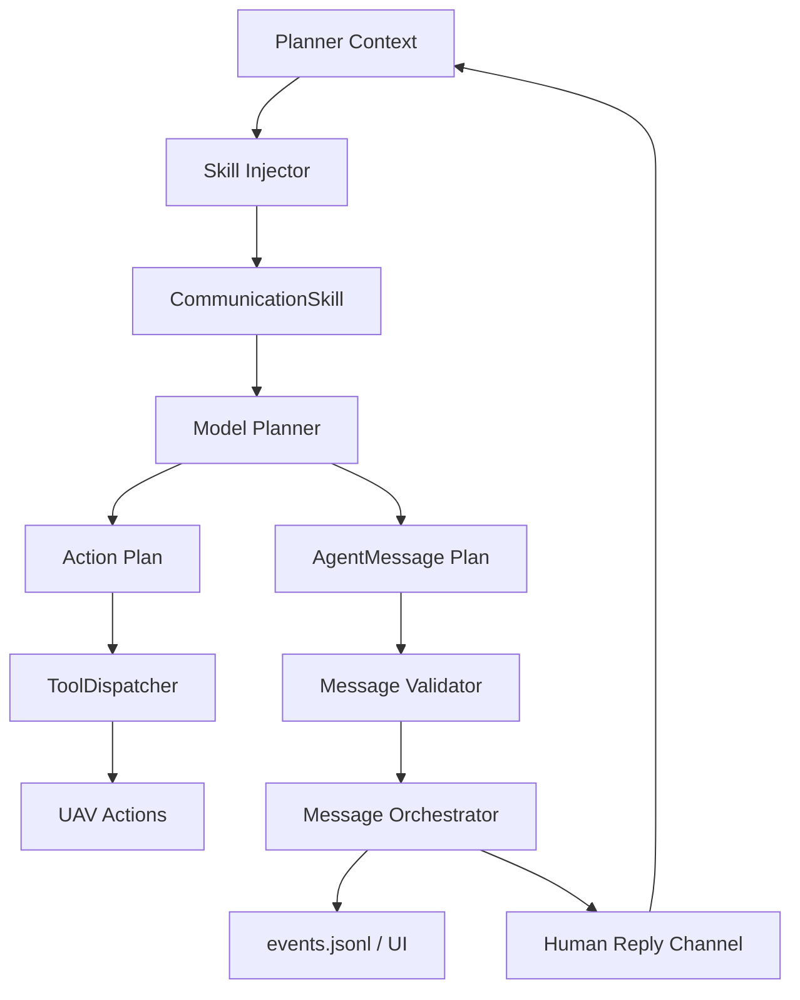

# 通信智能层设计记录

通信智能层要解决的问题是：无人机什么时候应该向人类汇报、什么时候应该提问、什么时候应该警告，以及任务结束时如何给出最终回答。

第一版不把 `report`、`ask_user`、`alert` 做成 `ToolDispatcher` 工具。它们的本质是通信能力，不是飞行动作工具。当前更合适的做法是：让模型在计划里输出结构化 `agent_messages`，由 runtime 校验、记录和推送。

## 阶段性结论

当前采用这条路线：

```text
CommunicationSkill = 教模型什么时候说、怎么说
AgentMessage = 定义消息格式
TaskRuntime = 校验、记录、推送消息
ToolDispatcher = 只处理真实动作或外部能力调用
```

当前不采用这条路线作为 MVP：

```text
模型 -> ToolDispatcher -> report / ask_user / alert -> 再转 UI 消息
```

这样可以避免把“对人沟通”和“飞行动作”混在同一个工具执行层里，也方便后续 TUI、Electron、Web UI 共用同一套消息协议。

## 第一版是什么

第一版本质上是一个 `communication_protocol` prompt / `KnowledgeSkill`。它告诉模型：

- 任务开始或阶段推进时，可以输出 `progress`。
- 目标不明确、多个候选目标、低置信度判断时，可以输出 `question`。
- 安全风险、距离过近、动作被安全策略拦截时，可以输出 `warning`。
- 找到目标、确认位置或任务结束时，输出 `final`。
- 不暴露 raw thinking，只输出给人类可理解的执行过程摘要。
- 如果有图片、pose、动作记录等证据，尽量放入 `evidence_refs`。

也就是说，第一版主要补“什么时候说、怎么说”的知识，不引入完整通信插件系统。

## 最终版是什么

最终版应演进为一个可配置、可审计、可回流的人机通信层：

- `CommunicationSkill`：作为内置知识技能，描述沟通时机、语气、证据引用和追问策略。
- `AgentMessage`：作为底层数据协议，定义 `progress | question | warning | final` 等消息类型。
- `MessageValidator`：校验消息合法性，禁止 raw thinking，约束 question/final/warning 的必要字段。
- `MessageOrchestrator`：负责写入 `events.jsonl`、更新 latest state、推送给 TUI/Electron/Web UI。
- `HumanReplyLoop`：当消息需要用户回复时暂停或挂起当前任务，并把用户回复注入下一轮 planner context。

## 数据流



## 为什么不先做 report 工具

如果把 `report`、`ask_user`、`alert` 做成普通工具，模型每次想说一句话都要生成一个 tool step。这样会让通信行为和飞行动作共享同一个执行通道，后续还要再把 tool result 转成用户消息。

更稳的方式是：

```text
模型 -> plan.agent_messages -> AgentMessage 校验 -> events/state/UI
```

这样模型仍然可以自己决定什么时候说话，但消息会经过协议校验，并且天然能挂载图片、pose、动作记录等证据引用。

## 推荐实现时机

通信智能层不要早于视觉闭环和追问回流来做完整抽象。推荐顺序是：

1. 先稳定 `AgentMessage` 基础协议和 `agent_message` event。
2. 接入简单视觉信息，让 `progress`、`question`、`final` 能引用真实图片 evidence。
3. 跑通 `question` 阻塞与用户回复回流。
4. 再把 `communication_protocol` 抽成内置 `KnowledgeSkill`。
5. 最后再把稳定后的机制收敛到完整 `ResponseProtocol` / plugin contribution。

