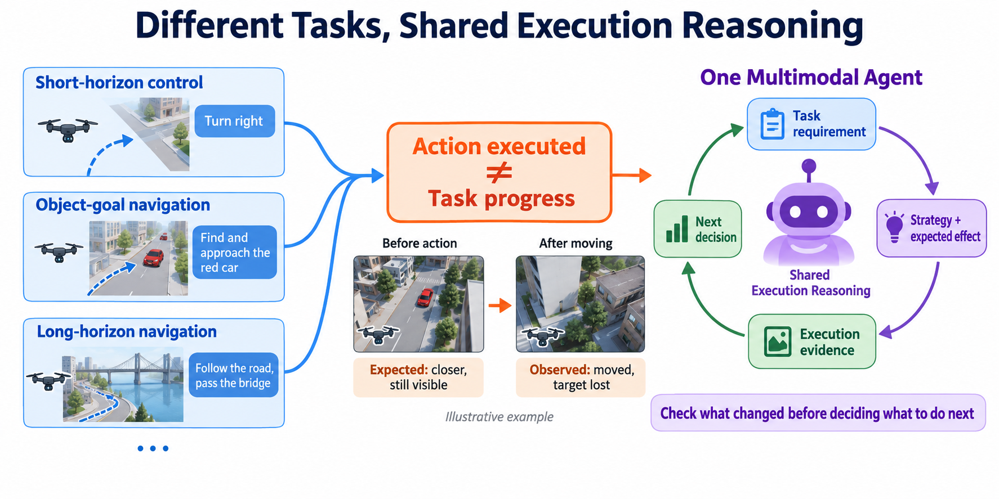
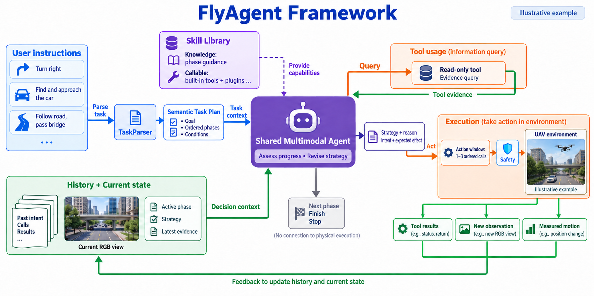
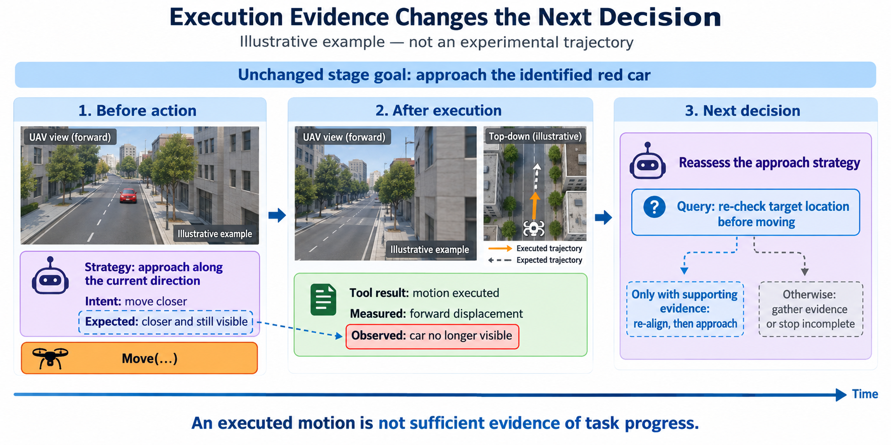
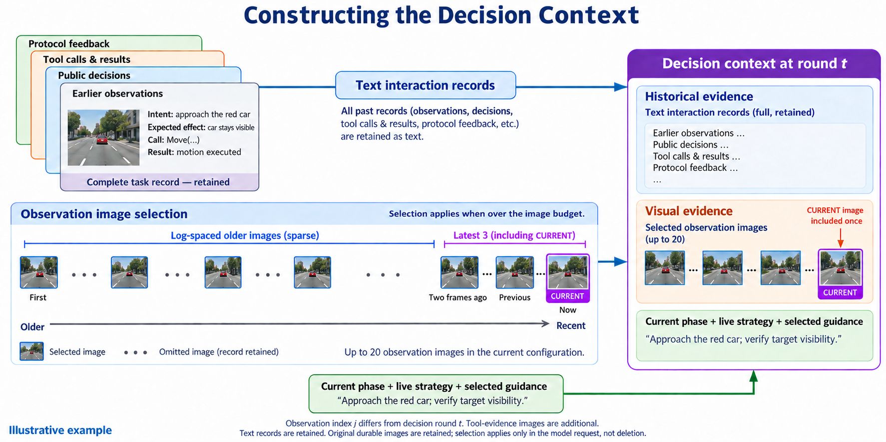

# FlyAgent Method（讨论稿）

日期：2026-09-20。本文为中文写作底稿，保留英文节标题与公式；图稿是视觉预览，不是实验记录或最终矢量稿。

研究目标是建立空中语言任务的统一决策与执行框架，而不是为预先列举的几类任务分别设计系统；方法核心是把任务相关能力组织与执行驱动的策略修订结合起来。短程控制、目标导航与长程导航是借助相应 Benchmark 组织验证的任务场景，不是框架的预设任务边界。统一性指共享工作机制，不意味着已经验证所有可能的任务。以下公式是实现的概念抽象，不表示新增训练目标或代码中不存在的数值误差计算器。

## 3. Method

FlyAgent 是一个空中语言任务的统一 Agent 框架，通过共享的任务表示、能力组织和决策循环，将语言目标转化为无人机的持续执行过程。不同指令首先被转换为目标与语义阶段；随后，同一个多模态 Agent 在任务相关指导、可调用工具、历史交互和当前观测的支持下决定下一步。动作完成后，实际运动与视觉变化重新进入决策上下文，使后续行为不仅依据此前的计划，也依据实际发生的结果。

框架不以短程控制、目标导航或长程导航等类别作为预设的高层流程分支。本文借助现有 Benchmark 中的相应任务，检验同一套机制在不同要求下的适用性。因此，任务类别用于说明评测覆盖范围，而不用于定义方法仅能处理哪些任务；实际能力仍受可用工具、模型能力与已验证范围约束。

方法包含两个相互衔接的部分：**Task-Guided Knowledge and Tools** 解决“不同任务如何进入同一种工作方式、需要哪些指导与操作”；**Execution-Grounded Strategy Revision** 解决“执行后如何判断进展、补充证据并修订策略”。Figure 2 展示整体关系，Figure 3 展示一次策略调整，Figure S1 解释历史上下文的构建。Figure 1 属于 Introduction 的问题说明，不是额外方法模块。

### 3.1 Task-Guided Knowledge and Tools

**（1）Unified Task Representation：将不同指令转为共同的任务表示**

给定语言指令 $I$，TaskParser 生成语义任务计划 $G$。该计划描述任务意图、最终目标和有序阶段，而不提前规定完整的动作序列：

$$
G=\mathcal P(I;\mathcal K)
=\left(z,g,\{\phi_k\}_{k=1}^{K}\right),
\qquad \phi_k=(g_k,D_k,C_k).
\tag{1}
$$

其中，$z$ 表示任务意图；$g$ 包含目标对象、属性与要求的最终状态；$g_k$、$D_k$ 和 $C_k$ 分别表示阶段目标、完成条件与继续条件。$\mathcal K$ 表示可用知识指导。实际解析包含结构生成和阶段条件构建，式（1）将其合并表达，并不表示每一步都读取全部知识。

例如，“Find the red car, approach it, then hover nearby.” 可以用如下示意结构解释：

~~~text
Semantic Task Plan
Intent: find and approach a visual target
Task goal:
  Target: red car
  Final state: hovering nearby
Phases:
  1. Find the red car
  2. Approach the car
  3. Hover nearby
~~~

上述阶段划分仅用于说明，不代表一次实际解析输出。定稿应替换为真实 TaskParser 结果，不为了画图强行拆分阶段，也不能遗漏指令要求的最终状态。

语义阶段回答“当前需要实现什么”，不回答“接下来固定执行哪些动作”。当前激活阶段由运行时选择并更新，属于当前状态，不属于解析器原始输出。阶段完成条件用于约束进度判断，但不被单独包装为本文核心创新。

**（2）Knowledge and Callable Skills：区分工作指导与实际操作**

FlyAgent 将任务相关的工作指导与可调用能力组织在统一的技能支持层中。两者作用不同：知识指导告诉 Agent 如何理解和处理当前任务；工具接口则允许 Agent 获取信息、执行运动或管理任务进度。

对当前阶段选择相关知识，可概括为：

$$
\mathcal K_k
=\operatorname{SelectKnowledge}(I,\phi_k;\mathcal K).
\tag{2}
$$

阶段相关指导在进入相应阶段时组织并缓存，不意味着每次模型调用都重新加载整个知识库。式（2）突出任务和阶段的条件作用，省略运行时选择所需的辅助上下文。

可调用接口集合记为 $\mathcal U$，包括内置工具和通过插件暴露的能力。按用途，可区分只读信息查询、物理操作与进度管理。这个分类服务于决策和执行语义，而不是要求代码中的每个内置工具都继承同一个 Skill 类。

因此，统一并不要求所有任务使用相同的操作序列，而是让它们复用相同的任务表示、指导组织和工具调用机制。当前实现中的可选感知能力以视觉定位为例；扩展接口不等于已经验证了多个独立插件之间的选择能力。

### 3.2 Execution-Grounded Strategy Revision

**（1）Evidence-Conditioned Context：将历史与当前证据共同交给 Agent**

仅知道上一轮“准备做什么”不足以判断任务是否推进。例如，无人机确实执行了前进，但目标可能离开视野，或运动方向并未带来预期的接近效果。因此，下一轮决策需要同时看到此前意图、实际返回和当前状态。

令 $t$ 为 Agent 决策轮次，$H_{<t}$ 为此前交互历史，$S_t$ 为当前状态。决策上下文表示为：

$$
c_t=\operatorname{Assemble}
\left(I,G,S_t,\mathcal K_k,\Pi_t(H_{<t})\right).
\tag{3}
$$

历史包含过去观测、公开决策、工具调用及其结果、动作窗口意图与预期，以及协议反馈。当前状态包含激活阶段、现行策略与最新观测和运动证据。工具定义 $\mathcal U$ 作为可调用接口随模型请求提供，不必重复展开在上下文公式中。

$\Pi_t$ 表示历史向模型请求的投影，而不是删除原始记录。当前图像策略在超出预算时保留近期连续观测，并对较早观测采用对数间隔选择；文字交互记录继续保留。当前配置最多选择 20 张观测图像，包含最近 3 张及当前观测；较早部分保留首帧并进行对数间隔选取。未超出预算时无需抽样。工具返回的证据图像不等同于这组观测图像预算。

这里的“近期密集、远期稀疏”是确定性的上下文构建规则，不是学习得到的遗忘模型，也不是按语义重要性检索。Figure S1 单独解释该细节，避免其挤占总体框架图。

**（2）Purpose-Dependent Decision：区分取证、行动和进度管理**

Agent 在每轮判断之后，可以继续获取信息、提交物理动作，或管理任务进度。需要区分三个时间尺度：语义阶段描述任务子目标；阶段内策略描述当前执行方式；动作窗口描述下一小段实际运动。

将阶段内策略与动作窗口的公开说明记为：

$$
\sigma_t=\left([s_t^1,\ldots,s_t^{m_t}],a_t,\rho_t\right),
\qquad
w_t=(\iota_t,\widehat e_t).
\tag{4}
$$

其中，$s_t^i$ 是局部策略步骤，$a_t$ 是当前策略步骤索引，$\rho_t$ 是策略理由；$\iota_t$ 与 $\widehat e_t$ 是动作窗口意图和预期效果。预期是可供后续检查的自然语言说明，不是一个已经实现的数值状态预测器。当前策略结构允许 1–4 个局部步骤。

使用冻结参数 $\theta$ 的共享模型生成决策：

$$
y_t=\pi_\theta(c_t;\mathcal U),\qquad
y_t\in
\begin{cases}
\operatorname{Query}(Q_t),\\
\operatorname{Act}(E_t,\sigma_t,w_t,B_t),\\
\operatorname{Manage}(E_t,b_t).
\end{cases}
\tag{5}
$$

这三项是论文中的目的分类，不是三种同名代码 API：

- **Query**：调用只读能力获得证据。返回结果进入上下文，Agent 再决定下一步；不能把依赖查询结果的运动画成与查询同时确定。
- **Act**：提交阶段判断 $E_t$、策略与预期，并执行有序物理调用 $B_t$。当前原生工具循环先提交决策，再执行 1–3 个短动作；运行时检查协议与安全约束。
- **Manage**：依据完成证据推进阶段或完成任务，或基于已有证据报告阻塞。它不意味着一定产生物理运动，也不意味着已经实现向用户提问。

完成条件的证据状态可取 supported、unknown 或 contradicted。工具报告“执行成功”不能替代阶段完成证据；阶段推进仍需满足相应条件。该判断是完整循环的一部分，不作为独立反思模型。

**（3）Outcome-Grounded Revision：用实际结果修订后续策略**

执行产生的反馈与下一轮状态更新可概括为：

$$
\begin{aligned}
f_t&=\operatorname{Execute}(y_t),\\
H_{<t+1}&=\operatorname{Append}(H_{<t},y_t,f_t),\\
S_{t+1}&=\operatorname{Update}(S_t,y_t,f_t),\\
y_{t+1}&=\pi_\theta(c_{t+1};\mathcal U).
\end{aligned}
\tag{6}
$$

$f_t$ 是论文中的执行证据集合，可包含工具返回、协议或安全反馈，以及物理执行后的新观测和运动测量。它不对应某一个包含所有字段的 ToolResult 对象：代码中的工具结果、观测和检查点可以分别记录。只读查询可能更新证据，而不推进物理观测时刻。因此，决策轮次 $t$ 不能直接等同于飞行步数或图像序号。

Agent 根据新上下文重新判断：此前预期是否得到支持，现有策略是否仍合适，下一步应继续行动、补充定位还是调整方向。这里的反思表现为公开策略、工具选择或进度判断的变化，而不是展示隐藏思维链。Append 和 Update 本身只是记录与状态维护，策略修订发生在共享模型对新证据的下一次决策中。

以红色车辆任务为例，此前的预期是“前进后更接近车辆，并保持车辆可见”；执行后虽观测到自身位移，但车辆不再可见。此时不能仅依据运动成功继续原方向。Agent 可以先请求定位；若获得足够证据，再调整接近方向。若证据不足，则继续取证或报告阻塞。Figure 3 展示这一条件性过程，不预设成功找回目标。

综上，本文希望验证的机制不是“保存日志本身带来智能”，而是**将行动预期与实际证据共同用于下一次决策，使不同任务能够在共享循环中调整执行方式**。其有效性需要受控实验支持，不能仅由框架图或个别示例推出。

## 符号与实现边界

### 符号速查

| 符号 | 含义 |
|---|---|
| $I,G,z,g$ | 原始指令、语义计划、任务意图、最终目标 |
| $\phi_k,g_k,D_k,C_k$ | 第 $k$ 阶段及其目标、完成条件、继续条件 |
| $\mathcal K,\mathcal K_k,\mathcal U$ | 知识集合、阶段相关指导、可调用接口集合 |
| $t,H_{<t},S_t$ | 决策轮次、此前交互历史、当前状态 |
| $\Pi_t,c_t$ | 历史投影、当前模型上下文 |
| $\sigma_t,a_t,\rho_t$ | 局部策略、激活策略步骤、策略理由 |
| $w_t,\iota_t,\widehat e_t$ | 动作窗口说明、意图、预期效果 |
| $E_t,B_t,Q_t,b_t$ | 完成证据判断、有序动作、查询、进度管理选择 |
| $y_t,f_t,\theta$ | 决策、返回证据、冻结模型参数 |

### 代码对应与边界说明

以下内容用于写作核对，不必全部放入论文正文。

| 论文概念 | 代码入口 | 写作边界 |
|---|---|---|
| 任务解析 | [task_parser.py](../../src/agent/semantic/task_parser.py) | 式（1）省略校验与返回元数据；激活阶段由运行时维护 |
| 阶段知识组织 | [skills.py](../../src/memory/context/modules/skills.py) | 指导选择与可调用工具不是同一种对象；不宣称每轮重新加载 |
| 策略、动作窗口 | [schemas.py](../../src/agent/planning/schemas.py) | 公开意图与预期不等于完整隐藏推理过程 |
| 原生工具循环 | [task_runtime.py](../../src/runtime/runners/task_runtime.py) | 目的分类是论文抽象；物理调用、完成提交和阻塞报告存在协议约束 |
| 交互记录 | [transcript.py](../../src/agent/transcript.py) | 审计记录与模型可见投影不同；不是所有内部字段都传给模型 |
| 当前配置 | [plugins.json](../../configs/plugins.json) | 插件可扩展性不等于多个能力路由效果已验证 |

需要严格保留的限定：

- “训练自由”指不针对评测任务更新模型参数，不意味着所用模型或感知组件从未经过预训练。
- 实测自身位移不等于目标距离；不能把实际运动反馈写成已获得全局真实目标位置。
- 当前预期检查依赖模型结合证据判断，不能声称存在已实现的标量预测误差或独立反思网络。
- 图中 Skill Library 是概念上的统一支持层，不将知识指导画成全局地图数据库。
- ObjectNav/目标导航可以作为任务类型与示例；未经正式评测，不写成已验证的独立 ObjectNav 基准结果。
- 未验证前，不声称该循环优于已有 ReAct、反馈式 Agent 或近期相关工作，也不把其他工作的贡献换一个应用场景后视为本文首创。

## 四张图的安排与图注草稿

### Figure 1：问题与核心洞察（Introduction）

**重点：为什么需要统一的工作机制。** 左侧用短程控制、目标导航与长程导航指令举例，并保留省略号，不写数据集名称；这些例子与可用于验证的任务场景相对应，不是穷尽式分类，也不是三个专用入口或决策分支。中间呈现“动作已执行，但任务进展仍需验证”；右侧给出由实际证据支持的后续判断。它不承担接口与字段说明，不把所有已有方法描述为无反馈。

图中的不等号是概念提醒，准确含义是“执行成功并不保证取得任务进展”，不是二者必然相反。合成场景不能作为方法性能证据。

**English caption draft.** A unified agent loop for aerial language tasks. The illustrated instructions are examples, not an exhaustive task taxonomy or separate task-specific pipelines. Successful execution of a motion command does not, by itself, establish progress toward the language goal. FlyAgent uses intended effects and observed outcomes to inform subsequent decisions within the shared loop. Scenes are illustrative rather than recorded evaluation trajectories.

### Figure 2：总体 Framework（Method 主图）

**重点：同一个 Agent 如何组织任务、技能与执行。** 中央只画一个共享多模态 Agent；左侧是指令到语义计划；上侧是知识指导和可调用技能；下侧是历史与当前状态。右上是查询与证据返回，右下是动作窗口、安全检查、环境执行和反馈。进度管理画为较小分支。

3.1 对应任务与技能支持，3.2 对应中央决策、执行分支与证据回流。图中查询返回意味着再次决策，而非自动触发物理动作。进度管理分支省略了返回运行时更新激活阶段的细线；“无物理执行连接”不表示状态不更新。只读工具结果同样会写入交互历史，主图为减少线条只突出直接返回 Agent 的路径。

**English caption draft.** FlyAgent combines task-guided knowledge and callable tools with a shared multimodal decision model. The agent conditions its decisions on the semantic task plan, current state, and interaction history. Read-only queries return evidence for another decision, whereas committed action windows are executed under runtime checks. Tool outcomes, new observations, and measured motion feed subsequent decisions. Progress-management decisions update task execution without necessarily issuing physical actions.

### Figure 3：策略修订过程示例（Method 局部图）

**重点：执行结果如何改变下一步，而不只是重新看一张图。** 用同一红色车辆任务连接此前预期、执行后变化和后续选择。预期轨迹用虚线，实际运动用实线；查询发生在依赖查询结果的动作之前。图中不同时间位置的 Agent 符号表示同一个模型的不同决策时刻，不是多个独立模型。

示例不预设恢复成功，不给出虚构距离或效果数字。当前是示意图；如果在实验章节用于支持方法有效性，必须换成真实观测、动作记录和策略输出。

**English caption draft.** An illustrative example of execution-grounded strategy revision. The agent initially expects an approach action to keep the red car visible. After motion is observed but the target is no longer visible, it requests additional evidence before choosing a subsequent action. Re-alignment is conditional on sufficient evidence; further querying or blocking remains possible. The example does not claim successful recovery.

### Figure S1：历史上下文构建（Supplementary）

**重点：保存了什么，与本轮模型看到了什么，不是一回事。** 左上堆叠历史观测、公开决策、工具交互和协议反馈。文字记录与图像选择走不同路径；右侧将其与当前阶段、策略、指导合并成决策时刻 $t$ 的上下文。

下方时间轴示意近期连续保留、远期按对数间隔选取；缩略图排版不代表精确时间比例，也不代表某次运行实际选中的帧号。选择仅作用于本轮请求中的图像，不删除原始记录。当前图像计入观测预算且不重复加入；工具证据图像另行处理。

**English caption draft.** Constructing the decision context at round $t$. Text interaction records are retained, while observation images are selected for the model request when their count exceeds the configured budget. The current configuration retains the latest three observations and samples older observations at logarithmically spaced ages, including the earliest observation, with up to twenty observation images in total. Selection does not delete the original records. Selected evidence is combined with the current phase, live strategy, and relevant guidance. Images and timeline spacing are illustrative.

## 与实验的对应关系（待验证，不填写结果）

| 方法主张 | 应验证的内容 |
|---|---|
| 统一框架在不同评测任务中的适用性 | 根据可用 Benchmark 选择验证场景，保持模型与核心循环一致，分别报告各基准官方指标；评测类别不作为框架的预设边界，不跨指标求平均，也不外推为所有任务均已验证 |
| 执行证据影响后续判断 | 在相同模型、可用能力与预算下，对比直接决策、重规划、ReAct-style 与完整方法 |
| 预期与实际结果的关联有作用 | 分别消融预期说明、运动反馈或策略修订，并分析失败后的行为变化 |
| 历史图像选择保留有效信息 | 如开展对照，固定图像预算比较仅近期、均匀与当前规则，关注任务效果；不要求单独做成本实验 |

不将图像数减少直接写成实测端到端加速；本稿不提供未经测量的延迟、成本优势或成功率。

## 图稿文件与修改记录

四张 PNG 由内置图像生成工具分别生成。总体图修正了未实现的工具示例和查询方向；历史图修正了虚构工具名、混淆历史图像与当前状态的标题，以及不准确的时间编号。

生成提示词与后续编辑提示词见 [prompts_and_notes.md](assets/flyagent_method_v1/prompts_and_notes.md)。本稿仅新增论文材料，不修改项目实现。
