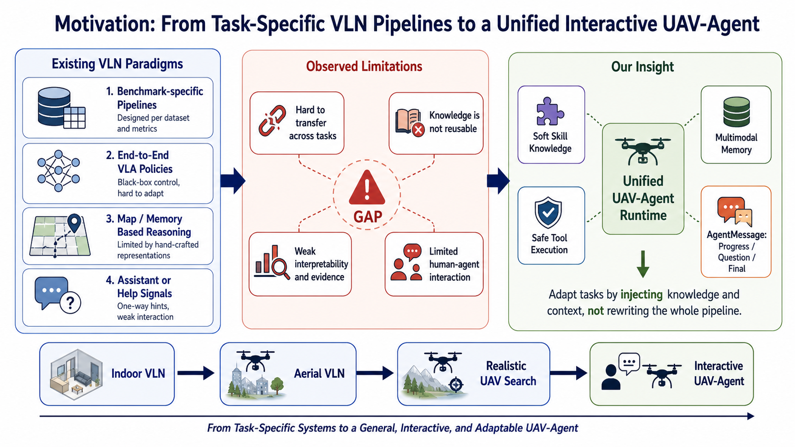
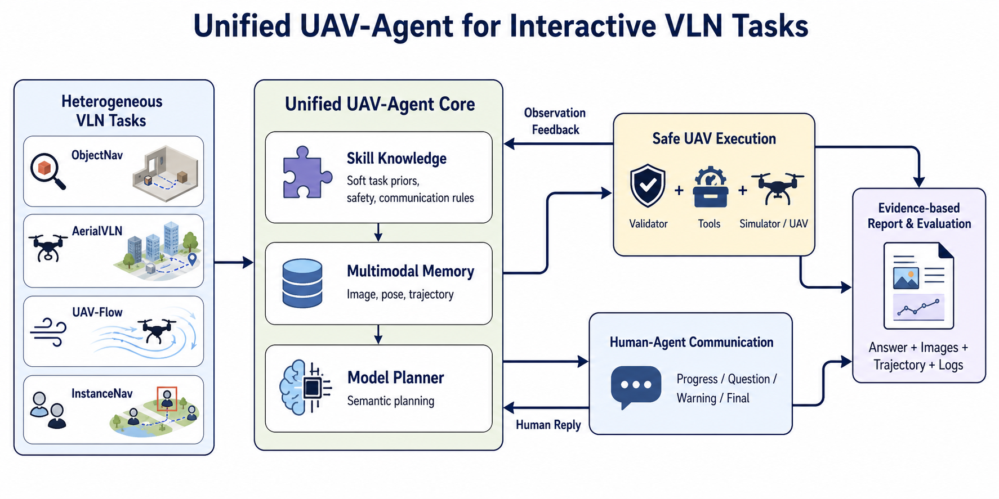

# 面向多类 UAV-VLN 任务的统一 UAV-Agent 框架

> **论文定位更新（2026-09）：** “统一 UAV-Agent Runtime”现在作为工程基础与
> 跨 Benchmark 证据，不再作为首要算法创新。当前 CVPR 主线为
> Execution-Grounded Agent Loop，详见 `flyagent_cvpr_execution_grounded_loop.md`。

本文关注无人机视觉语言导航（UAV Vision-and-Language Navigation, UAV-VLN）场景下的统一智能体框架设计。现有 UAV-VLN 研究已经在数据集构建、模型训练、空间记忆、对话交互和端到端控制等方向取得进展，但多数方法仍与特定任务、平台、动作空间或交互形式绑定。本文希望探索一种统一 UAV-Agent 框架，使不同 UAV-VLN 任务能够通过知识、记忆、视觉能力和通信协议注入完成适配，而不是为每一种任务重新构建完整系统。

## 1. 研究目标

本项目希望构建一个面向多类无人机视觉语言导航任务的统一 UAV-Agent 框架，使无人机能够根据自然语言任务，结合视觉观察、历史记忆、可插拔知识和人机通信机制，完成观察、规划、执行、提问与结果汇报的闭环。

> 不是为某一个 UAV-VLN 数据集重新训练或配置一套专用系统，而是用统一的 Agent 架构适配 UAV-Flow、AerialVLN、TRAVEL / InstanceNav 等不同无人机任务。

## 2. UAV-VLN 是什么

UAV-VLN 可以理解为无人机版本的视觉语言导航。它要求无人机根据自然语言任务，在空中环境中通过视觉观察和自身位姿信息进行自主导航。

典型输入包括：

1. 自然语言任务，例如“飞过黄色顶棚后右转，在路口附近寻找红色售货机”。
2. 无人机视觉观察，例如 RGB、Depth、多视角图像或视频片段。
3. 无人机状态，例如位置、高度、朝向、历史轨迹。

典型输出包括：

1. 飞行动作或连续轨迹。
2. 是否找到目标。
3. 目标位置、图像证据和飞行轨迹。
4. 在不确定时向人类提问。

相比室内 VLN，无人机场景更困难，因为它涉及三维飞行、长距离路径、视角变化、安全避障、目标搜索和真实飞行动力学。

## 3. 无人机领域现有研究主要做了什么

本文主要讨论 UAV / Aerial Navigation 相关工作，不将传统室内 VLN 作为主要对比对象。传统 VLN 可作为背景来源，但核心对比对象聚焦无人机领域。

随着 UAV-VLN 任务不断扩展，现有研究已经覆盖长距离语言导航、目标搜索、细粒度语言飞行控制、top-down 地理空间推理和人机对话等多种任务形态。不同工作通常围绕各自任务构建专门的数据、模型、记忆结构或交互机制。本文不按“是否端到端”或“是否需要训练”进行划分，而是按现有方法解决 UAV-VLN 任务时依赖的主要处理方式进行概括。

### 3.1 按研究贡献类型分类

| 方法类型 | 代表工作 | 主要思路 | 与统一 UAV-Agent 的差距 |
| --- | --- | --- | --- |
| 任务 / 数据 / 平台驱动方法 | AerialVLN、TRAVEL / OpenUAV、OpenFly、UAV-Flow、CityNav、AirNav | 为不同 UAV-VLN 任务构建数据集、仿真或真实平台、轨迹和评测协议 | 每个 benchmark 往往对应自己的输入格式、动作空间、环境接口和评测方式，难以直接迁移到新任务 |
| 任务专用导航模型方法 | UAV Navigation LLM、AerialVLA Minimalist Control、VLA-AN、OpenVLN、AirVLN-R1 | 针对特定任务训练、微调或强化模型，使其输出动作、航点、轨迹或控制信号 | 模型和任务设定强绑定，换任务通常需要重新适配训练数据、动作定义和推理流程 |
| 空间记忆与结构化推理方法 | STMR、GeoNav、CityNavAgent、PSC-AVDN | 将历史图像、位姿、轨迹、地图或场景图整理成 VLM/LLM 可推理的空间上下文 | 记忆结构和 prompt 流程多为特定任务设计，难以作为统一上下文模块复用 |
| 对话、求助与人机交互方法 | Aerial Vision-and-Dialog Navigation、AerialVLA with Online Dialogue、AirStar、AeroDuo | 在导航中引入对话历史、助手信号、主动提问或自然交互 | 交互机制通常嵌入具体任务或模型，缺少跨任务通用的回复、提问和用户反馈回流协议 |

总体来看，现有方法已经分别推进了 UAV-VLN 的任务构建、导航模型、空间记忆和人机交互能力，但它们大多是围绕单一任务或单一 benchmark 设计的专属处理方式。随着空中任务类型增多，这种专属化设计会带来明显的迁移和适配成本：新任务往往需要重新定义输入、动作、上下文、模型调用和交互逻辑，而不是接入一个统一的任务运行框架。

### 3.2 按空中任务类别分类

| 空中任务类别 | 代表任务 / 场景 | 任务特点 | 对统一 UAV-Agent 的需求 |
| --- | --- | --- | --- |
| 空中语言路径导航 | 长距离指令跟随 | 给定自然语言路线或目标描述，无人机在空中环境中持续导航 | 需要长距离规划、历史记忆和偏航恢复 |
| 空中对话 / 交互导航 | 对话式导航与主动求助 | 任务中包含对话、帮助、主动提问或确认过程 | 需要回复、提问、用户反馈回流和可解释执行过程 |
| 细粒度语言飞行控制 | 短程语言条件飞控 | 根据短语或一句话执行较短程、细粒度飞行动作，并评估轨迹 | 适合验证基础动作执行、轨迹记录和闭环稳定性 |
| 空中目标搜索 / InstanceNav 类任务 | 目标描述驱动搜索 | 给定目标描述，让无人机在真实感更强的环境中搜索、接近并确认目标 | 需要视觉目标确认、证据图片、位置汇报和不确定时提问 |
| Top-down 地理空间推理 | 地标与地图约束导航 | 任务依赖 top-down 观察、地标、道路、城市地图和跨尺度空间关系 | 需要地图、场景图、地理知识和历史轨迹上下文 |

从任务上看，空中 VLN 不只是“跟着路线飞”。它可以分成空中语言路径导航、空中对话/交互导航、细粒度语言飞行控制、空中目标搜索，以及 top-down 地理空间推理。不同任务虽然评估方式和任务目标不同，但都需要无人机在语言、视觉、位姿、历史观察和安全约束之间进行持续决策。因此，统一 UAV-Agent 框架的价值在于：用同一套运行闭环承载不同任务，而将任务差异交给知识、记忆、视觉能力和通信协议来表达。

其中，`Fine Control` 表示 UAV-Flow / Flying-on-a-Word 这类短程语言条件飞控任务，强调动作或轨迹执行粒度；`Top-down Geo Reasoning` 表示 CityNav / GeoNav / CityNavAgent 这类基于 top-down 视角、地图、地标和场景图的空间推理任务，不重点强调真实 6DoF 上下飞行控制。

## 4. 核心问题与本文切入点

现有 UAV-VLN 方法的核心缺口不是某一个模块能力不足，而是**不同 UAV 任务之间缺少统一的智能体运行方式**。任务越来越多，但每类任务通常都有自己的数据格式、动作空间、上下文组织、模型策略和交互形式，导致方法难以迁移，新任务适配成本较高。

| 现有专属化问题 | 具体表现 | 本项目对应思路 |
| --- | --- | --- |
| 任务接口专属化 | 不同任务有不同输入、动作空间、环境接口和评估协议 | 用统一 UAV-Agent Runtime 承载任务执行，通过 task adapter 接入不同 benchmark |
| 任务知识专属化 | 搜索策略、安全规则、位置描述和完成判断常写在具体任务流程中 | 用 Skill Knowledge 注入任务经验和飞行知识 |
| 记忆上下文专属化 | 图像、位姿、轨迹、地图和历史观察常被加工成特定任务格式 | 用 Multimodal Memory 和 ContextModule 统一上下文表达 |
| 交互机制专属化 | 对话和工具结果常绑定具体任务或模型 | 用 AgentTranscript 统一保存 assistant/tool 对话和工具调用历史 |

由此，本项目希望解决的核心问题是：

> 能不能用一套统一 UAV-Agent 架构处理多种 UAV-VLN 任务，让任务差异通过 adapter、skills、multimodal memory、vision capability 和 communication protocol 注入，而不是每新增一种任务都重新设计一套专属 pipeline？

### 4.1 为什么需要可插拔知识、记忆和视觉能力

很多 UAV 方法会把搜索策略、空间推理、视觉检测、停止判断和辅助信息写进具体模型或任务流程里。本项目希望把这些内容拆成可插拔的软性能力：

- Skill Knowledge：目标搜索、低空安全、位置描述、提问策略。
- Multimodal Memory：图像、位姿、动作、轨迹、关键帧。
- Vision Capability：模型看图、目标检测、场景判断。
- Communication Protocol：过程汇报、澄清提问、风险提醒和最终回答。

### 4.2 为什么需要面向人的回复和提问机制

很多 UAV-VLN 论文最终报告成功率、SPL、nDTW 或轨迹误差，但真实应用中，人希望无人机能持续交流：

```text
progress: 我正在观察右前方区域。
progress: 我没有看到明显售货机，准备向右转一点扩大视野。
question: 我看到两个相似柜体，你要找的是红白色售货机吗？
warning: 前方距离障碍物较近，我会先悬停。
final: 找到了，售货机在右前方约 8 米处，这是对应图片。
```

这里不是暴露模型内部思考链，而是输出给人看的执行过程摘要。它能把无人机从“只输出动作或轨迹的模型”推进到“能解释、能提问、能给证据回答的协作智能体”。

## 5. 本项目的核心思路

本项目的核心不是单独提出一个新的 UAV-VLN 模型，而是提出一个统一 UAV-Agent Runtime。

它把任务执行抽象成一个闭环：

```text
任务输入
-> 上下文构建
-> 模型规划
-> 安全校验
-> 工具执行
-> 环境观察
-> 记忆更新
-> 人机回复 / 提问
-> 下一轮规划
```

不同任务的差异不通过重写系统解决，而是通过注入不同的知识、视觉能力和上下文模块解决。

## 6. 研究动机图



研究动机图可概括为三部分：

1. 无人机领域已有研究范式。
   - UAV tasks, datasets, and platforms
   - Task-specific navigation policies
   - Memory-enhanced VLM/LLM reasoning
   - Dialogue and assistance

2. 现有方法限制。
   - Task-specific pipelines
   - High adaptation cost for new tasks
   - Fragmented memory and context design
   - Limited reusable communication protocol

3. 本项目的核心启发。
   - Unified UAV-Agent Runtime
   - Soft Skill Knowledge
   - Multimodal Memory
   - Safe Tool Execution
   - AgentTranscript: assistant / tool / tool_calls

对应的论文式表述为：

> Existing UAV-VLN studies have advanced task benchmarks, navigation policy learning, memory-enhanced VLM/LLM reasoning, and dialogue-based assistance. However, as UAV-VLN tasks become increasingly diverse, existing solutions are often tied to task-specific pipelines, including specific action spaces, memory formats, model policies, and interaction protocols. This motivates a unified UAV-Agent framework that decouples task adaptation from the core runtime through task adapters, skills, multimodal memory, safe execution, and human-agent communication.

## 7. 方法总览



统一 UAV-Agent 框架可以概括为：

```text
Heterogeneous UAV-VLN Tasks
        |
        v
Unified UAV-Agent Core
  - Skill Knowledge
  - Multimodal Memory
  - Model Planner
        |
        +--> Safe UAV Execution
        |
        +--> Human-Agent Communication
        |
        v
Evidence-based Report & Evaluation
```

不同类型的 UAV-VLN 任务，例如 UAV-Flow、AerialVLN、TRAVEL / OpenUAV 和 InstanceNav，不再分别进入不同系统，而是统一进入 UAV-Agent Core。核心模块由任务知识、图像记忆和模型规划器组成。规划器生成带原生 tool calls 的 assistant turn，经安全校验后执行；tool result 以 tool turn 回写 AgentTranscript。执行产生的新图像、位姿和轨迹会回流到记忆中，最终形成带图片、轨迹、日志和完整对话证据的报告。

## 8. 本项目可以强调的创新点

### 8.1 统一 UAV-VLN Agent 架构

不同于针对单一无人机数据集设计专用方法，本项目尝试将多类 UAV-VLN 任务统一到一个执行框架中，减少任务迁移时的系统重写成本。

### 8.2 可插拔知识与能力注入

任务差异通过 skills、knowledge、vision capability 和 context module 表达，而不是写死在 runtime 中。这使系统更容易扩展到新的搜索目标、新的安全规则和新的视觉能力。

### 8.3 多模态记忆和证据化上下文

系统持续保存图像、位姿、动作和轨迹记录，使模型规划不是只依赖当前一帧，而是可以参考历史观察和证据。

### 8.4 人机通信闭环

AgentTranscript 让无人机的 assistant 决策、tool calls 和 tool results 可以按真实时序追溯。这一点适合区别于只输出轨迹或动作的传统 UAV-VLN 方法。

### 8.5 渐进式评估路线

项目可以按任务难度逐步评估：

1. UAV-Flow：验证基础动作执行、轨迹记录和 benchmark harness。
2. AerialVLN：验证长路径语言导航、图像观察和多轮规划。
3. TRAVEL / OpenUAV：验证空中目标搜索、视觉确认、位置汇报和最终证据回答。
4. Aerial Vision-and-Dialog Navigation / AerialVLA with Online Dialogue：验证 question、用户回复回流和交互式导航。
5. CityNav / GeoNav 类任务：验证 top-down 地理知识、场景图和历史轨迹上下文的插件化表达。

## 9. 总结表述

> 现有 UAV-VLN 任务类型不断增多，但很多方法仍围绕具体数据集、平台、动作空间或交互形式设计专属 pipeline，导致系统迁移困难，新任务适配成本较高。本项目希望构建一个统一 UAV-Agent 框架，把不同无人机视觉语言导航任务统一到“观察、记忆、规划、执行、反馈”的闭环中。任务差异通过 task adapter、soft skills、多模态记忆、视觉能力和通信协议注入，而不是重写整个系统。最终目标是让无人机不仅能执行导航动作，还能在不确定时主动提问，在执行中汇报进展，并给出带图片、位置和轨迹证据的最终结果。

## 10. 当前开发顺序

当前实现可按以下顺序推进：

1. 完善 AgentTranscript 与 Provider Request 的审计和回放能力，不引入第二套消息分类协议。
2. 接入简单视觉信息：让模型能基于图片上下文规划和回答。
3. 打通 question 阻塞与用户回复回流。
4. 完成任务到观察、规划、执行、回复、最终答案的闭环。
5. 再把稳定下来的知识、视觉能力、上下文模块抽象成统一插件系统。

这个顺序的原因是：插件系统不应该先抽象过度，而应先基于真实任务闭环沉淀出稳定边界。
