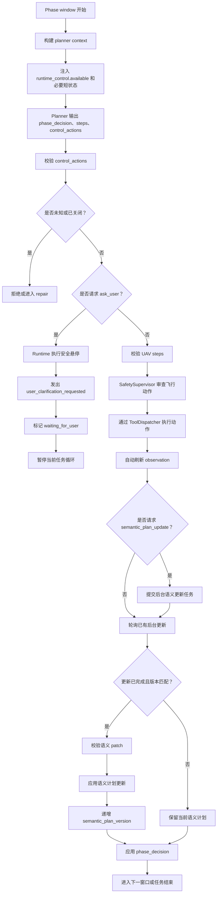

# 01 Runtime Control Actions 架构

Runtime Control Actions 是 FlyAgent 的运行时控制面。它处理“不直接驱动无人机，但会影响任务执行流程”的动作，例如主动询问用户、语义计划更新、暂停任务、等待确认等。

## 1. 设计目标

当前 planner 在每个 phase window 中主要输出：

```text
phase_decision
steps
agent_messages
```

其中 `steps` 是真实飞行动作或 callable skill，例如：

```text
uav.hover
uav.turn_relative
uav.move_body
skill.*
```

这些动作属于飞行动作面，需要经过动作契约校验、安全审查和工具分发。

Runtime Control Actions 补充另一类能力：

```text
ask_user
semantic_plan_update
pause_task
request_confirmation
后续记忆整理或状态更新控制
```

这些动作属于运行时控制面，不进入 `ToolDispatcher`，也不由 `SafetySupervisor` 当成飞行动作审查。它们由 runtime 自己编排。

## 2. 双平面边界

```text
飞行动作面
  真实影响无人机运动或插件能力调用
  经过 ToolContractValidator
  经过 SafetySupervisor
  经过 ToolDispatcher

运行时控制面
  影响任务流程、用户交互、语义计划、等待状态
  不进入 ToolDispatcher
  不作为 UAV primitive
  由 RuntimeControlExecutor 处理
```

重要规则：

- `steps` 只允许真实飞行动作或 callable skill。
- `control_actions` 只允许 runtime 控制动作。
- `ask_user`、`semantic_plan_update` 不允许伪装成 tool step。
- planner 只能请求 context 中 `runtime_control.available` 显式列出的动作。
- 被关闭的 control action 不进入 model-facing context。
- runtime 收到 control action 后必须二次校验，不能静默执行未知或关闭的动作。

## 3. Planner 输出结构

建议扩展 `CoupledActionPhasePlan`：

```json
{
  "phase": "当前 phase 名称",
  "phase_decision": {
    "decision": "continue_current_phase | advance_to_next_phase | complete_task",
    "reason": "为什么继续、推进或完成"
  },
  "agent_messages": [],
  "control_actions": [
    {
      "kind": "ask_user",
      "reason": "目标身份不确定，继续靠近可能选错目标",
      "payload": {
        "question": "你希望我靠近左侧目标，还是右侧目标？",
        "expected_answer_type": "clarification"
      }
    }
  ],
  "action_window": {
    "intent": "仅在继续当前 phase 且需要飞行动作时填写",
    "scope": "current_phase_only",
    "requires_intermediate_observation": false,
    "expected_effect": "下一次自动 observation 应该验证什么"
  },
  "steps": []
}
```

`control_actions` 可以为空。`steps` 和 `control_actions` 是并列平面，不互相嵌套。`ask_user` 是否阻塞、`semantic_plan_update` 是否异步属于 runtime 默认契约，不需要 planner 每次输出。

## 4. 模型请求控制动作的总流程

模型不能在任意时刻自由使用 control action。完整流程是：

1. planner prompt 或 registry contract 说明每种 control action 的含义、payload 和默认 runtime 行为。
2. runtime 配置开启某个 control action。
3. context builder 将已开启、允许运行且允许暴露的动作名写入 `runtime_control.available`。
4. planner 看到动作名后，才能在当前 phase window 的 `control_actions` 中请求。
5. runtime 校验 action 是否已开启、schema 是否正确、当前运行模式是否允许。
6. `ask_user` 这类阻塞式动作先处理，例如先悬停并暂停任务循环。
7. `semantic_plan_update` 这类异步动作不阻塞本窗口飞行动作，通常在动作执行和自动 observation 后提交或轮询。
8. runtime 写 public event 和 debug event，保证后续可诊断。

## 5. 代码放置建议

第一版 runtime 代码可以按 action 分离：

```text
src/runtime/control/
  registry.py
  schemas.py
  executor.py
  config.py
  actions/
    ask_user.py
    semantic_plan_update.py
```

职责：

- `registry.py`：稳定 contract，记录 action 名、payload schema、短说明和默认 runtime 行为。
- `schemas.py`：planner 输出和 runtime 内部状态的结构。
- `executor.py`：统一校验、分发、事件记录、边界处理。
- `config.py`：加载默认配置、配置文件、环境变量覆盖和 session 覆盖。
- `actions/*.py`：每个 control action 自己的执行逻辑。

第一版不新增：

```text
src/memory/context/modules/runtime_control.py
src/memory/context/modules/clarifications.py
```

原因是模型上下文仍然可以复用现有 context builder：`runtime_control.available/status` 可以由已有 planner context 构建路径注入；用户回复作为当前任务 instruction/conversation memory 的 clarification 摘要暴露，不需要先拆出独立模块。

如果后续 control action 数量增加、clarification 生命周期变复杂，再考虑独立 context module。

## 6. Phase Window 主流程



## 7. 边界规则

- 不把评测样例名、隐藏真值、专用评分经验写入 runtime control prompt 或 context。
- 不把 runtime control schema 写入 reusable `SKILL.md`。
- 不要求模型忽略不可见数据；应在 context 构建时直接不提供。
- 不让 control action 绕过校验。
- 不让 `ask_user` 或 `semantic_plan_update` 通过 `ToolDispatcher` 执行。

## 8. 后续测试建议

建议后续覆盖：

```text
tests/test_runtime_control_config.py
tests/test_runtime_control_actions.py
tests/test_model_action_planner.py
tests/test_task_runtime.py
tests/test_interactive_runtime.py
tests/test_prompts.py
tests/test_boundaries.py
```

关键场景：

- 合法 `control_actions` 能解析和 round-trip。
- 未知或关闭的 control action 会被拒绝或 repair。
- control action 不能出现在 `steps`。
- `ask_user` 会先悬停再暂停。
- `semantic_plan_update` 只在合法边界提交和应用。
