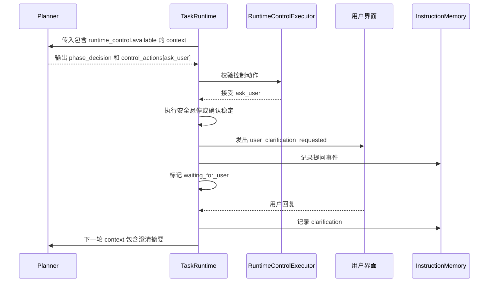

# ask_user 主动询问用户（旧 JSON 契约记录）

> 当前模型侧名称为 `runtime.ask_user`，通过 provider 原生 tool call 暴露；本文中的 `control_actions` 示例仅供迁移追溯。

`ask_user` 是阻塞式 runtime control action。它允许 planner 在继续飞行风险较高、目标或意图不明确，并且用户回答能显著降低风险时，向用户提出一个短问题。

## 1. 职责边界

`ask_user` 属于 runtime orchestration。

它负责：

- 在安全边界暂停当前任务。
- 让无人机进入或保持稳定状态。
- 向用户发出澄清问题。
- 用户回复后恢复规划。

它不负责：

- 作为 `ToolDispatcher` 的工具执行。
- 自己重写 semantic plan。
- 替代 planner 做动作选择。
- 暴露隐藏调试数据或评测专用信息。

## 2. Capability Contract

稳定契约：

```text
ask_user:
  用途：当继续飞行需要用户澄清才能安全推进时，请求用户回答一个短问题。
  输出位置：control_actions。
  payload：question, expected_answer_type。
  runtime 行为：提问前悬停，任务进入 waiting_for_user，收到回复后恢复。
```

`ask_user` 的阻塞语义属于 runtime 默认契约，不需要 planner 在 JSON 里输出 `blocking` 字段。

## 3. 模型什么时候可以请求

模型只能在以下前提都满足时请求 `ask_user`：

1. runtime 配置开启 `ask_user`。
2. 当前 planner context 的 `runtime_control.available` 中包含 `ask_user`。
3. 当前问题确实需要用户信息才能安全继续。
4. 请求的问题短、具体、与当前任务直接相关。

适合触发的情况：

- 当前画面中有多个目标候选，继续靠近可能选错目标。
- 用户指令缺少关键参数，例如目标身份、方向、优先级或是否继续搜索。
- 视觉证据不足，继续移动可能导致危险靠近、偏离任务或丢失可恢复位置。
- 已经经过一段恢复或搜索，仍无法确定下一步，而用户回答能明显减少风险。

不应该触发的情况：

- 只是普通低置信度，但可以安全悬停、短 yaw 或短距离调整后自动获取新 observation。
- 模型懒得规划下一步。
- 当前 observation、phase context 或历史摘要已经足够判断。
- 当前运行模式没有用户回复通道。
- 想绕过 safety、phase decision 或工具契约。

## 4. Planner 输出示例

```json
{
  "phase": "identify_target",
  "phase_decision": {
    "decision": "continue_current_phase",
    "reason": "两个候选目标都可能符合用户描述，继续靠近可能选错"
  },
  "agent_messages": [
    {
      "type": "warning",
      "content": "我看到两个相似目标，继续靠近前需要你确认。",
      "evidence_refs": [],
      "confidence": "medium",
      "requires_user_reply": true
    }
  ],
  "control_actions": [
    {
      "kind": "ask_user",
      "reason": "目标身份不明确",
      "payload": {
        "question": "你希望我靠近左侧目标，还是右侧目标？",
        "expected_answer_type": "clarification"
      }
    }
  ],
  "steps": []
}
```

第一版中，runtime 先悬停或确认稳定，再发出问题并暂停当前 task loop。

## 5. 执行流程

第一版采用“问前悬停”：

```text
planner 请求 ask_user
runtime 校验 ask_user 是否开启
runtime 执行或确认安全悬停
runtime 发出 user_clarification_requested
runtime 标记 waiting_for_user
runtime 暂停当前 task loop
用户回复
runtime 将回复写为当前任务 clarification
下一轮 planner context 看到简洁 clarification 摘要
```



## 6. 等待状态

建议 runtime/debug state：

```json
{
  "runtime_control_state": {
    "waiting_for_user": {
      "status": "waiting",
      "phase_key": "2:identify_target",
      "question": "你希望我靠近左侧目标，还是右侧目标？",
      "requested_at_window": 4
    }
  }
}
```

完整等待状态是 runtime/debug 数据，不应完整暴露给模型。

## 7. 用户回复如何保存

第一版不新增专门的 `clarifications.py` context module，也不强制新增 `memory/clarifications.jsonl`。用户回复先复用现有 instruction/conversation memory，作为当前任务的 clarification 保存。

建议 memory event：

```json
{
  "type": "clarification",
  "question": "你希望我靠近左侧目标，还是右侧目标？",
  "answer": "靠近左侧目标",
  "summary": "用户确认目标是左侧目标",
  "scope": "current_task",
  "phase_key": "2:identify_target"
}
```

这条 memory 的语义是“用户对当前任务的补充说明”，不是 tool result，也不是新任务。

如果用户回复明显下达新任务，应由交互层创建或切换任务，而不是把它伪装成澄清。

## 8. 下一轮如何强调给模型

下一轮 model-facing context 可以把澄清摘要放在已有 instruction / conversation summary / user memory 区域，例如：

```text
Current user instruction:
靠近指定目标。

Recent user clarification:
用户确认目标是左侧目标。后续目标选择应优先左侧目标。
```

如果现有上下文已经有结构化补充说明区域，也可以压缩为：

```json
{
  "active_clarifications": [
    {
      "answer_summary": "用户确认目标是左侧目标",
      "effect": "后续目标选择应优先左侧目标"
    }
  ]
}
```

压缩规则：

- 只保留对当前 task 或当前 phase 仍有影响的澄清。
- 用短摘要表达用户回答的事实和对下一步规划的影响。
- 不把完整聊天记录、等待状态、debug 字段或旧 observation 全量塞回 context。
- 澄清摘要应靠近当前任务指令，但仍保持短小。

## 9. 事件

建议事件：

```text
runtime_control_action_requested
runtime_control_action_started
user_clarification_requested
task_waiting_for_user
user_clarification_received
runtime_control_action_completed
task_resumed_after_user_clarification
```

这些事件用于 UI、debug、回放和任务恢复，不是完整 model-facing context。`user_clarification_requested` 是用户可见事件；debug event 可以记录 schema 细节，但 planner 下一轮只看压缩澄清摘要。

## 10. 关闭时的行为

如果 `ask_user` 被关闭：

- 不出现在 `runtime_control.available` 中。
- planner 输出 `ask_user` 时应被拒绝或 repair。
- runtime 不能静默提问。

对于没有用户回复通道的运行模式，`ask_user` 默认应关闭。除非 runner 显式提供自动回答策略，否则不能让任务阻塞等待。

## 11. 安全策略

`ask_user` 不应该让无人机在等待回复时继续移动。第一版应使用：

- 已经稳定悬停；
- best-effort `uav.hover`；
- 如果 hover 不可用，则使用现有 safe-hold 行为。

如果安全悬停失败，runtime 应发出 warning event，并根据现有 runtime 安全策略标记失败或停止。

## 12. 后续测试建议

建议覆盖：

- 开启 `ask_user` 时，runtime 会先悬停再暂停任务。
- 关闭 `ask_user` 时，planner context 不包含该能力。
- planner 输出关闭的 `ask_user` 会被拒绝。
- 用户回复被记录为 instruction/conversation memory 中的 clarification。
- 下一轮 planner context 包含短澄清摘要。
- 没有用户回复通道的运行模式拒绝 `ask_user`。
