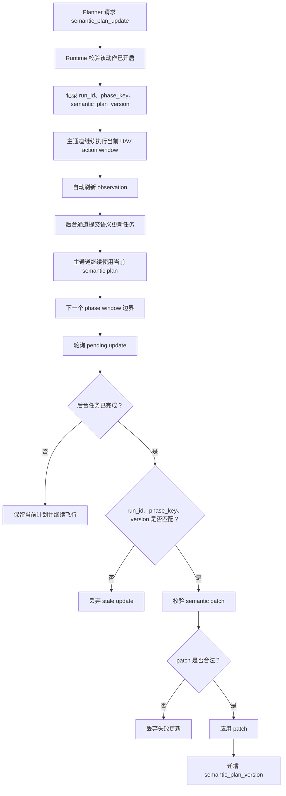

# semantic_plan_update 语义计划更新

`semantic_plan_update` 是异步 runtime control action。它允许 planner 在当前 semantic phase 合约明显不再适合已有证据时，请求一个更贴合当前任务进展的语义计划 patch。

## 1. 职责边界

`semantic_plan_update` 属于 semantic/runtime orchestration。

它负责：

- 请求对当前 semantic plan 的紧凑更新。
- 把更新工作放到关键飞行动作路径之外。
- 只在 phase window 边界应用通过校验的更新。
- 通过版本号和 phase key 防止 stale update 覆盖新状态。

它不负责：

- 执行飞行动作。
- 替代 phase decision。
- 绕过 safety。
- 读取评测专用数据或隐藏答案。
- 给某个样例写专门完成条件。

### 模型依赖注入

`SemanticPlanUpdater` 不自行搜索或读取 `.env`。应用入口通过
`--env-path` 加载唯一的 `ModelConfig`，TaskRuntime 再把同一实例注入
Planner Skill Selector 和 Updater：

```text
application entry
  -> ModelConfig
  -> TaskRuntime
     -> ModelSkillSelector
     -> SemanticPlanUpdater
```

启用 `semantic_plan_update` 但未配置 updater 时，请求会以
`semantic_plan_updater_unconfigured` 被拒绝，不会启动一个注定失败的后台
任务。模型 Runtime 若缺少显式配置或 API key，会在场景启动前失败。

## 2. Capability Contract

稳定契约：

```text
semantic_plan_update:
  用途：当前 semantic phase 合约明显阻塞真实进展时，请求异步修复当前 phase 语义。
  输出位置：control_actions。
  payload：scope, update_goal。
  runtime 行为：不阻塞飞行，后台生成 patch，后续 phase/window 边界校验后应用。
```

`semantic_plan_update` 的异步语义属于 runtime 默认契约，不需要 planner 在 JSON 里输出 `async` 或 `blocking` 字段。

## 3. 模型什么时候可以请求

模型只能在以下前提都满足时请求 `semantic_plan_update`：

1. runtime 配置开启 `semantic_plan_update`。
2. 当前 planner context 的 `runtime_control.available` 中包含 `semantic_plan_update`。
3. 当前 semantic contract 明显阻塞真实任务推进。
4. 请求理由能说明是语义合约问题，而不是普通动作失败。

适合触发的情况：

- 当前 phase 的 `done_when` 或 `continue_when` 和真实进展长期冲突。
- planner 已经有动作进展，但 phase 合约仍要求不可观察或过严证据。
- parser 生成的阶段粒度不适合当前视觉证据或运动证据。
- 需要把继续恢复、重新定位、降级完成条件表达成通用语义阶段。
- 当前任务需要从“原计划条件”调整为“可观察、可推进、可安全判断”的条件。

不应该触发的情况：

- 单次动作失败。
- 普通目标短暂丢失，但现有恢复行为仍可继续。
- 模型想绕过 phase decision、runtime loop guard 或 safety。
- 模型只是想把动作策略写进 semantic plan。
- 想为某个评测样例调分。

## 4. Planner 输出示例

```json
{
  "phase": "circle_target",
  "phase_decision": {
    "decision": "continue_current_phase",
    "reason": "当前 phase 合约要求的证据已经无法从最新观察中稳定获得"
  },
  "agent_messages": [
    {
      "type": "progress",
      "content": "当前阶段的完成条件和最新观察不完全匹配，我会请求更新计划，同时保持保守动作。",
      "evidence_refs": [],
      "confidence": "medium",
      "requires_user_reply": false
    }
  ],
  "control_actions": [
    {
      "kind": "semantic_plan_update",
      "reason": "当前 phase 完成条件过严，无法反映已有可观察进展",
      "payload": {
        "scope": "current_phase",
        "update_goal": "让当前 phase 合约表达可观察进展和安全恢复条件"
      }
    }
  ],
  "action_window": {
    "intent": "在等待计划更新时保守继续当前 phase",
    "scope": "current_phase_only",
    "requires_intermediate_observation": false,
    "expected_effect": "获得一帧新的 observation，避免继续扩大不确定性"
  },
  "steps": [
    {
      "kind": "tool",
      "tool": "uav.hover",
      "args": {},
      "reason": "保持稳定，等待更清晰证据"
    }
  ]
}
```

## 5. 第一版更新范围

第一版使用 `scope=current_phase`。

允许更新：

- 当前 phase 的 `goal`
- 当前 phase 的 `done_when`
- 当前 phase 的 `continue_when`
- 可选追加一个通用 recovery/fallback phase

不允许：

- 改写原始用户指令。
- 修改隐藏评测数据。
- 将 UAV primitive tool 名称写入 semantic phase。
- 不做版本检查就整计划重写。
- 写入评测专用完成条件。

## 6. 异步双通道执行逻辑

语义更新不应该阻塞无人机飞行。第一版采用双通道：

- 主通道：planner 继续基于当前 semantic plan 输出安全飞行动作，runtime 正常执行 action window 和自动 observation。
- 后台通道：semantic updater 根据压缩上下文生成 patch，完成后等待 runtime 在后续边界同步。

在后台任务完成前，模型最多看到短状态：

```json
{
  "runtime_control": {
    "available": ["semantic_plan_update"],
    "status": {
      "semantic_plan_update": "pending"
    }
  }
}
```

不要把后台任务的 run id、版本号、patch 内容、prompt、完整日志或失败堆栈暴露给 planner。

## 7. 异步边界流程



## 8. Stale Update 保护

每个 update job 应捕获：

```json
{
  "run_id": "run identifier",
  "base_semantic_plan_version": 3,
  "phase_key": "2:circle_target",
  "requested_at_window": 12
}
```

只有同时满足以下条件才应用：

```text
当前 run_id 匹配
当前 phase_key 匹配
当前 semantic_plan_version 等于 base_semantic_plan_version
任务尚未 completed 或 stopped
semantic_plan_update 当前仍然开启
patch 通过 semantic validator
```

任一条件不满足，就丢弃并写 debug event。不能部分应用。

## 9. Semantic Patch 形状

updater 应返回 patch，而不是自由重写完整计划。

建议形状：

```json
{
  "base_semantic_plan_version": 3,
  "phase_key": "2:circle_target",
  "current_phase_patch": {
    "goal": "更新后的 phase goal",
    "done_when": ["更新后的完成条件"],
    "continue_when": ["更新后的继续条件"]
  },
  "append_phases": []
}
```

runtime 将 patch 应用到现有 `SemanticPlan` 后，再运行正常 semantic validator。validator 通过后才能覆盖 `MissionState.semantic_plan`。

## 10. Updater 的模型上下文

updater 接收的是紧凑上下文：

- 当前用户指令。
- 当前 semantic plan。
- 当前 phase。
- 最近 phase execution summary。
- 当前 observation summary。
- planner 请求更新的 reason。
- 已经进入 model-facing context 的相关 skill 摘要。

不要传入：

- 完整原始动作日志。
- 完整 debug artifact。
- 评测专用路径或隐藏答案。
- 评测指标。
- 用于某个样例调参的经验。

## 11. 事件

建议事件：

```text
semantic_plan_update_requested
semantic_plan_update_submitted
semantic_plan_update_ready
semantic_plan_update_applied
semantic_plan_update_discarded
semantic_plan_update_failed
```

`semantic_plan_update_applied` 应包含：

```text
old_version
new_version
phase_key
patch_summary
```

完整 patch 可以进入 debug artifact，不必完整暴露给模型。

## 12. 关闭时的行为

如果 `semantic_plan_update` 被关闭：

- 不出现在 `runtime_control.available` 中。
- 新 planner 请求应被拒绝或 repair。
- 不提交新的 update job。
- 已完成但未应用的 pending job 在应用前再次检查配置；如果已关闭，应以 `disabled_before_apply` 为 reason 丢弃。

## 13. 失败处理

如果 update 生成失败：

- 保留当前 semantic plan。
- 写 `semantic_plan_update_failed`。
- 不因为 update 失败直接停止任务。
- 由下一轮 planner 决定继续、询问用户、悬停或按现有 runtime 策略停止。

如果 update 输出非法：

- 如果已有通用 semantic recovery 机制，可以进入 repair。
- 否则丢弃并记录 validation failure。
- 绝不应用非法 patch。

## 14. 后续测试建议

建议覆盖：

- 每个 phase 只提交一个 pending update。
- pending 时重复请求会忽略或合并。
- 版本匹配的 update 会应用并递增 `semantic_plan_version`。
- phase 已推进后的 stale update 会被丢弃。
- 应用前关闭动作会导致 update 被丢弃。
- 非法 semantic patch 被拒绝。
- patch 不能引入 primitive action token。
- prompt 和 model-facing context 不包含评测专用策略。
