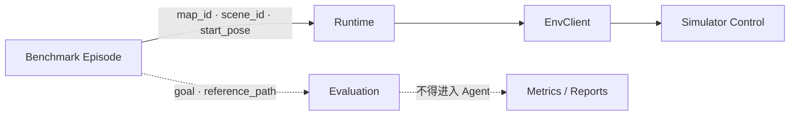

# 责任范围与系统边界

> Status: Implemented  
> Previous: [README.md](README.md)  
> Next: [02_current_state_and_debt.md](02_current_state_and_debt.md)

## 分层责任

```text
Benchmark
    → 选择 map_id、scene_id、start_pose
Runtime
    → 规划、执行、观测闭环
EnvClient
    → 统一场景和动作接口
SimulationServer
    → 场景生命周期与 Backend 路由
Backend
    → 模拟器控制协议
Adapter
    → 外部 SDK、动作实现和坐标转换
Remote Control
    → SSH、进程、文件传输和 Tunnel
```



## 每层拥有的内容

### Benchmark 与 Evaluation

Benchmark 可以拥有：

- dataset、split、episode_id；
- instruction、scene_id、start pose；
- 本次运行的 ObservationProfile，例如 canonical `depth`选择
  `depth_vis`还是 `depth_perspective`；
- 数据集坐标到 FlyAgent canonical pose 的转换；
- goal、reference path、SR、nDTW 和报告。

其中 instruction 和经过规范化的起始状态可以进入任务执行；goal、reference path 和其他评测真值只进入 Evaluation。

### Runtime 与 ToolDispatcher

Runtime 负责：

- 任务阶段和规划—执行—观测闭环；
- 能力驱动的 connect/takeoff/hover/land 预检与关闭；
- 通过 `TaskExecutionOptions`应用每个 episode 的 canonical initial pose；
- 将 ObservationProfile 的 modalities 解析为本次任务的 Agent 观测策略；
- 调用 ToolDispatcher，不解释 AirSim 或 UnrealCV SDK；
- 保存动作、观测、状态和 artifacts。

ToolDispatcher 负责验证工具名和参数，再转发给 EnvClient。它不启动 UE，也不选择 SSH 主机。
`set_pose`属于 Runtime 的特权初始化动作，不进入 Planner 工具、飞行动作历史或阶段度量。
应用 initial pose 后的第一帧观测才是 episode 的任务起点。

### EnvClient

EnvClient 是 Agent 可见的环境边界，只暴露：

```text
start_scene
get_or_start_scene
get_scene_capabilities
execute_action
get_observation
reset_scene
stop_scene
health_check
```

EnvClient 不根据 `AerialVLN`、`TravelUAV` 或具体地图名称分支。

### SimulationServer 与部署控制

SimulationServer 负责：

- 解析 MapPackage；
- 根据 `connection.mode` 选择本地或远程进程控制；
- 根据 `control.protocol` 创建 Backend；
- 将 Backend 实例与 `scene_instance_id` 绑定；
- 处理 settings、端口、ready check 和 ownership。

部署层拥有 SSH、GPU、UE executable、settings 路径和进程生命周期。这些信息不能进入 Benchmark case。
ObservationProfile 属于 Benchmark runner 的静态运行配置，不属于 episode，也不包含
goal、reference path 或其他评测真值。

ObservationProfile 的两个部分由不同层消费：

```text
modalities      → TaskExecutionOptions → Runtime 自动观测
capture_sources → SimulatorEnvClient   → Backend 图像请求
```

Runtime v1 的 Agent 观测必须包含 `pose`；内部稳定器还可以单独请求只用于控制、
不进入模型上下文的 pose。

### Backend 与 Adapter

Backend 负责把统一动作和观测请求映射到一个模拟器协议，例如 AirSim 或 UnrealCV。Adapter 负责具体 SDK、坐标轴、图像请求和 Simulator 特有动作。

通用类名只能表达协议或职责：

```text
AirSimBackend
UnrealCvBackend
SshRemoteSceneControl
ComputerVisionControlStrategy
```

不能使用 `AirVlnBackend` 或 `TravelUavBackend` 表达通用能力。

## 两组正交维度

```text
部署位置：local | remote
控制协议：airsim | unrealcv | future
```

AirSim 内部还有独立的控制模式：

```text
ComputerVision | Multirotor
```

因此“远程 AirSim ComputerVision”表示三个组合条件，而不是一种新的 Backend 类型。

## 禁止跨层传递

以下字段不得进入 MapPackage、Remote Worker、Backend 或模型上下文：

```text
episode_id
reference_path
goal truth
success label
SR
nDTW
leaderboard heuristics
```

以下字段不得进入 Benchmark case：

```text
ssh.host
ssh.key_path
linux_executable
gpu_id
AirSim port
settings_template
remote_run_root
```
